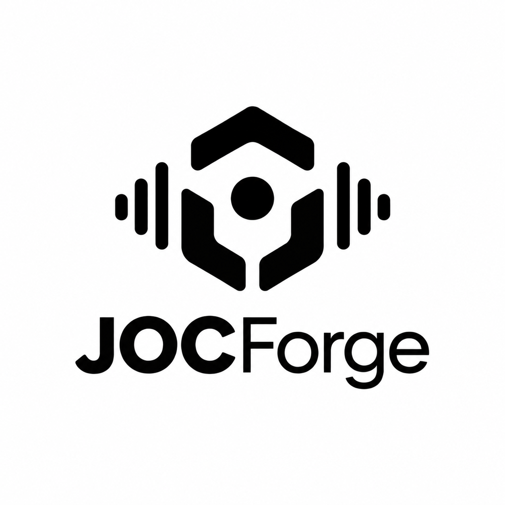

<p align="center">
  
</p>

<h1 align="center">One scene. 965 ways to forge it.</h1>

<p align="center">
  <strong>965 legal immersive-audio variants. Before you even choose a bitrate.</strong><br>
  Independent, clean-room ADM → E-AC-3/JOC encoding, built in Rust.
</p>

<p align="center">
  <a href="#the-965-difference">Explore the variants</a> ·
  <a href="#forge-your-first-stream">Quick start</a> ·
  <a href="docs/interop-census.md">Validation evidence</a> ·
  <a href="docs/development-guide.md">Developer guide</a>
</p>

---

| **965** structural variants | **5** public JOC profiles | **2,393** supported cells | **0** modeled implementation gaps |
|:---:|:---:|:---:|:---:|
| Bitrate choices excluded | idx0 through idx4 | Including bitrate choices | Applicable, unambiguous, capacity-viable space |

## The 965 difference

**JOCForge can generate 965 legal E-AC-3/JOC immersive-audio variants, excluding bitrate options.** Compose profiles, carriage, metadata signaling, block partitions, dependent substreams, and LFE ownership through one standards-derived encoding planner.

These are distinct supported configurations in the project's modeled public ETSI space. Count each supported combination of **profile × container × carriage × EMDF signaling × block partition × dependent count × LFE ownership** once, leaving bitrate out. At least one modeled bitrate supports each variant; every bitrate does not support every variant.

| Profile | Carrier family | Variants without bitrate |
|:---|:---|---:|
| **idx0** | 5.X | **185** |
| **idx1** | Flat-7.X | **201** |
| **idx2** | 5.X+2 | **201** |
| **idx3** | 5.X Phase | **177** |
| **idx4** | 5.X+2 Phase | **201** |
| **Total** | | **965** |

Phase profiles use distinct public signaling with the corresponding carrier family; they do not add a PCM phase transform. The [capability matrix](docs/joc-capability-matrix.md) defines supported combinations and the [capability freeze](docs/capability-freeze.md) defines their scope.

## Build the stream around the scene

| Capability | What JOCForge brings |
|:---|:---|
| **Scene → objects** | Deterministic N-to-15 reduction with signal, spatial, and energy weighting, temporal continuity, and explicit source accounting. |
| **Choose your carriage** | Raw ETSI I0 + dependents, I0 skip-field carriage, and an advanced legacy AC-3 core path. Strict and deployed EMDF signaling are explicit choices. |
| **Shape the frames** | Genuine source-derived raw partitions: `6`, `3+3`, `2+2+2`, and `1+1+1+1+1+1`, preserving 1,536 samples per programme interval. |
| **Own the topology** | Multiple dependent substreams up to the profile's semantic ceiling, final-dependent JOC/OAMD ownership, and explicit independent or dependent LFE routing. |
| **Package for CMAF** | Advanced fragmented `ec-3`/`dec3` output for validated no-LFE, strict, six-block I0+D0 profiles at 1664 kbps. |
| **Trace the result** | Independent OpenJOC inspection/rendering, FFmpeg decode evidence, carrier/source causality, and per-source accounting. |

Supported combinations are resolved before ADM I/O. Ambiguous structures, insufficient capacity, and unsupported ownership fail with explicit classifications. The matrix defines which features compose.

## Forge your first stream

Install **Rust 1.85+** and put **FFmpeg on `PATH`** for a source checkout. Generate a synthetic scene and encode it without downloading source media:

```powershell
cargo run -p jocforge --locked -- fixture --seconds 4 artifacts/demo/scene.bw64
cargo run -p jocforge --locked -- encode artifacts/demo/scene.bw64 artifacts/demo/scene.ec3 --profile idx0
```

Try Flat-7.X by choosing `--profile idx1`, or explore all five profiles and advanced carriage in the [developer guide](docs/development-guide.md).

Input support covers **48 kHz integer PCM BW64/RF64/RIFF with static ADM**, including supported Objects and positioned DirectSpeakers. The parser requires full-track timing, a single position block, and unambiguous CHNA bindings. Full ADM and complete non-LFE bed semantics are outside the current scope.

Output commands create missing parent directories and replace existing targets. Failed encodes remove the target and generated sidecars, so choose output paths deliberately.

Official Windows release bundles include separately licensed, pinned FFmpeg and ffprobe executables. See [third-party notices](THIRD_PARTY_NOTICES.md) for license and provenance details.

## Evidence you can inspect

The version-scoped interoperability census tests **20 legal probes** selected from the capability model:

| Reference | Observed result |
|:---|:---|
| **OpenJOC 0.16.0** | **20/20** inspection/render-or-container-decode gates passed: 19 raw renders and one CMAF decode. |
| **FFmpeg 8.1** | **14** full decodes; **6** partial results from additional-substream coverage. |
| **MediaInfo 21.03** | **1** JOC recognition; **19** E-AC-3-only false negatives. |

The 965 count describes supported compositions, not 965 individually rendered census probes or universal device compatibility. Decoder and detector observations do not determine standards legality. Read the [probe results and limitations](docs/interop-census.md).

<details>
<summary><strong>Reproduce the 965 count</strong></summary>

Generate the authoritative matrix, then collapse supported rows across bitrate:

```powershell
.\scripts\generate-joc-capability-matrix.ps1
$supported = Import-Csv artifacts/composition-capability-matrix.csv |
  Where-Object verdict -eq 'SUPPORTED_PASS'
($supported | Group-Object profile,container,carriage,emdf_profile,partition,dependent_count,lfe_ownership).Count
# 965
```

The complete model contains 140,400 rows, including 2,393 supported cells and zero `SPEC_LEGAL_NOT_IMPLEMENTED` cells. This is a bounded public-spec implementation claim.

</details>

<details>
<summary><strong>Run the controlled proof and workspace checks</strong></summary>

The controlled proof requires the separately provisioned [pinned OpenJOC validator](docs/validator-provenance.md), plus Rust and FFmpeg.

```powershell
.\scripts\run-mvp.ps1
cargo fmt --all -- --check
cargo check --workspace --locked
cargo clippy --workspace --all-targets --locked -- -D warnings
cargo test --workspace --locked
```

For local ADM, generalized closure, and advanced encoding examples, use the [development and validation guide](docs/development-guide.md).

</details>

## Where the project stands

**`0.1.0-dev` is an encoder proof focused on structural coverage and reproducible validation.** JOCForge owns its JOC/OAMD/EMDF writer and source-derived dependent carriage; FFmpeg supplies an external audio-core encoder, and OpenJOC serves as an independent validation reference.

The current algorithm uses a full matrix, one coarse parameter band, and bounded source-derived carrier fields. Perceptual encoder parity, production mastering quality, lossless ADM recovery, and Dolby certification are not claimed. Frequency-local optimization and complete non-LFE bed mapping remain research work.

## Go deeper

| Document | Explore |
|:---|:---|
| [Capability matrix](docs/joc-capability-matrix.md) | Supported compositions and rejection boundaries |
| [Capability freeze](docs/capability-freeze.md) | Scope, counts, and zero-gap invariant |
| [Developer guide](docs/development-guide.md) | Build, encode, reproduce, and audit |
| [Clean encoder design](docs/clean-generalized-encoder-design.md) | Reduction and source-derived encoding decisions |
| [Interoperability census](docs/interop-census.md) | Version-pinned external evidence |
| [Provenance](PROVENANCE.md) | Clean-room sources and implementation boundaries |

---

<p align="center"><strong>Forge the topology. Keep the evidence.</strong></p>

JOCForge source and workspace crates are **[Apache-2.0](LICENSE)**. FFmpeg retains its separate license. The source license does not grant trademark rights or resolve third-party patent questions.
