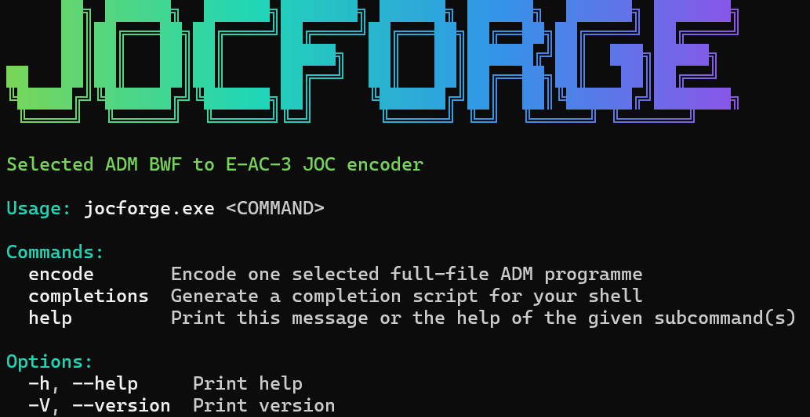

# JOCForge



## Flat 7.1 编码

CLI 将 48 kHz ADM BWF 编码为 Flat 7.1 E-AC-3 JOC。可选总码率为 **1024、1088、1216、1280、1408 和 1664 kbps**，默认 1664 kbps。每档都保留 640 kbps 的独立 AC-3 核心，其余码率分配给依赖 E-AC-3 子流。六档共用 Flat 7.X 重建配置（索引 1）、七路载体和 15 个 JOC 对象。

1664 kbps 档实测使用方大同《Love Song》（4 分 29 秒）。OpenJOC 0.20.2 在兼容模式下接纳了全部 8,417 个访问单元并完成 7.1 渲染。最终码流无损封装为 MKA 后，已实测可在 Adobe Audition 中打开，并可用 Windows 媒体播放器播放。

### 从 ADM 编码到 EC3

支持从节目起点开始、连续覆盖整段音频的笛卡尔对象自动化。每个对象可以包含多个 `audioBlockFormat`。编码器按每 1536 个采样（48 kHz 下为 32 ms）的控制回调读取对象位置，并根据 `jumpPosition` 和 `interpolationLength` 计算过渡。声床继续使用固定扬声器位置。

在仓库根目录运行以下 PowerShell 命令，将输入路径换成自己的 ADM BWF。需要 Rust 工具链和 FFmpeg。Flat7x CLI 要求输出到新的空目录，并使用 `.candidate.ec3` 后缀。

```powershell
cargo build --release --locked -p jocforge
if ($LASTEXITCODE -ne 0) { throw "构建失败" }

$adm = (Resolve-Path -LiteralPath "D:\Audio\input.adm.wav").Path
$out = (New-Item -ItemType Directory -Path (Join-Path $PWD ("flat7x-" + [guid]::NewGuid()))).FullName
$ec3 = Join-Path $out "output.candidate.ec3"

.\target\release\jocforge.exe encode "$adm" "$ec3" --joc-layout flat7x --total-rate 1280
if ($LASTEXITCODE -ne 0) { throw "Flat 7.1 编码失败" }
```

### 无损封装为 MKA 或 MP4

在同一个 PowerShell 会话中任选一种容器。`-c:a copy` 直接复制 EC3 音轨并保留 JOC 元数据。

**MKA**（已实测可在 Audition 和 Windows 媒体播放器中打开）

```powershell
ffmpeg -n -i "$ec3" -map 0:a:0 -c:a copy -f matroska (Join-Path $out "output.mka")
```


上图是《Love Song》编码结果封装为 MKA 后在 Adobe Audition 中的波形与频谱视图。八条轨道依次为 L、R、C、LFE、Ls、Rs、Lsd、Rsd，时间轴总长 4 分 29 秒。

**MP4**（可选用 `.m4a` 后缀）

```powershell
$mp4 = Join-Path $out "output.mp4"
ffmpeg -n -i "$ec3" -map 0:a:0 -c:a copy -f mp4 "$mp4"
if ($LASTEXITCODE -ne 0) { throw "MP4 封装失败" }
```

需要 `.m4a` 文件时，再运行下面的命令。FFmpeg 根据 `.m4a` 后缀默认选择 `ipod` 封装器；先生成 MP4 再改名，可以保留 MP4 封装和其中的 `ec-3` 音轨。

```powershell
Rename-Item -LiteralPath $mp4 -NewName "output.m4a"
```

生成的 `.m4a` 已实测可由 iOS 系统解码器打开。

Flat7x 在 CLI 中仍标为实验性。六档均已用一首含动态对象的 48 kHz 达芬奇 ADM 母版完成整曲编码、FFmpeg 解码和 OpenJOC 7.1 渲染。OpenJOC 的部署兼容检查通过，ETSI 严格检查仍报告载荷 11 和 14 的 `codecdatae` 标志差异。

## 5.1 编码

由于涉及 HMAC 私钥，iOS 系统解码器无法解码 JOCForge 生成的 5.1 全景声音轨，播放时为静音，目前本开源项目无法解决这一限制。用户自行修改本项目所产生的后果，由用户自行承担。

JOCForge 的命令行编码器支持将 48 kHz ADM BWF 编码为带 5.1 声道核心的 E-AC-3 JOC 码流。可选码率为 384、448、576、640、768 和 1024 kbps。六档码率均已在本地完成整文件编码，并通过输入配置、帧长和无密钥完整性检查。

下面的 PowerShell 命令使用上文构建的 Release 编码器，以 1024 kbps 输出 5.1 码流。

```powershell
.\target\release\jocforge.exe encode "D:\input.adm.wav" "D:\output.ec3" --data-rate 1024
```

### 使用 XML 作业文件

除直接指定输入和输出文件外，也可以用 `jocforge encode --job-xml <job.xml>` 读取作业配置。当前支持 ADM BWF 输入和 EC-3 裸码流输出。`adm` 和 `atmos_mezz` 两种输入配置共用 BWF 读取器，解析后保留各自的输入类型。添加 `--preflight-only` 可只检查 XML 和输入文件。MP4 封装可在编码后按上文示例使用 FFmpeg 完成。CLI 的 XML 作业不支持直接输出 MP4 或 DASH。

XML 解析器可识别并保留 Line 和 RF 两种动态范围控制（DRC）设置中的六个预设名称。当前可编码的 Line/RF 组合为 `none/none` 和 `film_light/film_light`。其他组合会在编码前被拒绝，若传入下游接口则返回 `UnsupportedDrcEffect`。

在 `filter/audio/encode_to_atmos_ddp` 中可以按文件位置截取 ADM，再添加片头和片尾静音。以下片段截取第 60 到 62 秒，前置 4 秒静音，后置 1 秒静音。节目长 7 秒。EC3 按 32 ms 整帧写入，本例成品长 7.008 秒。

```xml
<time_base>file_position</time_base>
<timecode_frame_rate>25</timecode_frame_rate>
<start>00:01:00:00</start>
<end>00:01:02:00</end>
<prepend_silence_duration>4</prepend_silence_duration>
<append_silence_duration>1</append_silence_duration>
```

- `start` 和 `end` 可以单独设置，分别默认文件开头和文件末尾。时间码表示左闭右开区间，也可以写为 `00:01:00.250` 这样的十进制秒时间码。
- 使用 `HH:MM:SS:FF` 时需提供帧率，编码端的 `timecode_frame_rate` 优先，其次使用输入端帧率。使用十进制秒时间码时可保留 `not_indicated`。纯整数帧号的结束帧包含在区间内。
- 首尾静音均以秒计，支持小数，省略或留空均按零处理。响度测量、音频编码和动态对象位置使用同一条剪辑时间线。添加 `--preflight-only` 可查看原文件和剪辑后的每声道采样数。
- XML 作业默认编码 5.1。使用 `jocforge encode --job-xml job.xml --joc-layout flat7x` 可编码 Flat 7.1。此时 XML 的 `data_rate` 指 D0 码率，例如 `640` 对应 1280 kbps 总码率，输出路径遵循上文的 Flat7x 文件命名要求。

### 开发与检查

项目采用 Rust 2024 工作区，包含领域逻辑、应用、文件读写、命令行和独立验证五个模块。编码请使用 CLI，应用层的 `encode()` 接口目前返回 `SourcePipelineUnavailable`。命令参数和版本可通过 `jocforge --help` 和 `jocforge --version` 查看。[架构说明](docs/architecture/ARCHITECTURE.md)

```powershell
rtk cargo fmt --all -- --check
rtk cargo check --workspace --locked
rtk cargo clippy --workspace --all-targets --locked -- -D warnings
rtk cargo test --workspace --locked
rtk proxy python scripts/check-boundaries.py
```
