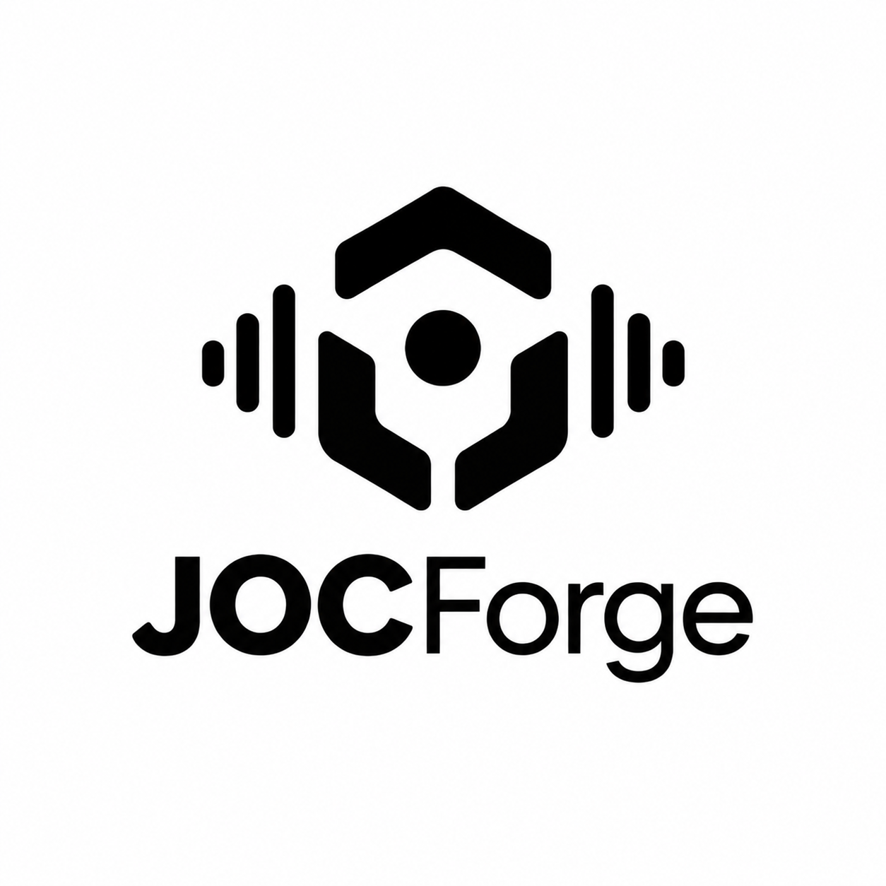

<p align="center">
  
</p>

# JOCForge

JOCForge is an independent E-AC-3 JOC encoder written in Rust. It encodes 48 kHz ADM BWF masters into audio tracks with spatial metadata, supporting the 5.X, Flat 7.X, and 5.X+2 top-front carrier layouts. Input can come from files or XML jobs.

**[English documentation](https://chyinan.github.io/JOCForge/)** · **[简体中文文档](https://chyinan.github.io/JOCForge/zh/)**

## Quick start

Build the CLI from this repository, then export a default 5.1, 1024 kbps EC-3 track:

```powershell
cargo build --release --locked -p jocforge
.\target\release\jocforge.exe encode "D:/Audio/input.adm.wav" "D:/Audio/mix.ec3" --data-rate 1024
```

[Layouts and objects](docs/site/layouts.md) · [Substreams and signalling](docs/site/substreams.md) · [CMAF, MKA and MP4](docs/site/containers.md) · [XML jobs and loudness](docs/site/jobs.md)

[Apache License 2.0](LICENSE) · [Third-party notices](THIRD_PARTY_NOTICES.md)
