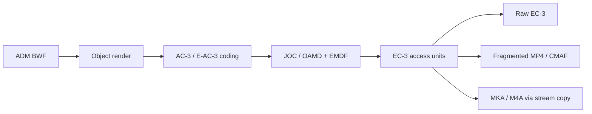

<p align="center">
  
</p>

<h1 align="center">JOCForge</h1>

<p align="center">
  <strong>The open, independent E-AC-3 JOC encoder.</strong><br>
  ADM BWF in. Object-based 5.1 and 7.1 immersive audio out. Pure Rust.
</p>

<p align="center">
  <a href="https://github.com/chyinan/JOCForge/actions/workflows/ci.yml"></a>
  <a href="https://chyinan.github.io/JOCForge/"></a>
  <a href="https://github.com/chyinan/JOCForge/releases/latest"></a>
  <a href="LICENSE"></a>
</p>

JOCForge is a clean-room Rust implementation of the end-to-end ADM BWF → E-AC-3 JOC chain — the object-audio codec used for Dolby Atmos delivery. It parses bed and object audio, renders moving object positions, encodes the AC-3/E-AC-3 core and dependent substreams, writes JOC/OAMD metadata and EMDF signalling, and assembles finished access units. The encode path does not depend on FFmpeg, a proprietary SDK, or any closed-source encoder.

Most workflows treat the JOC layer as a black box. JOCForge implements it directly: the same binary can produce a 5.1 EC-3 stream, a Flat 7.1 stream, or a CMAF track, with direct control over the object metadata and bitstream signalling.

**[Documentation](https://chyinan.github.io/JOCForge/)** · **[简体中文](https://chyinan.github.io/JOCForge/zh/)** · **[Releases](https://github.com/chyinan/JOCForge/releases/latest)**

## Why JOCForge

- **Independent from the ground up.** A clean-room implementation built from the specification — not a wrapper, a patched codec, or a call into a proprietary binary.
- **The whole encode chain, one tool.** ADM parsing, object rendering, AC-3/E-AC-3 coding, JOC/OAMD, EMDF and frame assembly all live in the same Rust workspace.
- **Object audio with real motion.** 15 coded objects by default, 32 ms position updates, jump and interpolation metadata, plus experimental 8/12-object modes.
- **Bitstream control most tools hide.** Dependent substreams, four LFE ownership modes, four block partitions, three carriage modes (audio-block skip field, frame-tail auxdata, legacy AC-3 core), and strict ETSI or deployed-compatible signalling.
- **Delivery-ready output.** Raw EC-3, fragmented MP4/CMAF, and MKA/M4A through FFmpeg stream copy.
- **Mastering workflow.** XML jobs, partial renders, lead/tail silence, DRC, downmix, surround/height trims, and BS.1770 loudness metering with a reusable cache.
- **Cross-platform.** Prebuilt Windows, Linux and macOS binaries, or install the CLI from source.

## Pipeline



## Profiles

| Profile | Reconstruction carriers | Phase signalling | Bitrates |
|---|---|---:|---|
| `idx0` | 5.X | Off | 384, 448, 576, 640, 768, 1024 kbps |
| `idx1` (`flat7x`) | Flat 7.1 | Off | 1024, 1088, 1216, 1280, 1408, 1664 kbps |
| `idx2` | 5.X+2 top-front | Off | 1024, 1088, 1216, 1280, 1408, 1664 kbps |
| `idx3` (default) | 5.X | On | 384, 448, 576, 640, 768, 1024 kbps |
| `idx4` | 5.X+2 top-front | On | 1024, 1088, 1216, 1280, 1408, 1664 kbps |

Five-carrier profiles use `--data-rate`; seven-carrier profiles use `--total-rate`. CMAF additionally accepts a 1536 kbps total.

## Quick start

Download a prebuilt binary from [Releases](https://github.com/chyinan/JOCForge/releases/latest), or install the CLI from source:

```sh
git clone https://github.com/chyinan/JOCForge.git
cd JOCForge
cargo install --path crates/jocforge-cli --locked
```

The defaults are 5.1, 1024 kbps and 15 coded objects:

```sh
jocforge encode input.adm.wav output.ec3
```

Flat 7.1 defaults to 1664 kbps:

```sh
jocforge encode input.adm.wav output-7.1.ec3 --joc-layout flat7x
```

Write a fragmented MP4 (CMAF):

```sh
jocforge encode input.adm.wav output.mp4 --joc-layout idx4 --container cmaf
```

Run `jocforge encode --help` for bitrate, substream, carriage and container controls.

## Verified end to end

- Full-length 5.1 encodes verified at all six bitrates (384–1024 kbps), with reference-encoder A/B measurements.
- A 4:29 Flat 7.1 programme at 1664 kbps produced 8,417 access units; OpenJOC admitted the stream in compatibility mode and completed a 7.1 render.
- The resulting MKA opened in Adobe Audition and Windows Media Player; the M4A opened in the iOS system decoder.
- CI runs formatting, workspace checks, Clippy and focused regression tests on Linux and Windows.

## Documentation

[Layouts and objects](docs/site/layouts.md) · [Substreams and signalling](docs/site/substreams.md) · [CMAF, MKA and MP4](docs/site/containers.md) · [XML jobs and loudness](docs/site/jobs.md) · [Development and verification](docs/site/development.md)

## Status

Native 5.1 JOC is the most validated path. Flat 7.1 and the reduced 8/12-object modes are experimental. Playback compatibility depends on the decoder; the documentation records the tested paths, including a known silent-playback case on the iOS system decoder.

Contributions are welcome — see [CONTRIBUTING.md](CONTRIBUTING.md) for the workflow.

[Apache License 2.0](LICENSE) · [Security policy](SECURITY.md) · [Third-party notices](THIRD_PARTY_NOTICES.md)
