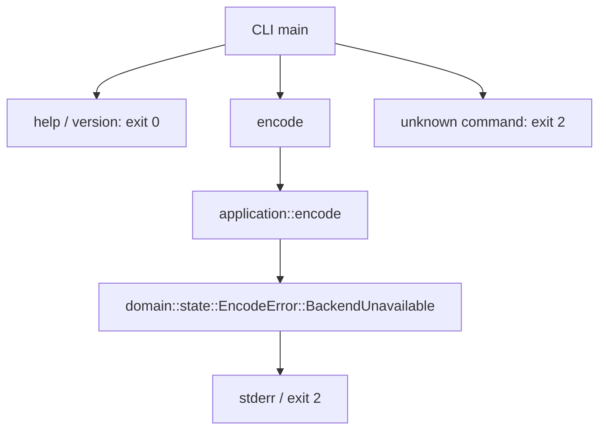

# 数据流

当前可执行调用图：

encode 不读取路径、不启动进程、不打开文件。其余 domain 模块、io 和 validation 均不在当前调用图中。

批准后的职责流：CLI 收集有界输入 → io 产生输入字节 → frontend 生成不可变语义输入 → application 按 GTC 协调 owner → 各 domain 产生 staged result → publication 产生完整发布提案 → CLI 调用 atomic_output 提交。本轮只物化边界，不启用这条生产路径。

已物化的 PostWindow fanout capability 位于 F03W `W3072` installed48 输出之后。future renderer 创建一个线性 proposal；`fanout(self)` 生成 CurrentFeatures 和 spatial-audio 两个非 Clone view，并共享同一 immutable `Arc` payload。CurrentFeatures 接收显式 phase。renderer、F04 assembler 和 parent transaction 仍 deferred。

## Main 时钟

| 域 | 范围或关系 | 行为 |
|---|---|---|
| normal callback | `g=0..4246` | 读取真实输入；最后一次含 1,050 个真实样本和 486 个正零 padding。 |
| cached drain | `g=4247..4250` | 4 次 cached drain；复用末次完整 padded host38 和 control snapshot。 |
| codec source | `s=g-2`，仅 `g>=2` | 共 4,249 个 source，`s=0..4248`。 |
| suppressed source | `s=0,1` | 完整推进所有 selected owner，但不发布 AU。 |
| published AU | `j=s-2`，仅 `s>=2` | 共 4,247 个 AU，`j=0..4246`。 |
| JOC dispatch | `d=g-1=s+1` | source 域有效时建立 dispatch。 |
| JOC writer | `writer=d-1=s` | 当前 source 生成 writer `s`。 |
| publication pop | source `s` pop writer `s-1` | FIFO 延迟一个 source。 |
| AU payload join | AU `j` 消费 ordinary writer `j` 和 JOC writer `j+1` | 两类 writer 域不得混用。 |

EOF 不新增 codec flush。ordinary pending writer `4247` 和 `4248` 丢弃。ID14 pending writer `4248` 丢弃。最终长度为 `4,247 × 4,096 = 17,395,712` bytes。

`g`、`s`、`d`、writer 和 `j` 必须分别使用 `FrontendCallbackIndex`、`CodecSourceIndex`、`JocDispatchIndex`、`JocWriterIndex` 和 `PublishedAuIndex`。公共接口不得使用裸 `usize` 传递时间域。

独立 validation 读取最终发布结果，调用外部工具解码或比较，输出带工具身份的证据。它不能反馈生产算法常数，不能作为编码器主体。FFmpeg 不属于 production 依赖图。
