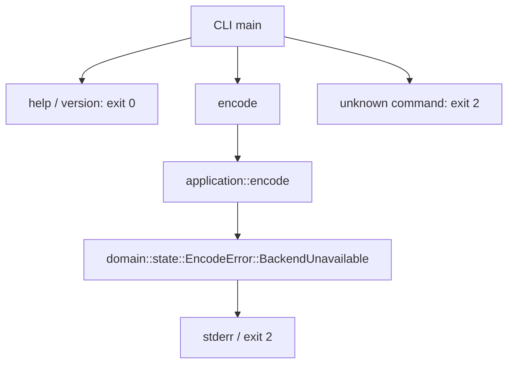

# 数据流

当前可执行调用图：

encode 不读取路径、不启动进程、不打开文件。其余 domain 模块、io 和 validation 均不在当前调用图中。

已验证的 F01G candidate 子路径是调用者显式提供 AXML/CHNA metadata payload → `selected_adm_graph` 的 typed physical graph/ATU UID/source-index identity receipt → candidate `adm_object_events` 零起点/单block/样本域 admission → 同candidate raw DBMD payload 经现有parser → physical-host join → candidate control52 set。它不在 CLI `encode` 调用图内，且 SOURCE_BINDING_TO_SELECTED_JOB 仍为 `UNRESOLVED`；F01E job vectors 的 N=6,522,906 与 candidate WAV receipt 的 N=13,888,071 不可合并。它不读取WAV/data/PCM内容，不产生prefix11 geometry、installed48 numeric state 或control38。

批准后的职责流：CLI 收集有界输入 → io 产生输入字节 → frontend 生成不可变语义输入 → application 按 GTC 协调 owner → 各 domain 产生 staged result → publication 产生完整发布提案 → CLI 调用 atomic_output 提交。本轮只物化边界，不启用这条生产路径。

已物化的 PostWindow fanout capability 位于 F03W `W3072` installed48 输出之后。future renderer 创建一个线性 proposal；`fanout(self)` 生成 CurrentFeatures 和 spatial-audio 两个非 Clone view，并共享同一 immutable `Arc` payload。CurrentFeatures 接收显式 phase。renderer、F04 assembler 和 parent transaction 仍 deferred。

F04C 的 E2 component stage 和 E3 Direct-LFE ring stage 分别消费同代受限输入，并返回不可提交的 proposal。E3 在 `g>=2` 提供 provenance 为 `g-2` 的 Type10 row0。rows1..15 来自当前 callback 的 E2 component15。E4 将两个 proposal 组装为只读的 16×1536 packet。

`spatial_audio_composer` 现消费 E4 proposal 和 admitted `ReaderTargetUpdateReceipt`。它在执行 receiver 前验证 programme/attempt/transaction、完整 F04 before root、phase、component origin g、LFE origin g-2、target envelope g、reader invocation g-2 及每行 producer generation。g0/g1 只安装 component/LFE after 值并产生完整 F04 root g+1；g>=2 才各执行一次 receiver 和 mode0 fitting，得到 final-six、target/carrier QMF、实际 target words 和 J05 lineage。完整 after root 仍只是 `SpatialAudioAfterProposal`，只能由 parent transaction 安装。

F05R56 输入从 `spatial_control` 同代 committed-before root 和 callback inputs 开始。每个 callback 都预览 marker/history 与 target snapshot；`g=0,1` 只返回状态 proposal，不生成 reader invocation 或 receipt。`g>=2` 使用 `q=g-2`，同一次 Type11 encode→wire decode 产生 ID11 body、16 条 previous-aware reader56 records 与 16×6 finite target rows。reader records、targets 和 ID11 必须来自同一预览；target payload 不从 expected literals 或旧 receipt 取值。pending receipt admission 后，F04C 直接消费其实际 target words/逐行 generation，F13 body barrier 原样消费同一 ID11 bytes；两个消费者都不得重跑 reader。

J05 projection 进入 F05JL 值级链后，依次推进 temporal、geometry 和 180-cell fit。full/sparse/channel 只在本 callback 内作为 retry 输入，不成为 persistent coefficient seed。所有 retry 共用同一个 sequence 与同次 F04D selected index；完整 ID14 成功后才提出 next dispatch/sequence/writer state，失败不推进。temporal、geometry、fit-generation 和 dispatch state 仍等待 programme parent 的一次安装。

F13 先用 `MetadataBodiesProposal` 校验 ID11/ID2/ID14 与同一 J05 source lineage；ID2 必须读取同代完整 ID11 header。`ProgrammeMeasurementReceipt` 只接受 case-sensitive `UNGATED`、`DIALOGUE`、`LEVEL`，对应 public semantic 0/1/2；ID1 config[2] 仅在 DIALOGUE 时为1。selected DI-off 只准入 UNGATED/LEVEL，不能用 false 掩盖 DIALOGUE receipt，也不能使用 internal enum顺序、job downmix字符串或裸数字。`MetadataOwner::stage_source` 使用 constructor-pinned wrapper，在 owned clone 内推进六 timer、生成 ID1，并按 ID11→ID1→ID2→ID14 push/pop，随后按 ID11→ID14→ID2→ID1 生成 source2+ EMDF。返回值保留 owned replacement owner、specialized receipt 和 bodies lineage；parent source transaction 在 F12/integrity/durable 条件全部成功后才可安装。

## Main 时钟

| 域 | 范围或关系 | 行为 |
|---|---|---|
| normal callback | `g=0..4246` | 读取真实输入；最后一次含 1,050 个真实样本和 486 个正零 padding。 |
| cached drain | `g=4247..4250` | 4 次 cached drain；复用末次完整 padded host38 和 control snapshot。 |
| codec source | `s=g-2`，仅 `g>=2` | 共 4,249 个 source，`s=0..4248`。 |
| suppressed source | `s=0,1` | 完整推进所有 selected owner，但不发布 AU。 |
| published AU | `j=s-2`，仅 `s>=2` | 共 4,247 个 AU，`j=0..4246`。 |
| JOC dispatch | `d=g-1=s+1` | source 域有效时建立 dispatch。 |
| JOC writer | `writer=d-1=s` | 当前 source 生成 writer `s`。 |
| F05R56 reader | `q=g-2`，仅 `g>=2` | reader invocation 独立于 callback clock；`g=0,1` 推进 marker/history/snapshot 但无 reader 调用或 receipt。 |
| F05R56 row provenance | direct row0 uses `g`; regular rows use delivered history generation | 16 行 provenance 与 receipt payload 一起传递；相同字节不合并 generation。 |
| publication pop | source `s` pop writer `s-1` | FIFO 延迟一个 source。 |
| AU payload join | AU `j` 消费 ordinary writer `j` 和 JOC writer `j+1` | 两类 writer 域不得混用。 |

EOF 不新增 codec flush。ordinary pending writer `4247` 和 `4248` 丢弃。ID14 pending writer `4248` 丢弃。最终长度为 `4,247 × 4,096 = 17,395,712` bytes。

`g`、`q`、`s`、`d`、writer 和 `j` 必须分别使用 `FrontendCallbackIndex`、`ReaderInvocationIndex`、`CodecSourceIndex`、`JocDispatchIndex`、`JocWriterIndex` 和 `PublishedAuIndex`。公共接口不得使用裸 `usize` 传递时间域。

独立 validation 读取最终发布结果，调用外部工具解码或比较，输出带工具身份的证据。它不能反馈生产算法常数，不能作为编码器主体。FFmpeg 不属于 production 依赖图。
