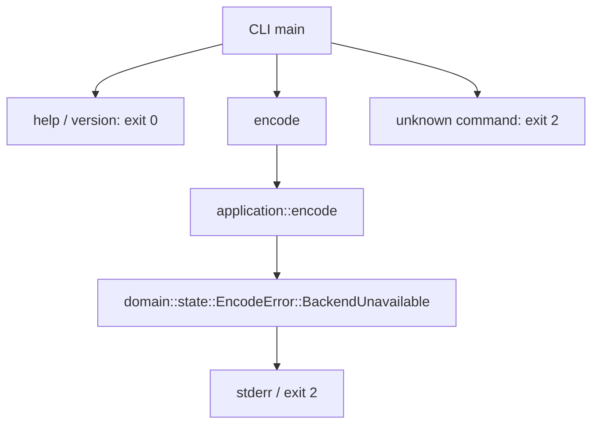

# 数据流

当前可执行调用图：

encode 不读取路径、不启动进程、不打开文件。其余 domain 模块、io 和 validation 均不在当前调用图中。

未来批准后的职责流：CLI 收集有界输入 → io 产生输入字节 → frontend 生成不可变语义输入 → application 按批准时钟协调 owner → 各 domain 产生 staged result → publication 产生完整发布提案 → CLI 调用 atomic_output 提交。此序列只描述工程边界，不定义 DSP 顺序。具体 GTC 边、时钟和 receipt 类型等待规范。

独立 validation 读取最终发布结果，调用外部工具解码或比较，输出带工具身份的证据。它不能反馈生产算法常数，不能作为编码器主体。FFmpeg 不属于生产依赖图。
