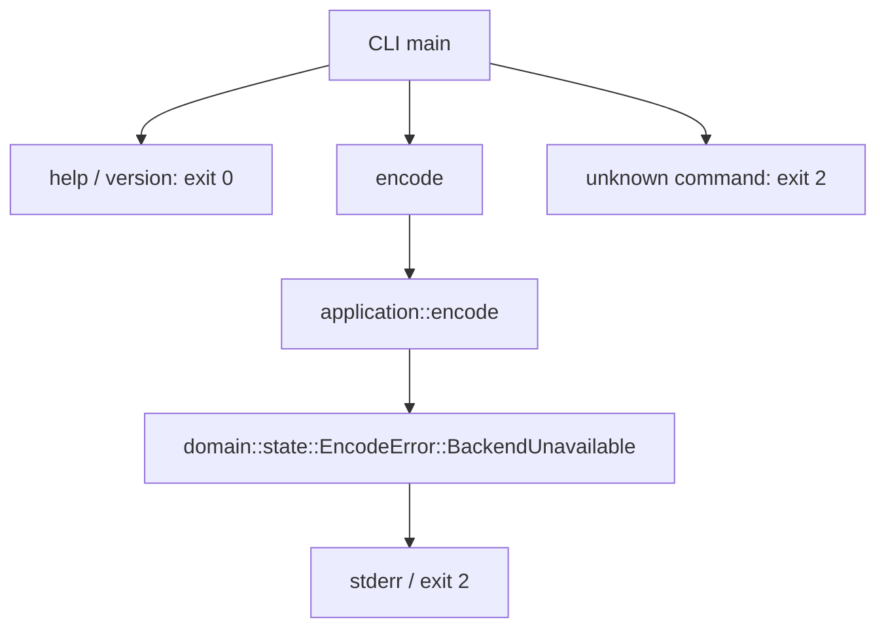

# 数据流

当前可执行调用图：

encode 不读取路径、不启动进程、不打开文件。其余 domain 模块、io 和 validation 均不在当前调用图中。

批准后的职责流：CLI 收集有界输入 → io 产生输入字节 → frontend 生成不可变语义输入 → application 按 GTC 协调 owner → 各 domain 产生 staged result → publication 产生完整发布提案 → CLI 调用 atomic_output 提交。本轮只物化边界，不启用这条生产路径。

已物化的 PostWindow fanout capability 位于 F03W `W3072` installed48 输出之后。future renderer 创建一个线性 proposal；`fanout(self)` 生成 CurrentFeatures 和 spatial-audio 两个非 Clone view，并共享同一 immutable `Arc` payload。CurrentFeatures 接收显式 phase。renderer、F04 assembler 和 parent transaction 仍 deferred。

F04C 的 E2 component stage 和 E3 Direct-LFE ring stage 分别消费同代受限输入，并返回不可提交的 proposal。E3 在 `g>=2` 提供 provenance 为 `g-2` 的 Type10 row0。rows1..15 来自当前 callback 的 E2 component15。E4 将两个 proposal 组装为只读的 16×1536 packet。

Receiver mode=1 stage 已通过局部测试。它接收同代 Type10 receipt 和带 parent lineage 的 S09 view。它推进五条 analysis history，只对 `[Ls, Rs]` 运行 mode=1 delay/FIR/synthesis。它返回 after-state proposal，不提交 owner root。F04R S09 producer、整条 receiver、J05 receipt 和 parent root replacement 仍 deferred。

F05R56 输入从 `spatial_control` 同代 committed-before root 和 callback inputs 开始。每个 callback 都预览 marker/history 与 target snapshot；`g=0,1` 只返回状态 proposal，不生成 reader invocation 或 receipt。`g>=2` 使用 `q=g-2`，预览 Type11 encode→wire decode、16 条 previous-aware reader56 records 与 16×6 finite target rows。reader records 和 targets 必须来自同一 wire decode/reader preview；target payload 不从 expected literals 或旧 receipt 取值。成功只产生完整 next-state proposal 与 pending `ReaderTargetUpdateReceipt`；parent `spatial_control` transaction 成功 commit 后才 admission。失败返回空输出并保留 committed root。当前实现切片不做 F04C/F04R/F05JC 消费或 parent transaction。

## Main 时钟

| 域 | 范围或关系 | 行为 |
|---|---|---|
| normal callback | `g=0..4246` | 读取真实输入；最后一次含 1,050 个真实样本和 486 个正零 padding。 |
| cached drain | `g=4247..4250` | 4 次 cached drain；复用末次完整 padded host38 和 control snapshot。 |
| codec source | `s=g-2`，仅 `g>=2` | 共 4,249 个 source，`s=0..4248`。 |
| suppressed source | `s=0,1` | 完整推进所有 selected owner，但不发布 AU。 |
| published AU | `j=s-2`，仅 `s>=2` | 共 4,247 个 AU，`j=0..4246`。 |
| JOC dispatch | `d=g-1=s+1` | source 域有效时建立 dispatch。 |
| JOC writer | `writer=d-1=s` | 当前 source 生成 writer `s`。 |
| F05R56 reader | `q=g-2`，仅 `g>=2` | reader invocation 独立于 callback clock；`g=0,1` 推进 marker/history/snapshot 但无 reader 调用或 receipt。 |
| F05R56 row provenance | direct row0 uses `g`; regular rows use delivered history generation | 16 行 provenance 与 receipt payload 一起传递；相同字节不合并 generation。 |
| publication pop | source `s` pop writer `s-1` | FIFO 延迟一个 source。 |
| AU payload join | AU `j` 消费 ordinary writer `j` 和 JOC writer `j+1` | 两类 writer 域不得混用。 |

EOF 不新增 codec flush。ordinary pending writer `4247` 和 `4248` 丢弃。ID14 pending writer `4248` 丢弃。最终长度为 `4,247 × 4,096 = 17,395,712` bytes。

`g`、`q`、`s`、`d`、writer 和 `j` 必须分别使用 `FrontendCallbackIndex`、`ReaderInvocationIndex`、`CodecSourceIndex`、`JocDispatchIndex`、`JocWriterIndex` 和 `PublishedAuIndex`。公共接口不得使用裸 `usize` 传递时间域。

独立 validation 读取最终发布结果，调用外部工具解码或比较，输出带工具身份的证据。它不能反馈生产算法常数，不能作为编码器主体。FFmpeg 不属于 production 依赖图。
