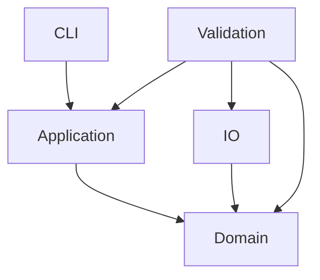

# 依赖规则

当前实际 crate 依赖图：

Domain 内未来依赖遵守：领域模块 → numeric 和不可变契约。具体领域间边等待 GTC 审核；空壳当前没有跨模块调用。state 当前只含错误契约，没有跨 owner 可变状态。

Domain 不得依赖 CLI、I/O、进程或环境变量。application 保持纯协调；CLI 的未来 I/O 组装不能把领域计算放入 main。io 只做文件适配，validation 只做独立检验。外部解码/比较进程只允许出现在 validation shell，不能充当生产编码核心。

禁止可变全局状态、string map 核心状态、跨模块私有 state 写入、catch-all util、算法 feature 分叉、数千行 orchestrator 或对历史源文件的 include/path 引用。每次新增依赖须更新边界脚本并说明规范理由，不预设未来 profile 框架。
