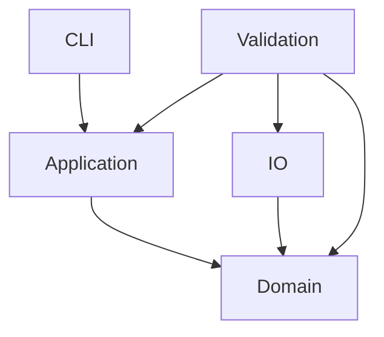

# 依赖规则

Selected input preparation uses the existing locked `sha2` 0.10.9 dependency in application to identify caller-provided immutable resource bytes. This LOCAL_TRANSLATION follows SELECTED-INPUT-APPLICATION-REFERENCES-V1 and FRONTEND-COLD-ENTRY-CLARIFICATION-V1. The input adapter remains responsible for validating RIFF and deriving descriptor/sample extent from the same resource. Application coordinates the existing job/profile and ADM event structural admission before retaining the graph, admitted events and immutable Arc snapshot. It performs no file I/O, grants no READY authority, and does not depend on io or validation. A later mutable path must not replace this resource between metering and main.

The PCM I/O crate also uses the locked `sha2` dependency to bind a borrowed parsed RIFF source to its meter read cursor. The cursor retains only the digest and sample position; it does not copy the source byte slice into persistent state.

当前实际 crate 依赖图：

Domain 内部只通过批准的类型化契约传值。`integrity` 使用 `timeline` 的 source、dispatch 和 published-AU newtypes，并只依赖已登记的 checksum 与 provider 校验模块。`reader_eof` 和 `integrity` 各自拥有局部 committed state；两者都未接入全局 CallbackTransaction。其他模块的实现状态以 `IMPLEMENTATION-MAP.json` 为准。

Domain 不得依赖 CLI、I/O、进程或环境变量。application 保持纯协调；CLI 的未来 I/O 组装不能把领域计算放入 main。io 只做文件适配，validation 只做独立检验。外部解码/比较进程只允许出现在 validation shell，不能充当生产编码核心。

`integrity` 在 domain 内解析调用者传入的 keyless provider bytes，并计算 canonical provider digest。它不读取 provider 文件，也不访问认证材料。provider 的文件读取和 manifest 适配仍属于未来 I/O 边界。

F13 metadata owner 只消费调用者注入并经身份校验的 clean provider/wrapper values；production domain 不读取文件、进程或环境。`MetadataBodiesProposal` 可以依赖 J05/reader receipts 的 immutable values，但不能读写 F04/F05 owner state；ID2 读取同代 ID11 body，ID1 读取 typed measurement projection。`stage_source` 只产生 owned metadata after-state，不调用 application、I/O、validation 或 parent commit。

F04C composer 只在 `domain/spatial` 内组合现有 component/LFE/reader/receiver/fitting proposals。它可以把 immutable J05 projection交给 `domain/joc`，但 F05 不得回写或重跑 F04。相应地，F13 只接收 F05 body proposal，不能操作 temporal/geometry/sequence；F05 也不能 push/pop metadata queues。三层之间只通过 typed value/proposal/receipt 单向连接。

F05JL synthetic coordinator validator 只在 `cfg(test)` 编译，不形成 production API/root，也不执行 producer。production `coefficient_fitting`/`dispatch_state` 是另一条明确登记的 pure proposal slice；它不得读取 synthetic expected material。`serde_json` 的 `float_roundtrip` 仅用于 test canonical material，production dependency features 不变。

Selected F01E job-configuration parsing uses the approved exactly pinned `roxmltree` crate with its approved default feature set. The parser consumes caller-provided UTF-8 XML as an immutable domain value; domain still performs no filesystem, process, or environment I/O. No general-purpose XML retrieval or external entity resolution path is enabled.

production crate 不得依赖 validation。validation 可以依赖 domain、application 和 io，但只能做外部比较。禁止可变全局状态、string map 核心状态、跨模块私有 state 写入、catch-all util、算法 feature 分叉、数千行 orchestrator 或对历史源文件的 include/path 引用。

F05R56 domain stage 仅接受调用者提供的不可变 callback inputs；selected profile constants are pinned to approved `MANIFEST.json` assets by input-only tests and boundary checks, with no runtime file or environment reads. F05O Type11 writer 输出必须经 Type11 wire decoder 重新解码后才能进入 reader56 materializer；不得把 writer-side rows 当作 decoded rows。F05R56 产生的 pending receipt 在 `spatial_control` parent admission 前不可供 F04C/F04R/F05JC 使用。

Profile 只能包含 `PROFILE-DIMENSIONS.md` 登记的七个维度和唯一 supported row。每次新增依赖或 profile variant 都须先修改批准架构和边界检查。

F01E.1 的 selected job-XML parser 使用 `roxmltree` 0.21.1，将调用者提供的 UTF-8 XML bytes 解析为只读 DOM。调用端先按 F01E 拒绝 `DOCTYPE`/`ENTITY` 字样；该依赖不读取文件或网络。它只服务选定 job-XML 配置归一化，不得扩展为任意 ADM graph/XML 语义解析。
