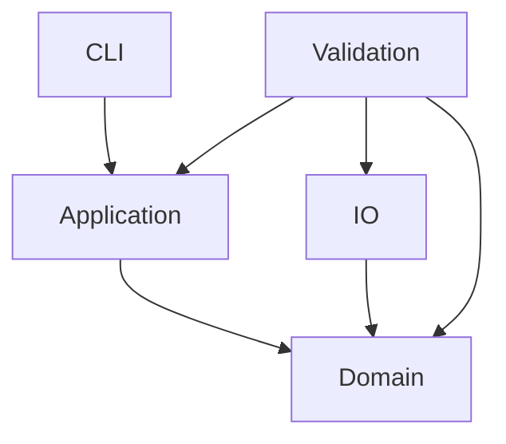

# 依赖规则

当前实际 crate 依赖图：

Domain 内部只通过批准的类型化契约传值。`integrity` 使用 `timeline` 的 source、dispatch 和 published-AU newtypes，并只依赖已登记的 checksum 与 provider 校验模块。`reader_eof` 和 `integrity` 各自拥有局部 committed state；两者都未接入全局 CallbackTransaction。其他模块的实现状态以 `IMPLEMENTATION-MAP.json` 为准。

Domain 不得依赖 CLI、I/O、进程或环境变量。application 保持纯协调；CLI 的未来 I/O 组装不能把领域计算放入 main。io 只做文件适配，validation 只做独立检验。外部解码/比较进程只允许出现在 validation shell，不能充当生产编码核心。

`integrity` 在 domain 内解析调用者传入的 keyless provider bytes，并计算 canonical provider digest。它不读取 provider 文件，也不访问认证材料。provider 的文件读取和 manifest 适配仍属于未来 I/O 边界。

production crate 不得依赖 validation。validation 可以依赖 domain、application 和 io，但只能做外部比较。禁止可变全局状态、string map 核心状态、跨模块私有 state 写入、catch-all util、算法 feature 分叉、数千行 orchestrator 或对历史源文件的 include/path 引用。

F05R56 domain stage 仅接受调用者提供的不可变 callback inputs；selected profile constants are pinned to approved `MANIFEST.json` assets by input-only tests and boundary checks, with no runtime file or environment reads. F05O Type11 writer 输出必须经 Type11 wire decoder 重新解码后才能进入 reader56 materializer；不得把 writer-side rows 当作 decoded rows。F05R56 产生的 pending receipt 在 `spatial_control` parent admission 前不可供 F04C/F04R/F05JC 使用。

Profile 只能包含 `PROFILE-DIMENSIONS.md` 登记的七个维度和唯一 supported row。每次新增依赖或 profile variant 都须先修改批准架构和边界检查。
