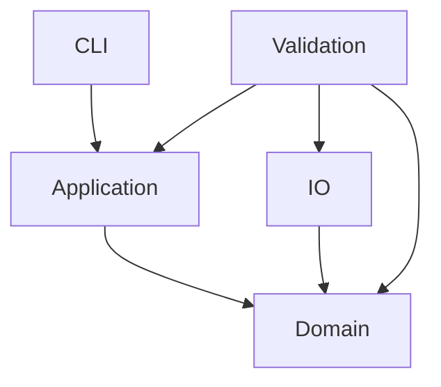

# 依赖规则

当前实际 crate 依赖图：

Domain 内依赖遵守：领域模块只能依赖批准的不可变契约和明确登记的下游边界。GTC 与 owner projection 已提供。空壳当前没有跨模块调用，state 仍只含 migration rejection。

Domain 不得依赖 CLI、I/O、进程或环境变量。application 保持纯协调；CLI 的未来 I/O 组装不能把领域计算放入 main。io 只做文件适配，validation 只做独立检验。外部解码/比较进程只允许出现在 validation shell，不能充当生产编码核心。

production crate 不得依赖 validation。validation 可以依赖 domain、application 和 io，但只能做外部比较。禁止可变全局状态、string map 核心状态、跨模块私有 state 写入、catch-all util、算法 feature 分叉、数千行 orchestrator 或对历史源文件的 include/path 引用。

Profile 只能包含 `PROFILE-DIMENSIONS.md` 登记的七个维度和唯一 supported row。每次新增依赖或 profile variant 都须先修改批准架构和边界检查。
