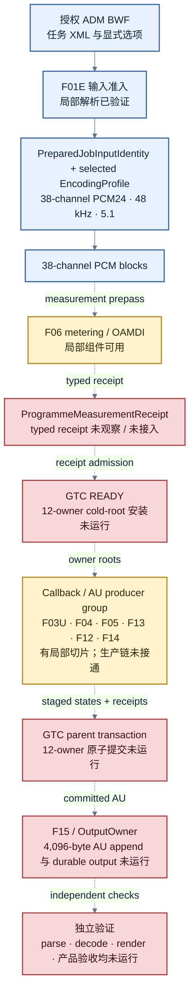

# ADM BWF 到 E-AC-3 JOC 的架构与状态

本文记录目标链路、现有实现边界和证据状态。图中的“合同”“局部验证”和“原生 DEE 证据”含义不同，不能互相替代。

> 状态基准：JOCForge `552bbf4`，2026-10-31。此基准没有完整的 Rust 编码输出。DEE 生成的参考文件不属于 JOCForge 产物。

## 目标与边界

目标输入是用户授权的 ADM BWF。目标输出是 48 kHz、1,024 kbps、5.1、E-AC-3 JOC。当前 profile 只接受选定的 ADM BWF、38 通道 PCM24、5.1 六个 carrier、mode 0/phase 1/index 3、单 independent 子流、零 dependent 子流、六个 block、1,536 samples/AU 和 4,096 bytes/AU。EMDF 使用 `deployed_compat` 或 `etsi_emdf`。OpenJOC render target 只属于独立验证配置。

profile 细节见 [PROFILE-DIMENSIONS.md](PROFILE-DIMENSIONS.md)。模块边界见 [ARCHITECTURE.md](ARCHITECTURE.md)、[DATAFLOW.md](DATAFLOW.md) 和 [STATE-OWNERSHIP.md](STATE-OWNERSHIP.md)。

## 端到端数据流

实线表示当前合同或模块依赖。虚线表示需要实现或运行验证的连接。节点中的状态是当前证据级别，不是完成承诺。

F03U 负责 sourceweight / source proposal；F04 提供 spatial 处理；F05 生成 JOC 数据，供 F13 metadata/EMDF 与 F12 E-AC-3 frame 汇合；F14 为 AU 提供 keyless integrity。图中将这些节点合并显示以控制宽度，模块级边界仍以架构文档和下方证据表为准。

| 图例 | 含义 |
|---|---|
| 蓝色节点、实线 | 已选合同或局部输入准入关系 |
| 黄色节点 | 存在已验证局部切片，生产连接仍未闭合 |
| 红色节点、虚线 | 目标边界明确，实现或运行验证尚未完成 |

### 事务层的含义

F15 plan/destination 合同只负责在 I/O 前校验输入身份、profile、provider 和目标路径能力。它不生成音频，也不预先伪造运行时 receipt。

GTC 把 12 个 programme roots 作为 parent 协调边界：`reader_eof`、`frontend_control`、`spatial_control`、`spatial_audio`、`joc`、`meter`、`drc`、`analysis`、`codec`、`metadata`、`integrity` 和 `output`。callback 或 source stage 返回候选 after-state 和 receipt。parent 应一次安装完整结果。当前各 root 的 receipt adapter 或候选状态有不同程度的局部验证；12-root parent swap 仍全部为 `NOT_RUN`。

计量进入 `READY` 和主编码 callback 是两个不同阶段。当前没有生产 measurement prepass 将最终 `ProgrammeMeasurementReceipt` 接入 READY。单个 owner 的候选 receipt 不能代替全局提交。

## 时钟和数量关系

下表是已选 profile 的模型时钟约束。不同时间域有不同类型，不能用相同数值推断同一调用或同一状态。

| 时间域 | 关系 | 当前用途 |
|---|---|---|
| callback `g` | 每次 frontend callback 前进一次 | 包括两个 suppressed priming callback 和 cached drain callback |
| reader `q` | `q = g - 2`，仅当 `g >= 2` | reader invocation 不等于 callback index |
| source `s` | `s = g - 2`，仅当 `g >= 2` | source producer 的 selected profile 时钟 |
| JOC dispatch `d` | `d = s + 1` | JOC dispatch 域 |
| JOC writer `w` | `w = s` | 当前 source 产生的 JOC writer |
| published AU `j` | `j = s - 2`，仅当 `s >= 2` | AU 发布域；队列存在延迟 |

EOF 不补造 codec flush。selected 计划的长度是 4,247 个 AU，即 17,395,712 bytes。该数值在 DEE 原生参考运行中得到观察；JOCForge 尚未生成对应文件。

## 证据与实现状态

| 切片 | 已确认 | 尚未确认 |
|---|---|---|
| 输入与 profile | 六个 production profile 维度和拒绝规则已列明。F01E 等输入解析存在局部验证。 | 完整 ADM → Rust source callback → AU 的运行路径。 |
| F01 embedded timecode | R121 的 hash-bound reader path 将 `StartSample` / `EndSample` 绑定为 sample-boundary values；End=0 使用 storage sample_count，等于 count 接受，越界 End 和 Start>End 拒绝。消费者仅在 `reader_cursor < reader_extent` 时读取，因此 EndSample 在该 R121 reader path 上为 exclusive。R128/R129 的独立 setter-linked pair 将同类一帧 token 变化在该 numeric-frame path 上定位为 relative binary64 truncation residual。 | R128/R129 的绝对 boundary delta 为 2,000，relative products 49,999.999999992724 / 52,000.000000007276 截断后 setter 值差 2,001；这不建立与 R121/R115 的执行身份。R121 的 49,999 与此前 50,000 预期之间的上游连接仍未闭合。R115/R121/R128 owner-generation、offset-vs-FFOA owner 和 sample-position→spatial generation 均 `UNBOUND`。参考输出未包含或试听，DEE 数值 exit code 未捕获；不声称输出符合性。 |
| F03U | 本次所追踪的 DLL 路径使用本地序号；未观察到全局 candidate ID 被该路径消费。 | 外层 host/ADM 到 Rust input identity 的完整 join。数值相等不能证明 lineage。 |
| F04 spatial | component、LFE、Type10、部分 receiver/fitting slices 有局部验证。 | 完整 receiver callback、上游 render、所有 drains、J05 parent 和真实 ADM 输入。 |
| F05 JOC | 部分 fit、dispatch、state schema 和直接向量已验证。 | 完整 producer 运行、root 安装、生产 AU 及真实空间/听感验证。 |
| F06 measurement / OAMDI / DRC | meter primitives、receipt schema 和部分原生阶段证据已记录。run-032 的 state `+0x18 → DSP` 只在 measurement 路径观察到。run-035/036 的选定 encoder pass 中，48-byte aggregate copy 和 DSP 监视点未命中。选定 logical category-5 规则关闭 DRC 写入，保留四个零 FIFO 项和 override 0。 | production meter prepass/finalize、最终 measurement receipt、`+0x18` 字段语义与 generation、category-5 到 generic event/DRC/BSI 的 typed join、其他 OAMDI state 到 encoder 的路径。限定 no-hit 不证明所有输入或路径都没有连接。 |
| F06ND / F12 DialNorm candidate | Run-100 V5 仍只绑定日志和输出阶段元数据。Run-11 的 V2/V3 将 width-5 调用定位到 Atmos DDP codec-loop metadata serializer：helper 参数为 field pointer、element_count=1、width=5；捕获到的 1 是 count，字段 scalar 为 `NOT_CAPTURED`。V3 绑定输入 member +8 及后续 short-read/copy 路径，但 semantic tag、builder/first writer、typed producer、owner/generation 仍 `UNBOUND`，且该运行调用不等同于原静态 candidate。旧 V1 的 `U16=1` 字段值解释已由 V2 判为无效并 superseded。 | Run-100 仍无单位和 typed MeasurementReceipt；Run-11 与 Run-100 candidate、measurement finalize、F06ND DRC、F12 BSI DialNorm 之间均无 typed join。scalar 未捕获、DialNorm correctness 未验证、output payload 未验证；后续观察计划仍待 Wash 协调。 |
| F06OF target crosswalk | Approved converter 将 AO_XXXX suffix 静态转换为 ChannelInputId；AO_1015→ChannelInputId(0x14)，metadata 报 CHNA track 21 / host slot 20，数值相等不构成身份。D8 V2 绑定独立 PCM metadata record writer→同 worker queue consumer→serializer view，serializer 不读取 +0xD8。D8 V4/V5 区分 AtmosProcessor getter inner state、queued record、CBIReader inner object 和 0x100-stride processing row；selected getter direct caller/owner、构造初始 +0xD8/+0xE0 为零、一个 same-receiver update 不写 +0xD8。 | queue/CBIReader/processing-row 到 getter 的 same-pointer / generation join、后续 AtmosProcessor +0xD8 writer、native key 到 ADM/SelectedGlobalTargetId/TargetSlotIndex/control16/generation 的 typed join仍 `UNBOUND`/`NOT_CAPTURED`。Selected builder 的空 OAMDI event list仅限该 builder；其他 producer/mode 未排除。DEE workflow input 未确认，native capture `NOT_RUN`，F06OF target bridge仍 `UNBOUND`。 |
| F12 E-AC-3 | 目标 AU 尺寸和选定 profile 合同已列明。局部代码现实现批准 frame contract 中的 selected-profile `mixmdate/infomdate` 31-bit MSB writer，并已由完整候选 trial 调用；trial 组合 fixed prefix、同源 DRC、mix/info BSI、六个 block、EMDF carrier、tail 和 CRC，在 private 4096-byte scratch 中先做整帧容量预检，再验证 32,734-bit body budget 和 CRC 后才返回完整 frame candidate。R3 carrier follow-ups 证实选定 `C<=511`、`B=C-4<=507` 与先前 native positive request 的 block-2 length 分支兼容；另一个 native U32 影响 first-segment capacity adjustment、但不选择 `first_block`，其 first writer/semantic owner与profile transfer仍 `UNBOUND`。R138 Wash 包绑定一个选定调用内的 derived reader position、provider descriptor→codec input 和 4,096-byte codec buffer→writer 输入关系。 独立的 profile correction V1 以 config SHA `fa65143f0bd7de52b36367137e61d681baa4c17824aded10be26317e7d1018a4` 绑定 `time_base=embedded_timecode`，并只撤回该 R138 配置上的旧 `file_position` 字段。Wash 随后直接复读同一 hash-bound XML，报告 start=86640、end=86664、timecode_frame_rate=`not_indicated`；这些是 XML token，不推导数值 FPS，也不改写 173286144 的单次 sample-domain reader 算术。V2 implementation-safe contract 已封存 start=86640/end=86664、两个 timecode-frame-rate 设置 not_indicated，并明确 resolved frame rate NOT_CAPTURED。按合同需以独立解析的 rate 解析 tokens、将 seconds 按 sample rate 四舍五入、检查 source bounds，再减 offset；endpoint、offset=auto 来源和 range/spatial time-domain join 仍 UNBOUND。 | F06.4 metadata producer/source identity、F06ND/BSI 同源输入、F13完整容器到F12的生产 join和F07-F11 production plan输入仍未闭合。Native length compatibility 不等于 profile→native plan identity，第三 U32 也不等于 `carrier_block`。 R138 timebase applicability addendum 将第三-U32 capture spec 到 R138 profile 及 planner call path 标为 `NOT_EVALUATED`；该 note 不授权 native job，profile-carrier owner 仍 `UNBOUND`。R138 position 仅是 `absolute start + relative start + cursor` 的本次调用派生值，native absolute-position field 未捕获。Offset/auto-offset/FFOA owner、native generation、host frame、spatial callback、fit/U04/consumer joins、per-channel values、plane/model、Type10/six-plane composition均未闭合；R139 的 `ffoa=auto` 规则因 converter build identity 未闭合仍为 provisional，不用于实现。Model replay `NOT_RUN`、Gate 1 `OPEN`。assembler 只输出本地完整 frame candidate，不是已发布 AU或产品符合性。 |
| F13 metadata / ID14 | 一些 body、配置和 noncommitting source proposal 有局部验证。模型的 ID14 parser 对完整容器做语义校验；模型复杂度规则是 `U8(object_count + 1)`，选定模型值为 16。run-100 另绑定了同-parent 的泛化 body-length 链。 | 这是 model/native sliced evidence。native run-100 事件没有记录 EMDF type/payload tag；counted body-length 到 F13 complete-container identity 仍 `UNBOUND`。native 复杂度字节来自配置记录；ID14 parser 执行和完整 wrapper 执行均 `NOT_RUN`。插件静态注册 `data_rate`，但它到 native count/config 字段的 typed join仍 `UNBOUND`；partial XSD不是拒绝规则。 |
| F13C code13 → complexity byte | Hash-bound host evidence shows separate ADM/AtmosMezz `file_name` and `encode_to_atmos_ddp` task routes. Plugin-selected code13 is synthesized from parser/config arguments, not copied from XML. Slot10 comes from a plugin-owned StringListType/map and its task meaning remains `UNBOUND`; the +0xF58 measurement block is separate from the slot10 source at subblock +0xD8. A separate static same-worker path binds code13 low byte → worker complexity byte → F12 `complexity_index_type_a` bits 105–112; missing code13 defaults to 11. | AtmosMezz::Run output packet→plugin process, task route→plugin factory selection, slot10 semantics/data_rate, parent/source generation, semantic ID14 object_count→native byte, F06ND measurement, and carrier-block owner remain `UNBOUND`. Code 14/type-4 are separate; vectors are static expectations and native observation is `NOT_RUN`. |
| F14 integrity | keyless public profile 的 checksum 与局部 owner stage 有验证。 | source/AU receipt 接入 GTC parent；私有认证路径不属于当前 keyless 目标。 |
| F15 plan/output | Wash 已批准 private plan 和 destination capability 的 admission 合同。F15 绑定列出 codec、JOC、F13、F14 四个顶层 role，已映射各 owner 的参数资产与验证职责。代码有少量类型与拒绝边界切片。 | 生产 provider load/validator、实际 immutable role handles、统一 admission receipt schema、完整 plan 构造、destination capability producer/schema、OutputOwner、AU append、flush、readback、replace 和 DONE。role aggregation 和 capability 的局部字段形状仍是设计候选，不是既有 Rust API。 |
| GTC transactions | 多个 owner state/schema/receipt adapter 已材料化，部分 callback/source proposals 可单独验证。 | 12-owner roots 的生产 cold construction、READY 安装和 atomic parent commit。 |
| 独立 validation | 验收职责与边界已定义。 | JOCForge 输出上的 E-AC-3/JOC parse、decode/render、整曲比较与产品验收。 |

实现映射当前包含 104 个功能 ID。局部切片的验证不等于功能清单完成，也不等于 production chain 已接通。

## DEE 原生参考证据

下列结果来自原生 DEE，不来自 JOCForge。它能证明参考程序对这份授权输入走完了文件输出路径，不能证明当前 Rust 已实现同一算法或事务。

| 观察 | 结果 | 边界 |
|---|---|---|
| run-99 输入 | 运行时副本与授权 ADM BWF SHA-256 相同 | 仅限本次选定文件和运行 |
| 原生输出 | 编码完成；17,395,712 bytes；SHA-256 `34d18a6fb0f477cbccd0b7d633a80b4191c0c535385ff66b8d9cbf7ff1440448`，与无插桩基线相同 | 原生 DEE 参考文件，不是 JOCForge 文件 |
| run-99 上游 length producer | 4,249 次 parent invocation、4,247 次 producer call；bounded U32 reads 有效，返回值匹配报告中的 static sum/tail replay 4,247/4,247 | intake 未提供完整公式、record 语义或返回单位。4,247 是匹配的调用数，不是每次返回值 |
| run-100 下游 body length | 4,247 个同 parent 关系把 selected count、codec record、planned/serialized/refill length 和 U16 prefix 接到一起；body length 为 232～375 bytes | 只证明 run-100 这条捕获路径中的下游字段单位。run-100 receipt 没有 DLL image identity，不能和 run-99 当作同一次执行 |
| reservation / writer | run-100 的 4,247 个 block-2 reservation 都等于同 parent body length + 4；wire U16、body-region U16 和 9-bit writer operand 相同，writer 每次前进 9 bits | `+4` 的语义，以及容量与地址范围的区别仍未知；run-100 body field 到 F13 EMDF complete-container identity 未观察，不能据模型上界宣称 native 不可达 |
| synthetic noise run-109/110 | 保留同一 ADM 元数据，合成 30 秒带零尾音频和全长噪声两种输入。938 与 4,247 个 same-parent 关系分别重复了 body-length prefix → refill、reservation/writer operand = body bytes + 4，writer 前进 9 bits。源 PCM 均跳过未读 | 只扩大选定 profile、这些合成输入下的重复覆盖；不是源音频比较，也不是所有 profile 的证明 |
| 未观察值 | 507、508、511、512 在所列捕获字段中的命中数均为 0 | 目标边界行为仍未观察。512 超过 9-bit 无符号范围，DEE 的截断、拒绝或失败行为未知 |
| 时钟连接 | parent invocation 到 ADM sample position 仍 `UNBOUND` | invocation number 不当作 generation |
| 输出 sink | 一个 native sink trace 记录 4,247 个 4,096-byte ranges、5 个 empty callbacks 和连续文件覆盖。run-036 又把单一输出路径、FileWriter 对象、同一 FILE* 和 frame-0 `fwrite` 接在同一运行中 | 证明所选 DEE 路径；不能代替 Rust OutputOwner 或 JOCForge 写入 |

run-99 Wash package manifest SHA-256：`ae7217ffbc881a48e741fbf91329492335501c398a141f2a62e9aa18e9468ac5`。manifest 声明不含地址、二进制摘录、audio/PCM；两个 payload 的 hash 已核对。状态为 `PASS_CAPTURE_INTEGRITY_BOUNDARY_NOT_CLOSED`，不要缩写成无边界的 PASS。

4 号的元数据清单复核没有发现其他已成功授权样本触发目标值。它把下一候选 fixture 限定为有效 selected 38-track ADM graph 和已准入 metadata，加上独立生成的 PCM，并要求真实 producer 自己产生 body length 503、504、507、508。这个条件是未运行的实验要求，不是预期 native 结果。

后续的 approved-model 算术界限给出 F13 internal body 上界 477/480 bytes、含 4-byte header 为 481/484 bytes。若 run-100 的 body field 与 F13 complete container 是同一语义字段，这些值低于 507～512；目前这个 native typed identity 仍未观察，所以它只是模型边界，不能替代 native crosswalk。

## 关键证据包索引

| 证据包 | manifest SHA-256 | 结论范围 |
|---|---|---|
| F15 validated plan admission | `524d14c69f27f4b1b56a38c166423bd56bc308fe23209f28b1a3bc1a3355b145` | plan/destination 的内部 admission 合同已批准；生产构造与 I/O 未运行 |
| DEE reference output sink | `935a406459e5438a6ff1960476eabee06c403199ca3f79a032c47cbfe1e91d55` | DEE 原生文件 sink 的范围证据；不是 JOCForge 输出 |
| OAMDI measurement/encoder phase | `0ae434889d1cb7fa11bcc00162bd7fa0e7eb817d8c2b31668e67c92f2fb79f63` | measurement 与 encoder 观察分开；尚无 state-to-encoder/output join |
| OAMDI output consumer v6 | `3a00ec555651406875260a3ff0cf2ffd538b97e1f9362e1f7d0a73ea471b6557` | run-036 单流路径和 FILE* 到 frame-0 fwrite 已绑定；run-035/036 selected encoder pass 未命中指定 OAMDI/DSP 监视点。F06OF crosswalk 仍 `UNBOUND` |
| run-99 selected length producer | `ae7217ffbc881a48e741fbf91329492335501c398a141f2a62e9aa18e9468ac5` | Wash 研究侧 intake，尚未纳入 JOCForge 映射。覆盖单次授权输入的 4,247 producer 调用数；returned value 的单位仍未确定 |
| run-100 full chain | `9fb28974eb536a28b76cfc914832c94679b5c4cb3e8c3d34e9d80cf80c4ea334` | 4,247 个 same-parent body-byte length 关系；与 run-99 的跨运行身份连接未建立 |
| run-100 F13 container identity follow-up | `c9b00de09eaefdb6ff4956b0b0a4ae137a420fc20d195a862cf40e925d010923` | run-100 没有 EMDF field tag；targeted Ghidra path 只部分关联 parent/count/serializer，native F13 identity仍 `UNBOUND` |
| run-100 reservation / writer | `df4991d79add578fdbaceb0604885e3be5cbc4e98fa8e2743119bbaa733a8a34` | 同目录下 `run-100\wash-evidence-v2`；4,247 个 same-parent `body_bytes + 4` / 9-bit writer 关系。507/508/511/512 边界仍开放 |
| run-115 embedded-timecode range | `7eb9f1625af1136248ed958f1794a571f7c7cfbd53feee82006f6b2c6e1c435e` | 单次授权输入的原生 `embedded_timecode` → sample range 观察；24 fps 映射是 inference，XML 未显式给 rate |
| run-121 range field semantics addendum | `c0938d12e1b7e377ae76d22081d4bad4f214a5b296271e685fce3b55b4e81ba7` | Ghidra 将字段绑定为 StartSample/EndSample sample boundaries；end convention 与跨 run owner 未闭合 |
| run-121 reader count and padding Wash supplement | `09f00963049bbc5bcbb5c843573cb85d84d559ea1d1568a0b6b2f9c55b0343f5` | 两个 reader 每声道各读 49,999 sample frames；1,536-frame 尾 callback 含 847 read + 689 zero padding；range endpoint、绝对位置和 run-115 identity 未闭合 |
| R121 EndSample exclusive Wash supplement | `b5965175c3fac3543936b043be191400f696e1ed2c62e0702fad4b959f37e505` | Exclusive 仅适用于 hash-identified R121 reader path；upstream one-sample conversion gap、cross-run identity 与 source-report rehash 仍 OPEN |
| R128/R129 EndSample truncation pair Wash supplement | `694b1ead05ddc062bf69c733f2684e7685fc0598508bf3be9282cf41b03ef508` | 仅 numeric-frame pair：absolute boundary delta 2,000，relative setter delta 2,001；R128 report `f531a227…c1b1ac7e17` 已重算，但不协调旧 R121 metadata hash；R115/R121/R128 owner join 与输出符合性仍 OPEN |
| R121 source-report metadata discrepancy | prior V2 `640dced700f854d96fdf5c2c9a813df5e5a1c04ac5a026e7f58239b622a1fba5`; current R1 `640dced700f854d96fdf5c2c9a813df9e5a1c04ac5a026e7f58239b622a1fba5` | Report bytes 未随包交付或独立重算；哈希协调保持 `OPEN_REHASH_REQUIRED`，不静默选用任一值 |
| run-109 synthetic-noise coverage | `3efda1655f8c02df369d6fb1167bfa9e0159cde5cd1ec7a2fb262b63e4e4ca4b` | 938 个 same-parent 关系；body 297～440 bytes，block-2 operand 最大 444；507/508/511/512 未观察 |
| run-110 synthetic-noise coverage | `56530c2f0a17f7999b5a34072af89ebb0c75538b1ebf0e68a7d7333776db7550` | 4,247 个 same-parent 关系；body 297～413 bytes，block-2 operand 最大 417；507/508/511/512 未观察 |
| run-99 target boundary coverage audit | `5015a118f986170c74c4f8f578358d4a4dc877de2cf18f1f77c3790cece728bd` | 未发现其他已成功授权样本命中目标；没有新 native run，目标 fixture 仍未运行 |
| run-99 selected F13 producer-bound research package | `1533fa5fa49bd374aafda903606bc08abffae44d7b43ecb63f7d8eaf3dbfe615` | Wash 对 MANIFEST.json 重算的 SHA；研究交付消息所报 SHA 有一处字符差异，源目录未含 MANIFEST.sha256。4 个 payload 均与 manifest 匹配 |
| selected F13 producer length bound | `46d6ef0f6b98c07711005b68544e6902749f7e171a6ef4c20b94dc53df53df1c` | approved model 的 producer 输入上界；不证明 run-100 native body field 就是 F13 EMDF length |
| native F13 container identity Wash supplement | `db46c73540f45dd47d43644be91b14b9db439a7c3c055be811ae87c298ab5bf5` | 绑定 run-100 length chain 与 partial Ghidra corroboration；EMDF typed identity仍 `UNBOUND` |
| run-99 field semantics Wash summary | `ea100c7c0e6da57fd9586311f17e1670cd7f49c1427bb4dc166f0abe72a7c36a` | 区分 run-99 上游 U32 字段与 run-100 下游 body-byte 关系；确认跨 run identity join、目标边界和 sample-position join 均未闭合 |
| JOCForge Wash supplement | `ff49b19687c2495a74e5d67871a6b8f558329c8fe62b60e32bbab4bdde6d6bed` | 已核对输入包 hash；仅把有界证据交给实现侧，不声称边界值或整条算法已闭合 |
| synthetic-noise Wash supplement | `f59133ac1e7744649d978e932c8bbafb93c03c4d91e50fedc9f66034372e4cbf` | 合并 run-109/110 的重复覆盖；目标 operand 行为与 sample-position join 仍开放 |
| target boundary Wash supplement | `5edaee3d5f3103b7b8e1d6fc9cbd67a996810082f559ea6274d3bf0acdb70432` | 登记真实边界 fixture 所需输入条件；实验状态仍为 `NOT_RUN` |
| embedded-timecode range Wash supplement | `b29d8828d0fac45d699254a4000076bb0a167a11b799f21b3022315a3037e2b9` | run-115 的 sample range 已映射；其他 rate、JOCForge 接入和 spatial-generation join 仍未闭合 |
| range field semantics Wash supplement | `0efba67355c043dabb6d8092bee31117d6b94034ef131d661f17596fa883cb2f` | StartSample/EndSample 静态类型与验证规则已映射；inclusive/exclusive 和绝对 origin 仍 `UNBOUND` |
| F13C ID14 semantic parser Wash supplement | `9b977564f235e324e69d305f58c5bcc5f1c66865a2e9a3c71d17d21152873c61` | 分开登记模型 `object_count + 1` 与 native 配置字节来源；native ID14 解析、跨来源 join 和 whole F13C 均未闭合 |
| F13C user-config complexity-entry Wash supplement | `6a4a916767bd9697237a0640f21d10487cd174b534e8b5c17e2796388748da5f` | `data_rate` 静态注册已观察；到 native count/config 字段仍 `UNBOUND`，受控 pair `NOT_RUN`，partial XSD 不作为拒绝边界 |
| F13C host data-rate owner Wash supplement | `40117ff1663498ab0691fa9f1f7536c3f50a0defdaa3494a4b08147e72beeaec` | Base DDP setter 与 Atmos plugin workflow parameters 属于不同 config object；到 importer record/complexity byte 的 owner join 仍 `UNBOUND` |
| F13C code13 to complexity-byte Wash supplement | `cec6b93609eeda43cd24bf19215bedaa4c62d30a8e7eb3428745be4dc59f1098` | 静态同 worker code13 low-byte→F12 field path；host input、runtime generation、semantic ID14 与 carrier-block joins 均未闭合 |
| R138 reader-origin/cursor/spatial-commit Wash supplement | `2b071bb4de00d0f90c9d960051a435281a91e565695f1eb34531f4ec7b8ed7fb` | One selected call only: reader cursor and codec/writer pointer chain bound within one parent activation; native absolute position, offset owner, generation, spatial/fit/U04/consumer joins and Gate 1 remain open |
| R138 profile timebase correction Wash supplement V1 | `a3f0f574b45d3b024ae5c1c62e9e6b4bdd1535d3d273c7888c7f64df2fb9ee0a` | R138 config hash `fa65143f0bd7de52b36367137e61d681baa4c17824aded10be26317e7d1018a4` selects `embedded_timecode`; only the prior `file_position` claim for this exact config is retracted. Route-to-profile lookup remains static-only, factory selection stays `UNBOUND`, and the position in the reader record remains a separate selected-call sample-domain derivation. |
| R138 embedded-timecode range contract Wash supplement V1 | `28287221a73d7a2842399e38279b893c0ba830127924756b7537189d1ccaf34c` | Hash-bound contract uses R138 embedded_timecode tokens 86640/86664 and a separate resolved-rate input; the configured rate is not_indicated and resolved FPS remains NOT_CAPTURED. It keeps file_position conditional, the 173286144 reader value DERIVED_ONLY, and offset/endpoint/spatial joins open. |
| R138 carrier-block timebase applicability Wash supplement V1 | `1020d0280684ccbe3478e398ee6bf6ef52a902f0887edbf2f0ca02aa0b5dff2e` | The R138 embedded_timecode prefix is reported; full hash is not rechecked in this addendum. The third-U32 capture spec and planner call path are NOT_EVALUATED, profile-carrier owner is UNBOUND, and this note authorizes no native job. |
| Codec complete-frame assembly contract Wash package | `d9085785d5484d236d4b24925a52954fc0bb01153c2e173e2d07d8f6e1b4a5f6` | Selected frame order/budget/BSI guards verified; full frame execution, upstream producer identity joins, and whole-programme acceptance remain `NOT_RUN` |
| Carrier-block native producer lineage Wash package | `fe7da26714bf09be3820ace5629d388c7db30243f6db435e93a02ab43a75a648` | Native request length→first_block branch is bounded; selected 507-byte body is compatible with block 2, but profile carrier transfer to native plan owner remains `UNBOUND` |
| Carrier-block third-scalar owner Wash package | `d3de48e5b079a84524d93c1c337dd3728eee6e9885a8b72bef23bd1a64bb0963` | Separate native U32 adjusts first-segment capacity but does not choose `first_block`; first writer/semantic owner and profile transfer remain `UNBOUND` |
| F13C host input to code13 static lineage Wash supplement | `a15f33eb790c4c9a037787dac42315ee0b92591c6c992363d1be555be62f3370` | Separate host routes and plugin config-argument code13 synthesis are statically bound; slot10 meaning, Run/task-to-plugin runtime edges, generation, ID14 and F06ND joins remain open |
| F01 range field semantics Wash supplement v2 | `0efba67355c043dabb6d8092bee31117d6b94034ef131d661f17596fa883cb2f` | StartSample/EndSample 为 sample-boundary values，End=0 使用 storage count；inclusive/exclusive 与 R115/R121 owner join 仍 `UNBOUND` |
| F06OF selected PMD empty OAMDI-event Wash supplement | `2bd84e29486fac896f11fbe5f2e3fe5e9d6b1c64c0a14cea286874d463ee1b79` | 仅 selected builder 的 event count=0、pointer=NULL；其他 producer/mode 未排除，F06OF crosswalk 未闭合 |
| F06ND category-5 native-effect Wash supplement | `ef7a0547ef0e72b54ab9dac3a78e429a451803a70852d3d5c31997f2ee06f6e8` | 选定 no-DRC 逻辑规则闭合；selected AtmosProcessor path 没有 category-5 输入，generic storage event 与 category-5 的连接仍 `UNBOUND` |
| F06ND/F12 measurement-dialnorm Wash supplement | `2bf5fa14c1ff01a3f77d79ae8301e11f7c4797ef082a81123dbd4021f2d369f5` | finalized measurement identity/receipt 到 F06ND source 输入和 F12 BSI 的 typed edge 仍 `UNBOUND` / `NOT_READY` |
| F06ND measurement/DialNorm candidate Wash supplement | `4f94cc3dca7e08eddde9cc368ee1edaf7199e827414f272a60d8c7325c1e0306` | Run-100 无 custom override；U16 member +1244→5-bit writer 未识别为 DialNorm；measurement→F06ND 与 F06ND→F12 edge 均 `UNBOUND` |
| F06ND measurement/DialNorm candidate Wash supplement V2 | `80cab5a61de2ae1d01cc08bea8ce50c7dbcfa2260c643131115b51fd19d95c79` | Extended Ghidra analysis remained warning-limited; five-bit candidate is untyped and measurement/F06ND/F12 joins remain `UNBOUND` (historical). |
| F06ND measurement/DialNorm candidate Wash supplement V3 | `695b23a992be20f9c0d9203eefffdd80f60227d103f56365d11ac2a46700b67a` | Run-100 scalars are hash-bound log observations only; units and typed receipt absent; DRC/DialNorm joins remain open (historical). |
| F06ND measurement/DialNorm candidate Wash supplement V4 | `06b18967c7ea59019e64cad9a26c96213b51245efe26f64876c5f880034828c7` | Run-100 log/completion/output metadata observed; payload unvalidated, loaded image identity and typed joins remain open (historical). |
| F06ND measurement/DialNorm candidate Wash supplement V5 | `dedc2b7201b372882f0684a6022d85e03e3f2eb8c493c944c7ab7fcdac59e2d6` | Adds encoder/output-stage markers, observed process exit, and output file existence/size metadata only; numeric exit, payload validation, loaded image identity, typed receipt and DRC/DialNorm joins remain open. |
| F06ND Run-11 width-5 ABI correction V2 | `3d4fcdc99858fa0fb02023bb075ce7b6382a06190ffc3db38f1510c386724ddc` | The captured 1 is element_count=1; field scalar NOT_CAPTURED. The earlier scoped V1 U16=1 interpretation is invalid and superseded; typed measurement and DialNorm joins remain UNBOUND. |
| F06ND Run-11 writer/producer gap V3 | `055515926b06f7a1ecb4f2df45dec57af36b0144a5b538c63f8ab0cb86cf5167` | Atmos DDP metadata serializer call and member +8 are mapped. Member semantic tag, builder/first writer, typed producer, owner/generation and Run-100 candidate identity remain UNBOUND; no new capture was run. |
| F15 provider-role/destination Wash supplement | `404b166ca5bcc5b17ecf01c33f01f0a10a9f2641b5da061c9271e9a4881dea19` | 四 role 来源映射已核对；统一 schema 与 destination capability producer 仍未定义/未运行，proposal 未冒充现有 API |
| OAMDI output consumer Wash supplement | `c0294f3c80916c8a251af875744d444cb65b019cf7beac85ad84f07187a3f24f` | 仅记录 run-036 的 selected FileWriter/path/FILE* join 和 run-035/036 bounded no-hit；不关闭 F06OF slot/word/generation crosswalk |
| F06OF native OAMDI key path Wash supplement | `8c41d120df3adbe2d07dae684bc213e080dbcca570c21f8cb392ea03cb1a5d91` | 仅闭合 native U16 key→per-object owner 的 selected static path；跨到模型 target slot/word/generation仍 `UNBOUND` |
| F06OF ADM object to ChannelInputId Wash supplement | `8aa4821d87e3c4c6ebbff8fec05ce927a016573cfcf7d56b7698c6323fd7d570` | AO_1015 的 static ChannelInputId(0x14) 与 metadata host slot 20 分属不同域；workflow 未到达，target/generation bridge 仍 `UNBOUND` |
| F06OF D8 writer/queue boundary Wash supplement | `904ce29ff7f39781c0563fd43de042a6dd136ee988e1ec47828bf8ea448511b1` | Separate record writer/queue path 仅闭合静态边界；到 PcmMd getter 的 pointer/generation join 与 F06OF target bridge 仍 `UNBOUND` |
| F06OF D8 queue-consumer Wash supplement V2 | `237640d321b2516c6e5dbe5400a6571b57787171dd5de062a9e93ab85f1fcdd3` | Same-worker record writer/queue consumer/serializer view bound; getter pointer, generation and target bridge open. |
| F06OF D8 getter-owner Wash supplement V3 | `cb7a5d1cd642102754b988738cca8097dd0eb7d5a614410a2765219fffba8f3e` | Selected AtmosProcessor getter owner and constructor zero state bound; later writer and queue crosswalk open (historical refinement). |
| F06OF D8 store-domain Wash supplement V4 | `e0f90f0db257e079fa50ec79322223afd990c85b0019014816d0d5a443147db2` | Separates queued record, CBIReader inner object, processing-row store, and getter inner state; no pointer/generation join. |
| F06OF D8 getter-update Wash supplement V5 | `c62dd9ced363a315a627f90b8db93efcd744ff01b1eb2da84fc5fd74e367020e` | Selected getter direct caller and one same-receiver update bound; constructor zero state confirmed, other writers/target join remain open. |

## 当前阻塞顺序

1. 分别厘清 F06 measurement、OAMDI 阶段和 selected length producer。再用有证据的 typed lineage 将其接到 PreparedJobInput 与 source/AU 时钟，并产生可消费的生产 receipt。
2. 接通 F03/F04/F05/F13/F12/F14 producer。每个 producer 必须从批准输入和 owner 状态产生真实结果，不能用 fixture receipt 冒充。
3. 建立 12 个 GTC roots，接入 METERING → READY 和 callback/source parent transaction。失败要丢弃 staged after-state，并按合同退休 programme。
4. 接入 F15 plan/destination、OutputOwner 和 durable file adapter，产生并逐 AU 校验 4,096-byte 输出。
5. 运行 JOCForge 整曲，使用独立 parser/decode/render 验证。整曲播放和听感验收另行记录。

在第 5 项完成前，不能把链路标为已闭合。应继续采用 `NOT_RUN`、`UNBOUND` 和局部验证这些准确状态。
