# ADM BWF 到 E-AC-3 JOC 的架构与状态

本文记录目标链路、现有实现边界和证据状态。图中的“合同”“局部验证”和“原生 DEE 证据”含义不同，不能互相替代。

## 2026-11-11：官方演示参考的 OAMD 位置字段域

Wash 补包 `OFFICIAL-ATMOS-DEMO-OAMD-POSITION-WASHED-V1` 的 manifest SHA-256 为 `c550a0536ed4752b46872c674fcabc8ad8828b7eb69e17e6fb4a0d082ee52ef8`，package seal SHA-256 为 `906f48f17f47ef372d339bebe598931a933e6dc132452862ab630fce4582c5f5`；普通及 `python -O` checker 均通过。补包覆盖用户指定的 1,280-kbps 参考样本 23,033 个 AU：15 个 dynamic object 每 AU 各有一个 absolute room-position/Z 更新，9 个对象为 Z code 0，6 个对象为 positive ceiling code 15；`b_enable_elevation` zone constraint、`object_size_idx` 与 resolved object-size height 分别保留独立字段域。

隔离实现的 target metadata reference fixture 位于 `crates/jocforge-domain/tests/fixtures/flat7x_metadata/official_demo_oamd_position_reference.json`。fixture 仅含聚合观察值，不包含坐标列表或编码配方。样本码率为 1,280 kbps，1,664-kbps target 仍 `NOT_EVALUATED`，`production_allowed=false`；现有 5.1 默认与生产路径未变。

## 2026-11-11：Flat7x reconstruction index 的现有 ID14 writer 路径

源码调用链已核对为：`run_with_data_rate_and_joc_layout` → `run_worker`/`run_inner` profile resolution → callback `stage_source_frame` → `prepare_main_metadata_bodies_for_callback` → `stage_selected_joc_source_with_transaction_for_profile` → `stage_joc_source_with_transaction_for_profile` → `stage_joc_payload_for_profile` → `write_id14_header_for_profile`。在现有 selected 1024-kbps full-file CLI 路径中，`--joc-layout flat7x` 会把 profile-owned `joc_dmx_config_idx=1` 传至 ID14 header；省略参数仍使用 selected 5.1 profile，profile writer 输出与既有 header bytes 完全一致。定向 `joc_reconstruction_layout` suite 覆盖 index1 header、profile-aware coefficient payload 和 5.1 byte equality。

该路径对应现有 selected 1024-kbps profile；1,664-kbps `Flat7xI0D0TargetPlan`、F15 pair staging 与 I/O adapter是分别建立的 target components。target D0 侧已有独立的 `d0_emdf_skip_field` helper；下一连接点是 D0 frame composition 调用 profile-aware ID14 metadata producer，并传入 1024-kbps D0 target context。现有 selected 5.1 path 与 D0 composition 保持分离。

## 2026-11-11：Flat7x D0 chanmap 数值字段 writer

Wash 包 `JOCFORGE-EAC3-CHANMAP-U16-SERIALIZATION-V1` 的 one-hot 与 `0x1A00` input-only vectors 已在 `codec::eac3_channel_map::write_flat7x_d0_chanmap_field` 中本地重放。writer 接受 typed `DependentChannelMap`，用既有 high-bit-first `FrameBitWriter` 写恰好 16 个 numeric field bits，并返回 caller cursor。该 slice 保留 `chanmap` numeric field boundary；D0 frame composition、周边语法、source-row role mapping 与最终输出属于独立开放边界，`production_allowed=false`。

## 2026-11-11：Flat7x D0 `chanmape` 与 `chanmap` 字段对

Wash 包 `eac3-dependent-chanmap-field-writer-v1`（manifest `fe364375e3a4ac4ae7a7959807d10d48f1f745e43077f4629fe2a16718702c43`，package seal `8d845b829d5a4488674953235df6c32ac7e8c9fd87b1cebdd32e80e64ff807b2`）将 `chanmape=1` 和后续 U16 map 合为一个需预检的 17-bit group。`codec::eac3_channel_map::write_flat7x_d0_chanmap_fields` 保留原 numeric-field helper，并先预检 group capacity，再依次写 flag 与 typed map；本地 tests 覆盖 one-hot masks、`0x1A00`、misaligned start bit 5 和不足 17 bits 的 no-partial-write case。

Chanmap supplement's `acmod=6,lfeon=0` is a separate validation-vector context. The fixed-prefix contract binds the actual Flat7x D0 target to `acmod=5,lfeon=0`; the field-pair writer consumes neither context. D0 frame/AU production, native record `+0x5c` owner and complete source-role join remain open, with `production_allowed=false`.

## 2026-11-11：Flat7x D0 固定 E-AC-3 前缀

Wash supplement `eac3-dependent-d0-fixed-prefix-v1` 的 manifest `686a51ef28e480d313e39c8d977faaa3e998214b87606fca7544596e913ccd24` / seal `11fe6023706236c6d1c1050dcb1b0139f5c63a12767d87e313e6eca6212d4687` 已在隔离仓库通过 normal 与 `python -O` 校验。`codec::frame_builder::write_flat7x_d0_fixed_prefix` 只在 cursor zero 写 45-bit target prefix，并在写入前预检完整容量；测试覆盖精确 bit string、zero-initialized bytes、end bit 45 与容量不足无部分写入。

该固定前缀在 bit 45 结束，不含 `dialnorm`；后续 BSI 由 caller 负责，其中 `chanmape`/`chanmap` 在 ETSI 指定位置作为独立字段组写入。Target row values 为 `acmod=5,lfeon=0,bsid=16`；完整 D0 BSI、frame/AU assembly、native record owner、audio encoder 与 production remain open。修订后的容量向量使用 5-byte / 40-bit buffer，writer 不产生部分前缀。

## 2026-11-11：Flat7x D0 BSI segment through chanmap

Wash supplement `eac3-dependent-d0-bsi-segment-v1` (manifest `cf24050c7539262f53f220366f3c4328d766147a39daeb37e3e89f27817b88db`, seal `5af97a494b53190ce7014f47829352fc71dc58d9bdf3354554469ed1676f7be2`) authorizes a structural segment from cursor zero through the target chanmap pair. `codec::frame_builder::write_flat7x_d0_bsi_through_chanmap` composes the 45-bit prefix, caller-supplied dialnorm U5, compre presence, optional caller-supplied compr U8, then `chanmape=1` and typed U16 map. It preflights 68 bits without compr or 76 bits with compr and returns before mixmdate. Input-only vectors pass for both segment forms, insufficient capacity, and dialnorm 0/32 rejection.

The helper maps no XML DRC profile and implements no compression effect. `mixmdate`, later BSI, audio blocks, EMDF, CRC, full D0 frame/AU and output remain outside this segment; `production_allowed=false`.

## 2026-11-11：Flat7x I0 AC-3 header segment

Wash supplement `flat7x-i0-ac3-header-segment-v1` (manifest `285bff275095c945a3f6f4b5040de20111779cec466602fb1aea29ca8c4ad8e1`, seal `19a1923a4ec264eca0f55c63eaab3065d6587ef1e86ef0e6af2d288f950acc9d`) authorizes the target's legacy independent AC-3 I0 header segment. `codec::frame_builder::write_flat7x_i0_ac3_header_through_compression` writes syncword, caller-supplied CRC1, fixed 48-kHz `fscod=0`, allowed `frmsizecod` 36/37, `bsid=6`, caller-supplied `bsmod`, fixed `acmod=7`/`lfeon=1`, caller-supplied mix levels and dialnorm, and optional caller-supplied compr. It prevalidates all field ranges and preflights the complete 62/70-bit segment, then returns before `langcode`.

The segment writer computes no CRC, maps no XML DRC profile and creates no AC-3 audio blocks or full I0 frame. The selected 5.1 E-AC-3 prefix and rate path remain unchanged. Complete I0 body/frame composition, source binding, I0/D0 AU and production remain open.

## 2026-11-11：Flat7x D0 mixing metadata 与 infomdate

Wash supplement `eac3-dependent-d0-mixing-metadata-v1`（manifest `a7d8bb0e724dd94b9a31fa860c4296daecc957e4570dfdb9f32bf5ef17c3aa12`，seal `a7fcace5ab491fb3f7f82927146a6c9e33f7fa6321bf875d0bb4c11b7c004a7e`）支持从 parent BSI cursor 68/76 延续到 `infomdate`。`append_flat7x_d0_mixing_metadata_and_infomdate` 将 `mixmdate` 由 mixing Option 导出；target `acmod=5/lfeon=0` 下写四个显式 U3 center/surround level；`frmmixcfginfoe` 由六个 block Option 决定，并在启用时写六个 presence flags 和相应 U5 values；随后写 caller 提供的 `infomdate`。全段先校验位域和容量。

该 helper 返回 `infomdate` 后、后续 informational metadata 之前的 caller boundary。它不映射 XML、不计算混音或音频、不处理后续信息元数据、audio blocks、EMDF、CRC 或完整 D0 frame/AU。Wash vector 声明 cursor68 尚有16 bits；字节型 `FrameBitWriter` 在该 cursor 下可表示12或20 bits，因此本地 no-partial-write 向量使用10-byte buffer提供的12 bits，已向 Wash 请求修正向量。

## 2026-11-06：authored silence duration admission gate

Wash 包 `ATMOS-SILENCE-DURATION-SAMPLE-BOUNDARY-V1` 已物化到隔离仓。manifest SHA-256 `1295151443daca741c7ca0477b91bdf84d88eae76065d7b861ca4125f895980c`、seal SHA-256 `47f5b8c8538894acdecad538f0537056b3ec216b5894943addf0d490b67f6852`，REPORT、INPUT-ONLY-VECTORS 与 PROVENANCE 三个 payload 本地逐项校验通过；普通 Python 与 `python -O` 均 PASS。向量只列 zero/fractional 两个输入，标为 `PROPOSED_NOT_RUN`。

REPORT 规定所查数值秒路径为 double × source rate 后向零转为 signed integer；48 kHz 下 `0.00390625` 秒先得 187.5，再转为 187。它与独立的 start/end range-rounding 路径不同。小写 `f` 的整数帧时长要求 indicated frame rate；负数与 fractional frame count 在所查路径被拒。当前本地 parser 保留 authored 字符串，并按 selected 48 kHz 计算本地样本数；本地中间整数用 i64，但 Wash 未给出原生整数宽度/溢出范围，故不声称原生类型相同。计数未连接到实际 per-source 写入。

F15 plan admission 与 Meter source admission 仅接受 authored prepend/append 均为数值零、append 明确提供的输入；正时长即使被向零截断成 0 个样本也会拒绝。描述符静态默认 0.0 不证明 host omission overlay，因此 append 缺省也拒绝。尚未实现静音 PCM 插入、零填充位置、输入/输出长度、PTS/时钟、reader cursor/limit、EOF flush 或 AU 计数。长度变化和 prefix/suffix zero-fill 只是报告中的模型推测；nonzero runtime、时间轴效果及 input-only 对照仍 `NOT_RUN/UNBOUND`。

## 2026-11-06：DI Bool 与首个数值消费者边界

Wash 包 `ATMOS-DI-FIRST-NUMERIC-CONSUMER-BOUNDARY-V1` 已物化并独立核验：manifest SHA-256 `8e2b80cad673be80694fc04a4cfb9debe47d511b9510472c0d856d08b54a97ad`、seal SHA-256 `451184ae34101748b0da235397999f02a31bca2ab6b832caabd4b33a3b69f5ea`，payload 4/4；普通 Python 和 `python -O` 均 PASS。REPORT 定位到静态 per-channel F32 gating/loudness 数值消费者，但外层 Bool+0x164 到消费者所用 nested state flags 没有 typed alias 或 owner/generation join，DI Bool 因果关系保持 `UNBOUND`。

OBSERVED-MEASUREMENTS 只记录一个 Human Cat 38-channel、1770-4、speech threshold 15 的 A/B：gate 从 level 到 dialogue、speech percentage 从 -1 到 61.16、integrated loudness 从 -16.784912 dB 到 -25.022484 dB。它是单样本观察，不能证明该静态子上下文路径造成差异；没有保存 PCM，也没有 playback 或 Atmos/JOC spatial render。Love Song 比较的两臂 DI 都为 true 且 metering mode 不同，不是 DI 对照。本地 F06 只登记 evidence-only 边界；Meter admission 仍在创建 source owner 前拒绝 DI=true，没有实现该 F32 消费算法。

## 2026-11-06：E-203 time_base comparator return-only observation

Wash 包 `DEE-TIMEBASE-COMPARATOR-RETURN-OBSERVATION-V1` 已物化并独立校验：manifest SHA-256 `cad0570f5b242a75d4554cc2555dfd2a588308baff42b23ba226d85885edc48b`、seal SHA-256 `558d242b6233fe636a00cb75816aa5c3edcb5e3d0db9f1edf9fc06db453c5d87`，payload 4/4；普通 Python 与 `python -O` 均 PASS。E-203 是 Love Song N36、input SHA-256 `34ecda6afa708aaf436930b86cc8d120a73faff2847088be975b10a22039f8b5` 的一次自然完成尝试；observer 在两次 attempt-local `PrivInvocation` 上各记录 signed comparator return `1`。这仅表示值“不等于 `embedded_timecode`”。向量中的 `file_position` 是配置输入值，不证明 enum validation 接受了该值。

该尝试 DEE exit code=0、observer errors=0、清理通过，无 PCM/payload 持久化。CHNA、U-format、K descriptor、composite-B 的 36 计数分别保留在各自域；不从数值相同推导所有权或跨域身份。既有 F01E/F06OF 静态 setter/reader slice 仅作上下文，没有与本次 `PrivInvocation` 做同对象/同代连接。Enum acceptance 与 Priv→ADM generation 均 `NOT_CAPTURED`；本地不改变 time_base、reader 或 timeline 代码。

## 2026-11-06：time_base plugin enum setter static boundary

Wash 包 `DEE-TIMEBASE-PLUGIN-ENUM-SETTER-BOUNDARY-V1` 已物化并独立核验：manifest SHA-256 `1a344c3b2a135f644e1bd8f882997707fcc5044dbc77347d87e1994e2ae80955`、seal SHA-256 `3ad87a65e919ea887aba9da78554f354c1e254c927b9e5ab3e7f93b44f1272af`，payload 4/4；普通 Python 与 `python -O` 均 PASS。包静态闭合 DDP option-tree 中已存在的 `time_base` key/value 到 `Priv+0x550` StringType allowed-value setter；允许 token 为 `file_position` 与 `embedded_timecode`。未观察 XML/job 如何填入 option tree，也未观察任一值在 E-203 中通过 enum validation。

该静态 setter 证据不提升 E-203 的 `1` comparator return：它仍只证明输入值“不等于 `embedded_timecode`”，不是 enum 接受的证据。XML 上游、runtime value/acceptance、Priv→ADM generation、PTS/reader range 和音频效果均保持 `UNBOUND/NOT_CAPTURED/NOT_RUN`；本地没有因该包修改 parser 或 timebase 规则。

## 2026-11-06：StageRunner time_base option-tree static path

Wash 包 `DEE-TIMEBASE-STAGERUNNER-PROPERTY-TREE-BOUNDARY-V1` 已物化并独立核验：manifest SHA-256 `85e861d7e2a9b39f80ea58af9f2976199a72b3d38e308d7ce05be71565499280`、seal SHA-256 `6f87dc452837671a63d9dbc5fe3964e500d43af62e90d9db06bf9401a92868f4`，payload 4/4；普通 Python 与 `python -O` 均 PASS。静态链从已解析/接受的 `job_config` 到同一 StageRunner 的 `filter/audio` 子树（`+0x68`）、DDP proxy（`+0x270`）、plugin option tree 的 `time_base` key/value，再到 `Priv+0x550` StringType setter；显式合法项覆盖 descriptor 默认 `file_position`。

包没有具体 XML 或解析后的 job 向量。省略 XML 的 XSD default 是否物化、运行时选择值/枚举接受、同次 owner/generation 仍未观察。E-203 非零 comparator 仍只表示“不等于 `embedded_timecode`”，不能据此升级为 `file_position`。本地没有修改 parser、default 或 timebase 行为。

## 2026-11-06：省略 time_base 的单次 best-supported 默认值

Wash 包 `DEE-TIMEBASE-OMITTED-FIELD-OBSERVED-DEFAULT-V1` 已物化并核验：manifest SHA-256 `4002ee379ac55d329b05433c07b3bf5983bf03dba17f417a9acb15a1c0065ae5`、seal SHA-256 `d4c48d8722f5c36f5f9df9eaf4271f2b2302706933f8606fec6108dc08f782f4`，payload 4/4；普通 Python 与 `python -O` 均 PASS。同次成功 Love Song N36 attempt 缺少 XML `time_base` 元素，comparator 两次返回 signed i32 `1`。当前 XSD 与已洗白 plugin descriptor 均把 `file_position` 声明为 default 并允许两项；结合成功退出及非 embedded_timecode 比较，Wash 将该 attempt 的 best-supported effective value 记录为 `file_position`。

这不是 literal getter 捕获，也没有独立 setter acceptance event。default source 在 XSD materialization 与 descriptor initialization 之间仍 `UNATTRIBUTED`；XSD hash与先前 schema identity 相同，但该运行 preflight 没有当时的 XSD hash receipt。Priv→ADM U/K/J/T/B/D generation join 仍 `NOT_CAPTURED`。因此只记录该一次省略字段尝试的最优支持值，不外推到其他 job/parser，也不改变通用 timebase 规则。

## 2026-11-06：ADM Start time 到 AtmosInfo 输出字段的静态 producer

Wash 包 `DEE-ATMOS-INFO-START-TIME-PRODUCER-BOUNDARY-V1` 已物化并独立校验：manifest SHA-256 `7b465fce02c42544b8839f62b9f91b217ac2daf01564ac32fbc6076a2ab71389`、seal SHA-256 `05e5edd07bca31269bac7ee2d835e08ccfb530a7b2904caf2dfa4609cf06ce5b`，payload 4/4；普通 Python 与 `python -O` 均 PASS。选定静态验证路径中，ADM time token → double → `AdmFileStorageDesc+0x60` → `master+0xa8`，最后报告 `Start time` 秒数；乘 source rate 的转换进入独立 integer range-difference 字段，不与 Start-time 秒数合并。

具体 XML/ADM 来源字段、AXML `audioProgramme@start` 的 source identity、FFOA `+0x58` 来源和 timebase origin 仍 `UNBOUND`。AXML 候选值与报告值相同只是数值相等，不能提升为 source attribution。未执行 DEE/atmos_info、未读取 sample/data chunk/PCM/payload，本地不改时间转换或 parser 规则。

## 2026-11-06：data_rate 到 carrier writer gap

Wash 包 `DEE-ATMOS-DATA-RATE-CARRIER-WRITER-BOUNDARY-V1` 已物化并独立核验：manifest SHA-256 `120d9e2e0f9348f7eb2dbad80e4b0df0dacf14d4ac4ae8be69f6bf6e66a919d5`、seal SHA-256 `a74b5fd21281580fb8d4ff5e80efbacc407d8bd608fb9c7a303e178e785fa782`，payload 4/4；普通 Python 与 `python -O` 均 PASS。所查静态路径区分 XML rate selector/setup、field ID 3 的 type-1 serializer slot 与独立 JOC configuration dependency；slot callback cell 为零，runtime callback target 未绑定，也没有 field ID 3 到 carrier BSI/frame-size/output-rate writer 的连接。

1024/768 kbps 的单变量输入对照仍 `PROPOSED_NOT_RUN`，旧输入 SHA 需在未来启动前刷新。没有声称两档或全部六档能产生有效 Atmos E-AC-3 JOC；不能从 JOC metadata 或输出字节长度推导 carrier 帧尺寸/码率。此包是证据映射，不改 codec。

## 2026-11-06：1024/768 两档 M4A 内 E-AC-3 帧头观察

Wash 包 `DEE-EC3-DATA-RATE-FRAME-HEADER-OBSERVATION-V1` 已物化并独立核验：manifest SHA-256 `164e10ada2a0d90b86eaf1b33baa7835f0ac1c1434ca12ad5a6362f41a6ab9a2`、seal SHA-256 `705ef96413c7aa4b97d2338a72bacd57c537efef95dd83e37bddafc6e843af38`，payload 4/4；普通 Python 与 `python -O` 均 PASS。同一 My Jealousy N36、48 kHz、5.1、M4A、0..24 帧窗口中，每档观察到 33 个 syncframe：1024 kbps 为 frmsiz code 2047 / 4096 bytes，768 kbps 为 code 1535 / 3072 bytes。Wash 使用 copy-only demux 流式解析并丢弃帧体；未保存 packet bytes，也未重新编码。

这只确认该输入/窗口的两档载波帧头差异；DEE carrier writer、rate field ID3 到实际帧尺寸/输出码率的生成链仍未绑定。candidate payload hash 未计算，PCM/audio parity 未测；不能推广到其余四档，也不能从文件总字节数推断帧大小或六档支持。

## 2026-11-05：Line/RF DRC XML typed admission

`ATMOS-DDP-DRC-PROFILE-INPUT-PACK-BOUNDARY-V1`（manifest SHA-256 `f675d60fac512750cb17d9fd65cd016d64eb8d254da65fe6131b5139b37a2f45`）给出的六个字符串现在由 `SelectedDrcProfile` 显式解析；Line 与 RF 独立校验，36 种组合均保留原字符串进入配置身份和 F01E dynamic normalized config。已有 `metadata_bodies.rs` → ID2 wire 的字符串消费者继续收到相同枚举值文本，不改变其 profile-code map。

原 codec source profile gate 继续允许先前的 `none/none` 与 `film_light/film_light` 两组。其它已被 XML 接纳的组合在该 gate 返回 `UnsupportedDrcEffect { line_profile, rf_profile }`，不会被替换为默认值或 `none`。Wash 包只证明六值映射与 packed slots；XML-to-stage 的 native transfer、最终 E-AC-3 DRC BSI/audio curve effect 仍 `UNBOUND/NOT_RUN`。保留字段及 ID2 的 metadata profile code 不代表 DRC 音频处理已经闭合。

新增 Wash `ATMOS-LINE-DRC-STATIC-PROFILE-MAPPING-V1`（manifest SHA-256 `9fa9b57f59058cc73a9db44babf0aad9cd43922301766d1b9062d6eed2a0da32`，seal SHA-256 `e43eb60bebc265e02341eb2a28a0a1dd518d9020f1993866d49b2890debbeb98`）界定 Line profile-tree U32 与 DDP_COMPR U32 的静态表，以及条件序列化时的 U3 值。`drc_profile_code.rs` 已为这些值提供分开的纯映射与类型；包的输入向量未运行，selected-plugin transfer、mode-1 path、serializer guard、解码 PCM 与听感效果仍未确认。该表不改变旧 pair codec gate。

已有 Wash `DRC-FILM-LIGHT-MODE1-ENCODER-CONFIG-BOUNDARY-V3`（manifest `2e4e0c8979930becf3ee96c073276c40f3bcd5360bb2cf9218ef6bb6847f3af1`）将 mode-1 条件链静态连到 film_light：profile-tree U32 0 → raw Line U32 0 → DDP_COMPR U32 2；所选 job 的 mode/同次运行仍未观察。`ATMOS-DDP-LINE-DRC-CONTROL-BOUNDARY-V2`（manifest `b19509505e794fa4726a33f3c0ce5def3193c866f934ddf9a07e574df895c417`）静态绑定 film_light/none 的显式 0x0d 参数 presence 与 guarded serializer 的三位 010/000。它没有建立 music 曲线，也不证明选中该 guard。music 模式现有缺口集中在 profile selector/curve row 与动态 Line DRC 状态的同源代连接及具体系数；2 号追 Line dynrng，3 号追 RF compr，不重复它们的生产规则。

Wash `ATMOS-MEASUREMENT-DI-THRESHOLD-INPUT-V1`（manifest SHA-256 `5044c4a091d21b4a872e60217d975487accab47115f49122195c9614f9e0f960`，seal SHA-256 `e3ef93203eb401c7543f1ba3860d841c3ee37e436f4b906d7273e2bdc24756eb`）确认 DI 是 `true/false` 字符串，speech threshold 是十进制整数 `0..=100`。XML parser 与 primary-control validation 保留这些显式值；当前 Meter admission 仅继续支持既有 `false/100`，其它组合以带原值的 `UnsupportedDialogueMeasurementEffect` 拒绝，尚未创建 Meter source owner。descriptor 初值与 host overlay 不合并；测量算法、响度、DialNorm、PCM 和音频 effect 未闭合。

Wash `ATMOS-51-TRIM-METADATA-BOUNDARY-V1`（manifest SHA-256 `bef793f7424c03309c0571708aa831f85b172add83d2917de4840e8fb93dcb49`，seal SHA-256 `abf8ec94f89b09dc5ef211013ae203a07c271d0f74f16037195612bdbf314372`）确认 surround trim 声明为 `auto/0/-3/-6/-9`，height trim 声明为 `auto/-3/-6/-9/-12`，descriptor 初值均为 `auto`。两字段现被解析为独立类型并保留精确 XML 值；codec source gate 只延续旧 `auto/auto` 组合，其它合法组合以 `UnsupportedTrimEffect` 显式暂停。host omission、单位精度、runtime signaling 和音频效果仍未绑定。

Wash observation 包 `ATMOS-MUSIC-LINE-DRC-OBSERVATION-V1`（manifest SHA-256 `cb76898f591e7d2ebb938a82486bc0d1079ecb3086d0889a1f29daf19909aaa7`，seal SHA-256 `e4f49331363bd1a4c124bc8100943879d8601740c98aad0ee905015c35af7634`）限一个 Human Cat 38-track 短窗、RF=`film_light`、DI=true/threshold=15、32 个 AU。Wash 报告：music_standard 的 per-block `dynrng` 分布不同于 film_light；禁用 DRC 的 FFmpeg core PCM 字节相同，启用 DRC 后五个非 LFE 声道不同。music_light 仅在这个窗口、这组控制下字段及 core PCM 相同；不能推广为等价。实验输出已删除，Wash 通过作业 XML、日志和结果收据核对，但无法重放；没有完整 JOC 空间渲染或听感比较。

该观察不是 profile-to-curve 算法。当前实现的 F12 codec gate 仍以 `UnsupportedDrcEffect` 拦截 music 模式；其最短开放边界是 profile 到 Line 动态曲线选择/系数与同代 owner 的连接。该 DEE 对照使用 DI=true/threshold=15，而当前本地 Meter admission 对非 `false/100` 显式返回 `UnsupportedDialogueMeasurementEffect`，不能在本模型中复现同一配置。

第二份 Wash observation 包 `ATMOS-MUSIC-LINE-DRC-LOVE-SONG-OBSERVATION-V1`（manifest SHA-256 `ba3817f24cdfc6f04b0edb62503229a79f6303d9a084cf3c7936bb12020e8bcd`，seal SHA-256 `d96ec086a9a2163ed181a8f3ab8f902328765cb491bb0765e3a4f1a97005c929`）限 Love Song 36-channel 五秒窗口、157 frames/942 audio blocks、RF=`film_light`、DI=true/threshold=15。Wash 在保留的三份输出上重跑 BSI dynrng 时间序列和 FFmpeg DRC-off/on core 比较：music_standard 的 dynrng 与 DRC-on core PCM 不同于 film_light；music_light 在该窗口与 film_light 相同，不能推广。无 JOC 空间 render 或听感测试；输出仍在研究侧，本包没有音频/PCM。该配置同样不经当前 Meter admission；它增加的是第二首歌/声道数的有限观察，不闭合 profile-to-curve 算法或产品支持。

## 2026-11-05：E-AC-3 BSI 到 audfrm cursor 更正

Wash 包 `DEE-KEYLESS-EAC3-BSI-AUDFRM-CURSOR-ERRATUM-V1` 已复制并登记，manifest SHA-256 `1a4eab7fa16748be61c5882c43eddac3e3f4fe2ec68604d115e1fc2a693ce17e`、seal SHA-256 `1775211b7ab7b44901e5fb8c3705013d7e1d38f77a304428c500877450dcda74`；payload checker 在普通 Python 与 `python -O` 均 PASS。该包更正先前 bit 113 被称为 `frmfgaincode` 的说明：候选与历史 Rust attempt-10 首帧 BSI 都结束于 bit 113；此处是 `expstre`，取值分别为 0 与 1。`frmfgaincode` 位于 bit 121，两个文件均为 1。条件长度分支解析出的 audfrm 末端分别为 bit 198 与 233；parser 未继续解析完整 audblk。

该包基于 source addendum manifest `f53822974ccb9482b01caf34b207c03404486eebc25e16fc6c208fc561866572` 与 parent v2 manifest `838c9b711129dbc23de8c47247308b753eb3a5f41e16692ca7da50d1c6f83187`。

当前用户报告的 Audition 失败文件未按 path/run/hash 绑定到历史 attempt-10，候选生成记录未封存，候选到 ADM 身份及恢复 ADM 完整性未验证；因此此 cursor 差异不是失败根因或音频算法缺陷的证据。该 erratum 只记录边界并留待后续验证，不据此修改音频逻辑。

## 2026-11-04：measure_only 与 DDP owner mode 边界

Wash 包 `DEE-MEASURE-ONLY-TO-DDP-OWNER-MODE-BOUNDARY-V1` 已物化，manifest SHA-256 `5ce226e83a05ed31208896439eaefc5fc84f78fed8b66f674df18437c6861238`，seal SHA-256 `f9ce0784d0d330dd44b26b2c12cbda640833762faed471f744e800d9d0340fc6`；本地复算 3/3 Wash payload 哈希匹配。它连接了 host StageRunner 属性行到一个间接 stage vtable slot `+0x8`，但未识别目标对象为 DDP `FilterDDPJocEnc` 实例。DDP 侧独立注册 `measure_only`；slot 1 setter 通过属性对象的间接 vtable `+0x28` callback，slot 5 则读取其 adapter `+0x8` 并写 owner `+0xf34`。两侧无 typed instance/字段 transfer；`measure_only=false/true` 到 owner mode `0/1` 的映射仍 `UNBOUND`。既有 owner mode 0=measurement、1=normal encode 的证据保持独立，不能由配置名或布尔值推出。本包向量是 symbolic/`NOT_RUN`，未运行 DEE 或媒体输入。

## 2026-11-04：DRC seal-chain 与 preferred-downmix 边界更新

Wash `DEE-DRC-LINE-MODE-SEAL-CHAIN-REFRESH-V1` 已物化，manifest SHA-256 `23baa7705f7acc15d86b7cb01abbf56d8795a70a04685bb0eee7ea273511bb56`，seal SHA-256 `8753d5e1aeb31c560550cdb1896480691c982a5aade27c3b755503316e8cbc64`；本地复算 3/3 supplement payload 匹配。该包仅刷新三份 line-mode source package 的 parent/child manifest 与 seal 链，18/18 payload hash 由 Wash 重算，调查结论未变化：default、mode 1、mode 2 的 line-profile audio effect 均 `UNBOUND/NO`，runtime `NOT_RUN`。三份当前 source identities 和旧 seal supersession 见 `SOURCE-PACKAGES.json`；normal 与 `python -O` checker 结果只是 agent-reported，Wash 未重跑。

后续 Wash `DEE-DRC-LINE-MODE2-CODEC-CALLSITE-BOUNDARY-V2`（manifest `f1a6fb3c3d214a4ea9a87ac78a438f2928f2b9d53b20949422db9c9f1a7b0ab8`，seal `07370e4d1ea443d10211f3b2580f6f610c47f2b67022a902822766e628821fe6`）更新 mode-2 的执行边界：selected mode-2 路径经 `EmpireEnc` slot `+0x8` 调用 `FUN_180179ab0` / `FUN_1801a8840` 处理 0x600-byte block，并把生成的 bytes 交给 writer。它 supersedes 旧的“mode-2 未进入 codec call”结论；但记录 `+0xa0` 未传入 per-item `+0xd8` config 或 codec args，final BSI/audio effect 仍 `UNBOUND/NO`，runtime `NOT_RUN`。这没有改变 DRC seal refresh 对 profile effect 的判断，也不支持实现 line-mode DRC 规则。

Wash `DEE-F13C-PREFERRED-DOWNMIX-FACTORY-REGISTRATION-BOUNDARY-V4` 已物化，manifest SHA-256 `1c2df9fbb76ae9b5b49705c4704bebd82251701013997bc6a091a835a959a7e7`，seal SHA-256 `0878212e213a34d16545b900645f52eab927644ffd23a3f645ab68f3008ba2b7`；本地复算 3/3 supplement payload 匹配，V4 取代此前 V1–V3 边界包。RTTI 将 vtable `0x140bca558` 绑定到 `Factory<AtmosMasterFileStorage>`；slot `+0x08/+0x10` 传递 opaque factory field，但导入程序没有该 vtable 的 code reference、registration initializer 或 `+0x8` 初始化者。opaque selector 到 `preferred_downmix_mode=loro` 及 typed `dmixmod` consumer 均 `UNBOUND`，音频/metadata effect 未验证，input vectors/runtime `NOT_RUN`。来源包没有 formal seal；Wash 已验证来源 manifest、payload、SHA256SUMS、三个关联包和目标 encoder image。不得从字段名或相邻 XML 设置推导默认值或效果。

## 2026-11-04：range record 到 frame reader 边界更新

Wash `DEE-RANGE-RECORD-TO-FRAME-READER-BOUNDARY-V2` 已物化，manifest SHA-256 `5c17024bdfa50c9de1c40e84705bc4ca80333f1031d043cd128622cd21c2943d`，seal SHA-256 `40583bd9016b479024323f8f53b9f1cb95acdb135e8789c051b5fa848daef443`；本地复算 3/3 supplement payload 匹配。V2 取代 V1。当前 source manifest 为 `250b3594fe21b7f5e6883705d4cc68ac5d6655acca97ebb3bf1093cecc5d9515`，替代先前报告的 `d6d9f5b...`；Wash 报告重算 11/11 source artifacts 和关联包。来源包无 formal seal，normal/`python -O` checker 结果记录在源包，但 Wash 本轮未执行 checker。

静态路径现在把 selected mode-1 range record 接到 per-source Reader 输入构造；根据未捕获的 per-source `+0x140`，候选是 `AtmosReader` 或 `AtmosReaderCC`。`AtmosReader` cursor `+0x28`、total `+0x20` 与首次 `read_float`/queued-read 接口已定位，但具体选中 reader 仍 `UNBOUND`。XML start/end 或 stage `+0xf98` 到 cursor/total 的 typed producer 连接、时间单位与精确 trim 效果仍 `UNBOUND/NOT_RUN`；不据此宣称 timebase parity，也不改产品 seek/trim 规则。

## 2026-11-04：ADM type-1 sampler 到 metadata consumer 边界

Wash `DEE-ADM-TYPE1-SAMPLER-RECORD-STATE-EDGE-V2` 已物化，manifest SHA-256 `098931d0c7c7ee28210ad57aa041507b52317e395b6d97221be3ebda3a511335`，seal SHA-256 `0805ee51065790883828d9fcb35ebe724419037260682375ecb777177b991e7b`；本地复算 3/3 supplement payload 匹配，V2 取代 V1。Wash 报告验证 source package 的 4/4 payload、SHA256SUMS、seal、父包和目标插件。

同一 slot 的 0x58-byte descriptor 写入/读取已静态绑定；`FUN_1801acd10` 把这些行转换为独立的 0x34-byte canonical metadata records。该 callsite 没有 PCM/audio-block pointer。条件 `+0x80` float/state recurrence 未观察到具体输入执行，也未证明输入是 PCM。canonical metadata 到 audio/encoded output 的 consumer 仍 `UNBOUND`；不将其列为 DSP 证据或改音频实现。

## 2026-11-03：F08 R4 候选整曲实验

本节记录 38-row `人是猫` ADM 的同输入 baseline 与 Wash F08 LFE coefficient candidate 实验。两次 JOCForge CLI 均独立生成 4,247-AU raw E-AC-3 JOC；这不是 DEE parity 或产品验收。

- 初次 baseline CLI 在 F15 拒绝 `CodecF12`。根因是 Windows checkout 的 `core.autocrlf=true` 将两份 hash-pinned application providers 变成 LF：`public_bap_48k.json` 实际 7,861 bytes（期望 8,509-byte CRLF）；`live_joc_coordinator.json` 实际 8,324 bytes（期望 8,538-byte CRLF）。为两文件补充显式 `.gitattributes` CRLF 规则后，`selected_f15_owner_values_load_from_approved_runtime_assets` 通过，真实 baseline CLI 越过 F15 并完成。该规则已在主分支提交 `dfe58285767df7fcd5c521af744b5214e4c6d379`。
- 候选 worktree 的完整测试又暴露 `k_matrix_parameters.json` 被 checkout 为 2,016-byte CRLF、而 include-string identity 要求 1,960-byte LF（SHA-256 `7396e0a9e54b97ac7c6cd02ae8e4b519815a195fdeda3042f1a46b30691ba363`）。添加精确 `-text` 规则并还原 LF 后，之前失败的 Meter bridge 定向测试通过。主 worktree 在本轮开始时已有正确 LF bytes；该规则也已随提交 `dfe58285767df7fcd5c521af744b5214e4c6d379` 固化。
- 输入 ADM SHA-256 `7826dcbef37ef69642a6164c97a37bcfb3f917cea74aa0f0a30d76d0a825f1d1`，38-channel PCM24/48 kHz，6,522,906 samples/channel。Baseline 输出 `target/f08-baseline-human-cat.ec3`：4,247 AU、17,395,712 bytes、CLI SHA-256 `d786ac4dcef680e2fb3a4fee7e52bf9b82e9d3585b5b09e2dde2a521e37cf11b`；CLI `status=DONE`，4249 sources、4247 published AUs，EOF 与 exposure 完成。
- Global Codex worktree `codex/lfe-f08-candidate` 通过独立 provider identity 加载 Wash 包 `DEE-LFE-F08-COEFFICIENT-CANDIDATE-V2` 的三个候选数组；参数 provider SHA-256 `df4bb6bdd7f0d776bf4b0e85ebff735df2427769333d286a5043dc0958dc8006`。没有改 F08 transform 运算、raw wrapper 或 lane mapping。候选输出 `target/f08-candidate-human-cat.ec3`：相同 AU 数与字节数，SHA-256 `df2e10406507b44bd76b425348f03812de0a677bf81cc157e53188fcaa953805`。逐帧对比为 3,670/4,247 AU 不同、9,001,482 bytes 不同（首个 AU 50，末个 AU 4193）。
- 本地 OpenJOC executable 报告版本 `0.18.0`。Baseline 与 candidate 的 `inspect --json` 均 exit 0：raw E-AC-3 JOC、4,247 AU、48 kHz、1,024,000 bps、5.1、每 AU 4,096 bytes/6 blocks、一个 independent I0、零 dependent、15 JOC objects；decoder admission 4247/4247。使用 observed-vendor-compat、7.1.4 render preset，两个文件均成功渲染为 12-channel 48 kHz float WAV，6,523,424 frames。Renderer 自报 `Experimental` 且 `semantic binding=Unresolved`，因此只证明这份产物能经该独立实现解码和渲染，不证明 Atmos 空间语义或与 DEE 等价。
- 同一 OpenJOC renderer 的 baseline/candidate 12-channel PCM 比较显示 LFE RMS 从 0.00174035 增至 0.00212596；其余声道也存在较小差异。两份 WAV 又由 FFmpeg 生成 stereo listening preview；它们是 OpenJOC 7.1.4 render 的普通立体声折叠，不是原始 immersive master。LFE 能量变化不能单独证明听感改善。
- Wash R4 `DEE-LFE-SELECTED-STRIDE-AND-INPUT-BOUNDARY-V2` manifest `dcdcead2a00e0ea922506cba7c6d2ea90a1656c4aeb501f7d30a11d9b4f2a7d2` 说明 native 分支选择取决于 core descriptor `+0x0C` 的 U16 sample stride；输入先进入 256-F32 shared transform，再到 recurrence wrapper。授权样本选中的 stride/分支与 Rust folded buffer 的同 owner/generation join 仍 `UNBOUND`；所以该候选仍是可回滚的参数实验，没有证明其为正确生产参数或音频差异的唯一原因。
- Wash F05/R7 绑定的 matched DEE reference 是 `D:\Tools\Dolby_Encoding_Engine\authorized_adm_window_2112_2207\dee_full_matched_control_20261102_01\output\sample6-dee-matched-control-20261102.ec3`：17,395,712 bytes，SHA-256 `80c3b9b9a3ed1eaa74a53dbd5bbdc714b0f00c1501e44e4c43eb1aa4ca9a2662`，对应 ADM SHA `7826dcbef37ef69642a6164c97a37bcfb3f917cea74aa0f0a30d76d0a825f1d1`、job XML SHA `c44aaaf5d155d2bc65d67d127ca48c43a5e58402643ffa74169c7f73a9365bc7`、DI=false / threshold=100。用 OpenJOC 0.20.1 `openjoc-eac3` tag commit `eb5cdd5562017b7ec4d54bb243dd3a626310ecb9` 的 I0 compatibility/base PCM decoder逐 AU在内存比较；采用 `CurrentDefault` Line DRC、Default dialnorm、OpenJocSession 的确定性 dither，按 f32 PCM 统计。三份输入均为4,247 AU / 6,523,392 samples per channel；没有调用 FFmpeg/speaker renderer，也没有保存 PCM。

| 声道 | Baseline 对 DEE RMSE / max error | F08 candidate 对 DEE RMSE / max error | Candidate 对 baseline RMSE / max error |
|---|---:|---:|---:|
| FL | 0.000260280 / 0.005236082 | 0.000260204 / 0.005236082 | 0.000012515 / 0.001211911 |
| FR | 0.000244986 / 0.004772410 | 0.000244909 / 0.004772410 | 0.000012875 / 0.001063339 |
| FC | 0.000206819 / 0.006011570 | 0.000206770 / 0.006011570 | 0.000008768 / 0.000586860 |
| LFE | 0.001236973 / 0.008434368 | 0.000043014 / 0.000488901 | 0.001221046 / 0.008182615 |
| Ls | 0.000286811 / 0.009829499 | 0.000286601 / 0.009829499 | 0.000012847 / 0.000892908 |
| Rs | 0.000278062 / 0.008009626 | 0.000277920 / 0.008009626 | 0.000011914 / 0.000740498 |

Candidate 将该 matched-control I0 base PCM 的 LFE RMSE 降低约 28.8 倍（0.001236973 → 0.000043014）；其他声道变化小得多。结果支持“候选系数对本输入的 base LFE 有显著影响”，不代表 JOC speaker/Atmos renderer parity、听感等价、native stride branch 已闭合或 W04 通过。`315c6a4bdc9b0d1317466d06c39b1809ce992c6d6b17997d82ca08aeebecf8a2` 是不同 DI=true / threshold=15 的文件，不用于本次匹配比较；`.test-tmp/sample6-dee-audio-full-20261102.ec3` 的 hash `d9680298ac1d913f408b77a72b45171fc379dabb71de80e44c24d27cbf1de6da` 是后续 Rust 输出，不是 DEE reference。另一项 OpenJOC 0.20.1 streaming capture 仅产出语义未绑定的 15 条 reconstruction rows，未用于上述指标，临时文件已删除。
- 2026-11-03 user acceptance: user accepts the measured same-decoder base PCM differences for this authorized ADM as sufficiently small. This acceptance is limited to the reported I0 compatibility/base PCM comparison; it is not speaker/Atmos renderer, listening, or W04 acceptance.
- 工程门禁：candidate `cargo fmt --all -- --check` 与 `cargo check --workspace --locked` 通过；5 个 F15/F08/Meter 定向测试通过。`cargo test --workspace --locked` 仍有既有 `migration_boundary::encode_cannot_modify_an_existing_destination` 断言失败（期待旧提示 `encoding backend unavailable`）；同一测试在主 worktree 也失败。严格 Clippy 因其他文件 12 项 `-D warnings` 失败，变更文件未出现在错误列表。candidate boundary check 因 direct-slice inventory 缺少 `crates/jocforge-domain/src/meter/standalone_root.rs` 登记而失败；主 worktree boundary check 则因 Wash supplement catalog 未覆盖最新包目录而失败。

## 2026-11-03：ADM 输入行数扩展

本轮将输入准备层从固定 38 行扩展为按实际 RIFF PCM/CHNA 数量携带行，不代表 36 行音频编码链路已闭合。

- `crates/jocforge-io/src/pcm/riff_pcm24.rs` 按 `fmt ` 中的实际 channel count、block align 和 byte rate 解析 PCM24；PCM 解码产生相同行数，保持 interleave 顺序。
- `parse_selected_job_configuration` 对 ADM 与 AtmosMezz 输入均接受 1–256 个实际 WAVE channel rows，并继续要求 PCM24/48 kHz。36/38 行 AtmosMezz 配置测试使用 Wash 元数据交叉表 V2 的 `fmt `/CHNA 计数摘要；`prepare_selected_job_input` 仍要求 RIFF channel count 与 CHNA physical-track count 相等。Normalized identity 已移除 authored-input label 中的固定 `38ch`，实际 WAVE 行数单独保存在 `wave.channels`。AtmosMezz gate 仅是输入配置准入；CLI 主路径生成 `<adm>` job input，R4 test projection 的 38 行 hash-bound 输入仍是独立边界，两个路径都不能据此宣称 36-row full path。
- ADM graph、object events 和 converter storage map 使用实际数量，不创建补位行。当前 `PhysicalHostIndex(u8)` 限制输入图最多 256 个 physical rows；选定 graph 还要求 10 个 bed rows，其余行按 object rows 处理。
- `bind_primary_control_rows` 和 F01E primary metadata/control value producer 现在按 graph physical rows 生成行；对 36-row 样本的一次性 local check 产出 36 行，其中 26 object rows ×13 words、10 bed rows ×6 defined words。selected BSI profile-field projection 也接受 wave/graph 行数一致的 36-row ADM input，但只产生与输入行数无关的固定 BSI 字段，不设置 native frame-view count。上述 value stages 均未进入 normal-control snapshot 或 callback commit。
- `PreparedJobInput::f01e_cold_owner` 使用同一准备对象中的 configuration/graph 与 programme/attempt key，调用 `ValidatedF01EColdProvider::for_admitted_adm_input` 并构造 generation-zero owner。新投影 schema 为 `F01E_ADM_INPUT_COLD_PROJECTION_V1`；原 `F01E_SELECTED_COLD_V1` 固定 28-object schema 不变。定向测试覆盖 36 rows/26 objects 与 38 rows/28 objects，均保留 callback index 0、4 个 cached drains 和零值 object sampler 状态。该投影没有扩展 38-row normal-control snapshot、没有 stage callback，也没有创建 DDP frame-view。
- Cold 的 `normal_callbacks` 保持已处理回调计数0；`F01E_ADM_INPUT_NORMAL_PREFLIGHT_V1.expected_normal_callback_count` 单独记录预期总数，避免把 cold state 预推进。
- `PreparedJobInput::normal_control_adm_input_snapshot` 从同一个准备对象和其 cold owner 构造新 schema `F01E_ADM_INPUT_NORMAL_PREFLIGHT_V1`。定向测试中的36/10/26使用一帧合成零PCM资源与38行测试元数据的CHNA子集，38/10/28使用现有测试资源；两者都通过。Snapshot identity hash包含资源/config/AXML/CHNA/DBMD身份、owner generation、LFE host及graph提供的regular-control顺序，不推导 `N-1`。此 preflight只校验及携带输入、owner和route值，不执行normal callback公式，也不是实际36-row WAV运行。
- `propose_f01e_adm_normal_callback` 将固定38 normal proposal与dynamic ADM proposal共用同一 per-row 计算函数，返回独立 `F01E_ADM_INPUT_NORMAL_STATE_V1` noncommitting after-state。单帧合成36/26与38/28测试各产生一份 proposal，并为 callback `Q+1..Q+3` 各绑定三份 FreshZero receipt；每个物理输入行都验证1536个零样本。两种合成 source view 都通过 `MeterSourceCallbackView` 行数绑定。36-row 合成 DBMD 行数来自 Wash `ADM-36-DBMD-ROW-COUNT-WASH-V1`，逐轨字段为测试零值，不是实际样本字段；未运行真实 PCM、Meter/Spatial callback或 owner 安装。
- 同一36/38合成 source view 另用每个 BWF row 首样本 one-hot marker 验证 graph-selected direct-LFE host 经物理行映射回到对应 PCM row；这只验证 Rust model 的 row/host 连接，不闭合48-source map中的37→35 regular slots，也不证明 native DEE lane或DSP parity。
- 旧 `NormalControlPreparedSnapshot::from_validated` 与 callback owner 保持38/10/28。36/26 cold root若送入旧入口，会先因 `FrontendControlState.objects().len()!=28` 返回 `NORMAL_CONTROL_STATE_SHAPE`；后续38/10/28 profile gate尚未到达。这个负向测试和新 preflight 正向测试分开记录。
- `F01E-36-ROW-COLD-OWNER-BOUNDARY-V1` manifest `65d36ef6b0ae295e54c55ea473fbd2653a38b5ce068105603bc5071d4684a9a7` 已由实现侧 normal/`python -O` 核验。它确认原批准 cold V1 固定28 owners、normal-control为38/10/28/37，且没有 in-place resize rule；本地投影作为独立 schema 保留，native/DEE 36-row 执行与 full path 仍 `NOT_RUN`。
- `MeterSourceAdmission` 基于 PreparedJobInput 的 WAVE/CHNA 实际行数构造 source-owner receipt，并使用 `adm-bwf-pcm24-48khz-dynamic-rows` profile label；它只建立 source identity，不执行 Meter callback。F01E 已有独立的36/26冷 owner、normal preflight 和首个 normal proposal；这些值尚未安装到 programme owner，也未驱动 Meter/Spatial callback。
- R6 `JOCFORGE-36-ROW-FIRST-PLAYABLE-BLOCKER-V1` 的最早 cursor gate 已从36/38名单推广到图允许的 `10..=256` physical rows：Meter cursor/root和 application admission共享 `MeterSourceChannelCount` 范围，PCM24 block-align按实际N计算。合成36-row 1,050-sample测试仍产出36行normal和drain；新增边界检查覆盖10/36/38/256准入与9/257拒绝。该扩展仅属 source cursor 与 Meter root；F01E production owner与Spatial仍未接入动态行状态，F03W `Installed48SourceMap`仍固定38 physical/37 regular rows，当前 `N+10` source axis在N>38超过48槽。36-row的source ID46/47仍缺映射依据，不能填零或合并；未运行真实36-row全Q Meter/Spatial prepass或可播放输出。
- 对授权的 `D:\\潜在的なアイ.wav` 做了 metadata-only 检查：fmt=36 channel / PCM24 / 48 kHz，CHNA=36/36，AXML 有 36 个 TrackUID 和 27 个 AudioObject。图解析得到 36 rows、10 bed、26 object。另用这些元数据构造一帧合成零值 PCM 的内存资源，`PreparedJobInput` 与 36-slot converter map 均通过；原件的 PCM data chunk 只 seek 跳过，没有读取 PCM 样本。
- `AUTHORIZED-ADM-36-38-TRACK-METADATA-CROSSWALK-V2` supersedes V1; manifest `2e238835a0edd84a90764a2c74778f50b2c12e760d7ad051446a772f2efc8113` 已由实现侧 normal/`python -O` 独立核验。V2 rehashes `fmt `/CHNA/AXML metadata, while inherited whole-file identities come from an earlier sealed receipt; it did not reread either WAV `data` chunk. This evidence does not establish JOCForge codec acceptance.
- `AUTHORIZED-ADM-36-38-OBJECT-BED-CROSSWALK-V1` manifest `8dd3769836cbad7df2048fba3dc274dc0345a72a4fc762aeb0de72254d5dcb73` 已由实现侧 normal/`python -O` 独立核验。36 行样本的 27 个 AXML `audioObject` 元素是 1 个 bed AO +26 个 Objects AO；模型 graph 只产生 26 个 object events。38 行样本同理是 1+28。XML 元素数、bed tracks、object rows、events 分属不同计数域，不能把 27 当作对象行数。
- `ADM-BWF-DDP-CHANNEL-COUNT-LINEAGE-V1` manifest `10e47c5266f02caef327b31890a3719521ab4a86c8f687ef0b10ca92edadc437` 已由实现侧 normal/`python -O` 独立核验。它分别证实 converter reader count 和 DDP configured count/descriptor count 可动态分配，但 host writer/argument 的 same-job transfer 仍 `UNBOUND`，36-channel end-to-end 为 `NOT_RUN`。
- `ADM-BWF-36-ROW-GATES-CURRENT-SNAPSHOT-V1` manifest `c2ebfcd7919c924bd26f0ca649b9b6e09c7d1295adf33b289861a89dd1e050b4` 已实现侧 normal/`python -O` 核验。Wash 后续澄清：快照中的 38 行比较属于 hash-bound R4 test projection，不是当前 CLI `<adm>` 使用的 `bind_admitted_selected_input`；fresh-zero、normal-control owner 与 DDP frame-view 仍分别保留自身行数/传递边界，36 行 full path 为 `NOT_RUN`。
- `ADM-36-DBMD-ROW-COUNT-WASH-V1` manifest `fd6b5b9e0075ebcf555f7c2b4688ecbc1f88c5af9c34006d1e8f97a245186374` 已实现侧 normal/`python -O` 核验。该单一样本 metadata-only 证据绑定 fmt36、CHNA36、DBMD section-10 track count36，data read=0；没有 per-track DBMD字段，也没有 PreparedJobInput owner-generation、callback或音频规则结论。实现测试仅用此计数构造 synthetic zero-value DBMD row-shape。
- `DEE-36-ROW-REFERENCE-ATTEMPT-ERRATUM-V1` manifest `9cb7d2aeeb5fe692e739b4f7c96e825f02b324ddcf1386835eed8dcb2d55130f` 已实现侧 normal/`python -O` 核验。此前一份 clean_temp=false 的36行配置含未替换 XML placeholder，标记为 `INVALID_CONFIG; ACCEPTANCE_NOT_EVALUATED`；clean_temp=true 36行运行的路径回读缺失。38行 exact-template 对照仍崩溃且无 EC3，行数接受/拒绝均未评估；此前成对比较包失效。
- `DEE-36-ROW-REFERENCE-ATTEMPT-ERRATUM-V1` manifest `9cb7d2aeeb5fe692e739b4f7c96e825f02b324ddcf1386835eed8dcb2d55130f` 已实现侧 normal/`python -O` 核验。此前一份 clean_temp=false 的36行配置实际含有未替换的 XML placeholder，故标记 `INVALID_CONFIG; ACCEPTANCE_NOT_EVALUATED`；clean_temp=true 运行的36行路径回读缺失。38行 exact-template 对照仍崩溃且无 EC3，行数接受/拒绝均未评估；此前36/38成对结果包不再作为有效比较。
- `ADM-BWF-EXPECTED-COUNT-GATE-V1` manifest `099ec589dd3a5bebc280950d1d04ec6ec9db9db02ff9db0a078c4473ca230321` 已由实现侧 normal/`python -O` 独立核验。Factory-provided expected count、AtmosMasterFileStorageDesc 字段、reader `fmt ` count 和 CHNA count 是各自的 typed value；Factory writer/active value 仍 `UNBOUND`，没有固定 36/38 比较，也没有 36-row runtime run。
- `SAMPLE6-DRC-HOST-FRAME-ABI-BOUNDARY-V1` manifest `9299500b6ee4931bd0104f34791ef88abf90e139fa4982f1de3df8a53dd732f3` 已由实现侧 normal/`python -O` 独立核验。它闭合 core 本地 Comp frame-view adapter，但未发现 selected host reader 到该接口的 typed call/count/pointer transfer；`external this`、owner 和 generation 仍 `UNBOUND`。
- `R6-F13-JOC-COUNT-CROSSWALK-V1` manifest `37f20833b54062b34e728116aac93180cce1ab3cf8f90fa1b78a653dc3211d23` 已由实现侧 normal/`python -O` 独立核验。PCM channels、CHNA rows、bed/object counts、DDP frame channels 和 dispatcher-derived coefficient slots 是不同计数域；source-count 到 coefficient-slot-count 的 runtime join 为 `UNBOUND/NOT_RUN`。
- `ADM-CHNA-PHYSICAL-ROW-ORDER-MVP-V1` manifest `17f8d2fc3f7525a8edacfad07db6ff7668df7b71ce9082489aa6b8c9524d1e7a` 的 CHECK.py normal/`python -O` 均通过。已授权的七份 BWF metadata 中，254 条 CHNA 记录均符合 `track_index_1based - 1` 到零基 interleaved BWF slot；它不证明同次 runtime pointer/owner join 到 DDP。
- `SAMPLE6-DEE-CORE-FBW-LFE-ROWMAP-COUNT-BOUNDARY-V2` supersedes V1; manifest `c55c5bf23502a819a96e359fad3669c4b1a16bb219cbe070e18d028fc5d8631a` 已由实现侧 normal/`python -O` 独立核验。它把 `context+0x19130` slot count 与 `context+0x19132` layout-position count 绑定到 selector/LFE table formula；这两个值是内部 row-map/layout 维度，不是 ADM physical row count。selected input、live selector range 和 ADM source-slot identity 仍 `UNBOUND`，不接入 Rust runtime。
- `DEE-RAW-PCM-DOWNMIXER-COUNT-BOUNDARY-V1` manifest `c6f9c8439fb3c408ddb2cd1ae071ee926f310bf46ff099fedb204d5a63b927a1` normal/`python -O` 均通过。它的 `>8` gate 只适用于 raw-PCM CLI→DDP downmixer branch；ADM BWF gate `UNBOUND`，不可拿来否定 ADM 输入支持。
- R2 `SAMPLE6-DRC-TRACK-COUNT-STAGING-BOUNDARY-V1` 显示另一 core wrapper 在 `local_d8[16]` 中先拷贝 process frame-view pointer entries、后做 count/capacity 检查；ADM row count 到此 frame-view count 没有 typed join。不得把输入 graph count 接进该字段。

旧 `NormalControlPreparedSnapshot`、`NormalControlFreshZeroMeterView`、IndependentMeterCallback、meter prepass owner 与 programme callback仍固定38行。版本化 per-input proposal与FreshZero value receipts只运行单帧合成输入，且没有安装after-state或进入Meter/Spatial callback；36行 synthetic MeterSourceCallbackView使用Wash核验的DBMD行数与zero per-track字段，不能代替真实样本。12-owner commit、真实多callback source loop、DDP frame-view count、native row transfer和实际音频映射均未闭合。未运行新的DEE编码或完整36-row可播放输出。

## 2026-11-03：Meter 按实际 source extent 派生 schedule

- `StandaloneMeterRoot` 从每声道实际 sample count 推导现有 Meter schedule：normal callback 数为 `ceil(samples / 1,536)`，保留三个 zero drains；published samples、1,024-sample blocks、960-sample energy windows及 remainder继续按既有截断边界计算。Meter source admission/cursor/root共用所选graph的10..=256 physical-row范围；这不改变下游source-axis限制。
- 选定38-row输入仍为6,522,906 samples/channel、4,247 normal callbacks；合成36-row extent 7,328,771 推导4,772 normal callbacks、3 drains、7,329,792 published samples、7,158 complete blocks和7,635 energy windows。Meter identity与canonical binding携带实际channel count。
- 局部36-row schedule/root断言与既有36-row source-cursor边界验证的是结构值，不是真实 PCM callback回放；未运行36-row全Q Meter schedule、terminal receipt、F01E parent安装或Spatial callback。
- Wash R10 `ADM-ARBITRARY-TRACK-48-AXIS-CAPACITY-V1` 已在隔离仓库物化，manifest SHA-256 `7d7bee4a7e4c9ae638917e2d39cb756ce94332da049152d099b1c8ecc68118b8`；4个 payload length/SHA、6行checksums、manifest sidecar和seal通过普通/`python -O`身份校验。有效的 `REPORT.md` 与 `AXIS-SIZE-VECTORS.json` 给出 `S=N+10`：N=38刚好占满48个内部source slots，N=39需49 slots；N=246的S=256超出U8 active-count，N=247的最大ID256超出U8 ID字段。它不证明外部/native ABI上限。`EVIDENCE.json` 虽与manifest哈希匹配，但 JSON 在line39/column39语法无效；实现侧已排除其字段，并已请求Wash重新交付修正版。native 1..128与另一个DDP capacity 11域均未和ADM行数typed join。36-row source IDs 46/47没有分配依据，不能补零或合并。本地尚未实现动态F01E/Spatial owners、48-wide消费者/presence或U8字段扩展，故N>38仍不支持，Meter切片不标记为arbitrary-N支持。
- F03W source map 已改为使用 `N+10` 活跃source rows，并让 Meter activity 的 regular history、postroute rows 和field masks依该map长度变化。合成输入验证36→46和38→48，36-row的IDs46/47保持缺席；一个单样本合成callback产生N−1 activity行与S条postroute行。应用层现将同一 `PreparedJobInput` 的动态F01E首个normal proposal、PCM source frame和source map绑定，产生同callback `GlobalSourceGeometrySnapshot`，并构造动态 `PointResponseSourceSnapshot`；36/38合成路径各产生一个P15 source-column候选。再用一个合成目标与prefix source分别生成 `C[1][46]` 和 `C[1][48]`，outer矩阵按活动source数而非48列分配。候选不安装F01E owner，也未运行多source/U04/后续outer或SpatialControl消费者；未运行真实PCM、完整多callback序列或整曲输出。
- F01E dynamic NORMAL 在36/38 synthetic input上新增一次 noncommitting continuation：1537 samples对应 g=0/1536 samples 与 g=1/1 sample；g=1 使用g=0精确 after-state borrow，同一 PreparedJobInput、graph、PCM row extent、cursor、read-index和callback均匹配。after-state推进到callback/owner generation 2；FreshZero views g=2..4以g=1为origin。该测试验证的是纯内存proposal连续性，没有 canonical dynamic state digest、GTC receipt、parent install、真实PCM或完整4247 callback执行；其他 row-count不支持。
- F06OF FreshZero Meter callback 的 PCM 行数门现在要求 Meter owner source_channels、PreparedJobInput.configuration().wave().channels() 与 source view 实际 rows 长度三者相等；这不扩展后续固定形状的 F01E/Spatial owner 数组，Q+3 序列仍 NOT_RUN。
- F03U stateless U04 projection 的 source vectors/gain rows 上限已从48扩大到R10内部容量S=266；49和266行用合成有限值可计算，267拒绝。该函数仍只消费调用者给的 arrays，不建立N+10 graph/source ID身份、不接同源PointResponse/selector gate，也不证明全F03U或产品链闭合。
- Wash `DEE-LFE-SEVEN-F32-TABLE-GENERATION-V1`、`DEE-LFE-SEVEN-F32-TERMINAL-PROJECTION-V1`、`DEE-LFE-SELECTOR-ZERO-PRETRANSFORM-HISTORY-V1`（manifest `8fe794aa046defe87c43827300b1068c05d26e84748341371c7dad1c30aac0e4`）和 `DEE-LFE-16POINT-TERMINAL-TRANSFORM-IMPLEMENTER-V1`（manifest `2b7d085bd727c36b489ebc9619090c7b2c7003fc051d7e93197af1ef8fbc07d9`）均已在隔离仓库按 payload hash 与 manifest/seal link 核验。`transform/lfe_transform.rs` 现含 layout-7 selector-zero main/companion pre-transform/history、64-group recurrence formula（显式调用方 A/B words）、256→16 16-point stage、16→7 terminal projection，以及将这些值阶段组合的一块函数。定向测试覆盖 L/R one-hot、跨 block history carry、Wash group0 recurrence vector、16-point synthetic input-only rows/block equations和terminal coefficient taps。A/B constants manifest所指的 raw table payload 尚未物化到实施目录，当前只有 caller-supplied table 接口；不能声称全系数级 DEE算法已闭合。Runtime MXCSR mode、selected lane/slot、wrapper gates、条件6×6 matrix分支、frame/wire join与PCM parity仍开放；这些测试仅校验本地公式/位模式，不是 DEE parity或当前输出差异证明。
- Wash `ATMOS-DDP-DRC-CONTROL-QUEUE-BSI-BOUNDARY-V1` 已物化并独立验证 payload 4/4、manifest SHA `1bea337bc0f9b7beb00b787852dd7f4b437f9b51b3fae799cc3b5ae18b0562f7`。本地 `drc/drc_control_buffer.rs` 现实现内部3-byte MSB-first相对bit布局和显式Line/RF三位值编码，包含输入向量与one-hot byte placement测试；它与已有E-AC-3帧内F12 DRC writer是不同路径。command-2 queue到output BSI record、selected-job activation、absolute AU bit position及decoded PCM effect仍UNBOUND/NOT_RUN；没有声称元数据或音频效果闭合。
- Wash `ATMOS-DDP-DRC-PROFILE-INPUT-PACK-BOUNDARY-V1` 已物化并验证payload 4/4、manifest SHA `f675d60fac512750cb17d9fd65cd016d64eb8d254da65fe6131b5139b37a2f45`。原有 `drc/drc_profile_code.rs` 六字符串到U32纯映射不选择默认。2026-11-05 的 XML admission 扩展已把 Line/RF 字段解析为 `SelectedDrcProfile`，并将原值保留到配置身份、F01E dynamic normalized config 与现有 ID2 metadata body 输入。Wash 所述 native host/XML-to-stage transfer、selected E-AC-3 DRC BSI/audio curve consumer、AU及decoded PCM效果仍UNBOUND。
- Wash `DEE-TIMELINE-SILENCE-READER-JOIN-RETRACTION-V1` 已物化并独立验证 payload 4/4、manifest SHA `9ce3ad6a94f6b8413ac4a9afe37f2f534344b3a47b35822eb50733503cfa47a9`。它保留 per-source record/profile-copy 的 prepend/start/end/append 字段映射，但撤回临时 diagnostic descriptor 到 reader cursor/limit 的推断：临时 descriptor 在 reader wrapper 构造前已格式化、移动并释放；wrapper 使用独立 local fields。local-field 到 per-source vector 的 lineage、silence insertion、reader limit/flush effect、AU count 仍 `UNBOUND/NOT_RUN`。上方 2026-11-06 本地秒数解析与 admission 拒绝门不据此推导这些下游行为；上游 checker 结果为原包报告值，Wash 本次未重跑。
- Wash `ADM-FRAME-COUNT-LINEAGE-STATIC-V1` 的 REPORT.md 以交接提供的精确 base64 字节替换后，payload 4/4 与 manifest SHA `5fca02a1dd968790b5449aa8c0ab47d14251de101ec64f93fcbcf29ddb6c925a`、seal 链接均通过本地普通/`-O`核验。其静态规则区分 opened K、composite B 与 frame D：普通模式保留 selected adapter count，extended 模式为 `max(tag-255 rows)+10`；D+0x08为B的U16行数，D+0x10为sample-frame size；被检查的PE wrapper按N分配并迭代行。36/38公式向量可执行；selected mode/source identity/runtime acceptance及opaque PE/JOC上限仍UNBOUND，upstream checker未由Wash重跑。
- Wash `DEE-ATMOS-SOURCE-AXIS-OAMDI-CAP-V1` 已物化并独立验证payload 4/4、manifest SHA `847514711fbb916b7f0828b8b2f0c09b29a11aed8e0cc3cf1bd94e18ad3c7124`。它给出所检查分支的动态 physical N 行和 OAMDI `1..=159`静态源轴守卫，并明确 `{16,12,10,8}` 是独立 profile code-row 轴。它不绑定选中job/owner generation，也不证明36/38运行接受、任意N或AU路径；upstream checker为NOT_RUN_BY_WASH。此与R10内部 `S=N+10`数组容量是不同计数域。
- Wash `ADM-FRAME-COUNT-LINEAGE-STATIC-V1` 已修复 REPORT.md 精确传输字节并通过4/4 payload核验。本地 `frontend/frame_channel_count.rs` 以输入-only向量分别计算 ordinary K-count与extended `max(tag-255)+10` 两种 36/38 frame-count候选，并单独建模所查分支的 1..=159 OAMDI 静态守卫；不选择运行时mode，也不把profile code-row数等同物理N。P2/source identity/generation、selected mode、PE/JOC opaque limit和 AU join仍UNBOUND；不宣称任意N runtime接受。
- Wash `ADM-SOURCE-PROPERTY-WORKER-OWNER-BRIDGE-STATIC-V1` 已验证并物化：静态链闭合 host `dee_audio_filter_source` property → P2 → private V → Q setter → 同一V stage执行，再条件连接到普通reader/PE分支的S→K→J→B→D。它不绑定实际P2实例、source值/generation或native descriptor值；不同count/hash相等不能替代identity join。
- Wash `JOCFORGE-F01E-WORKTREE-REAUDIT-V1` 是对历史 committed HEAD `31a21d7` 的快照：当时选定 Meter callback 仍走固定38行 `NormalControlPreparedSnapshot`。本地 F01E dynamic continuation 仍是 noncommitting proposal，尚未接入 selected callback 或 parent owner install。
- Wash `DEE-TIMELINE-TIMEBASE-DIRECTION-CORRECTION-V1` 已物化并验证4/4 payload，修正旧的减法方向：在所查 parser path，`embedded_timecode` exact-match 分支对 start/end 减 FFOA，`file_position` 非匹配分支不减 FFOA。selected FFOA/rate保持UNBOUND，XML `offset=auto`不是该值；本地没有据此增加默认值或改写时钟代码。其上游 checker未由 Wash 重跑。
- Wash `DEE-ADM-TIME-CONTROL-READER-RANGE-BOUNDARY-V1`（manifest `67f9edd6b4e49871d0a6664633985f08e3f779c4fa51a79c46520bce8403d177`）已按 payload hash 与 seal 独立核验。它按版本/路径区分：所查 R138 `embedded_timecode` 将 frame counts 用 resolved rate 转秒，offset 重置 source bound/endpoints，显式分支未观察到 FFOA；R139 `file_position` 为另一 `max(offset,ffoa)-offset` 路径。resolved rate、FFOA runtime value、normalizer→DDP setter/reader owner join 和具体 reader range 仍 `UNBOUND/NOT_CAPTURED`。不要合并成通用规则或推导默认/样本索引；本地未改时钟代码。
- DRC profile string→native U32 静态映射仍是独立纯值函数，未选择默认，也未连接 Wash 所述 native pack-slot/BSI/audio consumer。模型 XML admission 已实现六值 typed parsing 与原值传递；它不证明 Host DocModel、plugin constructor、XSD、R138 source 与所选 production XML 之间的默认或 owner transfer，因此不合并这些来源。
- Wash `JOCFORGE-36-ROW-DYNAMIC-SHAPE-COLD-RESET-V1`（manifest `7d7ed2fe971d43f5ced37fc5fbfa40e4c41a943ba43346041cfb0a3e97b816c8`）给出 10-bed/one-direct-LFE 的 36/38 model shape：N=36→object26/regular35/46 active IDs `0..45`、46/47 absent；N=38→object28/regular37/48 IDs `0..47`。不得填充缺失 ID。新 attempt 重建 owners；同 attempt 保留 row identity/generation/history。物理 PCM row→global-source typed crosswalk 仍 `UNBOUND`。
- Wash `ADM-PHYSICAL-ROW-U16-LAYOUT-MAP-V2`（manifest `9c1e53e93a34f9b66172bc217c7cbc0aef54a9208c32db3cc588537b8737ee97`）取代 V1 并修正了 source-package manifest 引用。它只绑定 conditional ordinary-copy 模式下的静态映射：精确 CHNA TrackUID→AXML graph resolution 后，physical slot=one-based CHNA track_index−1；每条 6-byte row 含 U16 input ID +0、U8 tag +2、U16 ordinal +4；row count=object count+group entries 总数。builder 仅接收 1..128 rows，并写 128 个 U16/256 bytes；object row 为 `0x8000 | physical_slot`，bed row 为 `((translated_label & 0x7f)<<8)|group_bucket`。N=36 为 10 beds/26 objects/216 K bytes，ordinary object map `0x800A..0x8023`，独立 target map `0x800B..0x8024`；N=38 为 10/28/228 bytes，maps 分别为 `0x800A..0x8025` 与 `0x800B..0x8026`。所选 native mode、K/B/D 值未捕获；runtime transfer、converter-owned C→opened-source K 同代绑定、global-source/OAMDI 等价及 PCM parity 仍 `UNBOUND/NOT_RUN`。target map 属于独立身份域，不是 global source map。
- Wash `JOCFORGE-36-ROW-CURRENT-PRODUCTION-GATE-ERRATUM-V2`（manifest `9bc12cc20b21e1a4ca60b4e77020d6cc3c43c6c7a8d917e197e212ed19b948bb`）取代 V1：选定 Meter G0 的 `build_meter_installed48_source_map` 调用动态 `validate_selected_source_binding`，支持 10..256 通道 ADM、48 kHz PCM24、block-align 与 sample-count 校验。随后调用 `normal_control_prepared_snapshot`，该路径仍固定38/10/28/37；SpatialControl/Installed48 arrays仍固定38/37。精确38 binding 是独立 `build_primary_installed48_source_map` helper，不能归给 Meter G0。FreshZero row identity 已按 N 动态校验。物理row→OAMDI/全局源身份等价仍 UNBOUND；不得把36行补零。selected 36-row callback、owner install、playable output均 `NOT_RUN`。
- `DEE-TIMELINE-TIMEBASE-DIRECTION-CORRECTION-V1` 已修正历史 R3 `ADM-AUTO-TIME-POSITION-CONVERSION-BOUNDARY-V1` 的 time-base 方向：`embedded_timecode` exact-match 减 FFOA，`file_position` 不减 FFOA；旧方向描述仅作历史记录，不再作为实现规则。selected FFOA/rate仍UNBOUND。
- `DEE-ATMOS-PER-SOURCE-SILENCE-ALTERNATE-BRANCH-BOUNDARY-V1` 当前只有 manifest/seal、REPORT 与 vectors 哈希匹配，EVIDENCE/SOURCE-MANIFESTS 仍有字节差异，未消费。`DI-MEASURE-ONLY-TRUE-FALSE-RESULTS-V1` 的 SOURCE-MANIFESTS 同样仍有3-byte差异；没有将其测量标量用于编码/PCM结论。
- 已推送独立提交至 `experimental/independent-encoder`：`7d43fd8`（LFE terminal projection）、`3e976a5`（DRC profile/control helpers）、`55b0abd`（静态 frame-count candidates）、`aefd8cc`（F01E dynamic continuation proposal）。按后续 Wash handoff，四个提交保持原样；`aefd8cc` 之后未发生 Git 提交、推送或其它远端操作。其后未提交的 LFE 代码已补入 selector-zero pre-transform/history、caller-supplied A/B 的64-group公式、256→16 stage、16→7 projection及一块组合函数；A/B raw table包未落到实施目录，且该算法候选未接入产品 callback。没有运行 DEE 编码、整曲输出或 PCM parity。36-row callback、12-owner READY/root swap、AU 发布及 W04 仍 `NOT_RUN`。

> 历史 run 记录（2026-11-02）：Rust film_light DRC candidate 使用 JOCForge commit `42925e78da48d942d51a4f8e82efb7860aa024eb`，Release exe SHA-256 为 `e61dd4de59804ee42b7193e5bda06718ef4da5b33ec6d2673fcd54d646b024df`。输入 SHA-256 为 `7826dcbef37ef69642a6164c97a37bcfb3f917cea74aa0f0a30d76d0a825f1d1`。
>
> Rust 输出 SHA-256 为 `d786ac4dcef680e2fb3a4fee7e52bf9b82e9d3585b5b09e2dde2a521e37cf11b`。DEE matched-control 输出 SHA-256 为 `80c3b9b9a3ed1eaa74a53dbd5bbdc714b0f00c1501e44e4c43eb1aa4ca9a2662`，job XML SHA-256 为 `c44aaaf5d155d2bc65d67d127ca48c43a5e58402643ffa74169c7f73a9365bc7`。两者使用同一 ADM 和 matched audio controls。
>
> Wash 比较包 `SAMPLE6-MATCHED-FULL-FILE-DEE-PCM-COMPARISON-V1` manifest SHA-256 为 `6a59d4eb1f8c1a0689fcc53878d52ff0c4d8b3fd8cf8f99c4dbaa93011981750`，package seal SHA-256 为 `593eee033f677b7e84e0de5367b005b95cf3d43defc0854b6eb0137070000e74b`。普通模式和 `python -O` 校验均通过。该包不含 PCM、encoded payload、key 或 license。 Full-file block package `SAMPLE6-FULL-FILE-PCM-BLOCK-RESIDUAL-V1` 的 manifest SHA-256 为 `41a9952b8e8342296d1c5114878ce51119ae80f93252b0fa3444c46621a2f198`，seal SHA-256 为 `458efc611799fc3341c83b472b2d1081771e4493daabb6de895b0ea5e5623443`；普通模式和 `python -O` 校验通过。

## 2026-11-03：Wash 补充包本地核验

R1–R8 八个边界补充包、两个 R8 补充、两个 R2/R3 followup、既有 36-row DBMD-count supplement、三个首个播放阻塞/meter consumer 补充、两个后续 DRC/DI boundary，以及两个 R4 native-map/F08-coefficient 包共19个隔离包已在 `outputs/IMPLEMENTER_SUPPLEMENTS/`。实现侧对每个 `verify_package.py` 分别运行普通 Python 与 `python -O`；38/38 均通过，manifest hash 与交付值相符。以下内容仍按各包的证据边界使用，不自动升级为生产规则、数值一致或听感 parity。

- R1 `DEE-ADM-LFE-ROUTING-MODEL-BOUNDARY-V1`，manifest `1e5f0dcfa714a0b0569c60f3c4f93572f5fd8e3c0bbe72be7f993031c4a2bafa`：UID `ATU_00000004` / CHNA index4 对应 physical row3、`AC_00011004` / `RC_LFE`。模型合同给出 direct-LFE lane、3-slot delay 与 allocated16 row0；native per-frame row→DEE lane、owner/generation 仍 `UNBOUND`。
- R2 `ATMOS-SELECTOR8-WAV-PROVIDER-OWNER-BOUNDARY-V1`，manifest `fab1a777f9db2a967742408544c412dde32b45ab2a2e9c31e08ff09544bcf331`：仅在 `extension=wav/type3` 条件下 getter/writer 与 selector8 记录存在静态关系。实际所选 job extension、返回 owner 类型和 profile join 仍未绑定，不能据此设置生产默认。
- R2 `ATMOS-SELECTOR8-CALLSITE-OWNER-UNBOUND-V1`，manifest `ee53dcc7ba4685ff6619f7de90499cc12be9394eb67092a5c8ff7d6e944535f0`：某个 selector8 caller 候选因缺少 typed identity 被拒为 selected writer；实际 selected caller 与 selector8 owner 仍 `NOT_OBSERVED/UNBOUND`。
- R3 `ADM-AUTO-TIME-POSITION-CONVERSION-BOUNDARY-V1`，manifest `9385643c861a797c0ba17a03e147a2940eb971af732684ca75dc0b62a1e38617`：历史静态观察记录 `file_position` 分支跳过 sample-rate multiply、`embedded_timecode` 条件分支按 offset seconds × sample rate 并向零截断；字面 `auto` 不被 `std::stod` 接受，`(-1, offset)` 有独立 invalid guard。后续 `DEE-TIMELINE-TIMEBASE-DIRECTION-CORRECTION-V1` 明确 supersede 该历史条目可能暗示的 FFOA 减法方向：当前洗白规则仅为 embedded exact-match 对 start/end 减 FFOA、file-position 不减 FFOA。auto source、selected FFOA/rate 与 master-start 丢弃后的值仍 `UNBOUND`，不得据历史行推导运行值或产品实现规则。
- R3 `ADM-AUTO-TIME-WARP-OWNER-BRANCH-BOUNDARY-V1`，manifest `06f2d71a656221cb07d0bd5c4d9eff14876da9f66afcc1ec8bfb9552047b9711`：同一 `PrivContext` 的 `dont_change` 分支选择读取 offset/FFOA map 的 `setRange`，或 `runWarpModeChange/master-open` owner-open；后者不写 map，也不传 owner 给 `setRange`。sample6 分支值、auto/seek source join 仍未绑定，不影响 default file-position MVP。
- R4 `DEE-JOCFORGE-LFE-STAGE-SHAPE-COMPARISON-V1`，manifest `c42f5e79f6b64f7b11fb31927a049a7b3ed2188d80a7ab935160094e392ea8c3`：发现 DEE/Rust LFE stage-shape 差异候选：共享256-word window hash 相同，但 native 独立 wrappers/table-or-recursion/16-point precursor/seven-value mixers 与 Rust lane3 post-filter/F08七bin路径尚未映射对应。它没有证明数值或听感差异；row3→DEE lane、layout/stride、numeric parity 仍 `UNBOUND/NOT_RUN`。
- R4 `DEE-36-38-DYNAMIC-NATIVE-ROW-MAP-V1`，manifest `11bef3de6d48b32b02f05440756185b9d26311fd87a0cfebbf89d6838b432b85`：DEE channel map 按实际 U16 count 分配36或38行；在模型 F03W 48-ID 轴上，36-row regular IDs 只到45，46/47未分配。native row→global ID join、真实U16/child partition、CHNA slot同代join仍 `UNBOUND`，没有零填充依据。
- R4 `DEE-LFE-F08-COEFFICIENT-CANDIDATE-V2`，manifest `eada50e01fca2cdefcd2b1b67a9f053f00b260ec7db2b637be6cb80df2abd1fa`：当前 production F08 crosswalk 在 recurrence/cosine indices5..7、sine indices4..7 有精确 F32 bit 差异候选；相同阶段和其它索引也有直接匹配。selected stride、row3→core-LFE lane、same-input/generation及数值/音频parity未闭合；候选尚未改生产参数。
- R5 `ATMOS-ATMOS-DDP-DRC-PROPERTY-REGISTRY-BOUNDARY-V1`，manifest `045424b8f0c92d39d1e029c5daa681358f94d6207116f8f4e08c39fe2d9b3407`：只覆盖 plugin-local DRC property descriptor/alias/registry lookup；XML handoff、枚举语义和 DRC 音频处理仍未闭合，不作为 DRC 算法依据。
- R5 `ATMOS-LINE-DRC-PROFILE-FIRST-CONSUMER-BOUNDARY-V1`，manifest `08746f785a27946c6f869adf52815cb35a18f22b1124e3a7dd4bc6d8a32364ab`：Line DRC profile string/default 到首个 consumer 已绑定；numeric DRC sink 与音频行为仍 `UNBOUND/NOT_RUN`，不据此猜测 string→U32 映射。
- R5 `ATMOS-LINE-DRC-PROFILE-U32-JOIN-BOUNDARY-V1`，manifest `e87878e28e661c8ef14de793c4613d3bab3ce42719acf229639318b63ea7edfb`：`film_light` 仅为字符串、静态 profile data tree 无 U32；首个 consumer 是 match-gated node→`param2+0xa0`，尚未连到 Line DDP_COMPR `param3+0x28`。
- R6 `JOCFORGE-LFE-CURRENT-SOURCE-PATH-V1`，manifest `8f9120e8431b58a3e757342e743b49b9ac5ccc7a704dddb0fd64542e9b292a50`：当前 Rust 路径含 LFE row0、后滤波、七 bin 变换、指数规划及 candidate quantization；public `encode()` 仍在 `SourcePipelineUnavailable` 提前返回。该包只确定 Rust source path，不建立 DEE parity。
- R6 `JOCFORGE-36-ROW-FIRST-PLAYABLE-BLOCKER-V1`，manifest `b85afd3f03560a5647303624aa8c14275bc4e21e9dfba1aff9f52b5a1be52003`：CLI 实际走 `encode_request::run`。原包针对36/38的cursor边界已由后续 `10..=256` Meter source-row gate取代；当前实现保留按N校验PCM24 block-align和行数。F01E normal parent stage仍未接，F03W map仍固定38/37；可播放输出仍未证明。
- R7 `ATMOS-DIALOGUE-INTELLIGENCE-METERING-CONTRACT-V1`，manifest `316c58238d7761890135d8f6e5a8ab55d4e65a7f1f83704ea11ae113674701d1`：`measure_only` 下 DI 默认 false、speech_threshold 默认100且范围0..100，两者进入 metering handler。threshold 公式、跨 DLL owner join及其他 mode 行为仍未闭合，不接 PCM/spatial DSP。
- R7 `ATMOS-SPEECH-THRESHOLD-METER-CONSUMER-BOUNDARY-V1`，manifest `bd331a7082ed855916fcf3279b71271d46d1c7276ff73c50e163721bdfe11d13`：speech threshold 的 Meter consumer slot 已定位，comparison formula 仍 `UNBOUND`；不按阈值猜 score 比较或将其接入 PCM/spatial DSP。
- R7 `ATMOS-MEASURE-AND-CORRECT-DI-THRESHOLD-BOUNDARY-V1`，manifest `13dae119d3bf3baf6994d6fd51eb647755d115bcb091dfd5da9dc20a7f642d8f`：threshold/DI 进入独立 `measure_and_correct` 分支；其 PCM scale、metadata update 或 DialNorm 效果仍 `UNBOUND`。
- R8 `ADM-AUTO-TIME-METADATA-SAMPLE-SURVEY-V1`，manifest `3c876bfed98e49faf586a96ed05d1ab9d513c9349ab117a31701fa82480b2255`：七份授权输入只检查 fmt/AXML/DBMD/CHNA、PCM data 均 seek 跳过；七份 AXML 的 audioProgramme start 均为 `01:00:10.00000`，未发现 offset/FFOA/time_reference token。该观察不把 programme start 归因到 DEE Start time/FFOA getter，auto source 保持 `UNBOUND`。
- R8 `DEE-ATMOS-INFO-CHUNK-READER-BOUNDARY-V1`，manifest `b2cc45fcf56b10810e427dbf83a55e46373a20b0eb36acccf57d47010524db9b`：AtmosInfo formatter 从 master record `+0x50/+0x58` 读取 Start time/FFOA，generic reader 的 RIFF/RF64 chunk 识别路径已封边；写入这两个 master fields 的 chunk reader 仍 `UNBOUND`。它与七样本 metadata survey 互补，不能把 AXML programme start 当成 DEE Start time。
- `ADM-36-DBMD-ROW-COUNT-WASH-V1`，manifest `fd6b5b9e0075ebcf555f7c2b4688ecbc1f88c5af9c34006d1e8f97a245186374`：First Love 的 fmt/CHNA/DBMD section-10 计数均为36且 PCM read=0；包只确认行数维度，不含逐轨 DBMD 字段或 owner-generation/音频结论。

## 2026-11-02 范围与证据更新

### DEE core PCM 差异：窗口表短向量试验

sample-6 源提交 `216326f622e66f1f7b255dbe7a8bcfb8ca473ce2` 的 selected F32 window 与 R2 候选绑定的旧表一致：window words SHA-256 为 `45e8cbe4c07bd1b59bc009ed6ac77d7911a3a309b01308131da97e640da95b23`。该提交的 CRLF provider SHA-256 为 `f1fb1a16b3caedab6ddc583201b9454755fd8871ecdf7881a6a3ffbad10fddf1`。Wash 候选 `SAMPLE6-EAC3-WINDOW-TABLE-CANDIDATE-V1` 的 manifest SHA-256 为 `6018113ec1c946272ac83ce74ce064a8685671803ba259c41c63487af8f09ba4`；它发现 256 项中有 12 项各相差 1 ULP。实现侧将这 12 项应用到当前 selected provider，当前 provider SHA-256 为 `963a176760f7c7d43dba138553717b7d5273a9457a574f658ee73eeb62e7da5c`，window words SHA-256 为 `097ea95140024fd143ed18a78299fa72d69bce1c8e0d356aed2efff2a6a099a2`。

后续 Wash 包 `SAMPLE6-DEE-CORE-WINDOW-COEFFICIENT-SPLIT-V1`（manifest SHA-256 `74973e18ac6001b34ec1225ae179e17c8cd78aef1cc7b6b1bdd89a305f2d0f34`，seal SHA-256 `755bc3741457420f09a25e5213e6aacdb840c54ac099f9a8bfd0b3fd4f4dba4b`）以旧 Rust words hash `45e8…` 比较，并报告 index 21 `3c0ea5a9`。当前 Rust provider words hash `097ea…`，index 21 为 `3c0ea5aa`，与该包的 native 值相同。因此该包记录了已修正前的差异，不表示当前参数仍有 1 ULP 偏差；不要再次改窗口表。

Wash supersession receipt `SAMPLE6-RUST-WINDOW-PROVIDER-SUPERSESSION-WASH-V1`（manifest SHA-256 `f2344e498f7101e82af212e9072bf1e72bbaf31533b5c061d8665bfe89e8cf93`，seal SHA-256 `3164e418594c160157222992b2450a73d5abd91603e468af53db5fa0dafaaa27`）通过普通模式和 `python -O` 校验。它把当前 provider 与 native 256-word table 匹配、并将旧 45e8 baseline 明确标为 superseded；matched LFE lane/history 和 PCM 因果仍未绑定。

Wash 后续直接重算 provider 文件的包 `SAMPLE6-RUST-WINDOW-PROVIDER-DIRECT-VERIFICATION-V1`（manifest SHA-256 `8fba13724421e217aa6c4144c74fb037cf3b5fcd134e89f2a42652c019ae2339`，seal SHA-256 `a7c36098269228ab59b8cfc7c8073c97b345ccb59f280e13e166a598fea8c38d`）也通过普通模式和 `python -O` 校验。它重算 provider SHA `963a…e7da5c`、256-word SHA `097ea…a099a2`，确认 index 21 在 Rust 和 DEE 都是 `3c0ea5aa`。当前窗口参数差异已关闭；matched LFE lane/history 和 PCM 因果仍未绑定。

单点 `input[234]=1.0` fold 回归与重算后的 F08/F09、secondary-overlap 向量通过。source-analysis bridge 现在从 domain selected-provider identity gate 载入 transform 表；定向测试通过。

Rust none-DRC baseline run 使用提交 `fb7dcae909e3c8c9e25707bc345dfb7a934a898b` 和 Release exe SHA-256 `a584780b0aa7abbee8e9e811e573f7f7d6e8d9835784ff286579989c9504a2cd`。输入 SHA-256 为 `7826dcbef37ef69642a6164c97a37bcfb3f917cea74aa0f0a30d76d0a825f1d1`。CLI 完成 4,251 callbacks、4,249 sources 和 4,247 AUs，状态为 `DONE`。输出为 17,395,712 bytes，SHA-256 `9d5a8c3c93b086855243de229db086781efeb1cd9689be67651f92ac445c4784`。FFmpeg 解码为 48 kHz、6 声道 `5.1(side)`。

| 声道 | Rust film_light DRC candidate 窗口 RMS | Rust film_light DRC candidate 窗口 peak |
|---|---:|---:|
| FL | 0.066257416 | 0.527288616 |
| FR | 0.065653450 | 0.507463872 |
| FC | 0.028341321 | 0.298127681 |
| LFE | 0.015280438 | 0.038299896 |
| SL | 0.053689326 | 0.295099407 |
| SR | 0.053543427 | 0.279753953 |

窗口覆盖 source samples `[4224000, 4416000)`，对应 AU indices `[2750, 2875)`，每声道 192,000 frames。Rust none-DRC baseline 与 film_light candidate 的 F32 PCM SHA-256 均为 `6d9a5de71c530e65d87aa7ef203b3900ff50beec336018c7b269ed061747f2f7`；本地 DRC 配置 A/B 未改变此窗 PCM。PCM 只保留在内存中。

本次匹配参考覆盖 AU [2750,2875)，sample frames [4224000,4416000)，每声道 192,000 frames。FFmpeg 8.1 仅用于解码，PCM 只在进程内存中处理。

DRC scale 1 的 aggregate RMSE 为 0.002320472；DRC scale 0 为 0.002258564。所有声道 best lag 都为 0。DRC scale 0 下，除 decoder channel index 3 外，其它五路 RMSE 均不超过 0.000456，相关系数均不低于 0.99991。

| decoder channel index | RMSE，DRC scale 1 | RMSE，DRC scale 0 | Correlation，DRC scale 0 | Gain，candidate / DEE，DRC scale 0 |
|---:|---:|---:|---:|---:|
| 0 | 0.0006013405 | 0.0004557199 | 0.99997635 | 1.00000394 |
| 1 | 0.0005369518 | 0.0004261326 | 0.99997895 | 0.99988552 |
| 2 | 0.0003869360 | 0.0003794719 | 0.99991036 | 0.99990588 |
| 3 | 0.0054772282 | 0.0054540887 | 0.94181738 | 1.00012061 |
| 4 | 0.0009005045 | 0.0004268775 | 0.99996840 | 0.99996932 |
| 5 | 0.0008348392 | 0.0003796039 | 0.99997487 | 0.99997783 |

decoder channel index 3 主导残差。用户试听已确认 DEE 解码输出 channel index 3 是低频/LFE 声道；这是输出声道的听音确认，不是输入 row 或 core lane 的指针 lineage。匹配窗口中，DRC scale 0 RMSE 为 0.005454089、相关系数为 0.941817、gain 为 1.000121、lag 为 0。整曲对照中，该声道 RMSE 为 0.006199551、相关系数为 0.817673；它在 34 个四秒块中的 30 块都是最大 RMSE 声道，RMSE 是次高声道的 4.275 倍。channel index 4 有最高单点 peak error。

Wash 包 `SAMPLE6-DEE-MATCHED-LFE-POINTER-EDGE-V1`（manifest SHA-256 `3280306b0cc45f457f142af098a9b88ecba88ec82dfa0f604894c7c63527a340`，seal SHA-256 `20c94ce57ecddc865fcd58b5aa2581bde99d27a909db5502ca487109d3fa3632`）已通过普通模式和 `python -O` 校验。授权 ADM 的 metadata 将 physical row 3 标为 UID `ATU_00000004` / `RoomCentricLFE`。审查的 DEE 静态路径将六声道 request pointer slot 3 传到 core API pointer slot 3；同次运行的 ADM UID 到 pointer table 的 owner/generation join 未捕获。静态 category 3 分支的首个样本操作是 unity accumulation，后续 staging 按 32-bit sample word 复制；加权分支只处理 category 4–7。该静态路径没有显示 core 前增益或重映射。

该包也没有绑定 DEE encoder 内部 LFE transform。Rust 将 external row 3 送入独立 F08 七 bin LFE transform。Wash 给出的 62.5 Hz、1536-sample vector 没有样本值或期望输出，尚未运行，不能用于 parity 比较。当前 channel 3 根因仍未确定。

Wash 包 `SAMPLE6-LFE-SPATIAL-ANALYSIS-WEIGHT-BOUNDARY-V1`（manifest SHA-256 `748f7657ae414ebb841e8a418b6475abf3ee4edd1b38ca2c901147205b204275`，seal SHA-256 `b439aff5c653e24879cd9161cd5a5a2da11362177e58f180f5dafa50b018d0b0`）通过普通模式和 `python -O` 校验。它在另一进程中观察到 4096 点空间编码功率计算使用 bin 权重 `0.042385533452034`；这不是 E-AC-3 LFE 样本增益。输入 lane 3、unity add 和分析权重来自分开的捕获，未绑定到同一 owner/generation，也未连接到最终 core PCM slot 3。不要把该权重接入 LFE 输出。Wash 披露了一次 8-byte sample-buffer read request；读值未保留或使用，包中不含样本。

R4 更正包 `SAMPLE6-DEE-CORE-LFE-TRANSFORM-CORRECTED-V1`（manifest SHA-256 `2ce9455b8524d7c6486438345ed1a0f2b7f7a25d9197597c8c4bd66a77eba463`，seal SHA-256 `af04c4bc3b6509c7aaad92bbaf09b02d31bd8d3f5a0824b88b601c13d25aa050`）通过普通模式和 `python -O` 校验。它撤回 param1 读取 index 381 的旧结论：param1 input scratch 只读 F32 index 0..255，镜像索引使用 `255-2i` / `254-2i`。input scratch 是 `state+0x262e8`，堆分配请求 `0x420` bytes 后对齐到 32 bytes；inline fallback 为 `state+0x25ee0` 的 0x400-byte 区域。

更正包把 persistent per-slot history 识别为独立对象 `state+0x266f0 + selected_map_slot*0x400`，并把 param3 temporary 识别为另一分配区。matched layout、selected map slot、ADM row 3 到 internal LFE lane 和运行时 history 值仍未绑定。Rust F08 的 folded banks 尚未与这个 native history owner 建立 typed lineage，因此当前不能据旧 index 381 公式判断两者的 LFE 数值差异或改写算子。

Wash 包 `SAMPLE6-DEE-CORE-LFE-LAYOUT-SELECTOR-LINEAGE-V2`（manifest SHA-256 `a7b7bcb7f410c7875f5a3057ed6fd4e29a1e0f770855aaddc22a9a2419f8440a`，seal SHA-256 `9840159b81b777a7e530f3332e716eaeb3326dab8cf5e7e490f9a8718251312c`）通过 `verify_package.py` 普通模式和 `python -O` 校验。它 supersede V1（manifest `b4af5107…600897f2`）。R4 上游包 manifest/seal/SHA256SUMS 与 18 个 payload 已由 Wash 独立核验；上游没有本地重哈希 ADM 或 DEE 输出，matched XML 已重哈希。包静态闭合 per-stream context 的 U32 layout/LFE fields 到 core selector、normalization、layout-row/FBW-count 查表和 `internal_lane >= FBW_count` LFE 分支。输出 channel index 3 的 LFE 身份标为 `USER_CONFIRMED_BY_LISTENING`。若假设 descriptor slot 3，layout ID 4–7 的表行都把 slot 3 放在 FBW lane 内；这只是条件表，不是 matched run 结论。matched core mode、layout ID、ADM row 3 到 descriptor slot、LFE lane 和 generation 均未绑定。

R4 后续核实了 source-manifest 版本链：`403527…ac205b` / seal `a467…` 是 owner/extent 中间修订；`8390bc…e44a4598` / seal `0c56…` 是加入 matched XML 边界后的最终 source 包。corrected package 的 `SOURCE-MANIFESTS.json` 引用该最终包，版本链冲突已解除。matched layout/map slot/ADM row 3 lane 和运行时 history 仍未绑定。

Wash 包 `SAMPLE6-CROSS-ADM-DEE-HEADER-REPEATABILITY-V1`（manifest SHA-256 `8592b9237de297f64cc703da495116ecd7bb01d6f2bc9ac0faaa648406e2775c`，seal SHA-256 `593cf6137e418e785d4e250be500c9e55e86183b99b7ddb2d0ddefd1aff73099`）通过普通模式和 `python -O` 校验。三份授权 ADM 的 CHNA/AXML 都把 5.1 bed 的 row 3 标为 LFE；另外两次 DEE 输出的首个 syncframe 也报告 48 kHz、6 blocks、5.1、LFE present。该包未测 PCM，也未证明运行时 row selection 或跨输入的 LFE 残差重复性。

Wash 包 `SAMPLE6-LFE-SYNTHETIC-ADM-CRASH-V1`（manifest SHA-256 `79cc983cf9ca9cb6029fa3539ba2e467c7d543b6beb5844a4688226acfec2bde`，seal SHA-256 `cebeef34c292a50ecec19c22049992c88348a21b15ff16c21d5abea39651debb`）通过普通模式和 `python -O` 校验。五次 DEE synthetic ADM 启动全部以 `0xC0000005` 退出，没有生成 E-AC-3。最终输入补齐了 `JUNK` 和 `dbmd`；源 ADM `data` chunk 未读，`dbmd` 仅复制、未解析。AU/PCM/LFE transform 均 `NOT_RUN`，故此包只记录输入 harness 失败，不提供 codec 行为或 LFE 根因证据；故障模块和 RVA 未观察到。

Wash 包 `SAMPLE6-CHANNEL3-FREQUENCY-RESIDUAL-V1`（manifest SHA-256 `a556b5499d57a40ce54df4a4166c4beb798ab3cda3334d1ffa577addd4fbda6a`，seal SHA-256 `d2606a34a3fdd2e63c64caaf704566766872c62cb81a21ea8b163c911b327c30`）通过普通模式和 `python -O` 校验。对当前同一组 DEE/Rust 文件解码后，在纳入分析的 31 个 4 秒块中，channel index 3 residual energy 的 78.1% 位于 120 Hz 以下；其它五路为 1.7%–36.7%。另有 3 个非静音块未纳入分析。该结果支持优先检查低频处理路径，但不能单独证明 native LFE 身份或变换原因；包未保留 PCM。

Wash 包 `SAMPLE6-MATCHED-DRC-BSI-FIELD-DELTA-V1`（manifest SHA-256 `476f4f6cf3fe3ae56d071e956252db469f5ccb5bcc63f7356ffe1d889e93f1c0`，seal SHA-256 `9760a99473423480bf29fe14419fb78e6c5ef20dc7146859fd30564ab29ac7b9`）通过普通模式和 `python -O` 校验。在 matched run 的 AU `[2750,2875)` 中，DEE 与 Rust 的 `compre`、`compr` 和首块 `dynrnge` presence 相同；首块 `dynrng` U8 有 32 个差异，首个差异在 AU 2843（DEE=1、Rust=0）。解析器按 exponent strategy 语法分支定位字段；该 AU 的 DEE/Rust strategy 分别为 0/1，字段位置相差 35 bit。decoder DRC scale 0 下 channel index 3 的 RMSE 仍为 0.0054541，因此这些 DRC 字段不能解释主要低频残差；它们可能影响启用 decoder DRC 的播放。DEE DRC code table producer 与 mode-to-profile source 仍未绑定。

Wash 包 `SAMPLE6-DRC-BSI-PROFILE-TABLE-INIT-V1`（manifest SHA-256 `c7640e04add5f025f9f5c30f97855ccc5e0c42db7bdc83ba44584a2d285587bc`，seal SHA-256 `755f7f56d9a6f27122d0c427ba92a33cfa7b326bc116a4bd3da3f12aadce4c7f`）通过普通模式和 `python -O` 校验。DEE 静态初始化两个独立 DRC mode，各含六个 block 的 U16 presence/code 表，初值均为零；profile 输入含 I32 custom flag、U8 preset selector 和可选的四个 U8 custom selectors。custom flag 关闭时，selector 1–5 选 built-in curve row 0–4，selector 0 不选曲线。`film_light` 到 selector 的映射、mode 到 Line/RF 的映射，以及 AU 2843 把 presence/code 写成 `dynrng=1` 的 producer 仍未绑定。

Rust 当前只存储 `line_drc_profile` / `rf_drc_profile` 字符串。源码没有 preset selector、custom flag 或 curve-row 表；F12 BSI 字段来自 `NoneDrcOwnerAfterProposal` 的 scheduler 输出。这个差异说明 profile 表路径尚未落地，不足以判定 Rust selector 错配，也不支持猜测 `film_light` 的 selector。

Wash 包 `SAMPLE6-DRC-BSI-BLOCK-PRODUCER-V1`（manifest SHA-256 `0e1802e700a4ed0e574c514a3d71a43f8ffe226eec63fb6d21f2b1c477745555`，seal SHA-256 `d38fdaabee9344f38d82fd7d278471ac3359a0e51793308676bbadb5e717a5d6`）通过普通模式和 `python -O` 校验。DEE 静态规则由曲线和逐 block F32 state 生成 U16 candidate，再与 U16 reference 组合写入 mode-0 code row；`param2=0` 时，block 0 presence 为 `code[0] != 0`，后续 presence 表示相邻 code 变化。Rust scheduler 从 peaks / dialnorm 生成 U16 code，但 `line_flags_u16` 固定为 `[1; 6]`；F12 BSI 直接投影 scheduler flags 和 words。mode 0 与 Rust Line/RF 的对应关系未绑定，因此不能断言 presence 规则已经错配。AU 2843 首块 presence 都为 1，但 DEE `dynrng=1`、Rust `dynrng=0`；selector、F32 state、U16 reference 和正向写入 lineage 仍未捕获。

Wash 包 `SAMPLE6-DRC-F32-SOURCE-INITIALIZER-V1`（manifest SHA-256 `94e8539f1640df9e2a49150f8ef70aaf13457e18093c3267ee3ca31c598405c5`，seal SHA-256 `90a8dd6a536c70f10985e483fa5abe101dd0bd73abda11b728acea4faa3466ee`）通过普通模式和 `python -O` 校验。DEE 构造 source context 时把 30 个 U32 word 清零，后续以 6×5 的 F32 rows、0x14-byte block stride 读取；同一静态调用关系把 F32 producer 输出行交给 U16 consumer。它没有找到 generation-time 非零 writer，也没有 matched runtime 数值。Rust DRC 目前用六个 peak/RMS 输入生成每 block 一个 line-gain F32；仓库没有同形的 6×5 F32 source rows。这个差异不提供 `film_light` selector 或实际输入值。

Wash 包 `SAMPLE6-DRC-F32-CORE-ROW-WRITER-BOUNDARY-V1`（manifest SHA-256 `79ab60d34114efc212369c0d84496f3882ae52ab8d770bfbc1383cf1e82c1939`，seal SHA-256 `90e3097c24a98c7bbf1df6cfbd3ec951f977a5ce4d3592a53f169869968be2f5`）通过普通模式和 `python -O` 校验。它将 core row 定位到 `[state+0x23e34,state+0x23eac)`，即 120 bytes、6×5 F32、block stride `0x14`；构造时写入 30 个零 U32。检查的 static scope 未发现 generation-time typed writer/copy，但这不代表全进程无 writer。下一条 unresolved edge 是 data-pointer slot `0x140610538` 到 `FUN_140350d00` 的 host/API consumer。构造零值不能代替运行值，也不说明 PCM/LFE 根因。

Wash 包 `SAMPLE6-DRC-CORE-DISPATCH-CONSUMER-BOUNDARY-V1`（manifest SHA-256 `decd17aeaddc36423c8fa4aad6cf1562ee3eee2dc2c990075ce8a3cbc9cd67bc`，seal SHA-256 `f48539d7fc340d8ed3da25ee8020407c86ea8526bf5c9227ec9d52455f6eb911`）通过普通模式和 `python -O` 校验。它将 channel method `+0x28`、`DDP_ENC_PRO_ddpi_enc_process`、dispatcher `FUN_140315db0`、consumer `FUN_140350d00` 和同一实例 `+0xdf8` state load 到 `FUN_140317600` 接起。检查的 pre-dispatch hook/frame-buffer 路径没有向 inline F32 row 传 typed pointer，也没有写入/复制该 row；这只界定所检查的路径，不排除其他 host writer。下一条边是 `FUN_140214e80/FUN_140214ef0 -> FUN_140215070 -> FUN_140213470` 到 `state+0x23e34` 的 typed writer/copy；运行时值仍未绑定。

Wash 包 `SAMPLE6-DRC-FRAME-INPUT-ROW-WRITER-BOUNDARY-V1`（manifest SHA-256 `9df512594660827563a0299ef61eaa4a3905f1661399b3af87d1a65d9cbe2fce`，seal SHA-256 `25c4b5a2ced3c03358762e3a7adff876fb3074966d8b7093038fe1927e09172a`）通过普通模式和 `python -O` 校验。`DDP_ENC_PRO_ddpi_enc_process` 的 frame view 经 `FUN_14031ef60` 写入单独 frame/work buffer；另一 setdata descriptor path 也属于单独对象。两条被检查的路径都未发现到 inline 6×5 F32 row 的 typed copy，不能据此声称全进程无 writer。下一条静态输入边是 refs `0x14076febc`、`0x1405537f8`、`0x14076fec8`、`0x140703210`、`0x1405537f0` 进入 `FUN_140214e80/FUN_140214ef0`，随后继续追同一 row 的 typed producer/copy；runtime row values 仍 `UNBOUND`。

Wash 包 `SAMPLE6-DRC-PLUGIN-ROW-PRODUCER-V1`（manifest SHA-256 `0eab2a5fed8758c7cac3e95c9de32d3c732332fc8300352feea975772bdbc353`，seal SHA-256 `d9cff7b9f7f50b5609d986af3b8a4a23c24b00142bbb234f936508055417df57`）通过普通模式和 `python -O` 校验。它绑定了 Atmos plugin 内 mapped/strided F32 输入经 filter、clamp 和平方和后，写入 plugin-local 6×5 F32 row，并由同一 plugin 调用读取。该 owner `plugin_root+0x21e9c` 与 encoder core `state+0x21cc4` 是不同对象；没有 typed host/API copy 或 owner edge。row 的 metric 语义和 core row 的非零 writer 仍未绑定。不要按相对 offset 或相同布局把 plugin row 接到 Rust core scheduler。

Wash 包 `SAMPLE6-DRC-PLUGIN-HOST-EDGE-BOUNDARY-V1`（manifest SHA-256 `0bbec6389ea12051df67f2ec24b92b6bdf9fd2511abcf39ba62ec951a5df1bca`，seal SHA-256 `7c6852105ef05c33673951d802a1d280e32c9ef2732ebe872bc82641d6165278`）通过普通模式和 `python -O` 校验。已检查的 plugin callback 成功路径把 output record 交给 plugin-owned writer/buffer；该调用路径不传递 plugin F32 row pointer。host 函数体和外部引用仍未解析，因此只能说“此 plugin 路径未观察到 typed core copy”，不能推断全局不存在 host transfer。core `state+0x21cc4` 的 writer 或 host-side typed edge 仍未绑定。

Wash 包 `SAMPLE6-DEE-RUST-DYNRNG-FIELD-HISTOGRAM-V1`（manifest SHA-256 `0d1ad1ce9e71a0205da38b22f908c60c3055610dc1553d8c3b2cdc27386be223`，seal SHA-256 `5414210a17d894bee65460f522009c73d95b9359b0f1d28dbc57dfb6de13dc2a`）通过普通模式和 `python -O` 校验。parse-only 检查了 4,247 AU × 6 blocks；25,482 个 `dynrnge` presence 全部一致，10,284 个 U8 `dynrng` 不同。目标窗口 `[2750,2875)` 中 194/750 个 U8 不同，六个 block 各有 32、32、32、32、33、33 个差异，且 DEE 均为 `0x01`、Rust 均为 `0x00`。该字段差异不能解释 decoder DRC scale 0 下的主要 channel index 3 残差；decoder DRC 开启时的影响仍未测量。包没有生成 PCM，也没有保存 syncframe 或 encoded payload。

本地 Rust none-DRC baseline 与 film_light DRC candidate 的该窗 F32 PCM hash 相同；job DRC profile 改变了码流字节，没有改变此窗 PCM。 matched-control 配置与 candidate 一致，用户提供的 DEE matched-control 已成为当前有效 PCM 参考。

用户确认：所有不涉及厂商机密的非音频行为均按 DEE 规则对齐，包含容器 CRC、ID11/ID14 与 downmix profile；私有 HMAC 采用 keyless 路径，不读取或使用私钥。验收比较常规解析结果和剥离私有 HMAC 后的音频 essence，非机密容器字段仍按 DEE 规则核对。当前 `hmac_sha256` 仅有定义与测试调用；生产完整编码链没有该函数调用。F14 选定 provider 使用 keyless CRC32/CRC8/CRC16。

本轮收到并提交了两份 Wash 边界包：

| 提交 | Wash 包 | 已绑定 | 仍未绑定 |
|---|---|---|---|
| `9f3301d7` | `F13C-DMIXMOD-OMITTED-INPUT-BOUNDARY-V1`，manifest SHA-256 `d7a0c1f03153310207473a7c6a82fde9524c12d04988d98bb285e48f9a577043` | DME 的 preferred downmix 控件未激活时省略该输入；native parser 对缺失的 `dmixmod` 跳过 enum lookup/invalid-value 路径。 | 运行时 enum default、用户任务配置到 native field 的映射、最终 F13C consumer 与输出分支。该证据不提供可猜测的默认值。 |
| `7ee1a0a1` | `NATIVE-EAC3-EXPONENT-WRITER-CALLPATH-BOUNDARY-V1`，manifest SHA-256 `b57ae86196c9aee0207d9fb6c9a1d3e66aed317adbaad260fa8db8be4b65019a` | 当前 Rust selected-frame source 的 U6 bandwidth、U4 base exponent、U7 grouped exponent 与 U2 gain-range 写入次序；DEE native F32 quantization 到 per-item packing 的有界调用路径。 | DEE native U4/U7 frame-syntax writer、attempt-10 AU/lane/block join 与 exponent `-1` 诊断的因果关系。不得据此单独归因或修改算法。 |
| `dd64b77c` | `ATTEMPT10-DOWNMIX-JOB-TEMPLATE-ORIGIN-V1`，manifest SHA-256 `0bb5190532da433666780f36c02cf3fea4d3d183612b5393109de29c2a721858` | 当前 Rust `selected_full_file_job_xml` 模板固定生成 `loro/-3`，不来自 CLI 用户输入；所选 config parser 要求这些值。 | attempt-10 runtime XML digest 未捕获；该模板配置与 DEE 有效默认/最终音频效果未绑定。此 job-template 路径与 DME UI inactive omission 是不同输入路径，不能互相代证。 |

三包的 manifest/payload checker 在普通模式与 `python -O` 下均通过；目录索引 `--check` 与 boundary check 通过。attempt-10 仍不作为输入或比较基线。当前 Rust 模板值可用于复现当前选定 Rust profile，不能宣称为 DEE 默认或已达音频 parity；不要求用户补选 downmix。非机密 DEE 规则收到 Wash 的精确合同后逐项接入；当前包标为 `UNBOUND` 的字段继续等待直接证据。

Wash 包 `KEYLESS-REFERENCE-CORE-BED-AUDIO-EQUALITY-V1`（manifest SHA-256 `5782243ba35fb2feed8a9716904a84566e1e0ef6e92eeee641f221fa1cbb4704`）报告：FFmpeg 8.1 对 protected/DEE reference、sample-table-extracted reference 和用户指定 keyless candidate 的 5.1 core/bed decode 都得到 48 kHz、6,523,392 帧；六声道 PCM SHA-256 完全相同，每声道最大/均值/RMS 差均为 0。该结果不包含 JOC spatial/object render，也没有比较 Rust attempt-10。实现侧没有读取或解码这些输出/PCM。它支持 core/bed 一致性判断，不能代替 JOC 元数据和空间渲染验证。

用户已将当前验收方向改为只依据 DEE 音频链；早期 Python 原型与对照组文件停止作为实现或验收输入。HMAC 继续使用 keyless 路径，不读取私钥。上述历史 Wash 比较记录保留为历史信息，不参与当前代码决策。

### F10 策略跨度对应的 exponent wire group

批准的 `10-exponent-normalization.md` 规定全带宽 strategy span 1/2/4 对应 216/108/54 个差分，并写成 72/36/18 个 U7 组。原计划构造器从完整 217-bin 展开行打包全部差分，使 strategy 2/3 也得到 72 组。当前修正按选定 span 采样代表指数，并在 frame candidate preflight 检查组数与策略一致；复用块仍不写 exponent body。

回归用例先复现 strategy 2 的 72 对 36 错误，修正后通过。domain `analysis::exponent_plan` 用例 3/3、`codec::selected_frame_trial` 用例 7/7、domain cargo check、fmt 和 boundary check 均通过。严格 Clippy 仍被其他既有文件中的 9 条 warning 拒绝；本次新增的组数 helper warning 已处理。尚未生成包含此修正的新编码文件；因此它修复了已批准 wire 合同中的具体错误，但尚未证明 attempt-10 的因果关联或 DEE 全链音频一致性。

另一个独立的 E-AC-3 core 向量包 `DEE-EXPONENT-STRIDE2-EMULATOR-COMPARISON-V1`（manifest SHA-256 `390c7c816ca84ebb13c5c47f263a9bc7da52b0a9001d56df4d61b6ea136f3aa8`）以合成 row `[10,11,99,9,99,8,99,6]`、stride 2 得到四个差分 `[1,-2,-1,-2]`，按现有 F10.5 分组输出 U7 `[76,12]`。当前 `pack_exponent_row` 的 `skip(1).step_by(span)` 已按该起点取样；其原先整除检查拒绝了这个尾部未满 span 的合成行，本轮已移除该限制并加入对应回归。该包目标为 `FUN_14032d580` 的 E-AC-3 core exponent 路径；它不验证 JOC `FUN_180...` coefficient-delta candidate。

配套 `EAC3-CORE-POSITIVE-N-WRITER-BOUNDARY-V1`（manifest SHA-256 `e848480e9a3da564e6cc81606d7c90ce7c97f7b48bd6310c67c6fa1c2f8ae8a3`）确认 `FUN_14032d580` 读取同一 D/N 字段，但这条有界调用链只找到 N 的清零写入，没有找到正向 N producer。当前 `ceil(D/3)`（例如 D=4→N=2、tail=2）继续作为 confidence 0.78 的 core 模型候选；所选全带宽 D=216 时组数为72，原选定 profile 结果不变。此 inference 不转用到 JOC `FUN_180...` 路径。

### 新的人是猫完整输出

Run `sample6-dee-audio-full-20261102` 使用本地提交 `216326f622e66f1f7b255dbe7a8bcfb8ca473ce2`、隔离 debug binary SHA-256 `d5e378f8478100c0e16dc805ec39639f01cd37a9987b2f12407824b58efc1ae7` 和已重哈希匹配的授权输入 SHA-256 `7826dcbef37ef69642a6164c97a37bcfb3f917cea74aa0f0a30d76d0a825f1d1`。CLI 终态 `DONE`/exit 0，完成 4,251 callbacks、4,249 sources、4,247 AU、EOF commit 和 F15 exposure；文件 `.test-tmp/sample6-dee-audio-full-20261102.ec3` 为 17,395,712 bytes，CLI SHA-256 `d9680298ac1d913f408b77a72b45171fc379dabb71de80e44c24d27cbf1de6da`，实现侧独立 streaming SHA-256 相同。

FFprobe/FFmpeg 8.1 对新文件的结果：AU0 位于 byte 0，packet size 4,096 bytes、duration 32 ms；全流识别为 48 kHz、E-AC-3 Dolby Digital Plus + Dolby Atmos、5.1(side)、1,024,000 bit/s、135.904 s。FFmpeg 全流 decode-to-null exit 0 且无报告错误。容器/核心解码可接受；JOC spatial render 和同输入 fresh DEE 音频等价仍 `NOT_RUN`，不以历史 Python/DEE 对照组作当前基线。

Wash 包 `DEE-AUTHORIZED-ADM-RUNTIME-SOURCE-BOUNDARY-V1`（manifest SHA-256 `1c5e5c13bd7ebb1fcc37356c47b649f7982cac4acd7250071a57219d1d9d1131`）确认新鲜 DEE run 使用与 Rust full run 相同的授权 ADM SHA-256 `7826dcbef37ef69642a6164c97a37bcfb3f917cea74aa0f0a30d76d0a825f1d1`，并记录一个 2.048 秒 5.1/48 kHz/1,024 kbps M4A 参考，SHA-256 `99e901e7ca836692ef3168a121a19c69fd67c49b3c1d1108efac185a1b50e671`。该边界包当时未提供 `file_position 2160..2208` 的源样本位置，也未运行 PCM 对照；后续更正与短段比较见下文。此参考不代表整曲或 JOC spatial render 等价。

随后 Wash 对该 bounded reference 做了 decode-only core/bed 比较，包 `SAMPLE6-DEE-REFERENCE-CORE-PCM-COMPARISON-V1`（manifest SHA-256 `c2dfb9336d20bc000d1610ee6bc5850dae950f834531f3da618fb62db7359485`）现已通过普通及 `python -O` 检查。DEE receipt 将其映射到源样本 `[4,320,000,4,418,000)`；M4A 有 98,304 个编码样本，源窗有 98,000 个样本，额外 304 个样本的位置仍未明。按 Rust sample zero 对齐的候选区间 `[4,320,000,4,418,000)` 得到不同 PCM SHA-256，相关系数 0.987903，RMS 差约为 Rust 窗口 RMS 的 15.5%；±1,536 样本搜索的最好候选仍有差异。`-drc_scale 0` 不改变任一文件的 FFmpeg PCM 哈希，六声道拟合增益也不是单一共同值；这些 DRC/增益统计仅适用于此 2.048 秒 provisional 窗口。该结果是同一授权 ADM 的短段 core mismatch 候选；Rust 输入样本零点到解码 PCM、两次 job controls 与尾部 trim 仍未闭合，因此不作为整曲音频不等价或 JOC spatial mismatch 结论。没有保存 PCM。

后续 AU 对齐包 `SAMPLE6-AU-ALIGNED-DEE-CORE-PCM-COMPARISON-V1`（manifest SHA-256 `83436f42e1bff437829c66e9a4dcfc604c371a3e872f8e9e784c558d538d9c39`）通过普通及 `python -O` 检查。它把 source `[4,224,000,4,416,000)` 精确对应到 Rust AU `[2750,2875)`，两边均为125 AU、192,000帧，DEE M4A 无有效 trim。DEE core PCM SHA-256 为 `fcd37d2218c98229a48cff1e25644315ecf62267acdd27da82d6d8524daf8025`，Rust 同窗重算 SHA-256 为 `6d9a5de71c530e65d87aa7ef203b3900ff50beec336018c7b269ed061747f2f7`；两者不同，RMSE `0.00639425`、最大绝对差 `0.3048092`。DEE M4A 已删除，因此 DEE PCM hash 来自封装源收据，无法再次解码。此结果确认一个同源、同 AU 窗的 4秒 E-AC-3 core/bed mismatch；job configuration等价和差异原因仍未闭合，不外推至整曲或 Atmos spatial render，也未保存 PCM。

`SAMPLE6-AU-ALIGNED-JOB-CONTROL-COMPARISON-V2`（manifest SHA-256 `9f8ec0de2775fcb8475efb19f1f1fc3e4952011308f6e51067547b6cd1a15b5d`）核对了两边可见的音频配置：1024 kbps、Line/RF DRC `none`、LoRo、四个 mix level `-3` 和 trims `auto` 与 Rust job-template source 一致。因此这些显式字段不是目前 core PCM 差异的主要候选。Rust full-run 的 runtime XML digest 未捕获；DEE XML 未显式给出 sample rate/acmod/LFE/channel map，完整 job-config 等价仍未建立。下一步优先检查仍会改变实际 core samples 的输入行映射和 E-AC-3 编码路径。

`SAMPLE6-NATIVE-F32-TO-BSI-U5-BOUNDARY-V1`（manifest SHA-256 `17ea85228b6fa43b2bffe4dd89e252e74ff2329cea17dcbd2a00958cda878403`）区分了 Rust selected-LUFS F32→U5、DEE aggregate/open-config F32 路径与独立 DDPi ID `0x12` integer path。`FUN_1800fdc60` 的候选结果只参与 mismatch flag，未连到首次 BSI U5 写入。因此旧窗口 U5 21 与 Rust full-file U5 17 仍不能归因到此次 4 秒 PCM residual；FFmpeg `-drc_scale 0` 对两文件各自的 PCM hash也无影响。当前4秒 core mismatch的音频原因仍待定位。

`SAMPLE6-DIALNORM-DRC-CORE-PCM-BOUNDARY-V1`（manifest SHA-256 `2919f24dd5ceee216179665092cf0c5f663be866cfd494e991ca52070f85f363`）进一步将 DDPi ID `0x12` 连到 frame-preparation，但仍未连到 BSI U5 首次写入或 core PCM/coefficient producer；`DRC none` 是配置事实，stream `+0xa8` 不可命名为 DRC。该包不解释 4 秒 core PCM residual，不据此改音频样本。

`ATMOS-CORE-INPUT-ROW-CAPACITY-V1`（manifest SHA-256 `57c7a9e85d3d5c95b85577ef0e8ed5c7803c7d04df8ba50e18541f6fb6264324`）显示该 DEE reader-to-core path 使用动态 U16 行数、每行 6 字节，并按顺序复制；没有固定 36 行上限，count=38 时可表达 228 字节。它排除了此路径中的固定 36 cap，但目标 run 的 runtime U16 和具体 row map 仍 `UNBOUND`，不能据此证明实际输入恰为38行或归因PCM差异。

### DEE JOC block-delta candidate

`DEE-NATIVE-JOC-DELTA-WRITER-BOUNDARY-V2`（manifest SHA-256 `d5a1e5b458ca00c092212b4027ef4bc0ebbc46d79cd37b13c359242f04df0c04`）与 selector source/initializer V2 包给出可执行的 JOC 音频候选：selector 0 跳过差分分支，1/2/3 对应 stride 1/2/4；每个值为 `current - previous + 2`，尾部补 2，以 MSB-first U7 写入，末尾补零到 16-bit word。EmulatorHelper 合成向量确认 `previous=5`、`current=[7,6,0]` 产生 `[4,1,-4,2,2,2]`；另一个 writer 向量确认 `[85,127,1]` 形成 U16 `0xABFC`，内存字节为 `FC AB`，残余 U16 `0x0800` 收尾后为 `00 08`。Rust 已在 `joc/coefficient_delta.rs` 实现独立纯候选及显式 selector 输入，未推导 profile selector，也未替换当前 ID14 production writer。`DEE-JOC-U7-SELECTOR-ROW-PROFILE-BOUNDARY-V2`（manifest SHA-256 `8908d7691c1b0c783dc1bc420624d419b98b54501cee929de036840ce12af14c`）确认 selector 0 跳过、1/2/3 对应 stride 1/2/4，构造器只将 rows 0/1 清零；profile bulk-copy 写入独立 slab，不写 inline row 2，辅助 vector 也未与 stride rows 建立类型关系。所选 profile rows 2–5 的值仍 `UNBOUND`。RenderBus ID-0 branch selector 与 per-block stride selector 是不同对象和语义。当前模型对短差值使用 `i16` wrapping；洗白资料未界定溢出时的原生行为，因此该边界仍是候选假设。定向测试 6 项、domain check、格式检查通过；Clippy 无本文件警告，domain 仍有 8 条其他文件既有 warning。边界检查当前被既有 `crates/jocforge-cli/src/encode_request.rs` 映射哈希不匹配挡住。生产 payload/AU 接线与 JOC spatial render 仍未验证。

`DEE-JOC-AU-BYTE-PUBLISH-BOUNDARY-V1`（manifest SHA-256 `4a06663791857bb8be715bb0deedef124ad87ae7bc47c74a8e9ec926932d828e`）将 DEE per-unit writer residual U16、valid-span repack、按序 dispatcher 和 caller-supplied AU buffer 写入连接起来。该链停在内存 buffer，不包含应用层 file/container append；它补强了 JOC writer 到 AU-buffer 的静态边界，不提供 selector 值或音频等价结论。

Wash 包 `SAMPLE6-JOC-TAGGED-MODE-COUNT-LINEAGE-V1`（manifest SHA-256 `d3cdd7d4ac874b939613fef6280587a9ea6e8ed5eea1509c647ad6fbb68c83c2`，seal SHA-256 `a14b249288f8da10714c73f8b1a3e422497842147b6b565b780f0abedc2097bd`）通过普通模式和 `python -O` 校验。DEE 静态路径把 per-source tagged record 的 tag 4 I32 值传入 mode 字段，再经 lookup 得到 U16 coefficient-slot count，并用于 coefficient-delta processing 和 bit-writer 长度。record-list creator、tag 4 的公开输入来源、匹配 run 的 M/N 值和 Atmos 音频影响均未绑定；它不授权新增用户设置，也不解释 channel 3 PCM 残差。

本次 full-file Rust run 记录 model DialNorm=17。Wash 的同输入 U5=21 观察来自 `file_position [2160,2208)` 的 48-frame bounded window；它不是 full-file U5 baseline，故不能据此声称 full-track U5 mismatch。当前 U5 公式按候选 `selected_lufs` 已在代码中实现，native scalar 单位与 Rust measurement scalar/owner join仍 `UNBOUND`；为便于下一次 trial 归因，CLI 现在会记录 `ProgrammeMeasurementReceipt.selected_lufs_word` 的 F32 值、原始 word、来源和单位边界。FFprobe 报告 `dmix_mode=0` 和四个 mix-level 字段均为0；对新 AU0 bit59–73 的只读检查却读到 `mixmdate=1`、`dmixmod=2`、四个 level code=4，与 bridge 输入一致。新鲜同输入 DEE BSI writer 比对仍 `NOT_RUN`，故不据 FFprobe 字段解释单独改 writer。三次同输入 run 中最高进度的输出已完成；其余两次重复 run 的 wrapper 已停止，encoder终态未证实，partial/log保留且从未作为成品检查。当前可交付文件只指上述 `sample6-dee-audio-full-20261102.ec3`。

本文档开头的 supplement catalog 计数来自本次运行前的检查点；此后有新的 Wash 补充包进入 D 盘，目录索引尚未完成重建。

当前源码按批准的嵌套事务合同分别校验 producer/source token 与父 GTC callback receipt token，并保留 owner/generation 检查。F05/F13 洗白包的九个 source hashes 与当前源码全匹配，普通与 python -O checker 均通过。attempt-02 时间线包（manifest 5b8e020296334e7597bdcd29b64921b9f20341692c2f69813182f1428d93027d）确认：Meter 4,247 callbacks / 3 drains 后，g=0 的 jocforge-main-callback-g0 提交 phase 1→2，g=1 的 jocforge-main-callback-g1 提交 phase 2→3，各有 12 receipts；随后首次 F05/F13 报 Joc(ProducerTransactionMismatch)，inner exit 2、Cargo wrapper exit 1。失败 executable SHA、expected/actual producer token、callback/source/dispatch、JOC owner 和各 generation 仍 UNBOUND；旧运行与当前源码/build 的连接未建立。两个针对性 domain 回归用例、workspace check、fmt 和 boundary check 通过。

CLI 加入 Meter prepass 与 programme callback 进度条：终端重绘当前行，重定向时约每 1% 写一行。attempt-03 terminal package（manifest d067b7173b6a0aca7f650778f216e0d0c6275d62cd3c3d8c2f377b9099c1354f）及实现侧 stderr 确认：run ID sample6-keyless-full-20261101-03 使用授权输入 SHA 7826dcbef37ef69642a6164c97a37bcfb3f917cea74aa0f0a30d76d0a825f1d1；exe 路径文件在 PID 存活时的 SHA 为 a080ea176f8e418898973ac87c1e1aad47c2ed9c07435d2093f8f2598299fe6e（不是内存映像 dump）。Meter prepass 4,250/4,250 用时 54:30，dialnorm=Some(17)、metadata generation 0；g=0/g=1 通过后，stderr 精确错误为 Analysis parent proposal: ParentTransactionMismatch，inner exit 2。stdout 0 bytes、stderr 8,312 bytes，目标与同名 partial 均不存在。该旧二进制的 Analysis handoff 把父 callback token 传入与 SourceStageKey.transaction_id 比较的单参接口；由静态调用链推得 producer token jocforge-source-0、parent callback token jocforge-main-callback-g2，但这两个值没有在运行日志单独打印，仍标为 code-derived 而非 captured。当前源码已把 Analysis handoff 拆为 source ID 校验与 parent callback receipt ID，并在错误中记录 source expected/actual、parent token、owner、callback/source 与 Analysis before/after generation。attempt-04 已于 2026-11-01T14:06:13.5867848+08:00 以流式 Start-Process runner 启动，runner PID 9428；输入 SHA 7826dcbef37ef69642a6164c97a37bcfb3f917cea74aa0f0a30d76d0a825f1d1，可执行文件 SHA-256 d1bebca609de0b6dee0e96c899baeceef21b8aac23a540c0b888d7961c1ddf1c。Meter prepass 4,250/4,250 用时 51:53，dialnorm=Some(17)，metadata generation 0；g0/g1 各提交 12 receipts，phase 1→2→3。随后 source0 在 DRC parent proposal 收到错误 ParentTransactionMismatch，inner exit 2；stderr 8,196 bytes、stdout 0，目标与同名 partial 不存在。失败旧方法将 SharedAnalysis SourceStageKey 的 source token 与传入的父 callback token作相等比较；按静态调用链，source token 为 jocforge-source-0、父 callback token 为 jocforge-main-callback-g2，但旧 attempt 日志未单独记录这两个值，故仍标为 code-derived。当前源码已把 DRC source token 校验与 parent callback GTC receipt 分开，并加入 transaction/owner/source/generation 诊断。下次完整重跑使用新 run ID、预启动 exe SHA receipt 和流式日志；attempt-02/-03/-04 的输入、exe 与终态收据不得混用。

attempt-05 已于 2026-11-01T15:21:09+08:00 启动，runner PID 1512、run ID sample6-keyless-full-20261101-05；输入 SHA 7826dcbef37ef69642a6164c97a37bcfb3f917cea74aa0f0a30d76d0a825f1d1。终态：Meter prepass 4,250/4,250 用时 53:02，dialnorm=Some(17)，g0/g1 提交；随后 stderr 报 DRC parent proposal: ParentTransactionMismatch，inner exit 2，stderr 8,196 bytes、stdout 0，目标与同名 partial 不存在。run.json 中的 exe SHA a51c251b7a20ac40e60699f5a2e9f6ad0812df2d3b3f535bf431a394a168ec7b 是启动前对 target-diagnostic 路径的哈希，但 runner 的实际 executable path/script hash 未写入该 receipt；进程映像身份保持 UNBOUND。不可据当前 runner 文件反推当时实际映像。此 attempt 不足以验证 DRC source/parent 修复；下一次使用带显式 TargetDirectory 的 runner，并让 exe path/SHA 同时写入启动 receipt。

attempt-06 已于 2026-11-01T16:26:48+08:00 以显式 TargetDirectory=target-diagnostic 启动，runner PID 44192；run.json 在 launch 前绑定 input SHA 7826dcbef37ef69642a6164c97a37bcfb3f917cea74aa0f0a30d76d0a825f1d1、executable path 和 SHA a51c251b7a20ac40e60699f5a2e9f6ad0812df2d3b3f535bf431a394a168ec7b、runner script SHA b8c0d9c7a670cc7e92ca341a2869c2554e626a25a18c90438e8ae9025a4d523f、output/log paths。实时 stderr 已开始输出 Meter prepass；当前目标和 partial 尚不存在，run 状态 ACTIVE。

attempt-07 terminal status: run identity receipt binds input SHA 7826dcbef37ef69642a6164c97a37bcfb3f917cea74aa0f0a30d76d0a825f1d1, target-diagnostic exe SHA 7377df8909a26f1fcccfe4288eab555ef982c6a2a36dfccdd6dd11f72dc57ae3, runner SHA b8c0d9c7a670cc7e92ca341a2869c2554e626a25a18c90438e8ae9025a4d523f, PID 16132。Meter prepass 4,250/4,250 用时 51:32，dialnorm=Some(17)、metadata generation=0；g0/g1 完成，source0/1 suppressed，4,245 AU 按序 durable append，最后 attempt partial 为 17,387,520 bytes（4,245×4,096），与正常 4,243 AU 加两次 cached-drain AU 相符；按时钟映射推断错误发生在第二个 drain g=4248/source=4246/AU=4244，但该 callback index 未被旧日志直接记录。随后 cached F01E/F03W/F04 parent proposal 报 CallbackIndexMismatch，inner exit 2；最终目标、exit-0 receipt、EOF/finalize/expose 均未完成。错误日志未记录各 owner callback indexes。代码审查发现 cached parent 误把保持在最后 normal 位置的 F01E callback index 当成递增的 delivery callback clock；源码现改为分别校验 frozen frontend index 与 delivery/spatial indexes，并在再次失败时输出这些值。该解释由源代码推导，旧运行字段仍未直接捕获；attempt-08 需使用新的 exe/run receipt 验证。

attempt-08 已于 2026-11-01T20:43:48+08:00 启动，run receipt 绑定 input SHA 7826dcbef37ef69642a6164c97a37bcfb3f917cea74aa0f0a30d76d0a825f1d1、target-diagnostic/debug/jocforge.exe SHA 8a6741d6b540bcddcf4ddc6b0e9dd5e758f1a0fa5e829a12df43433f8c8d589e、runner script SHA b8c0d9c7a670cc7e92ca341a2869c2554e626a25a18c90438e8ae9025a4d523f 和 TargetDirectory 参数；runner PID 47744。CLI 进度输出已覆盖 Meter prepass 与 programme callbacks；重定向 stderr 下约每 1% 写一行，独立 runner 使编码在检查命令结束后继续运行。

attempt-08 于 2026-11-01T23:34:53+08:00 结束：Meter prepass 4,250/4,250，用时 56:59，dialnorm=Some(17)、metadata generation=0；programme callbacks 4,251/4,251，用时 113:36；source=4,249，AU=4,247，所有 AU 均记录为 durable append，最终字节数 17,395,712，pending-drop receipts=7。EOF receipt 成功。F15 finalize/exposure 随后报 `DURABLE_OUTPUT_ERROR:finalize/parent-sync:ParentFsyncAfterRename`，CLI exit code=2：目标路径在 rename 后实际存在，大小 17,395,712（4,247×4,096），SHA-256 `593b6f866bf4396d25cd7b6307515f965f69e9884ce46599675c6f5d0a8c0473`。随后使用 Win32 目录句柄（GENERIC_READ|GENERIC_WRITE、FILE_FLAG_BACKUP_SEMANTICS）调用 `FlushFileBuffers` 成功，复算文件 SHA-256 相同；这确认了事后 OS flush，但不会补发缺失的应用 F15 durable receipt，CLI 本轮仍以 exit=2 结束。

OpenJOC 0.20.1 metadata-only `inspect --json` 对该目标 exit=0，分类 `eac3_joc`，报告 4,247 AU/frame、6,523,392 samples、48 kHz、1,024,000 bps、JOC present，953/953 payload parsed，complexity index 16，单一 I0 topology；时长约 135.904 s。此项只证明 OpenJOC 元数据解析接受，不是 ETSI 一致性或音频/render 验收。没有运行 decode/render。为后续 Windows 输出修复，`sync_parent_directory` 改用带读写权限的 parent-directory handle 执行 `sync_all`；该源码修复通过 `cargo fmt --all -- --check`、`cargo check --locked -p jocforge-io` 与 `git diff --check`，未运行测试，也未用新二进制重跑编码。

Wash 补充包 `F06-CUSTOM-BSI-VS-STANDARD-HEADER-PATH-V1`（本地 manifest SHA-256 `42c532661827ac727aee5578a77c7aca1a54125db76689e8ea702c2abfc7ab69`）确认：owner `+0x34` signed U16 经 custom BSI serializer 进入 type `0x0B` metadata item/container；standard syncframe U5 DialNorm 是独立 header field，由另一 per-frame encoder-request 参数供应。当前证据没有 owner U16 到 U5 的 typed transfer，数值映射、转换、clamp、rounding 和范围继续 `UNBOUND/NOT_PROVEN`。本地 CHECK 正常与 `-O` 均通过；该包 reference-only，不改变实现规则。

Wash correction 包 `F06-R138-PROCESS-STATE-FC8-PRODUCER-BOUNDARY-V1`（manifest SHA-256 `03704ec06fa99d2bfadb8e2c2ed1e6abcef87d311b052396d7e0fae65354b11a`，本地 checker 普通与 `-O` 均 PASS）正式撤回已提交旧包 `F06-R138-COMPONENT-RECEIVER-FIRST-STORE-BOUNDARY-V1` 的 process-state source `+0x7E4`：typed `longlong*` 的索引 `+0x1F9` 对应字节偏移 `+0xFC8`。旧偏移不得用于实现；修正后 R138 process-state 来源、mode applicability 和 owner join 仍为 `UNBOUND`。另一个独立观察仍支持 receiver `+0x50` block copy 覆盖 `+0x54`，不闭合 R138 source applicability。

attempt-09 仅创建了 runner PID 11648，但没有 started marker、输出、stderr 或退出码收据；其 run receipt 标记 `LAUNCH_FAILED_BEFORE_STARTED_MARKER`，没有确认启动任何 encode process。

attempt-10（run ID `sample6-keyless-full-20261101-10`）于 2026-11-01T23:58:34+08:00 启动，run receipt 绑定 input SHA 7826dcbef37ef69642a6164c97a37bcfb3f917cea74aa0f0a30d76d0a825f1d1、target-diagnostic/debug/jocforge.exe SHA `f7b60dd98ac7475134175fce0405c127615321e39088f60031f1ed2e8b70d278`、runner script SHA `b8c0d9c7a670cc7e92ca341a2869c2554e626a25a18c90438e8ae9025a4d523f` 和 PID 51180。修复后的 Windows parent sync 由新二进制运行成功：Meter prepass 4,250/4,250（53:50），programme callbacks 4,251/4,251（113:12），sources=4,249，published AU=4,247；EOF committed，7 个 pending-drop receipts，最终 17,395,712 bytes。F15 exposure receipt 被应用层接收，日志报告 `status=DONE`，runner exit=0。输出 `.test-tmp/sample6-keyless-full-20261101-10.ec3` 的 SHA-256 为 `593b6f866bf4396d25cd7b6307515f965f69e9884ce46599675c6f5d0a8c0473`。

用户指定的 keyless Python comparator `candidate-keyless-compatible-joc.ec3` 长度同为 17,395,712 bytes，流式 SHA-256 为 `383d7de4a57fd9bb32b8f871af1d2b5b0ad686a4b25e5fc6e51cd1be3adf6e86`；attempt-10 全文件结果为 **SHA256_MISMATCH**。用户随后明确不要求整文件 SHA 必须一致，改为要求常规工具能正常解析，并验证剥离私有 HMAC 后的音频部分与 keyless Python/DEE 对照一致；故全文件 hash mismatch 是差异事实，不再单独决定 MVP 音频等价验收。用户确认 comparator 与本次授权输入为同一 ADM/input SHA；原 Python run receipt 状态仍为 `USER_ASSERTED_NOT_RESEALED`，作为 provenance caveat 单列，不阻止本次哈希比较。当前只完成长度/退出收据/流式 SHA-256 核验；没有打开、解析、解码或播放 comparator/输出码流。

Wash 包 `KEYLESS-PROTOTYPE-COMPARATOR-SOURCE-CHAIN-BOUNDARY-V1`（manifest SHA-256 `fd3474bc504c49ef2b52abc761334f41e9362ced7a63b05fb05968be2bc2c538`）追到的仅是 `isolate_joc_recognition.py`→auth-CRC32/zero-padding variant→兼容探针复制/哈希链；起点为一个 pre-encoded `model-ordinary-5p1-1024.ec3`，不是完整 ADM→E-AC-3 编码路径。用户仍确认 comparator 对应同一输入 ADM，但原型 run/input/source receipt 未封存，source2→首个 AU 也未绑定；因此这个包不证明 audio essence parity，也不解释 attempt-10 的导入报告或哈希差异。CRC 字段只属条件性源码覆盖；不得把该后处理链升级为完整 keyless encoder 规则。

Wash 后续只读流式重算 `model-protected-stream.ec3`（Python prototype）与 `reference-extracted.ec3`（DEE），二者均为 17,395,712 bytes、SHA-256 `34d18a6fb0f477cbccd0b7d633a80b4191c0c535385ff66b8d9cbf7ff1440448`；先前截图摘要的手工 hash 转录已被更正。该 protected-policy 输出对照不是 `candidate-keyless-compatible-joc.ec3` 的 keyless 输入/运行血缘，不能代替当前 keyless 音频参考；实现侧未访问或解码这两个 protected 文件。

attempt-10 的 profile 仅完成 source-supported reconstruction：从 run-bound runner 输入路径、输出路径与 `selected_full_file_job_xml` 模板重建 job XML SHA-256 `17ea167465d24f420b5218f8a8bb8acf15f1bdd0eb8c5aa3efe1052e8a86d85c` 和应用等价 prepared-config SHA-256 `78586c903421ce5ea93837cc7bdd8a075d5a548a9698a9d1c6df8f8980639ba5`。当前源模板/准入要求 48 kHz、1,024 kbps、5.1 (`acmod=7`, LFE=1)、1,536 samples、4,096 bytes、6 blocks；实际输入 prepared-input 行记录 48 kHz、38-channel PCM24、6,522,906 samples。job XML/config digest 未由 attempt-10 应用在运行时落盘；`a4e1a667` source snapshot 在 build 后才提交，run receipt 绑定 exe hash 但未绑定 source commit。故 `target_profile` 仍是 source-supported、run-specific binding reconstructed/not captured，待 Wash 复核，不据此开始新编码。

Wash reference `F09-D45-CURRENT-RUST-COVERAGE-BOUNDARY-V1`（manifest SHA-256 `6b5526962c4af6a680eefc3cefb508d43f0d1342c1516dad276ad18ec0b8527f`，normal/-O PASS）确认当前 Rust 中 F12 quantizer/BAP packing 路径存在；限定源目录内未找到 D45 selector cell→4/7-bit accumulator 专属路径。它明确不是 attempt-10 hash mismatch 的原因；D45 字段语义/absolute bit position 与 attempt-10 binary-to-source-tree 仍 `UNBOUND`。

用户报告 FFmpeg 无法解析 attempt-10，Adobe Audition 也拒绝导入，并将该输出称为损坏；Audition import failure 本身只说明互操作失败，FFmpeg parse failure 仍是 `USER_REPORTED`、未由实现侧独立复现。实现侧未解析 attempt-10；不得用 attempt-08 的 OpenJOC metadata-only pass 抵消该报告，也不得把 parser-specific exponent `-1` 诊断直接当作损坏根因。按用户要求，不再打开/解析/解码/播放 attempt-10 文件，不再把它用作比较基线，也不重新编码，直至 Wash/R9 给出源码或规格支持的最小修复。R9 的只读 AU 结构审计及 Wash 的 keyless 原型源码对照待回。

## 目标与边界

目标输入是用户授权的 ADM BWF。输入准备层当前接受 48 kHz PCM24、10–256 个实际 physical rows，并要求 WAVE channels 与 CHNA rows 一致；36-row 已通过到 `PreparedJobInput`。目标输出仍是 48 kHz、1,024 kbps、5.1、E-AC-3 JOC，downmix mode 0/phase 1/index 3、单 independent 子流、零 dependent 子流、六个 block、1,536 samples/AU 和 4,096 bytes/AU。EMDF 使用 `deployed_compat` 或 `etsi_emdf`。OpenJOC render target 只属于独立验证配置。36-row 输入尚未进入 runtime callback、meter bridge 或 native DDP frame-view。

profile 细节见 [PROFILE-DIMENSIONS.md](PROFILE-DIMENSIONS.md)。模块边界见 [ARCHITECTURE.md](ARCHITECTURE.md)、[DATAFLOW.md](DATAFLOW.md) 和 [STATE-OWNERSHIP.md](STATE-OWNERSHIP.md)。

## 端到端数据流

实线表示当前合同或模块依赖。虚线表示需要实现或运行验证的连接。节点中的状态是当前证据级别，不是完成承诺。

```mermaid
%%{init: {"theme": "base", "themeVariables": {"fontFamily": "Segoe UI, Microsoft YaHei, sans-serif", "fontSize": "18px", "primaryColor": "#e8f1ff", "primaryTextColor": "#10243a", "lineColor": "#60758a"}, "flowchart": {"nodeSpacing": 28, "rankSpacing": 36, "htmlLabels": true}}}%%
flowchart TB
  INPUT["授权 ADM BWF<br/>任务 XML 与显式选项"]
  ADMIT["F01E 输入准入<br/>局部解析已验证"]
  PROFILE["PreparedJobInputIdentity + selected EncodingProfile<br/>48 kHz PCM24 · N rows preserved<br/>36-row preparation verified"]
  PCM["N physical PCM rows<br/>DDP frame-view transfer UNBOUND"]
  METER["F06 metering / OAMDI<br/>existing runtime bridge remains 38-row<br/>local-model dialnorm=Some(17) on prior 38-row run"]
  MEASUREMENT["ProgrammeMeasurementReceipt<br/>本次 run 已接入；metadata generation=0"]
  READY["GTC READY<br/>本次 run 构造 12 个 owner roots"]
  PRODUCERS["Callback / AU producer group<br/>4,249 sources → 4,247 AUs<br/>本次 run 全部完成"]
  TRANSACTION["GTC parent transaction<br/>source commits、EOF 与 finalize 已完成"]
  OUTPUT["F15 / OutputOwner<br/>baseline + isolated F08 candidate<br/>4,247 AU each"]
  VALIDATE["独立验证<br/>OpenJOC 0.18.0 inspect + 7.1.4 render passed<br/>matched DEE comparison、W04 未运行"]

  INPUT --> ADMIT --> PROFILE --> PCM
  PCM -. "measurement prepass" .-> METER
  METER -. "typed receipt" .-> MEASUREMENT
  MEASUREMENT -. "receipt admission" .-> READY
  READY -. "owner roots" .-> PRODUCERS
  PRODUCERS -. "staged states + receipts" .-> TRANSACTION
  TRANSACTION -. "committed AU" .-> OUTPUT
  OUTPUT -. "independent checks" .-> VALIDATE

  classDef contract fill:#e8f1ff,stroke:#3867a8,color:#10243a,stroke-width:2px;
  classDef partial fill:#fff2cc,stroke:#b58b21,color:#342800,stroke-width:2px;
  classDef missing fill:#f8d7da,stroke:#a94442,color:#3b1010,stroke-width:2px;
  class INPUT,ADMIT,PROFILE,PCM contract;
  class METER,MEASUREMENT,READY,PRODUCERS,TRANSACTION,OUTPUT partial;
  class VALIDATE missing;
```

F03U 负责 sourceweight / source proposal；F04 提供 spatial 处理；F05 生成 JOC 数据，供 F13 metadata/EMDF 与 F12 E-AC-3 frame 汇合；F14 为 AU 提供 keyless integrity。图中合并了若干节点，模块边界仍以架构文档和下方证据表为准。

source 0/1 生成完整 F12 candidate 和 CRC16，走 F13/F14K 的 absent-payload proposal，不 append AU。source 2 及后续 source 依次生成 F13 EMDF、F14K checksum、F12 frame 和 Integrity after-root，再由 F15 durable append。Integrity 不二次写帧。本次 Release run 提交了 source 0 至 4,248 和 AU 0 至 4,246，并完成 EOF、finalize 与 output exposure。AU0 为 4,096 bytes，含 285-byte EMDF container，CRC16 residual 为 0。完整 Rust 输出不证明 DEE 等价。获批 F09.4 model contract 的本地实现和 32 个 Table E.1.9 row tests 仍只证明 model-contract alignment。F06 DialNorm 公式、native U5 producer 与 CHNA/DDP owner-generation/native equivalence 仍 `UNBOUND`。

| 图例 | 含义 |
|---|---|
| 蓝色节点、实线 | 已选合同或局部输入准入关系 |
| 黄色节点 | 存在已验证局部切片，生产连接仍未闭合 |
| 红色节点、虚线 | 目标边界明确，实现或运行验证尚未完成 |

### 事务层的含义

F15 plan/destination 合同只负责在 I/O 前校验输入身份、profile、provider 和目标路径能力。它不生成音频，也不预先伪造运行时 receipt。

GTC 把 12 个 programme roots 作为 parent 协调边界：reader_eof、frontend_control、spatial_control、spatial_audio、joc、meter、drc、analysis、codec、metadata、integrity 和 output。本次 Release run 对全部 4,249 个 source 完成 source transaction，对 4,247 个 AU 完成 durable append，并提交 EOF、finalize 和 exposure。该运行验证当前 Rust 选定路径可处理本次输入；它没有验证 DEE parity 或感知一致性。

计量进入 `READY` 和主编码 callback 是两个不同阶段。本次 Release run 的 Meter prepass 通过 4,247 callbacks 和 3 drains；模型报告 `dialnorm=Some(17)`、metadata generation 0。该模型值不是已闭合的 native Measurement→DialNorm 公式。本次 run 将 measurement receipt 接入 12 个 owner roots；native 转换规则仍未绑定。

## 时钟和数量关系

下表是已选 profile 的模型时钟约束。不同时间域有不同类型，不能用相同数值推断同一调用或同一状态。

| 时间域 | 范围 / 关系 | 含义 |
|---|---|---|
| callback `g` | 正常输入 callback `g=0..4246`；cached drain `g=4247..4250` | 共 4,251 次 callback；drain 使用缓存，不代表新增 PCM input window |
| source `s` | `s=g-2`，仅当 `g>=2`；`s=0..4248` | 共 4,249 个 source。source 0/1 完整推进但抑制发布；`s>=2` 发布 AU `j=s-2` |
| published AU `j` | `j=0..4246`，仅当 `s>=2` | 共 4,247 个 AU |
| JOC dispatch `d` | `d=g-1=s+1`，仅当 `g>=2` | source callback 对应的 dispatch index |
| JOC writer `w` | `w=d-1=s` | source `s` 写入的 JOC writer index |
| 队列消费 | source `s` 发布时 pop JOC writer `s-1`；AU `j` 消费 ordinary writer `j` 与 JOC writer `j+1` | writer、dispatch、source、AU 是不同时间域 |

这些时间域必须使用各自的 index newtype；不得在公共接口用裸 `usize` 混用。EOF 不新增 codec flush：ordinary pending writer 4247/4248 丢弃，ID14 pending writer 4248 丢弃。selected 计划为 4,247 个 AU，即 17,395,712 bytes；JOCForge baseline 与隔离 F08 候选现均有本机 `status=DONE` 完整输出，尚未与同一 ADM 的 DEE 输出作 parity 验证。

## 证据与实现状态

| 切片 | 已确认 | 尚未确认 |
|---|---|---|
| 人是猫真实输入尝试 | 原件 SHA-256 `7826dcbef37ef69642a6164c97a37bcfb3f917cea74aa0f0a30d76d0a825f1d1`、743,696,526 bytes。2026-11-03 baseline CLI 与隔离 F08 candidate CLI 均 exit 0，完成 4,247 AU / 17,395,712-byte 输出、EOF、finalize 与 exposure；两者 hash 和 AU 字节不同，精确值见本页顶部 F08 实验记录。Meter 4,247 callbacks + 3 drains，模型 `dialnorm=Some(17)`，metadata generation 0。 | OpenJOC 0.18.0 inspect 与 observed-vendor-compat 7.1.4 render 均接受两份 JOCForge 输出；这不是 DEE 同输入对照、听感改善证明或 W04。`Some(17)` 仍只是 local-model 值；native U5 producer、CHNA/DDP owner-generation/native equivalence、全轨 DEE parity 仍未闭合。 |
| 输入与 profile | 六个 production profile 维度和拒绝规则已列明。F01E 等输入解析存在局部验证。 | 完整 ADM → Rust source callback → AU 的运行路径。 |
| F01 embedded timecode | R121 的 hash-bound reader path 将 `StartSample` / `EndSample` 绑定为 sample-boundary values；End=0 使用 storage sample_count，等于 count 接受，越界 End 和 Start>End 拒绝。消费者仅在 `reader_cursor < reader_extent` 时读取，因此 EndSample 在该 R121 reader path 上为 exclusive。R128/R129 的独立 setter-linked pair 将同类一帧 token 变化在该 numeric-frame path 上定位为 relative binary64 truncation residual。helper FFOA normalization 的 final master-open 规则以 V3 为准：读取同一 source-info 的 binary64 `start_time` 与 `absolute_ffoa`，默认分别为 0 和 -1；relative 为 missing `-1` 或 `max(0, absolute_ffoa-start_time)`，输出 `offset=start_time`、`ffoa=start_time+max(relative,0)`。V3 的 helper producer candidate closure 只对一个分析中的 candidate helper 绑定 AXML `programme.start`→binary64 source-info `StartTime`：fraction 右补零至 6 位，missing=0，invalid 拒绝。sample6 candidate crosscheck 仅读取 640 logical metadata bytes（12 RIFF + 48 chunk header + 580 DBMD），type-9 tuple 为 signed hour/sentinel `-1`、unsigned minutes `0`、signed little-endian ticks `0`；records 7/9/10/checksum accepted、无 fallback。First Love 与另 3 个授权 ADM crosschecks 各仅读取 576-byte DBMD payload（无 audio），tuple `-1/0/0`；Potential AI crosscheck 也仅读 576-byte DBMD，tuple `-1/0/0`，并把 input/preflight/job hash 连接到既有 Run147 OpenJOC metadata receipt（6,448 E-AC-3/JOC AU，compat PASS、strict FAIL），不查询 helper、不新跑 DEE、不读 PCM。merged matrix 覆盖 7 个 hash-unique 授权输入：`人是猫 - 张卡斯, 洛天依`、`First Love`、`My jealousy (Original ver.)`、`Hortus Regis Alti`、`アルジャーノン`、`潜在的なアイ`、`咲き誇れ - YOASOBI`；7/7 tuple 均 `-1/0/0`，3 个为 direct candidate-helper observations，4 个为 bounded DBMD parses。该覆盖只支持 candidate helper 在这些样本中的 negative-sentinel branch；positive-delta branch 可按候选静态规则建模/验证，但目前 positive DBMD samples=0，不外推至未来 ADM。historical helper identity boundary 先绑定当前 `dee.exe` hash 与 R138 host/Ghidra import、当前 candidate helper SHA/PE 与 helper Ghidra import；后续 R138-equivalent replay 的 child PEB path class/input identity/loaded PE/on-disk helper SHA 与 candidate helper 相符（`611d…93508`），process exit 0。该结果确认 replay candidate helper，不是原始 R138 PID 的追溯 receipt；原始 PID 仍 `NOT_CAPTURED`。replay 的 135,168-byte EC3 只 hash 后删除，未 parse。三段 signed32 tuple 仍只是会被后续 normalization 覆盖的 intermediate write。hash-identical sample-6 pair 为 `offset=ffoa=3610`，relative=0，full-file start 为 sample 0。 | 所有 candidate-helper DBMD crosschecks 均为 metadata-only，未读取 audio bytes；三份 bounded-screen payload 的文件名和 hash 独立核验。7 个输入没有 positive tuple，因此不能声称覆盖 positive branch、所有 zero/negative/fallback behavior 或未来 ADM。Potential AI 只通过 input/preflight/job hash 关联到既有 Run147 metadata receipt，不代表新 DEE run、helper query、PCM read 或 payload validation。R138-equivalent replay child identity 不等于 original R138 PID identity，后者仍 `NOT_CAPTURED`；135,168-byte EC3 未 parse，exit 0/hash不建立音频算法、codec output validity或renderer结论。候选 helper 行为仅限这 7 个 metadata samples，未做 encode/model acceptance，不外推至 historical host implementation 或 audio algorithm。R128/R129 的绝对 boundary delta 为 2,000，relative products 49,999.999999992724 / 52,000.000000007276 截断后 setter 值差 2,001；这不建立与 R121/R115 的执行身份。R121 的 49,999 与此前 50,000 预期之间的上游连接仍未闭合。candidate helper 的 producer 结论仅在其分析边界内 supersede 旧的 `programme.start`→source-info `StartTime` `UNBOUND` 记录；historical loaded helper equivalence 仍 `UNBOUND`。R115/R121/R128 owner-generation 和 sample-position→spatial generation 仍 `UNBOUND`。V1/V2 的中间解释已被 V3 supersede；不外推到其他 input/job。参考输出未包含或试听，DEE 数值 exit code 未捕获；不声称输出符合性。 |
| R138 host record-list/report consumer | Wash 将 RCX 校正为 linked key/value record-list。审查的 normalizer 会按 key 查询、改写记录，并把 list 追加到 input-run object。另一个静态 consumer 将其格式化为 `dee_audio_input_target` report/metadata。此分支按非 gating 的 reporting 路径处理。 | list 到 DDP range/setter/slots 10/11、R138 runtime method、PCM sample selection、spatial control、owner/generation 均 `UNBOUND` 或 `NOT_CAPTURED`。R141 本次 source-time setter 未命中；该 list 不被视为 audio-control map。 |
| F03U | 本次所追踪的 DLL 路径使用本地序号；未观察到全局 candidate ID 被该路径消费。 | 外层 host/ADM 到 Rust input identity 的完整 join。数值相等不能证明 lineage。 |
| F04 spatial | component、LFE、Type10、部分 receiver/fitting slices 有局部验证。 | 完整 receiver callback、上游 render、所有 drains、J05 parent 和真实 ADM 输入。 |
| F05 JOC | 部分 fit、dispatch、state schema 和直接向量已验证。 | 完整 producer 运行、root 安装、生产 AU 及真实空间/听感验证。 |
| F06 measurement / OAMDI / DRC | meter primitives、receipt schema 和部分原生阶段证据已记录。第三次 sample-6 CLI 的选定 profile Meter prepass/finalization 已通过，receipt 报告 4,247 callbacks、3 drains；得到 local-model `dialnorm=Some(17)` 和 metadata generation 0。R3 V4 在同一 sample-6 job 观察到 F06 Float32 `0xc1864780` → same-owner cache → encode parameter。run-032 的 state `+0x18 → DSP` 只在 measurement 路径观察到；run-035/036 选定 encoder pass 的 48-byte aggregate copy 和 DSP 监视点未命中。 | `Some(17)` 是 local-model 值，不关闭 native measurement→DialNorm 公式。Float32 到 encode parameter 的单位和 generation `UNBOUND`，不得推导公式。custom_dialnorm 在 R3 V4 job 中缺失；default-0 branch 未运行。`+0x18` 字段语义与 generation、category-5 到 generic event/DRC/BSI typed join、其他 OAMDI state 到 encoder 的路径仍未确认。measurement Float32 到 DDP DialNorm U16/U5 的 producer/formula 仍 `UNBOUND`；不得从该 scalar 或默认值猜公式。限定 no-hit 不证明所有输入或路径都没有连接。 |
| F06 DialNorm 条件交叉输入对照 | Wash 包 multi_adm_dialnorm_conditional_cross_input_v1 （manifest dc21759b0efe117068ee4b36fcf8de26b8d3a6b22feaf8a4c8b8d5a437664c08）在相同 1024 kbps、1770-4、file_position 2160..2208、DI off、DRC none、5.1 PE profile 下，对两个不同授权 ADM 分别测得 scalar -20.665958 / -14.418104，各自同进程绑定到 DDP Atmos module SHA 3d66…e7b95d2，仅读首个独立 syncframe 7-byte prefix（payload 0 bytes），观察 U5=21 / 14。在显式假设 native scalar == selected_lufs 下，批准 F12 公式分别预测 21 / 14；两个输入均条件匹配。 | 此证据对当前 MVP 是两输入 cross-check，不关闭 native 日志单位、一般 native rounding、measurement→BSI owner-generation join，也不建立其他 ADM 一致性。Prefix 未保留，helper 不是官方 openjoc.exe CLI；OpenJOC 0.20.1 组件的版本只属于 Wash helper 清单。不能据此宣称完整 JOCForge 输出、decode、render 或 playback 已验证。 |
| F06 measurement config and aggregation | Wash package f12_dialnorm_measurement_config_and_aggregate_v1 (manifest 50fada2dbe30050f52ede76f4ee31ea05e077a2906091eb457b77a7e3281e6bd) binds metering_mode 1770-4 as a measurement-method selector (not a loudness scalar) and a static max aggregator over 32-byte per-source records: candidate F32 at +0x14 replaces an initial -120.0 only when strictly greater; ties retain the earlier aggregate. One authorized My Jealousy run logged -17.093924 with unit unstated. The measure-only source boundary package f12_measure_only_adm_scalar_source_boundary_v1 (manifest a433d15b4aef66a71bdd5aeef59852a1fb42f74851c975adabec35d067822136) records the same sample AXML with no loudness fields, Job XML measure_only, metering_mode 1770-4, and no custom_dialnorm; the logged native scalar is -17.093924 with unit unstated. No user-supplied scalar is required by this bounded UI/job input evidence. | Per-source DSP, ADM programme→measurement entry, selector→invocation, physical unit/rounding, and measurement→BSI U16 +0x34 owner-generation join remain open. No PCM was decoded; output parse/playback NOT_RUN. |
| F06 source vector → BSI measurement context | Wash package f06_source_vector_bsi_measurement_context_v1 (manifest c15405b97154e539cef9e8a2292dca5d3ce9fa221853d15f809990a2ec43249b) identifies +0x68 as a 24-byte begin/end/capacity header with opaque U64 elements, stride 8; the per-source IO builder writes each qword, then deep-copies the vector to per-source record +0x30, distinct from the 32-byte row vector at +0x00. The same measurement consumer contains the BSI callback; pointer-only attempts support BSI context owner == serializer owner and != source record. | Qword semantics and numeric qword→BSI U16 +0x34 mapping remain UNBOUND. BSI first writer/default/measurement update, process-bound module identity/exit receipt, and input generation remain open; no qword or U16 values were read. This does not establish a DialNorm formula or same-generation owner join. |
| F06 BSI owner U16 default and conditional writers | Wash package f06_bsi_owner_u16_conditional_writer_scope_v1 (manifest 64df09bf9148606095b4fdda086f9ed270954de50923074a686fe29456f90047) binds owner+0x34 as signed U16 raw-BSI code and two conditional 36-byte setters (context mode=1; update flag=0), each with low U16 zero. Package F06-BSI-OWNER-ZERO-DEFAULT-LIFETIME-V1 (manifest ab1666ac993570b65574557a74fd26eb8d17f7eec2d6985ad836d544c07d8865) locates a typed initializer zero in one owner lifetime. A one-run observation package (manifest de84926d5e4c473541b1e8bd34a49e2d64f628c05494e96812eb2da9296b69b7) records mode=0/update_flag=0 with the measurement-update branch taken and the same serializer owner reading U16=0. | This binds one constructor-default path and one conditional runtime branch/value only; current attempt-08 serializer U16 is NOT_CAPTURED. Alternate writers/lifetimes, standard EC3 physical dB mapping, and measurement conversion remain UNBOUND. A separate prior header U5 observation of 17 is not the same owner/value receipt; do not equate them. No exit-code or EC3 output was captured for the U16 probe. |
| F06ND / F12 BSI field mapping | Run-11 V2/V3/V4 绑定 Atmos DDP metadata serializer 的 width-5 调用；捕获的 1 是 element_count。writer-order crosswalk 将记录 +8 定为 BSID；R141 的 +8 U16=16 与 BSID16 一致，输出字节未复核。Wash 将同 owner U16 `+0x34` 的字段语义标为 E-AC-3 DialNorm，并记录到 `+0x191d8` setter staging 与 BSI DialNorm serializer 的静态链；R4 cold `0x001b` 与 run144 `0x001c` 仍不能建立同实例转移。CLI 的 `dialnorm=Some(17)` 仅为 local-model 输出。wire layout 为 BSID bits 40–44、DialNorm bits 45–49、`compre` 自 bit 50 起。JOCForge 固定前缀和同源 F06ND writer 分别写 BSID16、DialNorm 于对应位置；FFmpeg 只作公开字段顺序和语法旁证。 | measurement Float32 → owner U16 `+0x34` → U5 DialNorm 的 producer/formula、R3 V4 same-owner cache 到该 writer/consumer 的 join 均 `UNBOUND`；获批路径仍需定位同 owner 的 post-init writer；任何舍入候选均 `NOT_APPROVED`。`Some(17)` 不证明 measurement conversion；R4 的 `0x001b` 仅为该静态冷路径值，不是通用 production default。`custom_dialnorm=0` 表示不覆盖，`loudness_target` 是独立字段；这些不能推出测量值转换公式。finalized measurement receipt → F06ND 与 F06ND → 同 programme F12 BSI 的生产 join 未闭合。DialNorm 字段身份和值的局部观察不证明转换算法、同一实例的 cold-to-runtime lineage、其他运行默认或 audible behavior；实际 JOCForge 输出字节与试听仍未验证。 |
| F09.4 / F11 converter strategy | Approved F09.4 model contract increments distance for every visited block, including refresh blocks. The local `derive_converter_strategies` correction follows that contract; its targeted test covers 32 Table E.1.9 rows. Wash packages `f09_4_force_d45_history_v1` (manifest `30451d1479127280f5fdfefbe4b7a21b0fdc54c6d3fa3751687482f697764f51`) and `f09_4_u5_no_row_cold_warm_boundary_v1` (manifest `4c8a15669a7e4abdfc40f2e6916e3f7fb6b28ceaf554cf8d00428aa85a5d4c01`) bind the static cold path: five lane records' first U16 start at zero; that U16 copies unchanged into the block-major six-by-five history matrix before force-D45 evaluation. With zero history and marker[0]=1, all 32 combinations of the remaining marker bits match the 32-row Table E.1.9; no cold no-row case occurs. | Cold-zero/copy is a scoped static path only. Wash package f09_4_force_d45_cross_image_scan_v1 (manifest fb4e4f21c72c50dac75074279827b5fe11f1d2f68165f63f4e421afe03bdfae2) found no direct nonzero store to owner+0x135c0 in seven hash-bound images; its one WinDbg observation did not resolve breakpoints or capture owner fields. Indirect/external mutation and later nonzero runtime values remain UNBOUND, so do not freeze history to zero. With arbitrary synthetic nonzero force masks, 1,495/2,048 cases have no exact row; this is not evidence native reaches them. Native selector returns 0xC without storing a code; caller ignores it and sets ready, so a fresh slot remains zero and a warm slot may retain a previous code, while the stuffer serializes the supplied short without validation. Later nonzero force history and native no-row reachability remain `UNBOUND`. JOCForge already fails closed when no exact row exists by returning `ConverterFramePatternMismatch`; this is a conservative local policy, not a claim DEE emits the same error. `FUN_1802fafc0` is a separate F10 exponent-row counter; the other observed counter is frame-set aggregate. Native U5 first writer remains `NOT_CLOSED`. Both supplement checkers passed normal and `python -O`. Attempt10 package f09_4_d45_pcm_atmos_route_nonhit_attempt10_v1 (manifest b8401cb10779fdc4e859c1ed27e5df14dbd09bfc7ef375a2df663728c9ff140f) records a schema-valid 1024 kbps pcm_to_atmos_ddp comparison with exit 0 and 100% progress; monitored owner/history routines were not hit. Output size 17,395,712 bytes was metadata-only and the file was deleted. This is a route-specific non-hit, not global unreachability or output validity; payload/read/parse/playback were not run. |
| F06ND / F12 BSI field mapping | Run-11 V2/V3/V4 绑定 Atmos DDP metadata serializer 的 width-5 调用；捕获的 1 是 element_count。writer-order crosswalk 将记录 +8 定为 BSID；R141 的 +8 U16=16 与 BSID16 一致，输出字节未复核。Wash 将同 owner U16 `+0x34` 的字段语义标为 E-AC-3 DialNorm，并记录到 `+0x191d8` setter staging 与 BSI DialNorm serializer 的静态链；R4 cold `0x001b` 与 run144 `0x001c` 仍不能建立同实例转移。R3 V4 未闭合其 F06 Float32/cache 到 `+0x34` writer/consumer 的 lineage。wire layout 为 BSID bits 40–44、DialNorm bits 45–49、`compre` 自 bit 50 起。JOCForge 固定前缀和同源 F06ND writer 分别写 BSID16、DialNorm 于对应位置；FFmpeg 只作公开字段顺序和语法旁证。 | measurement Float32 → owner U16 `+0x34` → U5 DialNorm 的 producer/formula、R3 V4 same-owner cache 到该 writer/consumer 的 join 均 `UNBOUND`；获批路径仍需定位同 owner 的 post-init writer；任何舍入候选均 `NOT_APPROVED`。R4 的 `0x001b` 仅为该静态冷路径值，不是通用 production default。`custom_dialnorm=0` 表示不覆盖，`loudness_target` 是独立字段；这些不能推出测量值转换公式。finalized measurement receipt → F06ND 与 F06ND → 同 programme F12 BSI 的生产 join 未闭合。DialNorm 字段身份和值的局部观察不证明转换算法、同一实例的 cold-to-runtime lineage、其他运行默认或 audible behavior；实际 JOCForge 输出字节与试听仍未验证。 |
| F06OF target crosswalk | 批准的 F01G 规定 JOCForge 自身把 CHNA `track_index` 映射到零基物理 PCM slot `track_index-1`；Wash opener package 在选定路径静态绑定 CHNA zero-based `TrackIndex` 对物理行的选择，AudioObjectID key/bed descriptor 值进入 payload。selector3 host static path clone opener header、按 count×6 分配新 table、逐条复制 6-byte records，再把 clone 传给 setup；setup 从 clone 读取 `param4[2]`。因此 opener table→setup param4[2] 的 static table-content lineage `CLOSED`，但 clone pointer alias 为 false by design，alias 不是必要条件；该静态闭合不证明某一实际 selector invocation 的 runtime token 或 parent/job generation。DDP descriptor package 静态绑定 callback 第二参数转发给 DDP processor descriptor：offset 0 是 source-row-pointer table，offset 8 是 channel count，offset 16 是 frame count；full-buffer copy 为 `source_table[i]→internal_row[i]`，每 row bytes=`frame_count*4`。另一 context7 converter endpoint 接收 caller row-pointer table并写出 borrowed F32 row view 到 reader object；DDP callback descriptor offset 0 后续作为 source-row table 被消费。两端 pointer 的 same-owner/generation edge 仍缺失，source join=`UNBOUND/NO`。最新 host-stage static boundary 显示 registry 通过 indirect callback 枚举 config objects，StageRunner 调用 config vtable `+0x30` 创建 generic `ProcessingStage`；9 个 R3 hashes match。`pcm_to_ddp -> filter:audio` string registration 仅表示 category mapping，不识别 registry callback/concrete vtable。selected host route 设置 source/target properties并把 generic stage object交给 stage-sequence control，观察到 status/pass/progress；该 scoped path没有 source-row descriptor argument、descriptor+0 store或typed DDP process call。以上仅是 host-stage证据。synthetic F32 vector 仅演示 copy，`NOT_RUN`。R3 V4 只观察到 DDP internal row 的单 lane scalar `0x38158000` 进入四-lane add，其他 lanes 未检查；PCM24 reader branch 未命中。R2 opener/setup pointer capture 与 R3 为同一 sample/job/output hash，不是第二次音频运行；WinDbg 两断点 unresolved/unhit 是 instrumentation failure，不证明事件不存在，pointer equality capture 仍 `NOT_EVALUATED`。前次 R3 DDP copy 的 ordinal 行序不产生端到端 permutation。D8 V2/V4/V5 的对象域结论保持不变。 | opener/setup static table-content copy 已闭合；实际 selector invocation、parent/job generation/runtime token 仍 `UNBOUND`。context7 PCM24 reader branch 未命中；caller row table→borrowed F32 reader view 与 DDP descriptor offset 0 source table 之间 same-owner/parent-generation join 为 `UNBOUND/NO`，没有新 DEE job 或 PCM read。host→DDP edge/owner-generation、concrete factory override/module、DDP descriptor `+0` writer及其与registry callback的连接仍 `UNBOUND`；下一边界是 concrete generic stage implementation/adapter。该 scoped host-stage路径没有观察到writer，不证明其他module不存在writer；`pcm_to_ddp -> filter:audio`不等于具体DDP stage调用。selector3→CHNA same-job lineage、PCM24 reader→DDP row same-job/generation、reader-to-row algorithm join 仍 `UNBOUND`。clone pointer alias 为 false by design，不能据此推 runtime identity；不要把 static content lineage 提升为 source-row token。不得按 selector invocation、record ordinal、R3 ordinal copy、synthetic F32 vector 或单 lane add 推导 row map。DEE ADM/CHNA→reader PCM row→DDP input row 的完整 mapping 仍 `UNBOUND`，本地 `TrackIndex-1` 映射不等于已验证的端到端 DDP map。DDP `samples` writer、`SamplingCount` formula、DDP map→AtmosMezz reader extent/EOF、helper/sample6 runtime owner 也仍 `UNBOUND`/`NOT_CAPTURED`。 |
| F12 E-AC-3 | Baseline 与隔离 F08 candidate 均写入 4,247 个 4,096-byte AU；AU0 有 285-byte EMDF container，CRC16 residual 0。 | Full-track DEE PCM parity and AU-level DEE frame syntax parity remain open. |
| F13 metadata / ID14 | OpenJOC 0.18.0 对两份 JOCForge output 均解析 4,247 JOC payloads、15 objects；7.1.4 render 成功。 | 与同 ADM/等价 XML 的 DEE 输出对照尚未完成；object/render parity 和听感仍未验证。 |
| F13C code13 → complexity byte | Hash-bound host evidence shows separate ADM/AtmosMezz `file_name` and `encode_to_atmos_ddp` task routes. Plugin-selected code13 is synthesized from parser/config arguments, not copied from XML. Slot10 comes from a plugin-owned StringListType/map and its task meaning remains `UNBOUND`; the +0xF58 measurement block is separate from the slot10 source at subblock +0xD8. A separate static same-worker path binds code13 low byte → worker complexity byte → F12 `complexity_index_type_a` bits 105–112; missing code13 defaults to 11. | AtmosMezz::Run output packet→plugin process, task route→plugin factory selection, slot10 semantics/data_rate, parent/source generation, semantic ID14 object_count→native byte, F06ND measurement, and carrier-block owner remain `UNBOUND`. Code 14/type-4 are separate; vectors are static expectations and native observation is `NOT_RUN`. |
| F14 integrity | Keyless checksum and Integrity owner completed the 4,249-source / 4,247-AU run; AU frame CRC16 residual is 0. | DEE checksum/metadata parity has not been compared AU by AU. |
| F15 plan/output | Baseline 与隔离 F08 candidate 均完成 plan admission、durable append、EOF、finalize、exposure；output SHA-256 分别为 `d786ac4dcef680e2fb3a4fee7e52bf9b82e9d3585b5b09e2dde2a521e37cf11b` 与 `df2e10406507b44bd76b425348f03812de0a677bf81cc157e53188fcaa953805`。 | 与 DEE full-track PCM parity、AU 音频语义对照和听感评估未完成。 |
| GTC transactions | Both current Rust runs completed 4,251 callbacks, 4,249 source transactions, 4,247 AU commits and EOF parent transition. | DEE audio parity remains unmeasured. |
| 独立 validation | OpenJOC 0.18.0 `inspect --json` exit 0 for both outputs and admitted all 4,247 AUs; `render-joc` generated 7.1.4 12-channel float WAVs. FFmpeg also produced stereo listening previews. | OpenJOC renderer reports Experimental/semantic binding Unresolved. Same-input DEE comparison, user listening assessment, full-track parity and W04 remain open. |

F06OF host-registry V2 另将 17 个 source hashes 与 registry→config factory→generic `ProcessingStage`/capability contract 绑定；`pcm_to_ddp -> filter:audio` 仍只是 category mapping，per-entry callback writer、selected callback target、concrete factory override/module、DDP descriptor+0 与 row transfer 仍 `UNBOUND/NO`。此项是 host-stage evidence，不是生产 audio path。新包 `dee_pcm_to_ddp_provider_inventory_scope_v1`（manifest `8e61beab9c7fda03ba3b19ab7a2d1b93b417215e9f52684458daaf8ff680c8a6`）将静态 inventory 扩至 seal 时的 6 个 `audio_filter` DLL/123 个 source references，唯一 exact `pcm_to_ddp` provider 是标准 `dee_audio_filter_ddp.dll` local slot 0；Run-specific loaded module set、累计 ordinal、descriptor offset-0 writer 与 converter owner/generation 仍 `UNBOUND`。它只修正此前将负结论限于 `ddp_atmos.dll` slots 0–2 的范围，不证明当前运行选中该 provider。Run150 First Love 同线程又观察到 host RunInput.param2 token 与 DDP source receiver token 不同；host stream_object 查询返回 false、输出指针 null、无 stream_object token；DDP receiver 与 getter 结果相同，DDP row-table token 与 descriptor+0 相同。此结果不连接 selected ADM master 或 generation。Run149 converter reader NOT_HIT 仅限 WinDbg 记录的 module name/SizeOfImage/timestamp；mapped SHA 未捕获，R4 disk hash 9972... 与当前 E 安装 hash bdb502... 不同，不外推到当前 E 文件。Run150 bitstream parse/playback NOT_RUN。 Run151 supplement pcm24_ddp_reader_adapter_lineage_run151_v1（manifest 053b1c8d67fd91fd10f8990da7968f9011cdb475ad179462928ff608bf4ff21c）将同线程 host RunInput→StageRunner→InputObject→AtmosMezz Init/Run control path 接起；DDP internal source-record→distinct AtmosReader config 静态字段路径与 unchanged forwarding、descriptor+0=row table 得到确认。Capture 声明的 Run145 First Love preflight SHA 未在 Run151 重哈希，selected ADM owner/generation 仍 UNBOUND；row contents 未读，encoder done marker/size 不代表 output validity，parse/playback NOT_RUN。 Search-path supplement DEE-AUDIO-FILTER-SEARCH-PATH-PROVENANCE-ADDENDUM-V1 (manifest a7f34ef8cf9d3cf248e2daf90eeec41506cce137dc0e1b1e4858f900db135700) statically binds DEE_PLUGIN_PATH/dee_loader.list as path producers and local append order, but Run145/148 effective ordered LoadOne lists remain absent; absolute ordinal remains UNBOUND. It does not turn the installed directory listing into a loaded-module set.

静态 F13C supplement id14_data_rate_count_u6_static_lineage_v1（manifest a75545842d062db554d8e52ba738986dfe2674f78c332bf7aa0e61eeef6378c6）将 plugin Priv.data_rate 的字符串选项 1024 映射到 enum 5；正常路径以 marked U16 record count 派生 code13=base+count、code14=count，enum1..5 的 base=15，ID14 writer 静态写 count-1 为 U6。它不绑定 host task 到该 Priv/packet、当前 ADM generation、六字节 row 的语义名，也不连接冻结模型按 EMDF object_count+1 得到的复杂度；不能把两条 count 路径视为同一字段，也不增加用户输入选项。 R2 addendum id14_runtime_packet_pointer_mapping_v1（manifest 4941239a0c3155e13f032fe6850b54d163bdf0e9841e30fa50ffc19f0440df38）进一步确认同一人是猫线程中 outer param3[5] 才是 inner metadata packet 指针（param3[2]=1536 frame size），1024 profile 同线程 enum=5，inner packet count=38、marker count=1、code13=16、code14=1、count seed=15。U6 若 writer 执行会取值 14，但 writer 未命中、实际 bitstream U6 emission NOT_RUN。host task→specific Priv owner、六字节 row 语义、packet→冻结模型 EMDF 的 generation join 仍 UNBOUND。 Row-consumer supplement id14_row_to_normalized_marker_consumer_v1（manifest e3ac4d08bb7bfebebebf4188e89184ddffc2dd6c741ca9b560680faac97fd04c）在同一 38-row、6-byte-stride run 中绑定 row10 的 raw/copy +3=0xBA、+4 U16=0、normalized consumed U16=0x800A、bit15 test=true；normalizer input 与 consumer 使用同一 copied/normalized buffers。它不声称 +4 导致 marker、不给 row semantic name；U6 writer 未执行，bitstream NOT_RUN，EMDF model join 仍 UNBOUND。 Cross-sample package id14_row10_cross_sample_consistency_v1 (manifest e53b8321615212dcfc751c4cd7d455e339143d668da3758b4bc7d3a4d0faf681) observes the same row10 values in two distinct authorized inputs (38 rows and 36 rows): raw/copy +3=0xBA, +4 U16=0, normalized U16=0x800A, bit15=true. Equality does not assign a semantic name or general transform; U6 writer remains not executed and model generation join stays UNBOUND.

F13C optional-input boundary supplement f13c_preferred_optional_input_boundary_v1（manifest 39b399c1e518904d2ea8ee7f07fd9989ad8704afaff5c2cc6a64bb2a8825c1c2）检查了 7 个授权 ADM 的 AXML，未发现 downmix/LoRo/LtRt/preferred 词项；DME 的 preferred 控件初始 inactive，仅在激活后追加 request 值，显式 UI 标签映射为 loro/ltrt/not_indicated。该信息只属 UI control-plane；native 默认、DME→dmixmod adapter 与最终 F13C consumer 仍 UNBOUND，不要求新增用户 prompt，也不推导编码输出默认值。 Separate package f13c_dmixmod_parser_handoff_unbound_v2 (manifest 7dabde419bf0a5e378d94613393686298c2baff4053f015d9d09222e4e9fad4e) binds the parser's dmixmod enum slot 0x11 separately from four mix-level slots 0x0f/0x10/0x12/0x13; when its presence flag is absent, parsing/conversion cleanup is skipped, and the targeted post-parse generic handoff showed no field-specific read. DME preferred→dmixmod mapping, omitted default, final F13C consumer, and Lo/Ro vs Lt/Rt output branch remain UNBOUND. This does not prescribe a user prompt or output value. V3 supplement f13c_generic_handoff_boundary_v3 (manifest 65f8c8028c035959fefa8135a40ad738775eb2a4a635da448c0eb97e1d3a1cd7) bounds the parser-success branch to a generic 104-byte result-tree handoff with name/value/error entries; targeted Ghidra analysis found no downmix-key read in that handoff. dmixmod-to-stereo postmix, target 5.1 JOC processing/signaling, and the final F13C consumer remain UNBOUND.

F13C candidate opener addendum V1（manifest 57d7e6579e8bb9c5bfd0a05d693e602154ee332c0057fc09a536072e45c4f6fd）只绑定一个 typed candidate：CHNA TrackIndex 11→zero-based candidate slot 10；object row +0 为 AudioObjectID-derived key、+2=0xFF、+4 为 object ordinal，+3 未写且初值未知。仅读一条 96-byte CHNA record；selected reader、opener→setup pointer、setup→DDP packet 的 owner/generation 与 actual DDP row identity 仍 UNBOUND。
DEE ordinal supplement V1（manifest df01e36e3d11a67c1726a98209f250788bc421f54b59899827fb523913016866）把同一 hash image 的 DDP Atmos local factory slot 0 与 append order / StageRunner relative order 静态绑定；absolute global ordinal 仍取决于未绑定的完整 module path order。Run152 hash erratum（manifest 0e28b6f92d1032573eb0fc1da23655f3288fb90fe479b48ba1700fed4317d701）将 Job XML hash 改为 31e642109943bc9a93a1704b8a5c6137eb6a50dfaa4e782f0b5dc2c897a8dd9c；Run153 hash 是 c1440b3ab909ec59574fb3bede15bc047e9b61428162e8cbb2c9d63d4c459cf6。两者不改变 input identity UNBOUND 或 pointer/source-row 边界。

F13C setup-table candidate addendum（manifest ef917c432cd40d8ef4fa335329edace747da282dac0ae669310dcd57f9cd1831）静态绑定 selector-3 opener table 的 clone/copy chain 到 setup master+0x50；source/clone pointer 不同，Bed row 的末 U16 还可被 setup 重写。actual DDP packet row identity 和 owner/generation 仍 UNBOUND。
PCM24 DDP composite-master addendum（manifest 84e4e7acce386d6724fd81ad95792c35ff161b48b91bebaa303f984b3cdae06c）绑定 DDP internal record→distinct AtmosReader config→composition_state+0x50 composite_master→getter→descriptor+0xC8；offset0 是 row table。owner+0x350 是 output-file list，不是 source array。host selected ADM/master/generation 与 DDP record join、Run152/153 sample identity 仍 UNBOUND/NO；job-hash erratum 只修正 XML hashes。
实现映射当前包含 104 个功能 ID。局部切片的验证不等于功能清单完成，也不等于 production chain 已接通。

## DEE 原生参考证据

下列结果来自原生 DEE，不来自 JOCForge。每一行都限定到对应输入、配置和运行；metadata receipt、文件存在、payload hash、parse、decode 和 playback 是不同证据。

| 观察 | 结果 | 边界 |
|---|---|---|
| run-99 输入 | 运行时副本与授权 ADM BWF SHA-256 相同 | 仅限本次选定文件和运行 |
| 原生输出 | 编码完成；17,395,712 bytes；SHA-256 `34d18a6fb0f477cbccd0b7d633a80b4191c0c535385ff66b8d9cbf7ff1440448`，与无插桩基线相同 | 原生 DEE 参考文件，不是 JOCForge 文件 |
| R141 combined scalar observation | R138-derived `audio.adm` / `encode_to_atmos_ddp` / 1024 kbps / `embedded_timecode`。constructor 收到 48 kHz；名为 `frame rate` 的 property 返回 24.0，但与配置 rate 的 join 未闭合。记录 +8 为 U16 16/count 1/width 5，后续 crosswalk 将 +8 识别为 BSID。 | source-time setter 未命中；输出 135,168 bytes 后删除，encoder completion 未确认，payload 未 hash/parse，JOC 和 render 未验证。 |
| 两份授权 ADM 的 DEE metadata comparison | First Love 与 Hortus 的 reference metadata 都是 E-AC-3/48 kHz/5.1(side)/1,024 kbps，33/33 AU 有 JOC Addbsi、profile index 3、16 OAMD slots、15 coded rows、complexity 16。First Love 的 24-token 窗口是近静音，排除为活动音频样本。Hortus 的本次活动窗口映射到 source frames 48,000～97,999。 | 两份都 strict EMDF fail、deployed-compat pass；render/playback 未验证。输出文件已删除，output SHA 只是 receipt 声明，未从文件重算。证据来自 DEE reference，不是 JOCForge 输出，也不建立通用 timebase 或播放增益规则。 |
| R3 V4 sample-6 EC3 artifact | 同一个 sample-6 job 的 DEE EC3 artifact 经 OpenJOC metadata-only inspect，报告 4,247 个 payload AU；compat PASS，strict validation 全部失败。 | Artifact 已删除；未 render/playback。此为 metadata inspection，不是 payload integrity、音频解码、JOC render 或 JOCForge 当前产物证据。 |
| First Love DEE reference output metadata | 与当前 sample-6 不同的 First Love DEE reference：32,964,608 bytes，Wash 报告 hash 前缀 `284fa…`。OpenJOC 0.20.1 metadata parse 报告 JOC 8,048/8,048 AU；compat PASS，strict fail 8,048/8,048，涉及 7 种 payload-11/14 deviations。 | Render/playback `NOT_RUN`，exit code `NOT_CAPTURED`，output 未复制进 Wash 包。仅是不同输入的 sample-level metadata reference；不是 JOCForge output、音频算法或 renderer 证据，也不解决当前 sample-6 F11 lane mismatch。 |
| Potential AI DEE reference output metadata | 与当前 sample-6 不同的 36-channel 授权输入 `潜在的なアイ.wav` DEE reference：26,411,008 bytes，Wash 报告 hash 前缀 `3f9a…`。OpenJOC 0.20.1 metadata-only 检查解析/准入 JOC 6,448/6,448，malformed=0；报告连续性、15 objects、complexity 16；compat PASS，strict 全部失败，涉及相同 7 种 payload-11/14 deviations。 | Artifact 仍在 research run folder，未进入 Wash supplement；render/playback `NOT_RUN`。仅是不同授权输入的 sample-level metadata reference；不是当前 sample-6 或 JOCForge 输出，也不是音频算法来源，不外推到 renderer/音频行为。 |
| Run145 DEE AU0 Type11 reference prefix | First Love DEE reference AU0 的 OpenJOC prefix inspection：payload ID11 matched，`group_id_present=1` at absolute bit 9156，`group_id=0`；cursor 停在 payload body 之前。 | Payload body 未读；R4 static target module 未与该 run 的 loaded DDP module 绑定。是 DEE reference prefix，不能与 JOCForge staged AU0 混同。 |
| Run147 DEE AU0 Type11 reference prefix | Potential AI existing Run147 reference AU0：payload ID11，`group_id_present=1` at config-relative bit 2，`group_id=0`；absolute AU offset `NOT_CAPTURED`，payload body 未读。 | 只连接既有 Run147 metadata receipt；loaded DDP module identity 未绑定。不是新的 DEE run，也不是 JOCForge staged AU0 或因果/通用 codec 规则证据。 |
| run-99 上游 length producer | 4,249 次 parent invocation、4,247 次 producer call；bounded U32 reads 有效，返回值匹配报告中的 static sum/tail replay 4,247/4,247 | intake 未提供完整公式、record 语义或返回单位。4,247 是匹配的调用数，不是每次返回值 |
| run-100 下游 body length | 4,247 个同 parent 关系把 selected count、codec record、planned/serialized/refill length 和 U16 prefix 接到一起；body length 为 232～375 bytes | 只证明 run-100 这条捕获路径中的下游字段单位。run-100 receipt 没有 DLL image identity，不能和 run-99 当作同一次执行 |
| reservation / writer | run-100 的 4,247 个 block-2 reservation 都等于同 parent body length + 4；wire U16、body-region U16 和 9-bit writer operand 相同，writer 每次前进 9 bits | `+4` 的语义，以及容量与地址范围的区别仍未知；run-100 body field 到 F13 EMDF complete-container identity 未观察，不能据模型上界宣称 native 不可达 |
| synthetic noise run-109/110 | 保留同一 ADM 元数据，合成 30 秒带零尾音频和全长噪声两种输入。938 与 4,247 个 same-parent 关系分别重复了 body-length prefix → refill、reservation/writer operand = body bytes + 4，writer 前进 9 bits。源 PCM 均跳过未读 | 只扩大选定 profile、这些合成输入下的重复覆盖；不是源音频比较，也不是所有 profile 的证明 |
| 未观察值 | 507、508、511、512 在所列捕获字段中的命中数均为 0 | 目标边界行为仍未观察。512 超过 9-bit 无符号范围，DEE 的截断、拒绝或失败行为未知 |
| 时钟连接 | parent invocation 到 ADM sample position 仍 `UNBOUND` | invocation number 不当作 generation |
| 输出 sink | 一个 native sink trace 记录 4,247 个 4,096-byte ranges、5 个 empty callbacks 和连续文件覆盖。run-036 又把单一输出路径、FileWriter 对象、同一 FILE* 和 frame-0 `fwrite` 接在同一运行中 | 证明所选 DEE 路径；不能代替 Rust OutputOwner 或 JOCForge 写入 |

run-99 Wash package manifest SHA-256：`ae7217ffbc881a48e741fbf91329492335501c398a141f2a62e9aa18e9468ac5`。manifest 声明不含地址、二进制摘录、audio/PCM；两个 payload 的 hash 已核对。状态为 `PASS_CAPTURE_INTEGRITY_BOUNDARY_NOT_CLOSED`，不要缩写成无边界的 PASS。

4 号的元数据清单复核没有发现其他已成功授权样本触发目标值。它把下一候选 fixture 限定为有效 selected 38-track ADM graph 和已准入 metadata，加上独立生成的 PCM，并要求真实 producer 自己产生 body length 503、504、507、508。这个条件是未运行的实验要求，不是预期 native 结果。

后续的 approved-model 算术界限给出 F13 internal body 上界 477/480 bytes、含 4-byte header 为 481/484 bytes。若 run-100 的 body field 与 F13 complete container 是同一语义字段，这些值低于 507～512；目前这个 native typed identity 仍未观察，所以它只是模型边界，不能替代 native crosswalk。

## 关键证据包索引

| 证据包 | manifest SHA-256 | 结论范围 |
|---|---|---|
| F15 validated plan admission | `524d14c69f27f4b1b56a38c166423bd56bc308fe23209f28b1a3bc1a3355b145` | 批准 private plan 与 destination-capability contract；owner validators、destination issuer 和生产 output API 仍未接入 |
| DEE reference output sink | `935a406459e5438a6ff1960476eabee06c403199ca3f79a032c47cbfe1e91d55` | DEE 原生文件 sink 的范围证据；不是 JOCForge 输出 |
| OAMDI measurement/encoder phase | `0ae434889d1cb7fa11bcc00162bd7fa0e7eb817d8c2b31668e67c92f2fb79f63` | measurement 与 encoder 观察分开；尚无 state-to-encoder/output join |
| OAMDI output consumer v6 | `3a00ec555651406875260a3ff0cf2ffd538b97e1f9362e1f7d0a73ea471b6557` | run-036 单流路径和 FILE* 到 frame-0 fwrite 已绑定；run-035/036 selected encoder pass 未命中指定 OAMDI/DSP 监视点。F06OF crosswalk 仍 `UNBOUND` |
| run-99 selected length producer | `ae7217ffbc881a48e741fbf91329492335501c398a141f2a62e9aa18e9468ac5` | Wash 研究侧 intake，尚未纳入 JOCForge 映射。覆盖单次授权输入的 4,247 producer 调用数；returned value 的单位仍未确定 |
| run-100 full chain | `9fb28974eb536a28b76cfc914832c94679b5c4cb3e8c3d34e9d80cf80c4ea334` | 4,247 个 same-parent body-byte length 关系；与 run-99 的跨运行身份连接未建立 |
| run-100 F13 container identity follow-up | `c9b00de09eaefdb6ff4956b0b0a4ae137a420fc20d195a862cf40e925d010923` | run-100 没有 EMDF field tag；targeted Ghidra path 只部分关联 parent/count/serializer，native F13 identity仍 `UNBOUND` |
| run-100 reservation / writer | `df4991d79add578fdbaceb0604885e3be5cbc4e98fa8e2743119bbaa733a8a34` | 同目录下 `run-100\wash-evidence-v2`；4,247 个 same-parent `body_bytes + 4` / 9-bit writer 关系。507/508/511/512 边界仍开放 |
| run-115 embedded-timecode range | `7eb9f1625af1136248ed958f1794a571f7c7cfbd53feee82006f6b2c6e1c435e` | 单次授权输入的原生 `embedded_timecode` → sample range 观察；24 fps 映射是 inference，XML 未显式给 rate |
| run-121 range field semantics addendum | `c0938d12e1b7e377ae76d22081d4bad4f214a5b296271e685fce3b55b4e81ba7` | Ghidra 将字段绑定为 StartSample/EndSample sample boundaries；end convention 与跨 run owner 未闭合 |
| run-121 reader count and padding Wash supplement | `09f00963049bbc5bcbb5c843573cb85d84d559ea1d1568a0b6b2f9c55b0343f5` | 两个 reader 每声道各读 49,999 sample frames；1,536-frame 尾 callback 含 847 read + 689 zero padding；range endpoint、绝对位置和 run-115 identity 未闭合 |
| R121 EndSample exclusive Wash supplement | `b5965175c3fac3543936b043be191400f696e1ed2c62e0702fad4b959f37e505` | Exclusive 仅适用于 hash-identified R121 reader path；upstream one-sample conversion gap、cross-run identity 与 source-report rehash 仍 OPEN |
| R128/R129 EndSample truncation pair Wash supplement | `694b1ead05ddc062bf69c733f2684e7685fc0598508bf3be9282cf41b03ef508` | 仅 numeric-frame pair：absolute boundary delta 2,000，relative setter delta 2,001；R128 report `f531a227…c1b1ac7e17` 已重算，但不协调旧 R121 metadata hash；R115/R121/R128 owner join 与输出符合性仍 OPEN |
| R121 source-report metadata discrepancy | prior V2 `640dced700f854d96fdf5c2c9a813df5e5a1c04ac5a026e7f58239b622a1fba5`; current R1 `640dced700f854d96fdf5c2c9a813df9e5a1c04ac5a026e7f58239b622a1fba5` | Report bytes 未随包交付或独立重算；哈希协调保持 `OPEN_REHASH_REQUIRED`，不静默选用任一值 |
| run-109 synthetic-noise coverage | `3efda1655f8c02df369d6fb1167bfa9e0159cde5cd1ec7a2fb262b63e4e4ca4b` | 938 个 same-parent 关系；body 297～440 bytes，block-2 operand 最大 444；507/508/511/512 未观察 |
| run-110 synthetic-noise coverage | `56530c2f0a17f7999b5a34072af89ebb0c75538b1ebf0e68a7d7333776db7550` | 4,247 个 same-parent 关系；body 297～413 bytes，block-2 operand 最大 417；507/508/511/512 未观察 |
| run-99 target boundary coverage audit | `5015a118f986170c74c4f8f578358d4a4dc877de2cf18f1f77c3790cece728bd` | 未发现其他已成功授权样本命中目标；没有新 native run，目标 fixture 仍未运行 |
| run-99 selected F13 producer-bound research package | `1533fa5fa49bd374aafda903606bc08abffae44d7b43ecb63f7d8eaf3dbfe615` | Wash 对 MANIFEST.json 重算的 SHA；研究交付消息所报 SHA 有一处字符差异，源目录未含 MANIFEST.sha256。4 个 payload 均与 manifest 匹配 |
| selected F13 producer length bound | `46d6ef0f6b98c07711005b68544e6902749f7e171a6ef4c20b94dc53df53df1c` | approved model 的 producer 输入上界；不证明 run-100 native body field 就是 F13 EMDF length |
| native F13 container identity Wash supplement | `db46c73540f45dd47d43644be91b14b9db439a7c3c055be811ae87c298ab5bf5` | 绑定 run-100 length chain 与 partial Ghidra corroboration；EMDF typed identity仍 `UNBOUND` |
| run-99 field semantics Wash summary | `ea100c7c0e6da57fd9586311f17e1670cd7f49c1427bb4dc166f0abe72a7c36a` | 区分 run-99 上游 U32 字段与 run-100 下游 body-byte 关系；确认跨 run identity join、目标边界和 sample-position join 均未闭合 |
| JOCForge Wash supplement | `ff49b19687c2495a74e5d67871a6b8f558329c8fe62b60e32bbab4bdde6d6bed` | 已核对输入包 hash；仅把有界证据交给实现侧，不声称边界值或整条算法已闭合 |
| synthetic-noise Wash supplement | `f59133ac1e7744649d978e932c8bbafb93c03c4d91e50fedc9f66034372e4cbf` | 合并 run-109/110 的重复覆盖；目标 operand 行为与 sample-position join 仍开放 |
| target boundary Wash supplement | `5edaee3d5f3103b7b8e1d6fc9cbd67a996810082f559ea6274d3bf0acdb70432` | 登记真实边界 fixture 所需输入条件；实验状态仍为 `NOT_RUN` |
| embedded-timecode range Wash supplement | `b29d8828d0fac45d699254a4000076bb0a167a11b799f21b3022315a3037e2b9` | run-115 的 sample range 已映射；其他 rate、JOCForge 接入和 spatial-generation join 仍未闭合 |
| range field semantics Wash supplement | `0efba67355c043dabb6d8092bee31117d6b94034ef131d661f17596fa883cb2f` | StartSample/EndSample 静态类型与验证规则已映射；inclusive/exclusive 和绝对 origin 仍 `UNBOUND` |
| F13C ID14 semantic parser Wash supplement | `9b977564f235e324e69d305f58c5bcc5f1c66865a2e9a3c71d17d21152873c61` | 分开登记模型 `object_count + 1` 与 native 配置字节来源；native ID14 解析、跨来源 join 和 whole F13C 均未闭合 |
| F13C user-config complexity-entry Wash supplement | `6a4a916767bd9697237a0640f21d10487cd174b534e8b5c17e2796388748da5f` | `data_rate` 静态注册已观察；到 native count/config 字段仍 `UNBOUND`，受控 pair `NOT_RUN`，partial XSD 不作为拒绝边界 |
| F13C host data-rate owner Wash supplement | `40117ff1663498ab0691fa9f1f7536c3f50a0defdaa3494a4b08147e72beeaec` | Base DDP setter 与 Atmos plugin workflow parameters 属于不同 config object；到 importer record/complexity byte 的 owner join 仍 `UNBOUND` |
| F13C code13 to complexity-byte Wash supplement | `cec6b93609eeda43cd24bf19215bedaa4c62d30a8e7eb3428745be4dc59f1098` | 静态同 worker code13 low-byte→F12 field path；host input、runtime generation、semantic ID14 与 carrier-block joins 均未闭合 |
| R138 reader-origin/cursor/spatial-commit Wash supplement | `2b071bb4de00d0f90c9d960051a435281a91e565695f1eb34531f4ec7b8ed7fb` | One selected call only: reader cursor and codec/writer pointer chain bound within one parent activation; native absolute position, offset owner, generation, spatial/fit/U04/consumer joins and Gate 1 remain open |
| R138 profile timebase correction Wash supplement V1 | `a3f0f574b45d3b024ae5c1c62e9e6b4bdd1535d3d273c7888c7f64df2fb9ee0a` | R138 config hash `fa65143f0bd7de52b36367137e61d681baa4c17824aded10be26317e7d1018a4` selects `embedded_timecode`; only the prior `file_position` claim for this exact config is retracted. Route-to-profile lookup remains static-only, factory selection stays `UNBOUND`, and the position in the reader record remains a separate selected-call sample-domain derivation. |
| R138 embedded-timecode range contract Wash supplement V1 | `28287221a73d7a2842399e38279b893c0ba830127924756b7537189d1ccaf34c` | Hash-bound contract uses R138 embedded_timecode tokens 86640/86664 and a separate resolved-rate input; the configured rate is not_indicated and resolved FPS remains NOT_CAPTURED. It keeps file_position conditional, the 173286144 reader value DERIVED_ONLY, and offset/endpoint/spatial joins open. |
| helper_ffoa_offset_auto_normalization_v1（V2、V3 后续 supersede） | `59aea88e1beacf1b8ca8337d7627fe0daaad81c06b54059598f67a166a95a0e2` | 历史候选；三段 signed32→seconds 解释不作为最终 FFOA normalization 规则。当前解释以 V3 为准。 |
| helper_time_normalization_chain_v2（已被 V3 supersede） | `ec2f7e549e7bef3626ff258bf4ebe509a6c69177e1c0a47e940aca68599d8048` | 历史中间版本；V3 为最终解释，见下方 V3 evidence row。 |
| helper_time_normalization_chain_v3 | `c794d494a739b44513fbd5de5694bf374d03866bc0b1c8c625f8a977f5efd83b` | Master-open normalization reads same source-info binary64 `start_time`/`absolute_ffoa`; defaults 0/-1, relative missing -1 or `max(0,absolute-start_time)`, outputs offset=`start_time`, ffoa=`start_time+max(relative,0)`. Three signed32 values are overwritten intermediates. Hash-bound sample6 has 3610/3610→relative 0/start sample0. The earlier producer `UNBOUND` statement is superseded only for the analyzed candidate helper by the following package; historical loaded-helper identity remains `UNBOUND`. |
| helper_time_producer_candidate_closure_v1 | `d8a1c0c623d4b35d3c60728c17199f1098651b1baa7e45d32318e4aaef3a4205` | Historical finding: one candidate helper binds AXML `programme.start`→binary64 source-info `StartTime`, fraction right-padded to six digits, missing=0, invalid rejected. Its DBMD tuple ambiguity for the negative-sentinel case is superseded by the following crosscheck; candidate helper hash still not joined to historical loaded helper. Do not extrapolate to historical host/audio algorithm. |
| sample6_dbmd_negative_ffoa_sentinel_crosscheck_v1 | `dd2bc672c93ef75af1fbca8eaca30aace71ced12520ae42bed6ec0608f67a83d` | Candidate helper only: read 640 logical metadata bytes (12 RIFF + 48 chunk header + 580 DBMD), DBMD SHA prefix `ea961b…93b75d9`; type-9 tuple has signed hour/sentinel -1, unsigned minutes 0, signed LE ticks 0. Records 7/9/10/checksum accepted, no fallback; negative sentinel suppresses absolute FFOA write and remains -1 through normalization, yielding final helper FFOA 3610 for StartTime 3610. No audio bytes read. Historical loaded-helper join, host equivalence, and codec behavior remain `UNBOUND`/out of scope. |
| first_love_dbmd_negative_sentinel_crosscheck_v1 | `ca46c680e2eb84b0928668c25ace0a98e78d70410f232dacd948b53bd8373a97` | Separate authorized First Love input; read only the 576-byte DBMD payload, SHA `f490e0d7…fa9145e`, no audio. Type-9 tuple is `-1/0/0`; candidate helper directly returns `3610/3610`, matching the negative-sentinel case. This is a second-sample, candidate-helper observation only; no positive delta. Original R138 child PID remains `NOT_CAPTURED` despite the R138-equivalent replay image binding. Do not extrapolate. |
| authorized_adm_remaining_dbmd_negative_sentinel_screen_v1 | `b65c9d5107509ac6caf2ba5a36858de0f73003e9f21fbfa86c3f6a8ed8d2ce3a` | Three other authorized ADM inputs were screened by reading only each 576-byte DBMD payload; independently verified named files/payload hashes all decode type-9 tuple `-1/0/0`, without reading audio data. These add three cross-sample negative-sentinel observations only; no positive DBMD delta or historical host/helper equivalence is established. |
| authorized_adm_seven_input_dbmd_branch_matrix_v1 | `7785bbe9b2a406f1623306fce19a3e5f0ee99c876eeb4038c32fa66d947e3553` | Seven hash-unique authorized input identities; all seven Type-9 tuples are `-1/0/0` and select the candidate helper negative-sentinel branch. Three direct helper observations, four bounded DBMD parses; positive tuple count is zero. Candidate positive static rule may be modeled/tested, but no positive sample or future-ADM universal claim is supported. Historical helper/native equivalence remains out of scope. |
| potential_ai_dbmd_negative_sentinel_run147_crosscheck_v1 | `5cc316f9a4124bed8f36dab2debfc06bdca05fe02baa198d5b9a2da70ad99188` | Potential AI 576-byte DBMD payload SHA prefix `f490e0d7…fa9145e`, tuple `-1/0/0`; input/preflight/job hash joins the existing Run147 OpenJOC metadata receipt (6,448 E-AC-3/JOC AU, compat PASS, strict FAIL). Addendum uses no helper query, no new DEE job, and no PCM read; it adds a sample/input-to-existing-metadata join only. Positive delta remains untested. |
| historical_helper_image_identity_boundary_v1 | `49d4e43acee56c310ad05c4e843d82f395f72626e8cd26dee85957d183d40654` | Current `dee.exe` hash matches the hash-bound R138 host/Ghidra import; current candidate helper SHA/PE matches its helper Ghidra import. Host statically builds a helper command with input and passes it to a timeout wrapper. This package itself did not bind a historical R138 child process. |
| r138_replay_helper_identity_crosscheck_v1 | `e35e62b580f940aabb837c11b111b727c08336706d0f2912822ea64c0a4f4b3c` | Same R138 host SHA and authorized sample/config projection; same debugger session captured host helper call and child-create. Child PEB path class/input identity/loaded PE/on-disk helper SHA match candidate helper `611d…93508`; process exit 0. This confirms an R138-equivalent replay candidate, not the original R138 PID (still `NOT_CAPTURED`). Its 135,168-byte EC3 output was only hashed and deleted, not parsed; no audio-algorithm inference. |
| R138 carrier-block timebase applicability Wash supplement V1 | `1020d0280684ccbe3478e398ee6bf6ef52a902f0887edbf2f0ca02aa0b5dff2e` | The R138 embedded_timecode prefix is reported; full hash is not rechecked in this addendum. The third-U32 capture spec and planner call path are NOT_EVALUATED, profile-carrier owner is UNBOUND, and this note authorizes no native job. |
| Host ADM reader factory handoff boundary Wash V1 | `33b58850f29632616a311c970ebbd2d562bb1fc3759d7b7a8f9124a5c93905ae` | R138 audio.adm factory selection, provider-to-DACT parser, parsed metadata-to-Atmos/codec, and reader-output-to-first-consumer remain UNBOUND; a WAVE adapter-local static metadata edge is not R138 selection evidence. No audio sample or native run. |
| Native E-AC-3 writer field classification Wash V4 | `c3de7b3feab86f7c9b919fdaeed16e8b3402f6dd4f10171fa9833338b9ecb91d` | Run-11 width-five hit maps to an E-AC-3 bitstream metadata serializer; element_count=1 and that run's scalar remains NOT_CAPTURED. A later, separate run144 binding identifies the same-owner `+0x34` field as DialNorm and observes U16=28; measurement conversion, generation join, and audible effect remain unestablished. |
| Native metadata field producer Wash V1 | `7d31fc3d598d510f18c60399bc33e8d82273a0e43cd4074516e1497f6f46b248` | One static same-owner setter/serializer edge writes U16=16 at +102848 and reads the same member at base +102840+8. The later writer-order crosswalk identifies this +8 field as BSID; 16 is not a DialNorm implementation input. Runtime provenance and unrelated measurement/DialNorm joins remain open. |
| native_eac3_dialnorm_bsi_field_binding_v1 | `76391b5b86a4691ea9d8ffeb1b8a6b6a64b06d7a0cb50e93017d4be3cd51fc16` | Same-owner U16 `+0x34` is identified as E-AC-3 DialNorm; run144 runtime U16=28 is consumed as U5 28. BSID bits 40–44, DialNorm bits 45–49, `compre` begins at bit 50. Measurement Float32→U16/U5 producer/formula remains `UNBOUND`; rounding candidates are `NOT_APPROVED`. |
| f06_dialnorm_record_layout_correction_v1 | `422ac28b8978304e422b30a8ebcf12d785f5e009d08fb6420f85c69287301074` | F06 的 per-source record header at `+0x30` is a three-pointer vector covering `+0x30..+0x47`; its `+0x34` is pointer data. This is a different object from the BSI serializer's owner-relative `+0x34` DialNorm U16. F06 copy to per-source record has no typed same-owner/generation connection to the BSI owner; the BSI first writer remains unlocated. The fresh -33.03 / U5=31 result is one lower-clamp model consistency point only; the older -20.665958 record lacks a per-run loaded-module receipt and was not inspected. |
| native_dialnorm_owner_cold_default_boundary_v1 | `2a6addbce0547df9a1d0797a2a43f3361b59cb0be873b0bf964d9b1c20506752` | R4 static same-codec-owner cold U16 `+0x34=0x001b`, linked to `+0x191d8` setter staging and BSI DialNorm serializer. Run144 is `0x001c`; this is cold-versus-runtime value difference or a distinct owner, not proof of same-instance lineage. Measurement float→updated U16/U5 rule remains `UNBOUND`; no conversion formula is inferred. |
| Codec complete-frame assembly contract Wash package | `d9085785d5484d236d4b24925a52954fc0bb01153c2e173e2d07d8f6e1b4a5f6` | Selected frame order/budget/BSI guards verified; full frame execution, upstream producer identity joins, and whole-programme acceptance remain `NOT_RUN` |
| Source-to-AU transaction contract Wash package | `c7cddb7d5ac073c0f410fe44be9a431cfbb21c3df469d8b43c32a4297298674a` | `specs/15-keyless-publication.md` defines source 0/1 as `ABSENT_PUBLISHED_PAYLOAD`: skip F13/F14K, still build the full F12 frame and CRC16, commit state without AU append. Source>=2 uses actual F13 zero-slot container → F14K CRC32/CRC8 → F12 carrier/tail/frame CRC16 → F15. |
| f09_4_native_refresh_counter_scope_v1 | `30a6c6e92b674d71eab1c3c68d11e49d456d00812771dc881514ed58b4034d90` | Approved F09.4 model contract counts each visited block, including refresh. Native `FUN_1802fafc0` counter belongs to another F10 exponent-row merge/normalization; a separate counter is frame-set aggregate. Neither writes/selects U5 Table E.1.9. Native U5 producer remains `NOT_CLOSED`; next boundary is single-pass block record lane-0 six strategies/frame-code first writer. Package did not inspect implementation source or run DEE. |
| native_eac3_joc_payload11_configuration_static_lineage_v1 | `d26e2e0f5de24ee0c89b63d353db5008d2e7c2180e91dc0813dfa2abf21cbae1` | Target DDP module SHA prefix `3d66bcec…e7b95d2`. Static Type11 writer sets U1 `codecdatae=0` / `payload_frame_aligned=0`; false alignment/no-offset omits duplicate flags, priority, and proc_allowed; `group_id_present=0` omits group_id. Shape matches two washed reference strict-fail payload-11 diagnostics while compatibility passes, but loaded DDP module/image not joined; OpenJOC cannot distinguish absent group_id from value 0, and input-only prefix excludes payload body. Do not call strict fail a product defect or authorize generic codec changes. |
| f09_4_native_refresh_counter_scope_v1 | `30a6c6e92b674d71eab1c3c68d11e49d456d00812771dc881514ed58b4034d90` | Approved F09.4 model contract counts each visited block, including refresh. Native `FUN_1802fafc0` counter belongs to another F10 exponent-row merge/normalization; a separate counter is frame-set aggregate. Neither writes/selects U5 Table E.1.9. Native U5 producer remains `NOT_CLOSED`; next boundary is single-pass block record lane-0 six strategies/frame-code first writer. Package did not inspect implementation source or run DEE. |
| f09_4_native_u5_writer_boundary_v1 | `becc45429eec928684c0a5c70083ce176f0d0689c2717714bc2f085682438569` | F10 segment grouping includes the refresh block as the segment's first block; it is separate from the F09.4 U5/Table E.1.9 selector. Rust matches the approved model vector `[2,0,0,2,0,3] → code 5`. The native first writer for lane-0 U5 fields remains `NOT_CLOSED`; do not claim native parity. |
| Carrier-block native producer lineage Wash package | `fe7da26714bf09be3820ace5629d388c7db30243f6db435e93a02ab43a75a648` | Native request length→first_block branch is bounded; selected 507-byte body is compatible with block 2, but profile carrier transfer to native plan owner remains `UNBOUND` |
| Carrier-block third-scalar owner Wash package | `d3de48e5b079a84524d93c1c337dd3728eee6e9885a8b72bef23bd1a64bb0963` | Separate native U32 adjusts first-segment capacity but does not choose `first_block`; first writer/semantic owner and profile transfer remain `UNBOUND` |
| id14_complexity_carrier_lineage_boundary_v1 | `8627af5bc0a2f8f21f1cc07eef19f08c94f9f4e326a8becdd422fcd729994c48` | 批准模型中，ID14 承载 JOC object body；15 个 object 得到 complexity 16（`object_count + 1`）。`carrier_block=2` 单独选择 opaque skip-field 的音频块位置，不属于 ID14，也不影响 complexity；完整 valid model wrapper `NOT_RUN`。选定 native dispatch 将 ID11 走 semantic path、ID14 走 generic opaque queue/serialization path，不据此声称全局不存在 ID14 parser。native complexity 来源于配置 count；已有 controlled count 1/16 在无 ID14 storage 时仍输出匹配 U8，因此 ID14 object count→native complexity 的 same-generation join 仍 `UNBOUND`。在选定 container cap 下，正 body length 与 block 2 相容；typed `carrier_block`→native plan transfer 仍 `UNBOUND`。未运行新 DEE job，未读取 raw payload/PCM；父 manifest 13 份中有 1 份无法定位并重哈希。 |
| id14_param13_native_lineage_boundary_v1 | `73eb1ae9f14fa8d50ed03fe1da8cabefeb73f80f8ab938445ccfde982147a184` | Native ID14 object count is formed from two U32 input-root fields, range-checked 1..15, copied into nested JOC state, then emitted as U6(count−1). Parameter13 comes from a separate property-list field and reaches the additional-BSI U8. They are statically co-resident in one worker; same parent/generation remains `UNBOUND`. The two root-field first writers are not bound; keyless runtime capture was not run. |
| id14_param13_first_writer_addendum_v1 | `92a0618fb2e1c841394fed68fe0c3fac23530e3ed198e01b908dbb3c96bcf46b` | Adds the selected static first-writer path for ID14 object count: `+0xc170 - +0xc174`, then the 1..15 range check, nested JOC copy, and U6(count−1) output. Parameter13 remains an independent property-list→additional-BSI U8 path. Same-parent/generation remains `UNBOUND`; no equality or runtime-pair claim. |
| id14_param13_query_buffer_owner_boundary_v1 | `77934f5860a2d3855b91f2c1af832b90d644c2cb5e355bd7a9e3d8d4967cdcfa` | `param3[1]` points to a plugin-created scratch root inside a sized/cleared query buffer, not the caller's host input pointer. The `+0xc170/+0xc174` cells feed the count subtraction, but their semantic source and first writer remain `UNBOUND`; whole-buffer zeroing is only a candidate initializer because exact extent/coverage and later indirect writes are not joined. Parameter13 is separate, with no same-generation link. R138 keyless capture remains `NOT_RUN`. |
| F13C host input to code13 static lineage Wash supplement | `a15f33eb790c4c9a037787dac42315ee0b92591c6c992363d1be555be62f3370` | Separate host routes and plugin config-argument code13 synthesis are statically bound; slot10 meaning, Run/task-to-plugin runtime edges, generation, ID14 and F06ND joins remain open |
| F01 range field semantics Wash supplement v2 | `0efba67355c043dabb6d8092bee31117d6b94034ef131d661f17596fa883cb2f` | StartSample/EndSample 为 sample-boundary values，End=0 使用 storage count；inclusive/exclusive 与 R115/R121 owner join 仍 `UNBOUND` |
| F06OF selected PMD empty OAMDI-event Wash supplement | `2bd84e29486fac896f11fbe5f2e3fe5e9d6b1c64c0a14cea286874d463ee1b79` | 仅 selected builder 的 event count=0、pointer=NULL；其他 producer/mode 未排除，F06OF crosswalk 未闭合 |
| F06ND category-5 native-effect Wash supplement | `ef7a0547ef0e72b54ab9dac3a78e429a451803a70852d3d5c31997f2ee06f6e8` | 选定 no-DRC 逻辑规则闭合；selected AtmosProcessor path 没有 category-5 输入，generic storage event 与 category-5 的连接仍 `UNBOUND` |
| f06nd_category5_selected_process_boundary_v1 | `ca5a25232e716bd3e994169e61a8db1495c879a56f21c02e273fed3b7bca3a60` | Selected AtmosProcessor 路径没有 category-5/event-vector 输入，因此该路径上的字节布局为 `NOT_APPLICABLE`。独立 generic storage-event surface 存在，但与 category-5 及 BSI/output 的连接仍 `UNBOUND`。包引用的 clean logical-spec 文件未能在声明路径重新计算哈希；四零 FIFO 规则只标为来源声明，不能当作本轮重新核验的规格。 |
| F06ND/F12 measurement-dialnorm Wash supplement | `2bf5fa14c1ff01a3f77d79ae8301e11f7c4797ef082a81123dbd4021f2d369f5` | finalized measurement identity/receipt 到 F06ND source 输入和 F12 BSI 的 typed edge 仍 `UNBOUND` / `NOT_READY` |
| F06ND measurement/DialNorm candidate Wash supplement | `4f94cc3dca7e08eddde9cc368ee1edaf7199e827414f272a60d8c7325c1e0306` | Run-100 无 custom override；U16 member +1244→5-bit writer 未识别为 DialNorm；measurement→F06ND 与 F06ND→F12 edge 均 `UNBOUND` |
| F06ND measurement/DialNorm candidate Wash supplement V2 | `80cab5a61de2ae1d01cc08bea8ce50c7dbcfa2260c643131115b51fd19d95c79` | Extended Ghidra analysis remained warning-limited; five-bit candidate is untyped and measurement/F06ND/F12 joins remain `UNBOUND` (historical). |
| F06ND measurement/DialNorm candidate Wash supplement V3 | `695b23a992be20f9c0d9203eefffdd80f60227d103f56365d11ac2a46700b67a` | Run-100 scalars are hash-bound log observations only; units and typed receipt absent; DRC/DialNorm joins remain open (historical). |
| F06ND measurement/DialNorm candidate Wash supplement V4 | `06b18967c7ea59019e64cad9a26c96213b51245efe26f64876c5f880034828c7` | Run-100 log/completion/output metadata observed; payload unvalidated, loaded image identity and typed joins remain open (historical). |
| F06ND measurement/DialNorm candidate Wash supplement V5 | `dedc2b7201b372882f0684a6022d85e03e3f2eb8c493c944c7ab7fcdac59e2d6` | Adds encoder/output-stage markers, observed process exit, and output file existence/size metadata only; numeric exit, payload validation, loaded image identity, typed receipt and DRC/DialNorm joins remain open. |
| custom_dialnorm_option_boundary_v1 | `91e93d…`（Wash handoff 提供的 manifest SHA-256 前缀） | XML Int64 `[-31,0]`，默认 0 表示不覆盖；`loudness_target` 是独立字段。run144 未包含 override，runtime branch 未捕获；没有获批的 measurement→DDP DialNorm U16 转换公式。 |
| sample6_f06_ddp_numeric_consumer_crosscheck_v1 | `6a7285dcc6fc3946d900a5926da7743b8171ba98cfb5560196775271946a3de6` | Evidence-only; `implementation_ready=NO`, inference forbidden. 同 job 观察 F06 Float32 `0xc1864780`→same-owner cache→encode parameter，unit/generation `UNBOUND`；custom_dialnorm 缺失且 default-0 branch 未运行。DDP internal row 单 lane `0x38158000` 进入四-lane add，其他 lane 未检查；PCM24 reader branch 未命中、无 PCM scalar→DDP row join；`+0x34` writer/consumer 与 selector3→CHNA 仍 `UNBOUND`。DEE artifact 为 metadata-only inspect，4,247 payload AU、compat PASS/strict 全 fail，已删除且未 render/playback。 |
| f06_dialnorm_native_observation_boundary_v1 | `96ae1cd29cdf62070cd57fd22a58c88456ac5e90aa7373475e6f5b407bf215dd` | One fresh R138-equivalent DEE process used the authorized sample-6 input and loaded the target DDP Atmos module in the same PID. Logs report integrated/measured loudness near -33.025146/-33.03 with units unstated; OpenJOC read only the first seven BSI bytes and observed DialNorm U5=31. The approved model predicts 31 only if -33.03 is assumed to be `selected_lufs`; this is one saturated lower-clamp consistency point, not a native formula/rounding/default proof. F06 copied record→BSI +0x34 same-generation remains `UNBOUND`. Temporary EC3 was deleted without reading or hashing. |
| F06ND Run-11 width-5 ABI correction V2 | `3d4fcdc99858fa0fb02023bb075ce7b6382a06190ffc3db38f1510c386724ddc` | The captured 1 is element_count=1; field scalar NOT_CAPTURED. The earlier scoped V1 U16=1 interpretation is invalid and superseded; typed measurement and DialNorm joins remain UNBOUND. |
| F06ND Run-11 writer/producer gap V3 | `055515926b06f7a1ecb4f2df45dec57af36b0144a5b538c63f8ab0cb86cf5167` | Atmos DDP metadata serializer call and member +8 are mapped. Member semantic tag, builder/first writer, typed producer, owner/generation and Run-100 candidate identity remain UNBOUND; no new capture was run. |
| F15 provider-role/destination Wash supplement | `404b166ca5bcc5b17ecf01c33f01f0a10a9f2641b5da061c9271e9a4881dea19` | 四个角色的来源仍按原矩阵处理；本地已完成 owner validator 和 destination capability。Source/AU 阶段仍未运行。 |
| OAMDI output consumer Wash supplement | `c0294f3c80916c8a251af875744d444cb65b019cf7beac85ad84f07187a3f24f` | 仅记录 run-036 的 selected FileWriter/path/FILE* join 和 run-035/036 bounded no-hit；不关闭 F06OF slot/word/generation crosswalk |
| F06OF native OAMDI key path Wash supplement | `8c41d120df3adbe2d07dae684bc213e080dbcca570c21f8cb392ea03cb1a5d91` | 仅闭合 native U16 key→per-object owner 的 selected static path；跨到模型 target slot/word/generation仍 `UNBOUND` |
| F06OF ADM object to ChannelInputId Wash supplement | `8aa4821d87e3c4c6ebbff8fec05ce927a016573cfcf7d56b7698c6323fd7d570` | AO_1015 的 static ChannelInputId(0x14) 与 metadata host slot 20 分属不同域；workflow 未到达，target/generation bridge 仍 `UNBOUND` |
| F06OF D8 writer/queue boundary Wash supplement | `904ce29ff7f39781c0563fd43de042a6dd136ee988e1ec47828bf8ea448511b1` | Separate record writer/queue path 仅闭合静态边界；到 PcmMd getter 的 pointer/generation join 与 F06OF target bridge 仍 `UNBOUND` |
| F06OF D8 queue-consumer Wash supplement V2 | `237640d321b2516c6e5dbe5400a6571b57787171dd5de062a9e93ab85f1fcdd3` | Same-worker record writer/queue consumer/serializer view bound; getter pointer, generation and target bridge open. |
| F06OF D8 getter-owner Wash supplement V3 | `cb7a5d1cd642102754b988738cca8097dd0eb7d5a614410a2765219fffba8f3e` | Selected AtmosProcessor getter owner and constructor zero state bound; later writer and queue crosswalk open (historical refinement). |
| F06OF D8 store-domain Wash supplement V4 | `e0f90f0db257e079fa50ec79322223afd990c85b0019014816d0d5a443147db2` | 区分 queued record、AtmosProcessor getter inner state、CBIReader inner object 和 0x100-stride processing row；所选 getter 构造时 +0xD8/+0xE0 为零。结合 V5，只能把所选 getter owner/default 列为静态绑定；queue-to-getter、same-generation 和 F06OF target 仍 `UNBOUND`。 |
| F06OF D8 getter-update Wash supplement V5 | `c62dd9ced363a315a627f90b8db93efcd744ff01b1eb2da84fc5fd74e367020e` | Selected getter direct caller and one same-receiver update bound; constructor zero state confirmed, other writers/target join remain open. |
| File-position samples/reader boundary Wash supplement | `ad77c108c4dee73808e8566b3fe4cf1304d2bb345aeb1b9b0517694a28415066` | DEE 消费 nonnegative `samples` 上界，但未找到本地 writer；reader extent getter 的 U32 tuple 字段语义和 same-generation join 未绑定。JOCForge 从 BWF header 读取自己的 extent，不声称是 DEE 属性生成规则。 |
| AtmosMezz ADM BWF helper boundary V2 | `811a434c4f21b7c28837e4b1ba8d99a1c66f4596130692857445efbc2eeea844` | helper 静态具备 CHNA/AXML/ADM XML metadata 解析能力；sample-6 的 helper PID、factory、master/vtable 均未捕获。 |
| Helper metadata/sample-reader boundary | `e9256d2131b232c113546ceca0a84feeb2987d37934b2637d9f98c76a4da3f47` | AdmValidationResult consumer 只读状态字节；另有借用 row table 的 sample-read vtable candidate。两条路径及 sample-6 reader owner 未连接。 |
| ADM BWF to DDP channel-order boundary V2 | `1c94f01a70d9b58e10aa218838193eb9d0ba3b12571063e04d59baee9b2944ef` | V2 supersedes V1：该次 R3 run 首次 DDP copy 观察到 38 input/destination rows、1536 frames 和 ordinal `i` copy；pointer set 不相交且同 ordinal pointer equality 为 0。该次 CHNA lookup 与 reader adapter breakpoint 未命中。后续 opener 静态材料独立绑定 `TrackIndex-1`→physical row，但不补齐此运行的 opener/setup/reader/DDP identity join；ADM/CHNA→reader row→DDP row 仍 `UNBOUND`。 |
| adm_bwf_opener_channel_table_producer_v1 | `8aa8ef80813c13a0b32d6e9d1286fcba8b2814e35996c5ba926923a6bd44d4cc` | CHNA `TrackIndex-1` selects a physical row at the opener; record byte 0 U16 carries an AudioObjectID/bed source-channel key. Setup `param4` table ↔ opener `this+0x50` pointer/generation join remains `UNBOUND`; ordinal copy does not establish end-to-end row permutation. |
| sample6_opener_setup_pointer_capture_boundary_v1 | `354f6f38668c2331e35b563b96f93abb2532f2477896928194c5cd7b31c09176` | Same R3 sample/job/output hash, not a second audio run. Both R2 WinDbg opener pointer-store/setup-entry breakpoints remained unresolved after module load and were not hit; no pointer/stack/generation captured. This is instrumentation failure, not evidence that sites/events do not exist. A later static package closes cloned table-content lineage to setup `param4[2]`; specific runtime selector invocation and parent/job generation remain unobserved. Same-hash artifact was metadata-only MediaInfo E-AC-3/JOC inspection; artifacts deleted, no render/playback or algorithm conclusion. |
| adm_opener_setup_param4_pointer_edge_gap_v1（历史 gap，后续静态 copy closure supersedes） | `eb9d568c09edca6f71063c1b1d44376a4cf9486a9ed812ed5366f306340b0cf6` | Earlier static review did not find transfer to setup `param4[2]`; the later V1 package resolves static table-content lineage by cloning/copying records. Runtime selector invocation and parent/job generation remain `UNBOUND`; pointer equality is not required for cloned content. |
| adm_opener_setup_selector3_table_copy_static_closure_v1 | `d67cb4830c69183871f538048221d0c3d85fb43deea5cb7ff63fc913134e4257` | Selector3 host path clones opener header, allocates count×6 new table, copies each 6-byte record, passes clone to setup; setup reads `param4[2]`. Static table-content lineage is `CLOSED`; pointer alias is false by design. Runtime selector invocation and parent/job generation remain unobserved/`UNBOUND`; do not infer runtime token. No new DEE job. |
| adm_bwf_ddp_source_row_descriptor_copy_boundary_v1 | `113038aa85c69e3d26bcf0b7933e48f7e031038da86bf18ccf8c603139f4b3d6` | Callback argument 2 is forwarded into the DDP processor descriptor; offsets 0/8/16 hold source-row-pointer table/channel count/frame count. Full-buffer row copy is `source_table[i]→internal_row[i]`, `frame_count*4` bytes per row. Synthetic F32 vector is demonstration-only and `NOT_RUN`. Context7 PCM24 reader borrowed F32 table→descriptor offset0 owner/parent generation remains `UNBOUND`; reader branch not hit, no new DEE job or PCM read. No reader-to-row algorithm join. |
| pcm24_reader_to_ddp_descriptor_owner_gap_v1 | `75f5be43d59f5b994c9bb18dfeeccedca81916ccccfe12561441c9fae4a661e1` | Static endpoints are clearer: context7 converter takes caller row-pointer table and writes borrowed F32 row view to reader object; DDP callback descriptor offset 0 is later consumed as a source-row table. Descriptor offset-0 writer and outer virtual callsite are outside the two scoped images; no same-owner/generation edge connects these pointers. Source join remains `UNBOUND/NO`; do not infer identity from endpoint/table shape. No DEE job or PCM read. |
| dee_host_ddp_stage_handoff_boundary_v1 | `cbf7d62247dc54da795d2c96ed1ad78b22ead23216cd66619f4e9c5fd2c7665f` | Selected host route sets source/target properties and passes a generic stage object to stage-sequence control; status/pass/progress methods were observed. This scoped path has no source-row descriptor argument, descriptor+0 store, or typed DDP process call. It does not prove that the concrete stage implementation or another module has no writer. Host→DDP edge and owner/generation remain `UNBOUND`; next boundary is the generic stage implementation/adapter. |
| dee_stage_factory_registry_callback_boundary_v1 | `888d9d37fe2e853f9b1c2e9a671168cd13c5d3697ad5303dba5f6d0ad0f50fb1` | Nine R3 hashes match. Registry indirectly enumerates config objects; StageRunner calls config vtable `+0x30` to create a generic `ProcessingStage`. `pcm_to_ddp -> filter:audio` is category mapping only, not registry callback or concrete vtable identity. Concrete factory override/module and DDP descriptor `+0` remain `UNBOUND`; host-stage evidence only, no algorithm claim. |
| dee_ddp_plugin_factory_measurement_boundary_v1 | `e594182b97d65014f82b306a531d7e4e730c6ff0cbcbc825a13b194f90e2b6cc` | The DDP DLL-local factory reaches `FilterDDPJocEnc`, its private backend, a conditional `AtmosProcMeasure` branch, and an `AtmosProcessor` call. The live host `pcm_to_ddp` registry callback is not joined to this factory; selected branch values, descriptor row-table offset 0, and owner/generation remain `UNBOUND`. No code behavior or runtime source is inferred. |
| pcm24_reader_ddp_host_dispatch_boundary_v1 | `1cf4238247887d3928e20f0705ddbb02924853b29b63ae6d5033f051deb1bf26` | The selected PCM24 reader exposes a borrowed F32 row table, and the DDP consumer reads descriptor offset 0 as a row-pointer table. The audited host-stage path has no typed reader-table argument or descriptor+0 store; same-owner/generation transfer remains `UNBOUND`. The reader image hash is inherited from a prior Wash boundary and was not rehashed here. No runtime capture, PCM, or license contents were read. |
| adm_bwf_converter_setup_record_boundary_v1 | `ef24c940…`（Wash handoff 提供的 manifest SHA-256 前缀） | 本地 selector 注册与六字节 setup record 字段被静态定位；`param4[2]` producer→CHNA 未闭合。不能按 selector 或 ordinal 推导 row identity，未新增 row permutation 规则；CHNA→DDP row identity 仍 `UNBOUND`。 |
| DDP samples alias boundary V2 | `a3e1b7d114e4bc9d591872b93a69b23515a755f3c96b3afa1c38ab746ea14d36` | DDP source map 缺字段时会条件复制 MediaInfo `SamplingCount`；完整 map 会跳过 fallback。source map 到 AtmosMezz samples map/reader 的 join 和 SamplingCount 公式仍未绑定。 |
| DDP samples prefill owner boundary | `a7080042f04d57c8764a9573f0ec403c1c4234aa5cab1c5bb7ded7a08cfba280` | Preflight 和 context initializer 都不写 source `samples`；complete-map 分支要求已有该字段，callback thunk 没有 direct code caller。上游 writer 及同代 owner token 仍未绑定。 |

| R138 normalizer record-list type correction | `fb82c4147c6ea0ba8dab742c0f1c68d645b29f14df9d57aa392d3af3dfad0992` | RCX 是 linked key/value record-list；不是 typed source map 或 audio-control map。参数次序为 RCX=list、RDX=rate、R8=FFOA、R9=offset；runtime values 和 owner/generation join 未捕获。 |
| R138 report-list consumer boundary | `a13d4b802428e4383bc3b4b499d66b7af11741440a02497377c2b3eab2522a74` | 静态 reporting consumer 格式化为 `dee_audio_input_target`；无 PCM sample、range 或 spatial-control effect 证据，作为 non-gating reporting path。 |
| E-AC-3 BSID/DialNorm crosswalk | `0cb7cf1ce05b509cffc82605f319deb733c465e3d7578c3fea4748ffec3d9335` | DEE writer order 将记录 +8 对应 BSID，后续 +0x20 对应 DialNorm；R141 的 16 与 BSID16 一致。+0x20 value/producer 与 output bytes 未观察。 |
| E-AC-3 DialNorm public-reference correction | `9c59b9d8e92c996f75dee14143131817dad5ef969a41eeb452094627ec602754` | FFmpeg 资料只作公开 E-AC-3 字段/解码路径旁证；不作为 DEE 算法、增益或参数值来源。DEE +0x20 producer/value 与 measurement-to-U16/U5 conversion remain UNBOUND; the later native field-binding package identifies owner +0x34 as DialNorm but provides no conversion formula. |
| R141 combined scalar observation | `d93cb4d82cee0e8ba9a64d8d829f7975350d15ce41211aed036a46650fd2fb23` | sample-6 输入 identity 与 metadata/config 有 hash-bound receipt；property 24.0 未 join 到配置 FPS，输出 bytes 已删除且未复核。 |
| Authorized ADM metadata comparison | `4b1a7d5960f4a3ca85ad49c93de6033e2df4306f48736db45ca9526b79ebdf1e` | 两份输入的 JOC metadata 一致；只将 Hortus 活动窗口算作有效音频 reference。strict/compat 差异、未验证 render 和未保留的输出字节均单独标记。 |
| first_love_dee_output_metadata_reference_v1 | `338cc6e787d359d49cdcdd7a18c3a32675a07554d8ac525576725b27a44e309f` | Distinct First Love DEE reference, not current sample6: 32,964,608 bytes, reported SHA prefix `284fa…`; OpenJOC 0.20.1 metadata parse JOC 8,048/8,048, compat PASS, strict fail 8,048/8,048 on seven payload-11/14 deviations. Render/playback `NOT_RUN`, exit code `NOT_CAPTURED`, artifact not copied into Wash package. Sample-level metadata reference only; not JOCForge output, audio-algorithm/renderer evidence, or a resolution of current sample6 F11 lane mismatch. |
| potential_ai_dee_output_metadata_reference_v1 | `56e0900a168faf0eb1a2672971389fe22ac520b84e573dabc68b7e10734d5e80` | Different 36-channel authorized input `潜在的なアイ.wav`: 26,411,008 bytes, reported SHA prefix `3f9a…`. OpenJOC 0.20.1 metadata-only inspection reports JOC parsed/admitted 6,448/6,448, malformed=0, continuity/15 objects/complexity16; compat PASS, strict all fail on same seven payload-11/14 deviations. Artifact remains in research run folder, not in Wash supplement; render/playback NOT_RUN. Distinct sample-level metadata reference only, not current sample6/JOCForge output or an audio-algorithm source; do not extrapolate. |
| r4_run_module_identity_boundary_v1 | `121c0eae79796d571c3a5b005c7d0a4317648f4fe77d2c7754b451f69397b2c0` | Run145/147 output-to-inspection and DEE completion-log joins exist; neither has a per-run loaded-module receipt. Target static DDP image SHA `3d66bcec…e7b95d2` match remains `UNBOUND/NOT_EVALUATED`; operational identity boundary only. Package/catalog checks normal and `-O` PASS. |
| r138_fresh_ddp_module_identity_v1 | `47b3b20a60e38f98fcfafaeaadd88c9e3f821b6aabc8af26cb21a9c779934d80` | Fresh R138-equivalent process PID 2948 loaded `dee_audio_filter_ddp_atmos.dll` in the same process as the job; resolved SHA-256 matches the target image and runtime PE identity matches. Authorized input and task alias hashes match; DEE exited 0. The temporary EC3 was recorded by size (135,168 bytes), then deleted without reading or hashing. This binds module identity for this fresh process only; Run145/147 remain `UNBOUND / NOT_EVALUATED`, and output parity/audio behavior remain unestablished. |
| run145_payload11_group_presence_observation_v1 | `d1bddb63ba1a7c0e56b38a47b43255b771de1d2eae50a739c3d5f71b58785be0` | External DEE AU0 Type11 prefix: group_id_present bit 1 at absolute bit 9156, group_id=0; cursor stops before payload body. Target module loaded in Run145 remains unbound; not JOCForge staged AU0. Package/catalog checks normal and `-O` PASS. |
| run147_payload11_presence_crosscheck_v1 | `445cdf216ee9239c53668e0cb897bb9c845913c2c9ccd678aad8d0cafc8f5903` | External existing Run147 AU0: group_id_present=1 at config-relative bit 2, group_id=0, absolute AU offset not captured. No payload body; output-to-inspection/input joins do not bind loaded DDP module. Same value only, no causal/general rule; separate from JOCForge staged AU0. Package/catalog checks normal and `-O` PASS. |
| dee_host_pcm_to_ddp_registry_factory_boundary_v2 | `387dd36492b8c2d216e4a88f5d2dcfe81ed746e198fbe9d2c307c52fca0005fd` | 17 source hashes match and host registry→config factory→generic ProcessingStage/capability contract is bound. `pcm_to_ddp -> filter:audio` is category mapping only. Per-entry callback writer/selected callback, concrete factory override/module, DDP descriptor+0 and row transfer remain UNBOUND/NO. Wash catalog/checker and normal/`-O` package checks PASS; host integration boundary only. |
| payload11_group_presence_branch_candidates_v1 | `dd92681e45570d922ac9013ae31f332e7b10aa122f95452d6f1115f36ab9632a` | Static candidate: typed Type11 producer zero-seeds `group_id_present` and no reviewed branch sets it to 1; separate OAMDI/EVO helper mode0/selector0 can write present=1/group_id=0 but no descriptor ID, and Type11 association is `UNBOUND`; whole-descriptor copy may propagate an unbound source. Separate ID1 builder negative-sentinel logic is not Type11. Run145's present=1 bit at file bit 9156 has no loaded-module/invoked-producer join to target DDP image. Candidate explanation only; no universal rule, typed-algorithm change authorization, or new DEE run. |

| FFmpeg external-reference scope correction | `c4498343ffff10a1efcd278241fd569e6b17dd454edc3e47090a764c4dbfcc5b` | FFmpeg 只允许作公开字段名称、语法和事后验证的旁证；不能作为 DEE 音频行为、算法、增益、公式、默认值或参数来源。 |
## 当前音频待验证项

1. 补齐 matched core mode/layout selector、ADM row 3 到 descriptor slot/LFE lane、stride 和 per-slot history generation，再把更正后的 native pre-rotation 与 Rust F08 folded banks 作数值比较。
2. 收到 DEE transform 的实测期望值后，再对同一 LFE 输入运行 Rust F08 并比较结果。
3. 只有新证据支持具体算子差异时，才修改 LFE transform；不改已确认的 row 3 映射或 unity 输入处理。
4. 为已绑定的 `dynrng` producer 捕获匹配 run 的 U8 selector、F32 state、U16 reference 和 mode→Line/RF 对应关系；继续从 refs `0x14076febc`、`0x1405537f8`、`0x14076fec8`、`0x140703210`、`0x1405537f0` 追 `FUN_140214e80/FUN_140214ef0` 到 core row writer/copy，并解释整曲已测得的 10,284/25,482 个 U8 差异。它不能解释 decoder DRC scale 0 下的主要低频残差。
5. 当前有 matched 4 秒窗口和整曲分块指标；整曲 PCM equality、OpenJOC object render、听感和 W04 仍未验证。

channel 3 根因、整曲 PCM parity 和空间渲染通过前，不宣称 audio parity 或感知一致性。

## 2026-11-03：36 行 Meter 动态 owner 接线进度

本轮按 Wash V3 补齐 selected Meter 的动态 S 轴，并贯通 synthetic 36-row G0、G1 与三个 FreshZero callback 的 Spatial/OAR proposal 路径。S 轴回调阶段已通过合成测试；真实 36-row 文件、完整 programme commit、AU 生成和产品输出仍未完成。

- `NormalControlAdmInputOutput`、F01E dynamic after-state 与 selected Meter source map 现在在本地路径中携带实际行数。合成测试覆盖 36/10/26 与 38/10/28，验证 g=0/g=1 owner stage、35/37 regular rows、46/48 个活动 source ID，以及三个 Meter FreshZero 控制 receipts；测试通过。该测试不运行 feature handoff，也不使用授权文件的 PCM。
- MAIN 36-row 路径现从独立 per-input F01E cold owner 建立 normal preflight 和 N+10 SpatialControl cold root；CLI MAIN normal callback 会使用动态 G0/G1 F01E proposal、动态 ReaderEof cache 和动态 SpatialControl proposal。Cached path使用新的动态 held-control view；normal/cached 回调均与同一 prepared input 和 S=N+10 source map绑定。合成 36-row schedule 已覆盖 G0/G1 与四个 cached drains，在非提交 MAIN owner proposal 内推进 ReaderEof、SpatialControl、SpatialAudio；未运行真实 PCM、全长 Q、12-owner programme transaction 或 AU。
- Wash V3 `JOCFORGE-READER-TARGET-DYNAMIC-AXIS-CONTRACT-V3` 的 MANIFEST SHA-256 `1d422839d7da503241e9cd923aa9e4a2d0dc276561644b35a182a85a0df6a40c`、四个 payload 及实际封印 SHA-256 `b668063023340640a4afa0aa1c2bebee0bd7303dd4db0972611e2ca864b1557e` 已重验并物化到本地 supplements；Wash 更正了先前错发的 seal 摘要。其 S=46 IDs 0..45 合同明确 46/47 不存在；同一 ordered `CodecSourceIndex` 绑定 owner generation、source receipt SHA、callback transaction 和 source origin，在各 handoff 保序。N=38 对应 S=48；N=39/S=49 只是结构向量，不是 runtime 支持。独立 DEE C-index 包 `DEE-PROFILE-RENDERER-C-INDEX-CONSUMER-BOUNDARY-V1`（manifest `28e51d4a0e45e0de5e2edca2bd15a068347c2bbe43fb5c74634045cef876c38a`，seal `4be1251bdf8a221e7402182ac49b812825b2734b57013c526ccc1d48a32eb850`）把 C=16 绑定到 profile/renderer metadata records；它与 JOCForge S/T 无 mapping。Wash V3 快照 12 个源码身份中 2 个已因本地更改变陈旧；实现按稳定合同进行，不引用旧源码哈希。
- Wash `DEE-PROFILE-LAYOUT-COUNT-MODE1-GLOBAL-STATE-V1` 已物化到本地 supplements（manifest `6cd9a2ac516936dc45e9bdc22f7c06031751c6135c8df06239870b04d73e883a`，seal `d77c25297789e6f2bb73d8b4f9842c7688a796835426939fb50644bbed77dcec`）；本地复算的 3/3 payload 哈希匹配。新包限定另一个 `open_config[0]==1` mode-1 branch：code 2/count 10 在 `DAT_1809d17c0 != 0` 时静态变成 code 1/count 12，否则维持 count 10，最后作为 DEE layout/profile count C 写入 `+0x08`。运行时 global value/调用顺序未捕获，输入 count 与 ADM physical N 或 canonical M 的 typed join 仍 UNBOUND。原 C=16 结论仅适用于独立的 descriptor-bearing `open_config[0]==0` branch；不得将 C 固定为 16，也不得将 mode-1 的 10/12 解释为 JOCForge N/M/S/T。源包无正式 seal；Wash package seal 记录了这一限制。Wash 报告 normal 与 `python -O` checker 通过，但该 Wash 轮未自行执行 checker。
- Wash MAIN owner-wiring 包 `JOCFORGE-MAIN-36-ROW-OWNER-WIRING-BOUNDARY-V1`（manifest `c1a109096037ce64c88b206dbaf1600d500b37e70bcbffa5bdb618b094415bce`，seal `f53f0558f259c23dc2492f73794f87114edbe0307180eb1d3b6f3342638d0952`）的 3/3 payload/seal 与 12 个源码快照身份在物化时均匹配。它记录的是本地动态 MAIN 接线之前的静态边界；当前实现已在这些源文件上继续修改，因此该源快照仅作历史基线。Wash 未运行测试、CLI、媒体或 PCM。
- 本地 `SourceAxisBinding` 现贯穿 Installed48 frame、SourceFlags、PostWindow、CurrentFeatures、component matrix、ReaderTarget 与 SpatialControl。36-row 路径 compact 保存 46 个 source entries，矩阵按 A×S/T×S，flags/features/audio/history 只包含有序 S 行；T=15 独立，缺失的 IDs 46/47 不创建、不补零。ReaderTarget 去掉 `snapshot_keys_complete` boolean，检查 source axis 与 flags axis 的 owner/input/callback lineage、完整 ID 顺序和 S=46/48；S=49 被拒绝。
- Synthetic 36-row schedule 现覆盖两个连续 normal callbacks（共 3,072 samples/channel）及其后的三个 FreshZero callbacks，五个 proposal 都走到 Spatial/OAR 并通过；G1 继续 G0 的 after-state，FreshZero 以 normal-count=2 和 cursor=3,072 开始。这不是 6,522,906-sample real-input prepass，也不安装 12-owner programme root、不产生 codec AU。38-row main callback 回归、36/38 F01E owner、S46 SourceFlags/CurrentFeatures/PostWindow/component/ReaderTarget 及 S49 reject 定向测试均通过。
- `cargo check --workspace --all-targets --locked`、`cargo fmt --all -- --check`、生成映射检查与 `git diff --check` 通过。未跑完整 workspace tests、W04 或真实 36-row PCM。之前 broad domain filter 遇到 Windows linker `LNK1285` PDB 损坏；不清理 target。严格 Clippy 仍被未改动的 Analysis/DRC/Metadata/ProgrammeState 文件 lint 阻断。
- `prepared_job_input` 测试目标 15 项通过，含 `main_spatial_callback_stages_dynamic_36_row_controls` 与 `main_36_row_normal_and_cached_callbacks_stage_spatial_and_reader_eof`；后者合成推进 G0/G1、ReaderEof cache及四个 MAIN cached proposal。ReaderEof domain测试 10 项、38-row SpatialControl regression 1 项通过。domain Clippy 有 8 条既有 Analysis/DRC/Metadata/ProgrammeState lint，本轮修改文件未在错误列表中；未运行 workspace 全量 tests。
- `scripts/render-implementation-maps.py --check` 通过。boundary checker 普通模式和 `python -O` 都停在 F15 map/status 不一致：checker 要求 `LOCALLY_VERIFIED_F12_F05_F13_F14_PROVIDER_ADMISSION_AND_OUTPUT_STAGING...`，当前 F15 子切片标为 `EVIDENCE_ONLY_TYPED_PLAN_AND_OUTPUT_AUTHORITY__PRODUCTION_BINDING_NOT_RUN`。这不属于 36-row 代码链，本轮保留该状态。

36-row Meter 五-callback schedule 和 MAIN 六-callback（G0/G1+四次 cached drain）synthetic owner-proposal schedule均已验证。此段是当时 36-row 的进度检查点；Love Song N36 全长产物后来出现并于 2026-11-06 只读复核，不能再将该行当成当前“尚无 N36 文件”的状态。产物与收据边界见文末补记。用户在 2026-11-03 turn `01a1a132-3692-73a1-8c34-1929f532141c` 明确授权：36-row 链路闭合后优先实验 `D:\Love Song 方大同.wav`（36-track）及预先生成的 DEE 对照版。

## 2026-11-04：MAIN 动态行数 owner 接线

`SelectedSourceRowDimensions` 将 physical rows `N`、regular rows `R=N-1`、active source IDs `S=11+R=N+10` 分开建模。F03W 的 48-ID 容量给出当前 MAIN 可映射范围 `N=10..38`；`N=39` 明确以 `S=49` 超容量拒绝。目标容量 `T=15` 与 DEE profile/metadata count `C/M` 保持独立。

- MAIN cold roots 使用同一份 PreparedJobInput 与 dynamic F01E cold owner，生成对应的 normal-control snapshot、source map、SpatialControl 与 SpatialAudio owners。产品 CLI 的 normal 和 cached callback 均沿 dynamic F01E/ReaderEof/SpatialControl 路径推进；MAIN EOF 保留四次 cached drain 时钟。
- 合成 schedule 覆盖 `N={10,20,35,36,37,38}` 的单 callback 输入，以及 `N={36,38}` 的双 callback 输入；`N=39` 覆盖显式 source-axis capacity rejection。测试检查 N/R/S、连续 source IDs、MAIN owner 行数与 ReaderEof cache 行数，不为缺失 ID 补零。该 schedule 不代表 DEE 对 N=10/20/35/37/39 的接受或整曲输出支持。
- 已验证 `SelectedSourceRowDimensions` 单元向量和 `main_dynamic_row_shapes_share_f01e_spatial_and_reader_eof_owners` 定向 integration 测试。`cargo fmt --all -- --check`、`scripts/render-implementation-maps.py --check` 与 `git diff --check` 通过。边界门禁已改为检查共享 N/R/S 维度、N=39 容量拒绝、F03W 动态 source map 和 typed clock；全量 collector 从首轮 104 项降至 91 项。其余包含更早 slice 的本地文件登记哈希与其他门禁不匹配，因此整体 boundary check 仍未通过。workspace Clippy 仍有先前 Analysis/DRC/Metadata/ProgrammeState lint。
- 用户授权的 38-row PCM24/48 kHz ADM 输入已从 g=0 重新完整编码，attempt `1793748416359072600`。新输出 `.test-tmp/main-dynamic-row-shape-human-cat-20261104-power-retry.ec3` 为 17,395,712 bytes / 4,247 AUs，SHA-256 `d786ac4dcef680e2fb3a4fee7e52bf9b82e9d3585b5b09e2dde2a521e37cf11b`；finalize intent 的 length/hash 与文件匹配。旧的完整 final 与被中断 partial 均保留。CLI managed-session exit code 在会话重启后未捕获，但最终输出和匹配 finalize intent 已验证；run receipt 为 `.test-tmp/main-dynamic-row-shape-human-cat-20261104-power-retry.run.json`。
- Meter prepass 完成 4,247 normal callbacks + 3 drains，selected LUFS `-16.785` (`0xc18647ae`)，模型 DialNorm=17（单位/DEE parity仍未绑定）。MAIN 完成 4,251 callbacks、4,249 sources 与 4,247 个 durable AU；最后 AU 4246 在 g=4250 commit，frame 4096 bytes、CRC residual=0，EOF drop receipts=7。目标 profile 为 48 kHz / 5.1 / 1024 kbps / 6 blocks / 1536 samples per AU / 4096 bytes per AU。
- OpenJOC 0.18.0 inspect 在新 retry 文件上解析 4,247/4,247 JOC payloads，malformed=0、decoder-admissible=true、15 coded objects；deployed compatibility 4,247/4,247 pass。ETSI strict 4,247/4,247 fail，原因是观察到的 ID11/ID14 字段差异，不能报告严格符合。FFprobe 确认 E-AC-3 JOC、48 kHz、5.1(side)、1024 kbps、135.904 s；FFmpeg 基础层解码返回 0。OpenJOC streaming decode 已在与 retry SHA 相同的完整输出上完成 4,247 frame；内部基础层 PCM 为 48 kHz/6 channel，FFprobe/FFmpeg 均通过。该 PCM 是诊断基础层解码，不是 authored-object PCM；JOC render、playback、W04、DEE parity均未运行。
- CLI 未暴露 normalized job/config SHA；当前产品不持久化完整 programme owner after-state，也没有 AU-offset resume 命令。旧 run receipt 中保留了 staging/intent/checkpoint 信息；断点恢复仍不支持，只能用新输出路径从 g=0 重跑。

### 2026-11-04：DEE E-AC-3 base PCM 对照

按请求对新 JOCForge 输出与两份同输入 DEE 文件做只读比较。三者均为 4,247 AU、48 kHz、5.1(side)，FFmpeg 8.1 用同一解码器与 `drc_scale=0` 输出 interleaved f32le；PCM 仅在内存中比较，保存的只有 `.test-tmp/power-retry-base-pcm-comparison.json` 指标。Best sync offset 两份对照均为 0 samples，使用 6,523,392 samples/channel（135.904 s）。

| Channel | matched-control correlation / RMS residual / peak | DI=true ref correlation / RMS residual / peak |
|---|---:|---:|
| FL | 0.999976 / 0.000445576 / 0.018295 | 0.999976 / 0.000445606 / 0.018295 |
| FR | 0.999974 / 0.000442406 / 0.012721 | 0.999974 / 0.000442236 / 0.012775 |
| FC | 0.999955 / 0.000407105 / 0.010160 | 0.999955 / 0.000407099 / 0.010160 |
| LFE | 0.818616 / 0.006119758 / 0.041010 | 0.818616 / 0.006119758 / 0.041010 |
| SL | 0.999975 / 0.000437145 / 0.010111 | 0.999975 / 0.000437179 / 0.010111 |
| SR | 0.999975 / 0.000422109 / 0.007728 | 0.999975 / 0.000422140 / 0.008148 |

`D:\Tools\Dolby_Encoding_Engine\authorized_adm_window_2112_2207\dee_full_matched_control_20261102_01\output\sample6-dee-matched-control-20261102.ec3`（SHA-256 `80c3b9b9a3ed1eaa74a53dbd5bbdc714b0f00c1501e44e4c43eb1aa4ca9a2662`）是 Wash 文档标注的同输入 DI=false / threshold=100 matched-control；JOCForge CLI 也用 DI=false / threshold=100，但它没有暴露 normalized job hash，所以完整 XML equality 没有独立确认。`D:\人是猫 - 张卡斯, 洛天依.ec3`（SHA-256 `315c6a4bdc9b0d1317466d06c39b1809ce992c6d6b17997d82ca08aeebecf8a2`）是 DI=true / threshold=15，属于 settings 不匹配的第二份参考；不能把它的差异归因于编码器。

这只比较 E-AC-3 independent base PCM：5 个非 LFE 声道相关系数约 0.99995–0.99998，LFE correlation 约 0.819、RMS residual 约 0.00612，明显是较大差异通道。它不证明 JOC authored-object 或 Atmos spatial parity。OpenJOC CLI 的 `render-joc` 输出 WAV/CAF 文件；本轮没有执行该磁盘渲染，也没有保存 A/B 的 raw PCM。此前独立 OpenJOC streaming 诊断产生的 base PCM WAV 仍保存在 `.test-tmp/openjoc-power-retry-streaming-decode`，其输入 SHA 与新输出相同；A/B 脚本没有读写这些 PCM 文件。

## 2026-11-04：Wash 计数域与时间元数据索引补充

- `DEE-ADM-MY-JEALOUSY-PROCESSFRAME-COUNT-DOMAIN-BOUNDARY-V1`（manifest SHA-256 `1b0348ab4274f170d798c3d287158ff45d7d32cf230f160ec851d77d5a2a756f`）与 `DEE-TIME-ENDPOINT-METADATA-INDEX-BOUNDARY-V1`（manifest SHA-256 `52ff70977290b6a433f9fed322ad9e6d70a73e4915e9b4ce5bcf556004bfd23a`）已批量物化到隔离仓库；两包各 5 个 payload 哈希匹配，普通和 `python -O` checker 均 PASS。两包已登记到实现映射，并更新生成 catalog。
- My Jealousy count-domain 包给出静态条件 mode-0 路径：descriptor N 通过 1..128 gate，marker count K 派生默认 M=K+10，M 到达 ProcessFrame；首个显式 guard 检查未标记/bed 项最多 10 且每项 low byte <=1，不是总 N/M 上限。独立 mode-1 只接受 10/12/16。My Jealousy metadata-only receipt 为 N=36、10 bed、26 objects；同源 selected job、runtime mode/N/M、marker 身份与 generation 均 `UNBOUND`/`NOT_CAPTURED`。K=26/M=36 仅为 all-markers-active 合成投影；1.4-GB 源媒体本轮没有重读或重哈希，完整 36-track 输出及任意 N codec 容量均未建立。N/K/M/C/frame-samples 保持不同计数域。
- Time endpoint 包仅绑定 start/end 作为成对的 per-source metadata-table 索引用于构造 I/O sets。没有证据把它们连接到 PCM frame slicing 或 reader frame-counter 比较；端点 inclusive/exclusive、运行时 source-map 选择、embedded-timecode alignment 和最终音频效果仍开放。未据此修改时间转换或音频处理逻辑。

## 2026-11-04：Preferred-downmix native consumer first-break

`F13C-PREFERRED-DOWNMIX-FIRST-CONSUMER-BOUNDARY-V1`（manifest SHA-256 `8f5939c24687d9c92b7d5824183e80c755612b5c4f9f698414a8d4da5edfd2da`）已物化并通过 5/5 payload 哈希、普通和 `python -O` checker。Wash source checker 同时核验六个 parent receipts。

候选 XML 的 `preferred_downmix_mode=loro/ltrt` 均 schema-valid，pair runtime `NOT_RUN`。独立 native key `dmixmod` 仅闭合字符串 allowlist 检查（`not_indicated`、`pro_logic`、`stereo`、`pro_logic_ii`）；没有 typed owner/alias/forwarding 边连接 XML property 与该 key。Numeric mix-level 和 generic result-tree paths 是独立路径。模式策略、音频/BSI 效果和空间渲染仍 `UNBOUND`/`NOT_COVERED`；有限的 direct-xref 查询不构成全局缺失证明。实现映射保留为 F01E/F13C evidence-only slice，不增加产品 mode mapping 或算法。

## 2026-11-04：F06ND Category5 event-owner first-break

F06ND 的三个相关 Wash 包已批量物化到隔离仓库；各包 payload 哈希、普通和 `python -O` checker 均通过。实现映射把它们并列挂到 `washed-selected-category5-process-boundary-status`，registry 现有 38 项。

- `F06ND-GENERIC-TYPED-STORAGE-EVENT-EDGE-BOUNDARY-V1`（manifest `227290201bcaffccc354584ceaad3df9148223bb009571fcc50dbf0c5e28b102`）只闭合 generic `writeData<int>` typed storage-event vector 到首个 per-event consumer；selected Category5 owner/generation join 与 DRC/BSI effect 未建立。
- `F06ND-TEXT-EVENT-PRODUCER-BOUNDARY-V1`（manifest `4cba6ea548a317f96ea3967669456804b3b4010b738d1c84fca56c4a46087425`）只闭合 generic text parser 到本地 collector/keyed entry；它与 typed storage path 是两个独立通路。
- `F06ND-CATEGORY5-EVENT-OWNER-FIRST-BREAK-BOUNDARY-V1`（manifest `9017e4a06d5900498f6420b4a299b6d48b83db37428d28777434b8645c1426e2`）记录 selected Category5 tuple 为 logical category 5 / width32 / count1；提交 receipt 没有 native producer pointer、event-vector handle、call context、owner 或 generation。它不写 selected DRC-control FIFO，四个逻辑记录保持零；到两条 generic path 的 typed application 均 `NO_SELECTED_JOIN_ESTABLISHED`，DRC/BSI effect `UNBOUND/NO`，runtime `NOT_RUN`。这不等于全局不存在 event，也不授权新 receipt API。

## 2026-11-04：Seven ADM metadata count matrix

`ADM-SEVEN-INPUT-METADATA-COUNT-PROJECTION-V1`（manifest SHA-256 `1e00f9c0770e88d8ce7a31d1993fe7bb17c593c244d33b3e4bf2c9e94d44442d`）已物化并通过 5/5 payload 哈希、普通和 `python -O` checker。七份既有 metadata receipts 中，六个输入为 N=36（10 bed + 26 CHNA Objects），一个为 N=38（10 + 28）；本轮没有重开 WAV。可选 K=Objects、M=K+10 仅在“每个 Objects row 都有 native marker 且属于同一 child partition”假设下产生与 N 数值相等的候选。Native K、child partition 和运行时行身份仍 `NOT_EVALUATED`/`UNBOUND`；数值相等不代表域或身份相同，也不证明任意 N codec 容量或端到端输出。该包已并入 F01E `process-frame-channel-count-candidates`，registry 现39项。

## 2026-11-04：Downmix、LFE 分支与 RF DRC 边界补充

三份 Wash evidence-only 包已批量物化；manifest、seal、payload 哈希及普通/`python -O` checker 均通过，并分别登记到 F13C、F04、F06NR。

- `ATMOS-PREFERRED-DOWNMIX-NATIVE-CONSUMER-FIRST-BREAK-V1`（manifest `2eafac0a19cb5b5feeb1f96f6f8a9d6533688e55121ad0954e7cfd6a3ec1c683`）仍未把 `preferred_downmix_mode=loro/ltrt` 接到 typed `ddp_dmixmod` owner/consumer；audio、BSI、UI-only、intentional-ignore 与 A/B 均 `UNBOUND`/`NOT_RUN`。Human Cat ADM hash 沿用既有记录，本轮未重哈希；未读 BWF/PCM。
- `DEE-LFE-MATCHED-LAYOUT-BRANCH-RECEIPT-V1` 的 lVar9+0x40/+0x44 claim 已由 `DEE-LFE-SELECTOR-SOURCE-OFFSET-CORRECTION-V2` supersede（仅对 reviewed FUN_140350d00 path）：有效 child source 是 lVar9+0x94/+0x98。配置字段 +0x64 U32/+0x70 I32 的语义标签、config producer、ADM row/layout crosswalk 和 matched values仍UNBOUND/NOT_CAPTURED。另一个 `DEE-LFE-RECURRENCE-SELECTOR-CORRECTION-V1` 的两 dispatcher selector=0 / stride gather-only结论独立保留；两者均不证明 sample parity 或 0.819 symptom 根因。
- `RF-DRC-SNAPSHOT-A4-CONSUMER-BOUNDARY-V1`（manifest `2a3d31dfdbcfdabe1c2394c337e3dafe5e22132d3b6dcfd4e135c0668e2ed11b`）绑定 +0xA4 RF StringType snapshot write；first typed consumer 和到独立 +0xE0 RF config 的 same-owner transfer 仍 `UNBOUND`，runtime `NOT_CAPTURED`。不得合并 +0xA4 与 +0xE0 字段。

以上材料均为 bounded static/model evidence，不推出整链音频效果。

## 2026-11-04：ProcessFrame N/M 与 downmix host-transfer 补充

三份 Wash evidence-only 包已批量物化，并分别挂到 F01E 的 `process-frame-channel-count-candidates` 与 F13C 的 preferred-downmix first-break slice；registry 现45项。

- `ADM-FRAME-PROCESS-ROWCOUNT-CONSUMER-V1`（manifest `b4bc7b5db3821eebbdafff7b027714fef32ef068937063275d9b20d42afd5fad`）绑定 D pointer 与 U16 count 同 owner，first copier 沿 D+0x28 读取 B+0x0A，按 N 行×1536 samples。N>3 只是 4-wide SIMD 分支加 scalar tail；1..128 gate 是已知 open-time gate，不代表任意 N。Native execution/generation 未运行/未捕获。
- `ADM-PROCESSFRAME-M-TO-EAC3-WRITER-BOUNDARY-V1`（manifest `424aae07eaab6fb2ad9a1b45079490b0b3820842c456c13387b29add13ff4d5c`）绑定 M 与 configurable root+0xC140 gate/shared handler；M→ADM N、M→stuffer 6-frame/6-block counters 仍 `UNBOUND`。16-qword staging array 的 pre-copy count guard 缺口仅为条件性潜在边界，未观察到运行时故障；symbolic M36/M38 不属 native evidence。
- `ATMOS-PREFERRED-DOWNMIX-HOST-PROPERTY-TRANSFER-BOUNDARY-V2`（manifest `e1d3d21dc0808e6b303806daad0cc8822be2ddf7ab31f6deff147521c5e21882`）supersedes V1's generic serializer note: the exact static DME method maps `PreferredStereoDownmix` to `preferred_downmix_mode` and serializes an active entry inside composite `--encoder`. Runtime UI/child argument and same-run XML join, host→native setter, typed `dmixmod`, audio/BSI effect, and A/B remain `NOT_CAPTURED/UNBOUND/NOT_RUN`.

以上各包不合并 N、M、stuffer frame/block counters 或 owner 域，也不宣称任意轨端到端闭合。

## 2026-11-04：DI receiver 与 RF A4 first-consumer 补充

`DI-FLAG-PROPERTY-RECEIVER-BOUNDARY-V1`（manifest `22ece1cfe149f0594f8863bea3354b9b575fd8e6921168c66d1014cf555d3735`，seal `33e345698086e343cdc5a3f383af55f70a9e86670a55391f0e8c1afefd495e5b`）已物化；7/7 payload 哈希及普通、`python -O` checker 通过，3 个 parent manifest/seal pair 已由 Wash 验证。它只绑定同一 `SimpleType<bool>` receiver 在 `FUN_18014f640`→`FUN_18016a540` wrapper/setter 内的静态连续性。Generic property-map caller、typed owner/generation 与 `this+0x50` 的首个 measurement/audio consumer 仍 `UNBOUND`/`NOT_IDENTIFIED`；DI A/B/runtime `NOT_RUN`。Wash V2（manifest `94afe3f54d3038c5710dbb3b73b160c1b7b750e51dce27a5e370668b62b317dd`）已封存并核验：截图显示获准输入路径，CLI 显示 `D:\ADM.wav` 别名；但没有逐次 source copy/hash receipt，因此 alias→source 仍 `USER_ASSERTED/UNBOUND`。V2 仅撤回 V1 的“别名证明非授权源”推断。两次尝试分别取消于 64.6%/74.8%，无最终 EC-3，均非 PASS；Human Cat 仍 NOT_RUN。不能据此声称 DI 有音频效果、UI-only 或被忽略。

`RF-DRC-SNAPSHOT-A4-FIRST-CONSUMER-BOUNDARY-V1`（manifest `28ad76b482110204ccf44f20bb0fe14e4726c3aab0c3a80b3859f9410cb004f2`，seal `07ff5309dc0f900834044456478d0cd3fc9764fe5d2628d48c2e157ccfa00b9c`）绑定同一 +0xA4 snapshot owner 经 `FUN_1801764e0`；bounded per-frame helper 中未观察到直接 +0xA4 access，但这不是全局不存在断言。下一边界为 helper 输出指针到立即 vtable+0x18 receiver；typed +0xA4 consumer、RF effect 和 runtime value 仍 `UNBOUND`/`NOT_CAPTURED`，+0xE0 保持独立 新 `RF-DRC-SNAPSHOT-A4-VTABLE-RECEIVER-HOP-V1` 将该 out-pointer→vtable+0x18 receiver hop 绑定：显式数据参数只是 local frame buffer，+0xA4 未作为该 hop 的显式参数；indirect +0xA4 流和具体 receiver class/target仍 `UNBOUND`。下一边界为选中构造器的 vtable+0x18 target及其 immediate typed input；这不是全局无 consumer 结论。

两包均保持 evidence-only，未读 PCM/媒体或运行 A/B/DEE；分别并入 F01E `selected-job-xml-profile-normalization` 与 F06NR `washed-rf-drc-snapshot-a4-consumer-boundary`，registry 现47项。

## 2026-11-04：Reader EOF 与 AtmosMezz data-rate 边界补充

- `TIME-ENDPOINT-READER-EOF-BOUNDARY-V1`（manifest `6e306a56916def0f2c35b4cb55ea20f3eb72ca5830a13a981ca7cf6c89eab94f`）绑定 CompositeMasterItem 的 start + length(end-start) 编码和 source_count 相等接受，即半开长度编码；底层 storage read 最终谓词、末样本包含性仍 `UNBOUND`，runtime 分支 `NOT_CAPTURED`。旧父目录的未封签额外文件和 raw trace/script 未复制。
- `DEE-WAV-SELECTOR3-STATIC-READ-EOF-BOUNDARY-V2`（manifest `29b8781a9c08e2149ed0558e5206fe5883b196a86ad8a06c20b8ef1cbd5ac3ad`，seal `a7a090d75e0efdcde90c163d1bcad27962ad44076f71bd87129bc5eb30dbb677`）补齐 WAV selector 3 的静态 read body：`FUN_1803ec660` 构造 type-3 `atmos_storage_master_s`，vtable `+0xd8` 到 `FUN_1804ccb00`；仅当 `current < limit` 且 request 非零时读取，将 request 限制到 `limit-current`，并将返回数限制到 lower reader 的实际返回数；`current >= limit` 返回 0。对历史 full-file 样本，`endSample=6,522,906`，`endSample-1=6,522,905` 只是算术候选；实际 provider selection、request/returned count 和末样本交付均 `NOT_CAPTURED`。本地 `ParsedRiffPcm24::read_pcm24_chunk` 原本越界/零长度请求返回错误，现按已解析 RIFF extent 截短 request，并在 EOF 或零请求返回零帧；它是纯内存 RIFF model API，不做 OS read，不证明 native/runtime parity。严格 hop API、callback/drain policy、编码帧尾填充均未更改。
- `DEE-ATMOSMEZZ-DATA-RATE-PATH-V1`（manifest `99a0e5f55b6051fdc39389d746db7551e880fa5ff0fff09976ca61f41f650cdf`）中，获准 Human Cat job 的 `atmos_mezz` XML text 为 1024，schema 候选为 {384,448,576,640,768,1024}。native selector 接受 U32 0..5，code0→dimension11、1..5→15；normal-open increment 后为12/16。XML number→selector code仍 `UNBOUND`，其他 rate未运行，writer after-capacity `NOT_EVALUATED`；不得称六个 XML rate均已支持。
- 同批再次交付的 `RF-DRC-SNAPSHOT-A4-FIRST-CONSUMER-BOUNDARY-V1` 与已登记包 manifest/seal 完全相同，维持既有 F06NR slice，不重复登记。

## 2026-11-04：LFE recurrence selector correction

`DEE-LFE-RECURRENCE-SELECTOR-CORRECTION-V1`（manifest `0381dbb8f9f022cef64884128fd7f7408e1c491a29c7e5e7cc22d76b0a4802a2`，seal `94c364fd9debbcc03fcfc23ee702ccd2ce1397cfd4ad1c69dbfd42585e063e92`）已核验。它仅 supersedes descriptor stride→recurrence-selector 推断于 `FUN_140343530` 与 `FUN_1403448d0`：两处 LFE lane selector 明确置零并进入 inline recurrence；descriptor stride 是 gather 输入，局部变量在 recurrence 前覆盖。FBW lane 的 nonzero table branch 使用独立 per-lane 字段。V1 `lVar9` source offsets仍待 Agent6 完整 register-chain correction；sample layout/generation、FMA/MXCSR、numeric parity 与 0.819 symptom 根因继续 `UNBOUND/NOT_RUN`。

## 2026-11-04：RF A4 constructed-receiver hop

`RF-DRC-SNAPSHOT-A4-VTABLE-RECEIVER-HOP-V1`（manifest `15418deb63d7d16fa42088f326d21880574afbc58e43545cd18033685db80202`，seal `4be10417c72b34988114850c0089bef0bf37e6e03a437ee7a8838ab1705b8bca`）已物化；8/8 payload、普通和 `python -O` checker 均通过。它把 `FUN_1801764e0` out-pointer 到 `FUN_1801754f0` vtable+0x18 receiver 的 hop 静态绑定；显式参数是 local frame buffer，+0xA4 未显式传入。具体构造类/slot target 与间接 +0xA4 流仍 `UNBOUND`，不是全局无 consumer 断言。V2 已并入 F06NR 既有 A4 slice，registry 现52项。

## 2026-11-04：Composite descriptor B+0x0A count producer

`ADM-COMPOSITE-DESCRIPTOR-COUNT-PRODUCER-V1`（manifest `97163232fbebe1cc009d4afa59d67a9d89513e5468cace3c244dc381e0d53b5d`，seal `340e41c9999c5d95119c312f03a1538eac48d6439daa2f2a4bdba4def92fdbba`）已并入 F01E count-construction slice。`FUN_18054fa70` 将 U16 写入 composite `B+0x0A`（`B=T+0x10`）。普通模式条件性复制所选 adapter J 的 K+0x0A count；扩展模式按六字节 row tag=255 统计、跨 adapter 取最大后加 10。26/28 Objects + 10 的 36/38 只是数值投影，不选择 native mode/J/K/generation/B，也不是物理 N 的恒等。Native execution/generation未捕获；不同 count domains保持分离。

## 2026-11-04：Preferred-downmix exact host-method binding

`ATMOS-PREFERRED-DOWNMIX-HOST-PROPERTY-TRANSFER-BOUNDARY-V2`（manifest `e1d3d21dc0808e6b303806daad0cc8822be2ddf7ab31f6deff147521c5e21882`，seal `6f546f5b676cfd8120dd15a81b19fd97ef0929df77f228b98af3726de4944265`）已核验；9/9 payload 与普通、`python -O` checker 通过。V2 仅以精确静态 DME method path supersede V1 的 generic serializer note：属性值形成 `preferred_downmix_mode` 后，在 active entry 下作为 `key=value` 放入 composite `--encoder` 参数。runtime UI/child argument、同次 prepared XML、native setter/typed `dmixmod`、audio/BSI 效果与 A/B 仍开放。

## 2026-11-04：ProcessFrame capacity-key2 profile boundary

`ADM-PROCESSFRAME-CAPACITY-KEY2-PRODUCER-V1`（manifest `ceddbde5e76657245dfcd8580ce2d8c00b7bc2d4bd6919cf15e838f8b45fc591`，seal `2acde5cb19a97ec5eb5e29bf19d96a7a741de7a25d45dfb2d8e1f721cf72ebe0`）已并入 F01E count-construction slice。它绑定 profile-dependent key2 的 C producer、同 root 的 slot-count 字段与独立 allocation arena；parent M gate 只在 `C < M` 时拒绝。由于 active profile/C、zero-clear extent 和 N→M join 均 `UNBOUND`，36/38 结论只是条件式，不是失败或支持证据。

## 2026-11-04：LFE recurrence instruction-order boundary

`DEE-LFE-RECURRENCE-INSTRUCTION-ORDER-V1`（manifest `48f6c7f7b909308fbcf4368b5f33eac39751578414ce135194e1f865116a35a8`，seal `34e0b39c6e22346ff4dd7a65242d302141e98d9e3ca17d8cbfae4c4c08b41908`）已通过 8/8 payload 与普通、`python -O` 检查。在六个指定函数中，inline path 是独立 MULPS 后 ADDPS；未见 FMA、MXCSR 读写或显式 ROUND/CVT/RCP/RSQRT。运行时 MXCSR 值、六函数外调用者、样本 numeric parity 和约0.819相关性的因果仍 `NOT_CAPTURED/NOT_RUN/UNBOUND`。此为函数范围 Listing 事实，不据此改算法或声称 LFE parity。

## 2026-11-04：DI property registration entry

`DI-FLAG-PROPERTY-REGISTRATION-ENTRY-V1`（manifest `22a6b2c3f87de0a9f436ac9dcf5e4c95f42105dc02641e3356d3e0e084215691`，seal `9771594f21fd5c9f7b3d1d54c1578d1967cb313ca59d0848bf41f14d67bddfc9`）已验证。静态链把 `loudness:measure_only:dialogue_intelligence` 绑定到 `FUN_180133420` 的 `param_1+0x270` 存储、同地址 `SimpleType<bool>` base 初始化及最终 `Bool` vptr；这只是注册/构造 storage edge，与现有 receiver→setter edge 分开。Generic-map runtime receiver、owner/generation、measurement/audio consumer 和 DI 效果仍 `UNBOUND`/`NOT_IDENTIFIED`/`NOT_RUN`。

## 2026-11-04：AtmosMezz data_rate selector constructor edge

`DEE-ATMOSMEZZ-DATA-RATE-SELECTOR-CONSTRUCTOR-EDGE-V1`（manifest `63ddeef0d32d8bbc1cf6b4bd5fbf5c9b6a50c3d2dd22671b441ab9ab1868b3b8`，seal `b5bc2ed74a1c9edfa28b543830c0c818f48992cea03021d67693dae5cbf6efe5`）已核验。静态表将 XML 字符串 384/448/576/640/768/1024 映射到 selector code 0..5；selected job XML 的 1024 若进入 lookup 则候选为 code5。该包还绑定条件性 `processor+0xFC8==2` 时 `+0xD8` 到 provider state `param_1[0]` 再写 `open_config[10]` 的 constructor path。Same-run XML→Priv+0x6A workflow map 与 branch selection 仍 `UNBOUND/NOT_CAPTURED`；其它 rates 未运行，writer after-capacity `NOT_EVALUATED`，不可称六码率均已支持。

## 2026-11-04：Preferred-downmix host-to-child argv V3

`ATMOS-PREFERRED-DOWNMIX-HOST-ARGV-TRANSFER-BOUNDARY-V3`（manifest `181b292befdd83ed92d55305430f81082ea44fc0a47fe2ffdb0c543b8b8ddc0b`，seal `b9ba439a2849fac780a50b90e292227379f0862ba3f8f29f0be50360992a3d1e`）已核验；9/9 payload 及普通、`python -O` checker 通过。它把 active preferred_downmix_mode 的 composite `--encoder` pair 静态追踪到 child_process.spawn，host路径未见 split/rename/drop。实际 UI/inputType/child argv、native parser处理、typed dmixmod owner、audio/BSI效果和A/B仍未捕获/未绑定/未运行；V3 仅替代 V2 的 host-to-child 边界。

## 2026-11-04：AtmosMezz data_rate selector constructor edge V2

`DEE-ATMOSMEZZ-DATA-RATE-SELECTOR-CONSTRUCTOR-EDGE-V2`（manifest `ecbddc90e07a1a238113116068dc7c17a983f7bbd249fd4c29858f35d951cc7f`，seal `33b22df369422c3371e464bfea2df88122fbf4cfc49112078d5af9d3188bb1de`）supersedes V1 的 source-linkage wording。它绑定 workflow rate string 到 `FUN_1801535b0` 静态查表及 +0xD8 frame-local 写入；六值静态表为 384→0 至1024→5。仍未绑定同次 job XML→`Priv+0x350` workflowParams entry，`processor+0xFC8==2` 实际分支未捕获，writer after-capacity未评估；因此不是全码率运行支持。

## 2026-11-04：LFE source-offset correction V2

`DEE-LFE-SELECTOR-SOURCE-OFFSET-CORRECTION-V2`（manifest `d36a0a5e81e8ee81e67e6155747077b81448033adefc349ca48b4d73157cf462`，seal `3ffd3edc92dfbcc0dcb1e4483748cc1bd6af3ca7ae1c2a927d34ae267b5a7db5`）修正 reviewed static register chain：FUN_140350d00→FUN_140317600→FUN_1403471f0 得到 child +0x94/+0x98，而非旧 +0x40/+0x44。Same-owner writer从 channel_instance+0x1098 的 +0x64 U32 和 +0x70 I32 生成字段值，descriptor-ID5 的较早 +0x98 store 在此静态路径被覆盖。字段语义、config pointer producer、ADM row crosswalk、matched values及 LFE root cause仍 `UNBOUND/NOT_CAPTURED`。这与两个 dispatcher 的 recurrence selector=0 更正是独立结论。

## 2026-11-04：ProcessFrame profile-index key1 producer

`ADM-PROCESSFRAME-PROFILE-INDEX-KEY1-PRODUCER-V1`（manifest `7fd71afea105cfe930f626e5be5e82f2d3503bfdc51db66c2a0a72d0a3059257`，seal `83671f7a5e1d526b3ca3f549dc1524232825736121fbe93bbb452edf8176e623`）已并入 F01E count/capacity slice。静态 key1 signed-I32 override 直接复制为 profile index；若未覆盖且 image flag 为1，则静态 default index 为0。profile index 是直接 table index，仅 `[0,1,3,4]` 有行。profile0 的 key2 C=11 与 M>C 拒绝仅是条件关系；active key1/profile/C、root clear extent、N→M join均 `UNBOUND/NOT_CAPTURED`，不能据此宣称36/38实际拒绝或支持。

## 2026-11-04：RF A4 branch-to-worker input boundary

`RF-DRC-SNAPSHOT-A4-BRANCH-TARGET-INPUT-BOUNDARY-V1`（manifest `2b9517c5fbbc32b67c00677edeaf4115561355f0015001101c17f80a2c14c7cb`，seal `b3a56041e0043a36d10c527f44a7dfa7a646d96c677d2deaf0d55332921e2750`）已核验；9/9 payload 与普通、`python -O` checker 通过。三条静态分支均把构造对象 `wrapper+0x08` 作为 first-worker 的通用 64-bit `longlong` 首参数。它不是已证明的 `+0xA4` 标量；opaque helper 是否把 +0xA4 复制进 inner state仍 `UNBOUND`。运行时分支/class `NOT_CAPTURED`；下一边只沿同一 snapshot owner 检查选中 worker 的 typed input。

## 2026-11-04：LFE recurrence coefficient crosswalk

`DEE-LFE-RECURRENCE-COEFFICIENT-VECTORS-V1`（manifest `8cdbdd776b0066b4110a4d6ae73070eeb2e52b5f0b0bba9c0e9a6fdfe3dc7fd6`，seal `502b46ee6e38671ccd6d0efff81697402cf1a04495308bd7d8294f53f85d0e86`）的 388 个静态 F32 words 已与 Rust 比对并实施零分支 A/B provider。`lfe_transform.rs` 现嵌入完整 128-word primary/secondary arrays；`transform_selector_zero_lfe_block` 固定使用这些 module-owned words，低层 `apply_selector_zero_lfe_recurrence` 仍保留 caller-supplied primitive。四个 shared scalars 与 `LFE_SELECTOR_ZERO_SCALE_BITS` 完全匹配；新增 exact-word test 对 sealed Wash 向量逐项核对 128+128 words，composition test 使用 Wash arrays。PRETRANSFORM_L/R 同为128 words但属另一阶段，均与两个 recurrence 表128/128 words不同，不能替代。非零64+64表与selector dispatch仍未实现，workspace中未找到非测试调用点。Sample branch、numeric parity、MXCSR/FMA与0.819根因仍 `UNBOUND/NOT_RUN`。

下一最小边界仍是 selected owner/selector dispatch 与 matched sample branch；非零64+64 FBW tables 属于独立路径，须有对应 owner/branch 证据后再单独实现。当前零分支系数实现不建立 sample parity、MXCSR/FMA等价或 residual root cause。

## 2026-11-04：RIFF PCM24 parser channel cardinality

Read-only gate inspection found no fixed 38-channel rejection in `parse_selected_riff_pcm24` or `parse_selected_format`: the parser preserves `fmt.channels`, rejects zero, and checks PCM24 block-align/byte-rate consistency from the actual channel count. `parse_selected_job_configuration` separately permits 1..=256 channels. `decode_selected_pcm24_read_chunk` retains a 38-channel convenience shape; it is not the RIFF parser gate. A hash-bound metadata-only receipt provides six N=36 and one N=38 shape values; a new synthetic RIFF regression also covers N=37. No original WAV/PCM is read. Fixed 38 gates in `bind_selected_primary_control_projection`/`normal_control_snapshot` and downstream source/capacity owners remain separate and unchanged; this does not claim arbitrary-N end-to-end support.

## 2026-11-04：First Love 与 Human Cat 授权输入的 parser header gate

对 `D:\First Love.wav` 与 `D:\人是猫 - 张卡斯, 洛天依.wav` 做了流式 SHA-256 重算和有界 RIFF/ADM metadata scan。SHA-256 必须遍历完整文件（包含 `data` 字节）作为摘要输入；这些字节没有被解码、保存或解释为 PCM。独立 metadata scanner 只读取 656/660 个 RIFF/format/CHNA/DBMD 元数据字节，并 seek 跳过对应的 1,334,998,044 / 743,611,284-byte `data` payload。

- First Love：SHA-256 `db3ccb02260882bbd830d22c0ab207e6b8a6916743e87c939e2caa8fb4be4335`；文件/Riff extent 1,335,078,774 bytes；fmt=PCM24/48 kHz/36 channels/block-align 108；data=12,361,093 samples/channel；CHNA=36 tracks/36 UIDs；DBMD section-10 track count=36，3 sections。fmt/data/axml/chna/dbmd 各一块。
- Human Cat：SHA-256 `7826dcbef37ef69642a6164c97a37bcfb3f917cea74aa0f0a30d76d0a825f1d1`；文件/Riff extent 743,696,526 bytes；fmt=PCM24/48 kHz/38 channels/block-align 114；data=6,522,906 samples/channel；CHNA=38 tracks/38 UIDs；DBMD section-10 track count=38，3 sections。fmt/data/axml/chna/dbmd 各一块。
- 两份 header 都满足 RIFF extent、fmt 格式、data block-align 与计数匹配条件；没有 `N != 38` 的 parser gate。当前实现中没有字面错误标签 `RIFF_PCM24_PARSE`；对应的路径是 `encode_request::run_inner` 的 `read_resource -> parse_selected_riff_pcm24 -> selected_adm_payloads -> prepare_selected_job_input`，parser 错误包在 `EncodeRequestError::Riff`。
- 使用一次性、只读 Windows memory map 将两份真实文件逐个传给实际 `parse_selected_riff_pcm24` 函数。First Love (N=36) 与 Human Cat (N=38) 都 `PASS`；每个文件的 before、parser 内、after SHA-256 完全相同，parser 返回的 channel/sample/data extent 与 header scan 一致。没有创建 PCM 副本或输出文件。
- 此调用验证的是实际 parser 函数；CLI 文件 adapter/整条 admission 仍未运行：当前 `read_resource` 采用 `std::fs::read`，而 `parse_selected_riff_pcm24` 要求完整 `&[u8]`，所以没有运行 `encode_request::run_inner`、`selected_adm_payloads`、`prepare_selected_job_input` 或完整编码。两份样本都未命中固定 38 gate，因此本轮无需改 parser channel rule；下游 N→M identity、normal-control 安装和任意轨产品闭合仍未验证。

## 2026-11-04：Wash 静态 first-break supplement 批次登记

以下登记只保留隔离后的静态边界。没有据此声称运行时选中、音频/BSI效果、numeric parity 或任意轨闭合；lower-storage V1、preferred-downmix XML V1 与 V2 的重复交付按各自 manifest/seal 去重，V1 与 V2 仍分别保留为两个版本记录。

| Supplement | Manifest / seal SHA-256 | 已绑定的静态边界 | 仍开放 |
|---|---|---|---|
| `COMPOSITE-SELECTOR-K-COUNT-HANDLER-SELECTION-V1` | `63529a6bb3f0c2626290f0a1126ca93f7c57b1d7b4cf0898b3e67b8c2b8d3b2e` / `e7c7b013c548b80d62f77cfed9d9cb075997d9ed41e32496dd6c2a1ff6634805` | per-item suffix map 与条件 WAV slot-3 route | 当前嵌套 path suffix/handler、J+0x08 K-count 公式适用性、writer reach |
| `COMPOSITE-SELECTOR-NESTED-SOURCE-PATH-BOUNDARY-V1` | `3ce58ded640e63686cfb922b6827e87534396758cdd67cadb3f10271af0b2bde` / `7e9c9154be93b0b2331fafbbd644ba066f8e7232850c1e77ba46d122089854a1` | indexed 32-byte source record 的 +0 字段经 64-byte carrier 到 storage-open | symbolic owner、path bytes/suffix、generation、handler；不以顶层文件名替代 |
| `DEE-LFE-INTERMEDIATE-CALLEE-DISPATCH-BOUNDARY-V1` | `d056541186431fe7cc9bb3ab030dc37477bf98820c594e66a46e95abdeda10bd` / `df8b76765056f04432a424bfefc5c4c32196790bf780098145c7f1c14b22b887` | 16-byte alignment 分支与两条 helper 调用，保留原指针及 EDX=0x100 | runtime branch、numeric parity、后续 buffer 内容 |
| `DEE-LFE-HELPER-READONLY-EXTENT-V1` | `90e29e332787d43d1547769b4f3a70eb59aa57b0977bf2035f242c27d72ab` / `a3696e6523240144b878739290e9670348a502c4bd7eb1660cc8688994b4eb5d` | 两个 alignment helper 各读 256 F32/0x400 bytes、scalar min/max、无输入写入 | 后续 helper 效果与 e350 内容连续性、parity/root cause |
| `DEE-LINE-DRC-A0-PERFRAME-PACK-FIRST-BREAK-V1` | `5ccc2f08330392bf7461419adfbfe94f37d50a76ff2cfeb4969e7a699d04deae` / `a3b05226e8d4dbd039da98ff78ebb0afaaf0e731ab23b25b74b8a31eea52d587` | snapshot 指针到 validator/per-frame packer | 两个有界 body 均未直接读/拷贝 +0xA0；codec/BSI join 与音频效果 UNBOUND |
| `DEE-ADM-TIME-BASE-SAMPLE-RANGE-BOUNDARY-V1` | `8ec2de3c452aded30a5aad5a370e93fdcae958ebc6f516c18265ca76c16437f1` / `273db15bdc1196598f36a0f2f2439ee8837a9e36a3985c0267ba7d1ea88c4ca2` | `time_base` 分支与 embedded-timecode sample-bound 写入 | 选中 XML/setter、Priv owner/generation、runtime branch |
| `DEE-ADM-TIME-BASE-DEFAULT-SETTER-PRODUCER-V1` | `5495ac7a41da20518ebb91cb8d00a1edae8b80f1f5d9555890ee196a6593193a` / `1a515a1813fb6e9f74112844072e95db52d21aa05ad686e1e3f1b09e8d1ccf12` | 构造器把 static default candidate `file_position` 交给 StringType setter | 选中 XML 值和 host SetProperty target、runtime branch |
| `DEE-WAV-LOWER-STORAGE-RANGE-INITIALIZATION-BOUNDARY-V1` | `6c3f61ad8c7aa2723d75219530b7261c1d88310a2c5b3b9b18af59bbad2ec23c` / `3d7de197f0e99f7f07241d2a482de48ed469a4b7148d3bf5fd57baea6eb34034` | current/limit getter 与构造期静态初始 `[0,0)` | nonzero limit writer、单位 runtime 验证、provider selection；parent V2 仅保留 supplied hash reference |
| `DEE-DI-DIALOGUE-BOOL-STATIC-KEY-OWNER-BOUNDARY-V1` | `b46b594c5c7680820711972e9bb257aff270e390c698902c31255d4f27a2c2c3` / `3d0e00b29671cba7a64c7afbaf2b494f1a83d0f8e519fc98ada066b5d9160ab9` | ParametersContainer 精确 key 到注册 Bool candidate | runtime 是否查询、owner/generation、measurement/audio/JOC effect |
| `DEE-FLATTENED-MASTER-INNER-PROVIDER-FIRST-BREAK-V1` | `68beaf1e33787941727a3d5481ffdaf221d393d1f2e8a842a0a6a384177476b1` / `eff72f5111b6a38ddc253cf008da85389304b67303149417b9d2d3d902d1d11d` | nonzero param8 wrapper 的 +0xA0 到 inner provider +0xA0 forwarding；+0x58 与 +0x60 分开 | concrete inner provider、qword0 owner、selected ADM reader/profile join 与 runtime branch |
| `DEE-PREFERRED-DOWNMIX-ARGV-INPUT-VECTOR-BOUNDARY-V1` | `1e8d409b2e11033b318b9b96087d18d7ce49d0871f9c62e6d8271babb2c5fbdc` / `a93e787cc98300c7f734bba7984faead2c2b683ff4e959ab69388be109c940c3` | +0x318 repeatable input-path vector 与 consumer；不拆 colon/equal | 专属 `--encoder` storage/parser、actual argv、native join/effect |
| `DEE-PREFERRED-DOWNMIX-XML-TOKEN-SETTER-BOUNDARY-V1` | `e8f22f112e8376efd34bbf38b252e6842445428e19e4fb94d310cc8f15ddf1c8` / `2d671996a65dad4b3f1fa7acd2643ce6168f57ea738188b7f812d62c2096b100` | 四 token 到 0/1/2/3；V1 callback-null setter 路径 | XML ordinal 到既有值、initializer 与 effect |
| `DEE-PREFERRED-DOWNMIX-XML-TOKEN-SETTER-BOUNDARY-V2` | `8cc3571d5a28c506b303ba0358cafa0235b6d9278f9ae9712c76814ba42f6d74` / `05a967e6311a13bbeaf1be907f2b63be599564e5602a595831dbeb0f623173d5` | 补充：构造期没有直接初始化 +0x50；V1 token map 保留 | 首次 setter 写回既有值，ordinal-to-value、runtime 与 audio/BSI 仍 UNBOUND/NOT_RUN |

## 2026-11-04：selector、DRC 与 downmix first-break 续补

后续 Wash 包继续收窄静态 first-break。重复交付按相同 package ID/manifest/seal 去重；以下均是独立静态边界，没有 runtime、codec/BSI 或音频效果结论。

| Supplement | Manifest / seal SHA-256 | 新绑定事实 | First-break / 未绑定边界 |
|---|---|---|---|
| `DEE-LINE-DRC-A0-FIRST-ROW-PACK-BOUNDARY-V1` | `efe9886183b41e1bdb3654606b0d727e6d6ad8ff64e83da28ca10d693d92f31a` / `015369ddf3cd46b5ed8a3a121a6abdc8a28db9161d3d1c64224819708e04b8dc` | snapshot+0xA0 到 +0x9C 两分支的 row-pack helper 路径绑定；+0xA0 非显式参数 | row owner/alias 与 codec/BSI join UNBOUND |
| `DEE-LINE-DRC-A0-FIRST-ROW-CONVERTER-BOUNDARY-V1` | `d4435a85efc332cad1b3a7bb9e4b417630395da1d46116b1f370f842e5a7417b` / `b577df431c2964596e29e9ff4800af86fd0732e5363c19dfcc96ecfecd5b4b84` | zero branch 进入 FUN_180182850 的首个 nested row-converter | child body/type/extra formals、row owner 与 codec/BSI UNBOUND；另一分支未展开 |
| `DEE-LINE-DRC-A0-NESTED-ROW-STRING-BOUNDARY-V1` | `7a73c252249a4943f7823b538dd9d6433fc17d2dc482fee34a512d3db7b01806` / `0dc864acc40d2bb241f6a9de6a84c2b07f72c4b9497936df8d66a6312593f937` | generic string consumer 读 +0x10 length/+0x18 capacity，有限复制后 NUL terminate | 这是 generic string，非 typed codec/BSI record；snapshot+0xA0 owner join 和后续 copy consumer UNBOUND |
| `DEE-WAV-DESC-LIMIT-WRITER-FIRST-BREAK-V1` | `7bc353061c346d29cf371b4cd3814607318748aac32ca16c18d1b7079e0d8460` / `a08db0685e3ceca061eb6923fc373d551c1ddbfc9cdee3e29e6b26d7d36c88b5` | selected Factory-open 到 Desc+0x88 call 静态绑定；bounded target 无同实例 +0x68 显式 store | 后续/global writer 与 runtime limit UNBOUND；不是全局不存在断言 |
| `DEE-WAV-DESC-ALTERNATE-CALLER-BOUNDARY-V1` | `92c13e47e23ca05188177588c299b6fbba6b8ab2a9fb5246ebcc1e6121219087` / `682a7163d11bb06b42aff53a7ab705b488eb0c123dc2dbacd3ba8b86dd07f94f` | FUN_180406cd0 分配另一 Desc 并写 +0x38；该函数无 +0x68 post-write | alternate instance 到 selector-3 消费对象的 owner/generation join UNBOUND；其它 writer 未排除 |
| `COMPOSITE-SELECTOR-SOURCE-VECTOR-OWNER-BOUNDARY-V1` | `3495b4c9d5e4f07c0c92fd1a4021601c73098c66c705ca4be28d5ff36962b5d7` / `84eb7118bfdfe65dd240fe987e3e0838e44ca0244f39cdaec6d853a3dd368a66` | param_2 begin/end-backed vector count=(end-begin)>>5，same pointer 传 reader builder | vector writer/owner、job field、generation、path/suffix 与 handler UNBOUND/NOT_CAPTURED |
| `COMPOSITE-SELECTOR-SOURCE-VECTOR-CONFIG-FIELD-BOUNDARY-V1` | `65f9aa8afc68ec66cb9d9202b750ba7cec9b54dad06ed368ebf18203ed25dca8` / `ee8db5d162de556cc14e3e1dbb197ec9fdc96e3d5c4e089a1bdcbaf69a4a014e` | mode-two queue record +0x08 U64 begin/end/capacity header被复制，32-byte rows经 wrapper 以原指针到 reader | queue record owner/job field、generation、actual path/handler UNBOUND；1536 U32 独立为 frame sample count |
| `DEE-LFE-BUFFER-FIRST-CONSUMER-EXTENT-V1` | `156086e2fa24ce7deafcd33442a36e5211ae89c65d5edef7a7e4746b75e3a9d3` / `ec48c5a2f2429e8dd14ba844f11cfa3a58c214e7698aaa221b83ee9d8ae7a3db` | FUN_14036bc60 的一处调用只读 RCX 0/4/8/12 四个 F32（16 bytes），缓存用于 64 轮且不写 RCX | scalar 意义、其它 helpers 与 e350 buffer 内容、parity/root cause UNBOUND/NOT_RUN |
| `DEE-TIME-BASE-HOST-TO-SETTER-BOUNDARY-V1` | `e0c84b29c31809d3488312513906067484b01e37cd793a248a6fa9d1e01e920c` / `6c05eabd5ca77cda10d491ef4965d2ededad2cbe16ff3b0e609abff46dd9f9a1` | StageRunner::Build descriptor +0x30 interface -> StageRunner+0x270 -> RunAudioFilter -> generic SetProperty | 当前 keys 是 source/target，不含 time_base；dynamic factory/setter 与 typed Atmos setter join UNBOUND |
| `DEE-TIME-BASE-DEFAULT-SETTER-PRODUCER-V1` | `5495ac7a41da20518ebb91cb8d00a1edae8b80f1f5d9555890ee196a6593193a` / `1a515a1813fb6e9f74112844072e95db52d21aa05ad686e1e3f1b09e8d1ccf12` | FUN_180136220 构造器把 static default candidate file_position 交给 setter | selected XML 值、host SetProperty 目标、runtime branch/owner UNBOUND |
| `DEE-PREFERRED-DOWNMIX-ENCODER-STRING-PARSER-V1` | `e39222a99bef7c9006033f9ca033b308a95a7a8a66a23cfaf81c5ef3c5209bcd` / `7bfc61839b10b676d6ec0bf01c726ae5d571997baa1a7ea5a8135fea0a2a4dc0` | +0x360 typed encoder string 按 colon 分段、首个 equals 拆 key/value 并进入 preferred_downmix reader | child argv/branch/effective value 与 audio/BSI consumer UNBOUND/NOT_CAPTURED；ddpjoc: 仅空字符串 fallback |
| `DEE-PREFERRED-DOWNMIX-STAGE-CONSUMER-FIRST-BREAK-V1` | `82beecbe27f18154de45dabff6a01f2f844df21d448fd87bd4ea6fe72adeaf0a` / `bb299d73124f23d6266259addbcd23bb0dbe3d0f00e411a40f67281936f819c4` | getter scoped xref 只见 formatter caller；selected setup/encode未见 direct ref；首个候选 receiver 为 param_1+0x210 slot+0x30 | receiver 到 MixMode owner/type 与 audio/BSI consumer UNBOUND；不是全局缺失结论 |
| `DEE-DI-DIALOGUE-QUERY-KEY-PRODUCER-BOUNDARY-V1` | `c0a8d3be31e0ffe59d51ab8f160bc743797ac17ae5be396009918def7cd3312d` / `e5827a2ff3bd610590021fcea502b83bba1f1c9ef6003a56b314cd5df8e41af1` | getter receiver 静态为 Priv+0xec0；query 来自 FUN_18014a060 展平 0x68-byte records | dynamic name/query 是否等于 dialogue_intelligence key、runtime Bool selection/effect UNBOUND |

## 2026-11-04：LFE、参数传递与 writer first-break 补充

新增记录均来自 Wash-only 静态/边界包。包检查在隔离仓库 normal 与 `python -O` 下通过；没有运行 DEE、读取媒体 PCM、改写音频逻辑或推断未绑定 owner/generation。重复交付按 package ID、manifest 与 seal 去重。

| Supplement | Manifest / seal SHA-256 | 新绑定边界 | 仍开放 |
|---|---|---|---|
| `DEE-LFE-OUTPUT-STACK-CLAMP-BOUNDARY-V1` | `19dba09c955b837a65c43452b06cd0c1de8224d7655da2f331dc0f7fdb8a8bf7` / `4a1a6d984b8ccb0d3e140b522d78974845490979407efc9e8ce6672aa7cc02ab` | arg7 的 256-F32 stack output 在返回后由 FUN_140340640 原位 clamp | 与 RDI 输入 alias、后续 e350 内容连续性及数值 parity UNBOUND/NOT_RUN |
| `DEE-WAV-ALT-DESC-SOURCE-OWNER-BOUNDARY-V1` | `4fd4a4dd19f1ec7cf5bc1d8d319ae0ed1567282276adf355ddf0ddb915b6d4fd` / `9f962d0e29b567ff43d854a7020dbd04e799d7e3952c2245d83292c0d742560f` | Factory +0x20 shared owner 参数经 source vtable +0x60 返回值写入新 Desc+0x38 | source pointee owner/generation、与 selector-3/PcmMd getter 的同对象连接及后续 writer UNBOUND |
| `DEE-DI-QUERY-CALLER-RECEIVER-BOUNDARY-V1` | `0b9bf8bfc028c0295a9fa503c45b753339eb3a13fbbff1f3c7041f9b7a13e19d` / `f960138d56c39fb89fb17c4887353697d9690e4b3e366799f7173581d462dc33` | getter thunk 从 FilterDDPJocEnc+0xb8 取 Priv，保留 RDX；receiver 为 Priv+0xec0 | caller query owner/bytes、是否匹配 dialogue_intelligence、运行时选择与效果 UNBOUND |
| `DEE-PREFERRED-DOWNMIX-VCALL-FIRST-BREAK-V1` | `3193c097333426dc1ad80e85f9067b0f48982226d993a0c7630c66904f9f8411` / `5f571cfd3681631e35dc89706f6f89adf69668e9cdc71f9240e7b613df7f99b2` | FUN_1801535b0 的 +0x30 virtual call receiver 为 param_1+0x210 | dynamic target、MixMode typed owner、audio/BSI effect UNBOUND |
| `DEE-LFE-STACK-OUTPUT-ALIGNED-HELPER-BOUNDARY-V1` | `5fd4ef74c0f69d42894c83f468818b377b78684ee928abea49e0e3edfc2e98bb` / `50b3070a7c94558e3c24610c82ec3d03254e93d1c5ea67fe8f8e82f202102ad6` | ABI 静态推导 RSP+0x40 stack output 到 FUN_1403174c0；helper 只读 256 F32 | runtime stack/RDI alias、e350 link 与 numeric parity UNBOUND/NOT_RUN |
| `DEE-RATE-CODEC-WRITER-FIRST-BREAK-V1` | `c9328dd7994774da8434ccfea280f6937a349f86070ced5cd3d6f99f4a5d725d` / `4c3fbcac6f4ee9f63da46a417ce826222e2713e936ea412a873fa1adcaee543e` | rate code 静态构造 typed codec config 并进入 writer adapter 路径 | config 与 writer-state pointer owner join、动态 writer target、具体 bitrate field UNBOUND/NOT_ESTABLISHED |
| `DEE-PREFERRED-DOWNMIX-CLI-ARGV-STORAGE-BOUNDARY-V1` | `a168d53ca33fba23029b02bfa319188ccea84895e6ee597f2bd9859f7d135007` / `eff2780bb1bb7e8d6664493ac06f91a8f31871143a44d8db8aa5cb6845a144fe` | 宽 argv 转窄字符串后作为 R8 传入 app runner；已绑定 typed encoder-string storage 与空串 fallback | argv 到 Boost parse/store/notify 写入、child argv 与实际参数值 UNBOUND/NOT_CAPTURED |
| `DEE-DI-QUERY-VIRTUAL-CALLER-RDX-BOUNDARY-V2` | `8239d3f3a6b174f9ab98d997702cc4799135dfb6088913c9f9b84f31798bcc39` / `b5fa159280d79bc5eb857dc29054317689e428b0c589473979373c152a392ed0` | V2 绑定 getter thunk 保留 RDX，修订 virtual caller 边界 | caller/param2 name owner、query bytes 与 dialogue_intelligence key join UNBOUND；V1 receiver 事实保留 |
| `DEE-LINE-DRC-A0-NESTED-STRING-BYTE-COPY-EXTENT-V1` | `1a2982d3e3c4a6d67dce5d47950c5feed7d481f9d549172897baa095fbf46f6d` / `ce15a5ea116e03f8ec7f95e81e4810d3d790cf958e314788383b90fe16ed4db6` | FUN_18059a7e0 被静态界定为 generic overlap-safe byte copy，之后写 string length/NUL | +0xA0 owner、codec/BSI consumer 与音频效果 UNBOUND |
| `DEE-LFE-REDUCTION-SCALAR-FIRST-USE-V1` | `bc161609efd11ae9106996bc087fb660ac2e11a3860ee0680e6f854539220cde` / `80cce8b3f7fbd34814609b934220dfbe4415f345e381392ffb7618a022f26b20` | selected `FUN_14036bc60` 在读取 incoming R9D 前重定义它；后续输出 store 使用 returned XMM0 | 仅否定该 R9D 参数到该次 XMM0 store 的直接路径；更广 helper effect、owner/generation、parity/root cause UNBOUND/NOT_RUN |
| `DEE-RATE-PAIR-BSI-WRITER-BOUNDARY-V1` | `f1ea2ab322a39cf411ae8817da7662bcf89dda4f250fd136c9303fdf0a934ce9` / `e6087dc22a5b2e5e83886488431eedac4b782129a1c4d40ade89548a498cbcc9` | lookup reached 条件下，384→selector 0→typed setup value 6；1024→selector 5→typed setup value 8 | 其它码率、rate config 到 writer state owner join、动态 writer target 与具体 BSI bitrate field UNBOUND |

另一次 `DEE-LFE-STACK-OUTPUT-ALIGNED-HELPER-BOUNDARY-V1` 交付与上表 package ID、manifest、seal 完全相同，故不重复登记。

## 2026-11-04：row-count、rate、DRC 与 downmix 边界续补

以下为新增 Wash-only 静态/边界事实。checker 在 normal 与 `python -O` 下均通过；没有运行 DEE、读取 PCM/payload/key/license、修改 DSP/codec 算法或将未绑定事实升级为产品支持结论。

| Supplement | Manifest / seal SHA-256 | 新绑定边界 | 仍开放 |
|---|---|---|---|
| `DEE-ADM-ATMOSMEZZ-ROW-COUNT-FIRST-CONSUMER-V1` | `88803f96751c30843dc357731c7b0e5f9c9af8bb9a10b2a18ab61a87b612dd20` / `a5ab2c6d86d281249cfa0230133df7336e2be19e64fa4442d961022f6fb7d891` | descriptor-bearing branch 的 U32 N gate 为 1..128，创建 N 个 map entries 并复制 6*N physical rows | fmt/CHNA 到具体 K instance/generation、heap/PCM row allocation 与 arbitrary ADM admission UNBOUND/NOT_EVALUATED；不构成固定行数结论 |
| `DEE-RATE-SETUP-ENUM-BOUNDARY-V1` | `bb44a5580d4a8d602ff13ba63a483bbd3a3e629f017c365c66c56892dd93533f` / `1f0515ae38ec7805cb00fc8dbc14f0a2c9de030beab099b6f678f1afb24c7686` | 六个 XML rate 值条件映射到 selector 0..5 和 typed setup 值：384→6，其余五值→8 | lookup/setup 是否到达、writer owner/generation 与 BSI bitrate field UNBOUND；不是全码率 E2E 结论 |
| `DEE-LFE-ZERO-INLINE-TABLE-DIGESTS-V1` | `40fd1e8833cbec5cd7ca911dbf2e8666ab2ce1f4a486b99aaf57ea41b2e715d5` / `8ae4cd657a4e0986424c60dc4e6c626c41e45d18bc6502f036205ef52731fea8` | 两个 reviewed dispatcher 的 zero-inline A/B 128-F32 表 digest 已 hash-bind | F08 候选缺少对应 128-word vectors，表比较与 parity NOT_RUN；不作 match/mismatch 判断 |
| `DEE-RF-DRC-PROFILE-TYPED-SNAPSHOT-V1` | `d315d056f970ffb04cf472b6bc1b7fd4b33ddac7237ce686a0ae7e6df04204b6` / `140f0a91b897df4cf60d94be4e4e8cc7133ad0c81e0ed59da4e8d930f634ae77` | RF DRC xs:string schema、film_light default、六个枚举和 RSI+0x730 StringType snapshot writer | 数值 RF 字段和 DDPI+0xA4 join UNBOUND；与 line-mode +0xA0 分开，runtime/audio effect NOT_RUN |
| `DEE-DI-BOOL-MEASUREMENT-INPUT-BOUNDARY-V1` | `5f13d9022b8d0ff2a6efafcee9ea1967fb39ba19a1548ff5e356ed7d01af5dcf` / `0e9832d96a913defd7bc07eda417fee77ac9a1a21976ab25c2075857e30bddb0` | candidate Priv+0x290 SafeType<bool> 到 measurement setup +0x94、engine 和 first-record consumer 的静态路径 | +0x94 用途、最终 Priv+0xf6c effect、runtime key selection 与 owner/generation UNBOUND |
| `DEE-PREFERRED-DOWNMIX-FIELD-LIST-COPY-BOUNDARY-V1` | `21deec0bd9317571ddd9b2fe1c1fd0a3e8bafcefa25b1c730192e97854930d97` / `7499bf330362a0f5a49bb9d38b241a1057906a6c6a68071c276795351ac5d705` | Priv+0xec0 ParametersContainer 与被复制的 Priv+0x210 pointer-list 元素属于不同对象域 | member constructor/vptr writer、ordinal/MixMode、audio consumer、generation/effect UNBOUND |
| `DEE-PREFERRED-DOWNMIX-CLI-ARGV-SEMANTIC-BOUNDARY-V2` | `a86ff9e516f43370fc0cf213707bdf49fb53212ca622708206436aaae3ce051c` / `830d630471ee0b5235ff56b706bb1a08e714404480308b570a8293b370dec7e1` | V2 沿 slot +0x20 到 FUN_1401da950、ChildOp RDX 与 semantic token-count bounds；parsed records 进入 this+0x18 config tree | RDX 未被 ChildOp 消费；this+0x18 到 encoder storage this+0x360 及 parse/store/notify 仍未连接 |
| `DEE-LFE-RECURRENCE-ARITHMETIC-ROUNDING-BOUNDARY-V1` | `a792b7c8cd85d5d874fa9d81ff9d83e0e9f44cedce66299dea2efacba09da8d5` / `703d859ab220434fd3063edeaea6bfcb07565ca861d9d0445e5b4e82cbfd768b` | 两个指定函数体中 MULPS/ADDPS 是分离的 binary32 rounding points；105/105 instruction encodings 匹配 hash-bound EXE | 函数体外 entry MXCSR、numeric parity、sample generation 与 0.819 因果仍 UNBOUND/NOT_RUN |

注：Wash 回传的 LFE recurrence package_seal 摘要字符串含 65 个十六进制字符；上表采用隔离仓库 `package_seal.json` 重算出的 64 位 SHA-256，并以本地包 checker 验证 payload 封存。

## 2026-11-04：LFE zero-inline words 对照当前 F08 Rust 常量

`DEE-LFE-ZERO-INLINE-RAW-WORDS-V1`（manifest SHA-256 `bb0458a351d4f923ceaf23f92c231ae5c5254e67ddfbcf433714a478c6ed03e1`；seal SHA-256 `7f3acaf810bab466ae4afb35f2019ca76533127f66dee6742d4dc2e05b8a2e2b`；`INPUT-ONLY-VECTORS.json` SHA-256 `2468568363d487361c8359e50362ebc5502414e6e3924f2486cb31a71c523f54`）提供了 zero-inline A/B 两张 128-word little-endian binary32 原始表。逐 word 对照当前 [lfe_transform.rs](D:/Programs/JOCForge-isolated/crates/jocforge-domain/src/transform/lfe_transform.rs) 的 `SELECTOR_ZERO_LFE_RECURRENCE_PRIMARY_COEFFICIENT_BITS` 与 `SELECTOR_ZERO_LFE_RECURRENCE_SECONDARY_COEFFICIENT_BITS`，两张表均 128/128 完全一致，raw byte SHA-256 分别为 `bbd2bd460b0a750ccb45f959561a9a7e2ed2f8c6fd9391fb21abc9216b08fa41` 与 `e4cbb855ed455887b387cdb188bf8bab41976c73648c1b022dd18156214bde50`。本地源码当时的 SHA-256 为 `d9011f5a3ec28e7bed0d5621569fc3289834fbbfd8a38f7d7428c338ab7e39eb`。

该结果仅是隔离仓库当前 Rust 常量与 Wash 原始字数组的精确相等；单独封存的 `DEE-LFE-F08-COEFFICIENT-CANDIDATE-V2` 仍没有 128-word arrays，未对它本身作包间比较。selector/runtime 分支、sample generation、numeric parity 与 0.819 causality 仍为 UNBOUND/NOT_RUN。

## 2026-11-04：LFE temporary/history owner first-break

`DEE-LFE-TEMP-HISTORY-OWNER-BOUNDARY-V1`（manifest SHA-256 `cdc6f7192712bd90648eed975b7aa0bcee60f68924ca26d9356079de57ad665c`；seal SHA-256 `ae6931ed92e43054dd90b9465292ce89251124662522ad2cb0e4d486846cc59b`）补充到 F08 selector-zero pretransform/history slice。FUN_14036e350 的 RCX temporary、RDX 128-F32 in-place state、R8 256-F32 output extent 静态区分；dispatcher 的 RCX/RDX 是不同表达式，但 pointer alias 未证明。首个 caller FUN_140317600 的 RDI owner/type/generation 和跨帧同 owner history reuse 仍 `UNBOUND/NOT_PROVEN`；runtime 未运行。

## 2026-11-04：K owner、RF teardown 与 downmix config-tree 后续边界

新增包都已 normal / `python -O` checker 验证，保持静态 first-break 范围，不推断运行时选择或算法效果。

| Supplement | Manifest / seal SHA-256 | 新绑定边界 | 仍开放 |
|---|---|---|---|
| `DEE-ADM-ATMOSMEZZ-K-OWNER-FIRST-BREAK-V1` | `1ec4a6a5fc8b7fbe44fb4e33bfba651c08792fa7854f7c3b58e7eb63ba014766` / `6be61003d9ba93802f009f9c801cb7546103f3b25526678b84f2d6252ccce56c` | StageRunner file_name 到 source-reference 的条件路径、fresh reader U 与 descriptor K count source | StageRunner 到 worker source owner/generation、WAVE fmt/CHNA C 到具体 U/K join UNBOUND；不主张 arbitrary-N admission |
| `DEE-RF-DRC-TYPED-SNAPSHOT-TEARDOWN-FIRST-BREAK-V1` | `61aa9912053c3e220068dff5e1fb34c2415eacb6f433418cfd16e2d4ebe3abd9` / `566c0400fe357db421104d3dcc7757387aed36ccf9d7f090c994e8b078246f16` | +0x730 same-offset candidate 到 generic Type destructor call | parser RSI owner join、string value read 和 numeric RF consumer UNBOUND |
| `DEE-DI-BOOL-MEASUREMENT-INPUT-BOUNDARY-V2` | `4d57fcdb7e3c3e1c43024fe73c758cb2b4188fefc239dc415618e574e453557e` / `1d126bb8f20ba8de99305e3d1162f0978decbcb5a103b370ac326c890dbfefc9` | V2 保留 Bool 到 setup+0x94，并增加 first-record reader result 和 slot+0x10 status call | setup+0x94 到 reader/status typed join、runtime key selection 和最终 measurement effect UNBOUND；V1 保留为 superseded revision |
| `DEE-PREFERRED-DOWNMIX-CONFIG-TREE-WRITER-BOUNDARY-V1` | `3a2dc4cccd0f02aee9b341a32c840404ee47ae4ac4535e3987d49a2bfba268a2` / `1200a5e3d305de0bc0e7db79e92487f29f38fe2ed2846d2b2268c5088e58718a` | parsed intermediate option 与 merge path 到 DdpjocEncoderApp this+0x18 config tree；首个值写入 RBX+0x40 | semantic identity 与 typed encoder storage this+0x360 writer join UNBOUND |
| `DEE-PREFERRED-DOWNMIX-PRIV-MEMBER-STRINGTYPE-BOUNDARY-V1` | `72da75d70462f3af11b4ad8993eb96e1e39a1f85b6ad892a82b31c3919ad3668` / `906defa281ae9e904ee389dfa9c90959ec45a9fb672f0ab5979a6b5e33f29eca` | inspected constructor path 在 Priv+0x210 写 StringType vptr；slot +0x30 转换 contents 为输出 string | 与先前 pointer-vector copy element 的实例 join、preferred ordinal/MixMode 和 audio/BSI consumer UNBOUND；仅对该 constructor 路径取代 V1 的 member-type 缺口 |
| `DEE-PREFERRED-DOWNMIX-ORDINAL-MIXMODE-SETTER-BOUNDARY-V1` | `978c3754e3ee8e4c6dbba771444c1ae71aff3e5cf10d4ba1a534e8f808045c2b` / `51682c7814a08ec48e74b6c836b9a9943fbbaad4c117e5e3be241a20994157d1` | XML mapped code 0..3 到达 typed SafeType<MixModeValue,MixMode> setter +0x50；write source 为 FUN_180143cf0 return | null callback 返回预存 +0x50 code，不能据此认定 XML ordinal 已成为 effective value；audio/BSI consumer UNBOUND，Priv+0x210 StringType 为另一对象 |
| `DEE-PREFERRED-DOWNMIX-MIXMODE-INITIAL-VALUE-BOUNDARY-V1` | `64196c5c264d63dc92155bc0e21b4883790898e445e4c60745d8b4b04438aca0` / `f4456f27ef4d21d5dea28fd7ff99acecd07ba1e2ab59da4197cd3d95d63f1e04` | bounded initializer 未观察到 field +0x960 直接写；首个 +0x50 写入是 callback-null helper 返回的预存值 | 预存值来源 UNBOUND、zero-init NOT_CONFIRMED、runtime/effective XML value 和 audio/BSI effect 未运行/未绑定 |

## 2026-11-04：CHNA→U lineage、reader range 与 DI result writeback

以下 Wash 包均经隔离仓库 normal 与 `python -O` checker 验证；只登记静态字段/owner first-break，保持任意 N、reader cursor、DI 因果边界开放。

| Supplement | Manifest / seal SHA-256 | 新绑定边界 | 仍开放 |
|---|---|---|---|
| `DEE-ADM-WAVE-CHNA-U-GROUP-ROW-LINEAGE-V1` | `d9b131b1e08cc88f32a29bac649e5a0e51abc2fd125357893c71d0bda102e0b6` / `8532631139f2b0ff041e44ff46a86efc5a35bb005d4cd594f3887d0bcc1d02a4` | CHNA UID→physical slot→U Bed::Channel→U group entries→已有 K count producer 静态路径 | concrete U/K owner/generation、K serialization 和 arbitrary N UNBOUND/NOT_EVALUATED |
| `DEE-TIME-BASE-RANGE-READER-BOUNDARY-V1` | `b596f28957eb13816b0ccaa36d0f0745437da699f1b76338a17aa2b30c091890` / `3511fb713dcc78d9e4041a1ec92d4e212ad63a9bccb6a51fc97c8ce7dfbe21a5` | sample bounds to reader-input handoff 与 +0x140 reader selection byte 静态绑定 | selected XML/setter、offset units/multiplier、bounds 到 cursor/total 与 runtime owner/branch UNBOUND |
| `DEE-DI-MEASUREMENT-RESULT-WRITEBACK-BOUNDARY-V1` | `d14120c3c19368f6cde1bbaa037cd9f264efb6fe1b31f71d44fbbc38f726bbbb` / `dd5d6fde632abe76cbe37c3b78c37bf5ad5dab5e0d14aaf6649d4140207346bb` | U32 result+0x14→Priv+0xf6c writeback 静态绑定 | Bool setup+0x94 到 result+0x14 的 causal join、runtime DI key selection 与 Bool effect UNBOUND |

注：Wash 初次回传的 `DEE-TIME-BASE-RANGE-READER-BOUNDARY-V1` seal 有一位差异；上表和实现映射使用隔离仓库 `package_seal.json` 重算出的 SHA-256。

## 2026-11-04：preferred-downmix semantic vtable first-break

`DEE-PREFERRED-DOWNMIX-ENCODER-SEMANTIC-VTABLE-BOUNDARY-V1`（manifest SHA-256 `add8628176e2648df89290058b348606383611bcd1286901fdda1f56f137af6d`；seal SHA-256 `7232f35d8c0d6a4a28deb0943a0b5a2966bbf43fad45d5a6f9ebd00d78ba264a`）补到 F13C CLI argv-to-typed-storage slice：typed_value vtable slot+0x28 到 FUN_140296e20 的 parse/conversion target 静态绑定；该边不写 storage+0x10 或 app+0x360，notify/storage writer 仍 UNBOUND。实际 child argv、effective preferred-downmix value 和 audio/BSI consumer 未捕获。

## 2026-11-04：RF StringType snapshot field-list first-break

`DEE-RF-DRC-STRING-SNAPSHOT-FIELD-LIST-BOUNDARY-V1`（manifest SHA-256 `db7f9988798b045936da529532f3bfcd57b70078ca0643d1142d2af23df918b6`；seal SHA-256 `9b7b8b90bb3a590cbeb24c7af026af8c3e871c7855b313a9afafbb0d5accc15b`）登记到 F06NR 新 direct slice：snapshot pointer RDI+0x750 落在 31-entry field-pointer array 的 entry 15，FUN_18012bda0 只复制 pointer bytes、不解引用 pointee。typed value consumer、numeric RF DRC 与 DDPI+0xA4 effect 仍 UNBOUND；不以相同 displacement destructor 作为值消费证据。

## 2026-11-04：preferred-downmix config-tree first observer

`DEE-PREFERRED-DOWNMIX-CONFIG-TREE-OBSERVER-BOUNDARY-V1`（manifest SHA-256 `9e38f4b01e2c28fc9196907580c9d9ee4fad57f37bbdbd4ec976431fad25209b`；seal SHA-256 `521fe41ee7e6f775b755de0c884bc6d645b9e0b96fa35be2f1467adc9a72f698`）补充到 F13C config-tree writer slice：FUN_1400b46b0 首个 observer 收到 this+0x18 config tree 并做 required/conflict 检查；没有收到 this+0x360 typed storage 指针。observer 到 storage/notify 写入仍 UNBOUND_STATIC；这不是全局无 consumer 断言。

## 2026-11-04：U group-entry 到 K six-byte row writer

`DEE-ADM-U-GROUP-K-SIX-BYTE-ROW-WRITER-V1`（manifest SHA-256 `2a3dbac8ace62ffe1aab3b52251eee903069da09ef01556a946a4b5e7bf2224a`；seal SHA-256 `36b4614c1c0304e9ad55476ad3d04f8f38ffc8570780836ccdf39eb2c7433dc2`）补到 F06OF CHNA→U group rows slice：selected writer 对每个 accepted U Bed::Channel group entry 生成一条 6-byte K row；+0 U16 来自 record+0x08 low16、+2 U8 来自 record+0x0C 转换低位并拒绝负 sentinel、+4 U16 是 outer zero-based group ordinal。row+3 无 store，initial value 未评估；具体 K 值、所有行接受情况、owner/generation 和 arbitrary-N 仍未闭合。

## 2026-11-04：LFE local owner first-break 与 DI route selector

以下两个 Wash-only 包均为静态边界证据；不改写算法，也不作全局 caller/writer 缺失结论。

| Supplement | Manifest / seal SHA-256 | 新绑定边界 | 仍开放 |
|---|---|---|---|
| `DEE-LFE-PLVAR5-CONTAINER-OWNER-BOUNDARY-V1` | `0835d83e523fe2409fdc72e0247be217bcebd9ce80cb892b0307e8106fa8468d` / `1b3318ad91c84047f536750bbc1a4fa126484dbbfdf5aaec728f6c10c81006bb` | FUN_140350d00 中 local expression `plVar5=(param_1+0x10a6)`；0 CALL refs，3 DATA refs 均为 unwind metadata | plVar5 owner/generation UNBOUND；不是全局无 writer 结论，LFE effect NOT_RUN |
| `DEE-DI-BOOL-MEASURE-ROUTE-SELECTOR-BOUNDARY-V1` | `4483449ae67c93244bd3d6650352d89df7128ec40ffe44937c1c6a83ddcb090e` / `b2d13adc7dd9e23383c30be0be381f067b93d3fc59daffc2a52a3b1e207b72f8` | FilterDDPJocEnc+0x8 route selector→Priv+0xf34 的 measure/encode dispatch 与 Bool Priv+0x2e0→setup+0x94 是分离字段 | scoped route edge 不读/分支 Bool；reader variant、final Bool effect/runtime key selection 与全局 absence 仍未绑定 |

## 2026-11-04：DI Bool input 与 measurement result 依赖 first-break

`DEE-DI-BOOL-RESULT-CALC-DEPENDENCY-BOUNDARY-V1`（manifest SHA-256 `ca23fefc41eaeafca198257093472dbb4f1ce38b106def292959519c0755b404`；seal SHA-256 `30377206c47f881ad382f12a3c7c959dc8d89b9aee945ff97c4ad4ed6de23100`）补充到 F06 result-writeback slice：setup+0x94 到 FUN_1801769a0 param_3 静态绑定；result param_2+0x14 起始 -120.0，由 per-record lVar7+0x14 更新，最后写到 Priv+0xf6c。Bool 输入与计算结果无 typed dataflow join，runtime key selection 和 Bool 对最终测量的影响仍 UNBOUND/NOT_RUN。

## 2026-11-04：line-mode DRC aggregate diagnostic first-consumer

`DEE-LINE-MODE-DRC-AGGREGATE-DIAGNOSTIC-FIRST-CONSUMER-BOUNDARY-V1`（manifest SHA-256 `e66467d53cb3c027b0b744ece131bfa7f6054ac776c68e1fd9c0f9d9f2c6ea74`；seal SHA-256 `ff35cbafe479012168786fa7a4a142155c3933607a8f12b9a78852373361f8c9`）登记为 F06NR 独立 diagnostic first-read slice：aggregate 由 FUN_180182850 产生并传至 FUN_1801764e0；FUN_180184c10 接收但不读取，随后 FUN_180184960 读取 string/capacity 与四个 QWORD，仅格式化 “Initializing Composite Item” 诊断文本并送 logger slot+0x20。到 per-frame DRC+0xA0 或 codec/BSI 的 typed transfer 未建立；owner/generation UNBOUND，后续 uses 未检查，不作全局无消费者结论。

## 2026-11-04：授权 ADM 36/38 metadata-only inventory

`DEE-AUTHORIZED-ADM-36-38-METADATA-INVENTORY-V1`（manifest SHA-256 `cf9ba36859cdd8d3f1ff6dff0a67cbf824138812e5e4bfbb3d0ef32006187e75`；seal SHA-256 `8a473415a547d097704efc8d981780693eb1f3d04f680e53bacd53c1623d8143`）列出七份获准输入：均为 48 kHz/24-bit，fmt/CHNA/AXML 数量一致；其中 6 份 N=36、1 份 N=38。metadata scan 读取 PCM bytes=0，未计算 whole-file hash，也未运行 DEE。最短 N=36 样本 7,328,771 frames（2:32.683），最短整体样本 6,522,906 frames（2:15.894）。这只是七份文件的 metadata 清单，不证明一般 track-count 支持；本条不改变仅 First Love N=36 与 Human Cat N=38 曾通过 read-only mmap parser 的既有范围。

## 2026-11-04：RF DRC F88 caller-local first-break

`DEE-RF-DRC-F88-CALLER-READ-BOUNDARY-V1`（manifest SHA-256 `f0db547153e1895e1a443453cba6b5b21ddaf3e7665032001b7044d418dd6240`；seal SHA-256 `f61ccb271f99637ebdc3a7264b03723dc867ed56a188e06e17d19c35fefbd43b`）登记为 F06NR 独立 caller-local slice：在 FUN_180135d40 中 RDI+0xf88/RBX 两个 qword 清零后地址作为 RCX 传给 FUN_18013ee70；callee 未读保存的 RCX，返回后 RAX 写回 [RBX]，alias 重定义前无 caller-local read。field type、owner/generation 与 destination vector/RF StringType/numeric RF state joins 仍 UNBOUND；仅限单 caller body，不作全局无消费者结论。

## 2026-11-04：Atmos composition-layout branch writer

`DEE-ATMOS-COMPOSITION-LAYOUT-BRANCH-WRITER-BOUNDARY-V1`（manifest SHA-256 `e8f866c59734a30738b344a566d547039fa4ac2cc2e92e2eac46c8da8b0a433d`；seal SHA-256 `e9b78d798cddf980c1539dae45a1ca698e93547006400acc72ad7fbbad3bbdb5`）登记为 F06OF 静态 writer observation。构造器先将 composite master+0x100 置零；admission 后 first writer 按 option-map key2 或 shape-count/six-byte-entry mismatch 写 1/0。后续 identity correction 已将此 writer 与 composite format count receipt 的静态 image identity 对齐；这不构成 owner/generation、物理 CHNA N 或运行时分支 join，也不闭合轨数链。

`DEE-ATMOS-COMPOSITE-FORMAT-CHANNEL-COUNT-BOUNDARY-V1`（manifest SHA-256 `e159e7316f2e206480f7d6e15ad2f545b1a5d25a0b20f506d0826bffda5c92be`；seal SHA-256 `24f28dfbf06b6e0060b9eacf7dd20105026e152005dea54c87bd389ffd8d6753`）登记到独立 F06OF slice：FUN_18054fa70 的 layout flag=0 分支取 direct format-shape count，非零分支按 per-source 六字节 entry 中 +0x2==0xFF 的计数取 max+10；两支写 U16 到 metadata+0xA，由 FUN_180186870 读取。运行时选择与物理 CHNA N 到 composite count 仍 UNBOUND。

`DEE-ATMOS-COMPOSITE-FORMAT-COUNT-IDENTITY-CORRECTION-V1`（manifest SHA-256 `9eced28b10c000096088ab1ae45c0c0573d6efa75a5686b97fa5caddce4962b9`；seal SHA-256 `9d3dd2508027020c5a4f8161f80bdded3ef9bc8dd08f48d8f6e4bef5108b8567`）以 corrected target DLL SHA-256 `3d66bcec36031fd48e6565d15f05fea656642377ca4f8c98cdce1cce8b7e95d2` 匹配 Ghidra Program property 与重算 source file hash；历史 parent receipt 中 `...cd1e...` 是转录错误，未用作身份。此 correction 只绑定 layout writer/count receipts 的 same-image static identity；不修改 parent 包，也不绑定 owner/generation、物理 CHNA N、运行时分支或一般轨数范围。

## 2026-11-04：time_base host property dispatch boundary

`DEE-TIME-BASE-HOST-PROPERTY-DISPATCH-BOUNDARY-V2`（manifest SHA-256 `74153c6e7d111cd9b2e476954e0374a8854150a3d3db6eb023cd13c3d4fadb09`；seal SHA-256 `04c2110e1e774b3ffd88ff04aca6d8bbbd9643f7c12a7fcf2ab93ef5d5b043cd`）登记为 F06OF 独立 host property dispatch 切片：StageRunner::Build → factory vtable+0x30 → StageRunner+0x270 → RunAudioFilter → generic SetProperty vtable+0x8；所查 keys 只有 source/target，没有 time_base key，也没有到 AtmosMezz Priv+0x550 setter 的 join。构造默认 file_position 不是 selected XML 值；concrete target、owner/generation 与 runtime selection 仍 UNBOUND。sealed parent 的 plugin hash 长度错误未用作 identity。

## 2026-11-04：preferred-downmix selected child 与 line-mode DRC aggregate next-use

| Supplement | Manifest / seal SHA-256 | 新绑定边界 | 仍开放 |
|---|---|---|---|
| `DEE-PREFERRED-DOWNMIX-FIRST-PASS-CHILD-DIAGNOSTIC-BOUNDARY-V1` | `193d3cf9bf64768c676536de02080f922d3661480ddb3cb582d1787b7c7b30ff` / `3a80aa0daca880aedb12564ac34c1fa425d83339afebf102b6d073cf2eea8379` | selected edge FUN_1801475f0→FUN_180153090 passes Priv+0x350 record/subobject pointer; return+0x20 is source-count/mismatch diagnostic | MixMode scalar/effect, typed DSP/renderer/BSI consumer and other callers remain UNBOUND; not a global absence claim |
| `DEE-LINE-MODE-DRC-AGGREGATE-NEXT-USE-BOUNDARY-V1` | `300cbafd12c5ca07fd6e59eff9aee2ce526e472ec23b6736286206565b69502e` / `045ac5b15ddef838008951090b1059b92a76c2416935c4356464deb0bba7095b` | same aggregate RBP+0x40 passed as RDX to FUN_180184100 while RCX points to separate destination object | callee does not read RDX in the bounded body; nested helper, later uses, typed DRC/codec/BSI transfer and owner/generation remain open |

注：selected-child package 的原始 Wash seal 字符串长度为 65 位；表内使用隔离副本 `package_seal.json` 重算的 64-hex SHA-256。

## 2026-11-04：data_rate to writer-state consumer first-break

`DEE-EAC3-JOC-DATA-RATE-WRITER-STATE-CONSUMER-BOUNDARY-V1`（manifest SHA-256 `b53c69b9b55f2ec9acd3e142d4b624ce452d1c611ec004f67e2dba0c117e0c5d`；seal SHA-256 `7ff5efa5019ba96d0ad9684ed75afbcee8a21ea87fdf82a2357385d09bc5b959`）登记为 F13C 独立 writer-state consumer slice：同一 FUN_1801c0770 callback 内 `rate_kbps * 1000` 仅在 validation 成功后写入 writer receiver+0x20；FUN_180236590 读取低 32 位并选择 table row，后续 FUN_180231ce0 把 nested U32 写到 generic destination。destination codec/BSI 类型、slot2 到 slot4 的同 handle/generation、特定 1024 kbps instance 链仍 UNBOUND/CONDITIONAL_UNBOUND；不是端到端码率或 BSI 字段结论。

## 2026-11-04：授权输入 bijection 与 DI result producer 边界

| Supplement | Manifest / seal SHA-256 | 新绑定边界 | 仍开放 |
|---|---|---|---|
| `DEE-ADM-CHNA-AXML-36-38-SLOT-BIJECTION-BOUNDARY-V1` | `0c4bf35590bdf941e0661620eedc7367b4d581dde94711bd32094342c0d9acd4` / `0bff87b9b58719de4b1443c9c051eb6c4d6c664ff86d104ae58d4254f44450d7` | My jealousy N=36 和 Human Cat N=38 两份 metadata 中，CHNA trackIndex 1..N 无缺/重，UID→AXML audioTrackUID 一对一，trackref/packref 一致且直接 channelFormat 覆盖唯一 | 仅限两份输入 metadata；PCM=0、whole-file hash 未计算、DEE 未运行，CHNA→U/K owner/generation 与 general N 仍 UNBOUND/NOT_RUN |
| `DEE-DI-BOOL-RESULT-PRODUCER-DEPENDENCY-BOUNDARY-V1` | `644b2cf00de7d5108cd3df19009cda85daf516db878141d5924023a3e20f7cda` / `38912474f832e69cc7aa4f3ac599ba36e1a0d26c30963458bcf28d56cc1002dc` | 两种 static producer 更新 record Float32 lVar7+0x14；EmpireLoudness owner+0x88 与 Bool owner+0x2c 分开，AtmosProcMeasure Bool→config+0x00 | runtime producer selection、Bool→scalar dependency 和最终 measurement effect UNBOUND/NOT_RUN |

## 2026-11-04：attempt-04 authorized N38 dynamic frame-shape observation

`DEE-ADM-38CH-DYNAMIC-FRAME-SHAPE-OBSERVATION-V1`（manifest SHA-256 `52b6145b8689d4b4f89da0cda82be3a9c7bc0ad47c7ec3c74c10842cf8f4d3a2`；seal SHA-256 `91f499766846037568ee2f97af5950805942e23f9f50619d1d16f062913ba372`）仅覆盖 attempt-04 对授权 Human Cat N=38 atmos_mezz 的 50,000-sample 短窗：DEE exit 0，ordinary measurement/encoder passes 完成，135,893-byte 输出内容未读取或解码。fmt/CHNA/U/K/B counts 均观察为 38；K→B→processor D 的 scoped Tgen-1/Jgen-1 中一个 writer 与 33 次调用 joined，但四个 K writers 的 U-owner token 均 null，故 U→K 仍 UNBOUND。首个 nonempty frame 实际 38/expected 0，其后同 descriptor expected 38；10 次空零调用不携带 B。time_base hook 四次 key read 均失败，native value/absolute position/layout flag 未捕获。此单样本不支持 N36、一般 N 范围或任意轨闭合。

## 2026-11-04：attempt-05 authorized N36 dynamic frame-shape observation

`DEE-ADM-36CH-DYNAMIC-FRAME-SHAPE-OBSERVATION-V1`（manifest SHA-256 `ff6ee179a5fc1379a7b7ac85aa46be795d7cb07f81fef8ff7b0626ce4d8edb6d`；seal SHA-256 `9e3e983a6ac44afa30894d6cb300a0390f318bcfdb84183bf6b56569c8ab1e38`）仅覆盖 attempt-05 对授权 N36/48 kHz/50,000-sample atmos_mezz 短窗：DEE exit 0，ordinary measurement/encoder passes 完成，135,893-byte 输出内容未解码。Tgen-1/Jgen-1 中一个 K writer joined 到 B 和 processor D，33 次非空调用实际 36；但四个 K writer U-owner token 都是 null，U→K 仍 UNBOUND。首个 nonempty frame actual=36/expected=0，下一个同 descriptor expected=36；time_base key read failed。此 attempt 与 N38 attempt-04 是两份样本级证据，不证明 N36/38 之外的一般范围或任意轨闭合。

## 2026-11-04：time-axis start/end host-property first-break

`DEE-TIME-AXIS-HOST-START-END-READER-JOIN-BOUNDARY-V1`（manifest SHA-256 `da86a39c2f600d8f8c5d6c52207abe170535235374747fa713b6c6d726d6ee32`；seal SHA-256 `62882ba0c91145de009dd112432ed6ec577f45257ae512a6a8d6a1fc028d5434`）登记为 F06OF 独立 host-property slice。StageRunner/SetProperty 的 source/target 调度路径与 parent sample-range reader receipt 分开；没有 start/end key/value 或 host property 到 Priv+0xf98/+0xfb0、reader cursor+0x28/total+0x20 的 join。selected values、owner/generation 和 runtime sample position 仍 UNBOUND/NOT_RUN。

## 2026-11-05：CLI 输入 N 容量与 native count owner 边界

以下 N 都是不同数据域；不得用数值相同代替 owner/generation join。

| 数据域/阶段 | 当前代码或 Wash 边界 | 判定 |
|---|---|---|
| Authored ADM input N | RIFF channels 与 CHNA graph rows 动态配对；选定 graph 为 10 bed + N−10 object，输入准备上限 256。 | 输入准备/profile 准入范围，不等于 callback 或端到端支持范围。 |
| CLI 的 F01E、PCM cursor 与 physical-row map | 当前 CLI 调用动态 `NormalControlAdmInputSnapshot`；cursor 和 bridge 按实际行数建表。 | 这些层保留 N；固定 38-row `NormalControlPreparedSnapshot` / detached projection 是并行 API，不是当前 CLI 路径的统一 N 门禁。 |
| Meter installed48 与 MAIN F03W source axis | `R=N−1`，`S=11+R=N+10`；48-source axis 令 N≤38。Meter installed48 renderer 另有 10..=38 host-row gate。 | 当前 CLI callback 路径的结构性 N 窗口为 10..=38；这是形状容量判断，不证明该区间每个 N 都通过运行时或完整输出验证。N>38 会在 Meter/F03W 容量边界被拒绝。 |
| Codec BSI profile projection | 它把 WAVE N 与 graph row count 配对，最多 256。 | 输入侧 BSI projection 不设置 DDP per-call frame-view channel count。 |
| DEE descriptor-bearing Reader N | V2 source receipt 报告条件性 static N=1..128 gate、固定 128-slot wrapper/map、per-slot row count 为独立维度；`DEE-ADM-READER-N-ROW-LOOP-BOUNDARY-V1` 报告 N 进入 Pcm row loop。 | Native descriptor N 尚未 join 到 Authored N、具体 U/K、composite B 分支及实际 D frame-view count；这不是 CLI 或端到端 1..128 支持声明。 |
| K / composite B | K 是 U16 count 与六字节 rows；B 的 U16 count 来自两种条件分支之一。 | 输入 physical N→K/B count 和实际 branch 仍 UNBOUND。K、B、Reader N 与 D frame count 不可互换。 |
| N36 / N38 runtime observations | 已登记的 attempt-05 N36 与 attempt-04 N38 各为一次短窗观察。 | 两个样本不定义中间连续范围，也不证明任意 N 或完整输出链；既有 N36 package registration 保持不变。 |

### 新登记的 Wash 边界包

下列 9 个新包已登记在 `docs/implementation/IMPLEMENTATION-MAP.json` 的 F06OF、F06、F13C、F06NR package registry；N36 包此前已登记，本轮没有重复添加。它们是静态/模型边界证据，不是产品实现或端到端通过收据。

| Package ID | Manifest SHA-256 | 登记功能域 | 已绑定 | 仍开放 |
|---|---|---|---|---|
| `DEE-ADM-N-1-128-ROW-CAPACITY-BOUNDARY-V1`（V1 source manifest superseded by V2; V1 package retained） | `5b3471620135b298794e5bfa947d1fcc8a6002e47de03c880bf8590b1176b43c` | F06OF | 条件性 native 1..128 gate、128-slot wrapper | physical N→U/K/B owner/generation、runtime count |
| `DEE-ADM-READER-N-ROW-LOOP-BOUNDARY-V1` | `6f18291c24afa881358e0b85d0f4558d8df9dd937c84b3f2764ab14f332237cd` | F06OF | Reader N 到 Pcm row-loop 的静态路径 | runtime N、physical CHNA owner、通用范围 |
| `DEE-DI-CONFIG-PLUS14-CONSTANT-INITIALIZER-BOUNDARY-V1` | `4a1612c34b133ec1830bee0cc8d74c8690f312014a65cfc09938c7728cf20e75` | F06 | config+0x14 初始化常量 1 | 与 Bool+0x94 的关系 |
| `DEE-DI-BOOL-PLUS00-FIRST-CONSUMER-BOUNDARY-V1` | `c8c0e94a95cae7aa506d8336418e99c1ece2520a3695cf03dc8116bf664812eb` | F06 | Bool→config+0x00 producer edge；首个 consumer 读取+0x14 | Bool 到 meter result 的依赖及最终 effect |
| `DEE-EAC3-JOC-DATA-RATE-WRITER-RETURN-CONSUMER-BOUNDARY-V1` | `b0516a25df7fc7046478c88099cb088db56620c46af690ba84edd2fb788a8e0d` | F13C | writer return 后的 RDX 丢弃边界 | destination 首读、codec/BSI owner |
| `DEE-EAC3-JOC-DATA-RATE-WRITER-DESTINATION-OWNER-BOUNDARY-V1` | `81da57f74937a2a3305ae50e382eabaaa536590fb6cad0ad84b4f039ded3eb38` | F13C | receiver+0x2a8 所指对象+0x10 的 generic U32 store | child owner/reader 与 codec/BSI join |
| `DEE-TIME-AXIS-XML-START-END-SCHEMA-BOUNDARY-V1` | `54101e607209579b6101f708011b0a5ac96ea2381eaf96be773cc223758efe35` | F06OF | optional xs:string start/end schema 与默认值 | selected runtime 值、执行版本、Reader join |
| `DEE-RF-DRC-F98-VECTOR-FIRST-CONSUMER-BOUNDARY-V1` | `af5e1ac7274255ab6302f79819d79531eaa1353fbb50fcdf6017d39db736a2b3` | F06NR | scoped caller 中 F98 vector 的 first-consumer 边界 | vector consumer、owner join、效果；FB0 是独立目标 |
| `DEE-LINE-DRC-SNAPSHOT-A0-PERFRAME-PACKER-BOUNDARY-V1` | `bfb329ab3659a3bcd7c098d02487e20b9f752f22284d6fb0bdb96a013f363118` | F06NR | snapshot→per-frame packer call path | +0xA0 值消费、row owner 与 codec/BSI join |

### 扩展 N 的最小前置 join

扩大 N 前，Wash 至少需要在同一 selected run 中用 typed owner/token 与 generation 连接：

1. WAVE fmt/CHNA physical N → 同一个 ADM reader U owner。
2. 该 U → 具体 K owner 的 U16 count 与全部已接受六字节 row buffer。
3. 同一 K → 实际选中的 composite B owner、branch、count 与 mapping rows。
4. B count → Reader 入口 N/row-loop → 同一处理器 D frame descriptor 的实际 channels。

单个 N39 joined observation 可判定本地 N38 容量边界之后的一个 case，但不能证明 39..128；声称 1..128 还需要在范围端点及 gate 邻界上有对应的 joined observations 和明确拒绝向量。若继续沿用本地公式 `S=N+10`，N=128 需要 138 个 active-source slots；是否能这样扩展取决于上述 native count/owner join，不能仅把 48 改成 138。

### 最小可实施扩展顺序（计划，不代表已实现）

| 步骤 | 最小变更 | 必要前置 |
|---|---|---|
| 1 | 将 `PhysicalInputRowCount`、U/K row count、composite B count、Reader row count、DDP frame-view count 作为不同 typed domains；跨层只接受带 source/owner/generation lineage 的转换 receipt。 | 上述 same-run Wash join 至少闭合一个越过 N38 的实际 N，且选定目标上限。 |
| 2 | 按已闭合的物理 N→active-source 映射扩展 MAIN source axis 与 Meter installed48 的 host-row gate；保持 checked capacity admission。 | Wash 证明确切 row 映射及容量语义。若 `S=N+10` 得到 same-owner native confirmation，则 N=128 至少需要 S=138；若不成立，按实际 join 定义新映射，不能沿用此算式扩容。 |
| 3 | 仅通过 typed receipt 把所选 frame-view count 送入 codec/BSI/frame descriptor；未知输入拒绝为 `UNSUPPORTED_PROFILE`。 | physical N→K→B→Reader N→D frame-view count 的同一 run/owner/generation 链闭合。 |

当前轮只更新映射和支持矩阵；未按此计划改生产代码，也未运行测试。

## 2026-11-05：N gate V2 与分配/控制 addenda

新增 6 个 supplement 已进入实现映射。N gate V2 只 supersede V1 的 source manifest receipt；旧 V1 包、manifest 与 seal 保留。V2 仍只证明静态 gate/capacity，不闭合 physical N→K/B。

| Package ID | Manifest SHA-256 / seal SHA-256 | FID | 本次可登记事实 | 仍开放 |
|---|---|---|---|---|
| `DEE-ADM-N-1-128-ROW-CAPACITY-BOUNDARY-V2` | `1d103e5f7fcb77f7067027786947eb40849bc62c932357d3eb5c6a19a9da8119` / `91235b228668ac8e68e331e5b5c5864a66d26b77e04bfd01a0ab8bf94bc0eee8` | F06OF | static physical-N gate 1..128；fixed 128-slot wrapper/map；per-slot row count 独立 | N→K/B 与运行时 count |
| `DEE-ADM-READER-N-PCM-ALLOCATION-BOUNDARY-V1` | `1fb31dcca1fb22c93f7df0def6804f1b03a5de32ab4c1bf622ca894a474974c9` / `e27b1361ff27c7de6cd7ef0978955d78fd686bc22be9cfb6f0e30b08ae203ca5` | F06OF | Pcm extent N×sample_count；capacity 以 elements 增长并有 4-byte scaling overflow path | runtime values 与 allocator result `NOT_CAPTURED` |
| `DEE-ATMOS-FRAME-BUFFER-CAPACITY-LIFECYCLE-BOUNDARY-V1` | `f3102cc6c327096e5e30080af6ca815ff7e03fa9fb5a3cfe0dddb6700d8a47a2` / `2630086873e1ff396e5e497dc4635280504fe9593281f5f51daa088433f2b729` | F06OF | owner+0x68 one-time allocation flag；matrix/table pointers +0x80/+0x88 | capacity field/guard 未观察；changed-count reuse `NOT_CAPTURED`；不由“未观察到 overrun”推断安全 |
| `DEE-LINE-DRC-SNAPSHOT-A0-ROW-HELPER-BOUNDARY-V1` | 实际 MANIFEST SHA-256 `1c4d19e0bf96749d816390baef29eb0b9c03e5603f89a1c4c8d06e461eeda76b` / `ca4a500b0daa2f7f33aba65d32e8c3c09db0e281e9d546c33bc82be5bfcdb3be` | F06NR | snapshot pointer reaches first row-helper call | +0xA0 U32 不是显式 argument；row owner join `UNBOUND` |
| `DEE-ATMOSMEZZ-OFFSET-FFOA-BOUNDARY-V1` | `531dbb986a323aaf54cd84e6a171ad55ae1027046f3f68f3eb0951742b3711fe` / `d40d2bb36e8685acfcb3fbed871e8bca91b9b5d79f166ef26992f9604b67815d` | F06OF | optional-string schema 与 static host normalizer；literal `auto` 被 converter stod reject | host→PrivContext、selected value 与 Reader seek `UNBOUND` |
| `DEE-RF-DRC-F98-VECTOR-ENTRY-PRODUCER-BOUNDARY-V1` | `6838713e0b1473d12a97c36a203e7422628ce320ca567ac64c9e905ccae7d89c` / `33f548d5d23de24c65a9d6795f27ad2c9ab1467eee0826b02e13841b8ca13956` | F06NR | F98 vector header/source qword；generic longlong width 8 | semantic owner/type 与 consumer `UNBOUND` |

`DEE-LINE-DRC-SNAPSHOT-A0-ROW-HELPER-BOUNDARY-V1` 的交接摘要漏了最终 `b`；本地 MANIFEST 重算哈希为表中的 64-hex 值，映射按本地 bytes 登记。

这批 addenda 没有把结构性 callback ceiling 从 N38 提高：V2 的 native 1..128 gate 仍未 join 到 input N；allocation 的运行值、buffer 的实际 capacity/reuse，以及 DRC/time-control 的 selected owner/consumer 都未捕获。现阶段最小安全代码切片仍是把本地 N>38 的已知 capacity rejection 前移到 Meter prepass 之前，作为 typed unsupported-input outcome；这不扩大支持范围。扩展 N 的生产实现仍需先完成 physical WAVE/CHNA N→U→K count+rows→B owner/branch/count→Reader N/allocation→D frame descriptor actual channels 的同 run/owner/generation join，并补齐运行时 allocation/capacity evidence。

其他未闭合边界：offset/ffoa `auto` 虽有 schema 与静态 normalizer 证据，但 host→PrivContext/Reader seek 未绑定；line DRC snapshot+0xA0 未作为 row-helper argument；RF DRC F98 的语义 owner 与 consumer 未绑定。上述证据不支持实现其音频/DRC 行为。

## 2026-11-05：U→K 静态修正、time_base proxy、nested rate writer 与 DI Bool first-break

本批 4 个 Wash-only supplement 已登记为新的 F06/F06OF/F13C evidence slices。N gate V1/V2 的 source-receipt supersession 关系保持不变：V2 只替换 V1 source manifest receipt，不删除或覆盖任一 package。

| Package ID | Manifest SHA-256 / seal SHA-256 | FID / slice | 新静态事实 | 仍开放 |
|---|---|---|---|---|
| `DEE-ADM-N36-LOADER-FAILURE-AND-U-K-STATIC-REVIEW-V1` | `579d2841d0e8d0671fab48fc60d3c1baf81ce06d779e4077bc687a6d0de4c2a9` / `104928577689f32caa9bc9a0ed9e59fe09f8e8963b9fcbf59bfd22d29137062a` | F06OF / `washed-atmosmezz-wave-chna-to-k-owner-boundary` | attempt-05 的 K writer 在 entry 后初始化 U owner slot，传入 count helper，返回低 U16 写 K header；修正此前“entry 时 U slot null”解释，静态 U→K writer path bound。 | runtime U owner/generation 未捕获；physical N→K/B 仍 UNBOUND。attempt06–10 在 module load 前失败，loader root cause unresolved；attempt08 `GetLastError=0` 不是 host error。 |
| `DEE-TIME-BASE-HOST-SETTER-PROXY-BOUNDARY-V1` | `42f1363e1ad8210d94160101fca254914a8d0546faf8997f6dd6682b4372c3f2` / `9d7330ca2001eccb540f18a9024c7ed10f835234ef4650e9dc7e4875a90a1156` | F06OF / `washed-time-base-host-property-dispatch-boundary` | generic SetProperty bounded body 无 +0x550 operand；8 个 bounded callsites 只路由 source/target。 | selected DDP proxy 和 concrete proxy+0x08 target 未绑定。 |
| `DEE-EAC3-JOC-RATE-NESTED-RECORD-FIRST-WRITER-BOUNDARY-V1` | `a7491f60a6bd80fd4ff55aaaecf29202d7baa8f53e07bb3ac01b6ab77cda4af7` / `c097ffd88eacd664016271bc6279786aef870c7f47611b656e06374329e076da` | F13C / `washed-data-rate-writer-state-consumer-boundary` | rate-conditioned table writer 向 nested object+0x4/+0x8/+0x10 写 U32。 | nested semantic owner/type 和 codec/BSI 仍 UNBOUND。 |
| `DEE-DI-EMPIRE-BOOL-RESULT-FLOAT32-FIRST-BREAK-BOUNDARY-V1` | `26d86de2db113ce14f69e2a28f56bb3b84bb6a14c4badebc80de18a710f8df7d` / `f87448060df3245e1b2a091fff57e368dff285982526a49ad9bb8c4e1ed973e2` | F06 / `washed-empire-bool-subcontext-result-first-break` | Bool+0x94 条件性到 engine subcontext+0x164。 | 首个 processing consumer 不读/forward +0x164；owner+0x88 Float32 result 因果边 UNBOUND。 |

N36 修正只关闭静态 U→K writer 路径；不能把 attempt-05 的样本值提升成 runtime owner/generation join，也不能连接物理 N→K/B。对扩大 N，最小下一 Wash join 仍需将同一 selected run 的物理 WAVE/CHNA N、实际 U owner/generation、该 K count/rows、所选 B branch/count、Reader N/分配和 D frame descriptor actual channels 连成一条链。当前 N>38 仍由本地 Meter/F03W 容量边界拒绝；该阻塞没有变化。

### attempt-12 loader error-id boundary

`DEE-ADM-ATTEMPT12-LOADER-ERROR-1114-BOUNDARY-V1`（manifest SHA-256 `30e97afb93878e1426b9fb98fcb10e8bef37d15d7faa9b7693bd24a26e1fb8d1`；seal SHA-256 `35864ef8debbe4dfe32f059d8f4c329543e1d30482968be3f85e30be96c2702b`）已登记为单独 F06OF evidence slice `washed-attempt12-loader-error-1114-boundary`。Attempt-12 在 host formatter 参数观察到 44 个 error-id，全部为 1114 / `ERROR_DLL_INIT_FAILED`，wrapper A=40、B=4；target Atmos component 未加载，U/K/B/D observations=0。该结果把失败类别限定为 DLL initializer failure，但无法区分 requested component initializer 与 dependency initializer。Runtime U→K owner/generation 仍 `NOT_CAPTURED`，physical N→K/B 仍 `UNBOUND`。Attempt06–10 的 module-load failure root cause 仍 unresolved；attempt-08 generic `GetLastError=0` 不是 host error。包不含 source、decompilation、PCM、compressed payload 或 key，也不声称模块成功加载或输出成功。

## 2026-11-05：N=10..128 静态边界与首消费者 addenda

下列 8 个 Wash-only supplement 已分别登记为 F06OF/F06/F06NR/F13C 的新 evidence slices；它们只更新静态事实，不改变产品支持范围。

| Package ID | Manifest SHA-256 / seal SHA-256 | FID | 已绑定 | 仍开放 |
|---|---|---|---|---|
| `DEE-DRC-A0-HELPER-FIRST-CONSUMER-BOUNDARY-V1` | `34b2af9dcc0ef6ec406d773770d5b9de096ce758600f32e0e2d73cae681949c2` / `8e68fee87f3b0748cf7c96ac3296659f525b05d2a02f8d426e857349c30dbbf1` | F06NR | row helper 未显式接收 snapshot+0xA0 U32/typed row；aggregate 首次数据用途是 diagnostic | A0 到 row/codec/BSI typed join |
| `DEE-XML-START-END-READER-FIRST-CONSUMER-BOUNDARY-V1` | `3c9f6f5027e516f49e79049c8390a5c16d23e388568e5489fc053caed893e77c` / `7ff63e05dce47e019f80f5c7b422e3bde58fc64fc10a1b602457c2d07598efe2` | F06OF | XSD optional string/default、sanitized XML 文本与独立 Reader range path | XML selected value/omission→host key/value→实际 Reader position |
| `DEE-EAC3-RATE-NESTED-RECORD-GENERIC-PROJECTION-BOUNDARY-V1` | `dcb4837ca1b37f9d8b26896d65abcfbf02612e80a87d81adf9b737e212b9af10` / `5cd153c25934fe9abb77390e6d4d553e6dbf551603ade23be4415613eb307ed5` | F13C | nested+0x10 U32 在同一 invocation 投影到另一 generic destination+0x4 | destination semantic owner/type 与 codec/BSI effect |
| `DEE-TIME-BASE-SELECTED-PROXY-VTABLE-BOUNDARY-V1` | `4105e1f4408f748119d2c2d1be5963992f4ccc144ad3ee42cb6ddf347726aa12` / `5714dd6b3eadc5a7d14c03d3b8cf8179651fbd0347918eb6979efe47195cb90a` | F06OF | filter key encode_to_atmos_ddp→DDP class；host property 经 proxy/vtable 路由 | selected factory instance→host proxy/vtable+0x08 setter→+0x550 descriptor write |
| `DEE-ATMOS-COMPOSITE-COUNT-SOURCE-LINEAGE-BOUNDARY-V1` | `38fe9dde445867e0146cdb044d3d2b0f82de59b3de459ab1c8491ee01bb02ebb` / `1d6cee623816d5f6572950a4c8bc03cd3100ecde6ac2bd1963aa4ffebf77576d` | F06OF | 所检查路径 CompositeFormatCount 的立即来源是 per-source shape metadata/view 或 map transform | 本路径物理 N→shape count typed join 未见；runtime branch/value 未捕获；不能推断其他路径永远无关联 |
| `DEE-DI-EMPIRE-BOOL-RESULT-FIRST-BREAK-BOUNDARY-V1` | `367af35e98f00f6a88c7fab72172d151068b1e51f6d3aaf0ab7ef709b07033eb` / `11a47126e2573d896806423b9b77e7b9a71b6a97788575eeabd6b5a5e22ebfae` | F06 | Bool+0x94 条件性写 subcontext+0x164；selected consumer 只读其他字段且不转发+0x164 | Bool→owner+0x88 Float32 result 因果边 |
| `DEE-RF-F98-CANDIDATE-FIRST-READER-OWNER-BOUNDARY-V1` | `1b42484c1cd97d21bac8991ffb65c594ab04cf79efa3f0db89e44cff91e6284f` / `ca3a530ff9363e4f5a77c9e7ba0eb5a47b20234bdf5375df76f59bc3f7594fba` | F06NR | bounded candidate 读取自己的+0xF98 qword并用于 pointer/offset arithmetic | candidate argument→sealed parent produced vector owner/type join；不证明它消费该 vector |
| `DEE-ADM-READER-N-ARGUMENT-PRODUCER-BOUNDARY-V1` | `28a0a069a25abddc5559f9b22c5c477397048047f90e185749067ebd17d2ebb0` / `df00d42f98a58019d708ce9b03f9e41eb1339f18d53ace80ac5b3b4155e9e370` | F06OF | Reader N 来自 descriptor U16+0x0A 并零扩展；sample-count S 来自独立 selector，N/S 分别传给 allocation helper | physical CHNA N→Reader descriptor 与 Reader→mode-zero composite K 的同 owner/generation join；runtime values/allocator |

其中四个 source package（rate nested generic projection、selected time_base proxy、composite count lineage、Reader N/S argument producer）未提供 standalone source seal；其 source manifest/payload inventory 与 parent hashes 已按 Wash 交付说明核验。本地 package manifest/seal hashes 均已复算匹配。

### 已派发 N=10..128 只读扩展审计状态

截至本次登记可读到的审计 turn 仍为 `inProgress`，只完成仓库状态、F01/F01E/F01R/F03W/F04/F06OF/F12 切片清单和相关源文件清单；尚无完整审计报告。现有可确认边界为：输入准备动态 N=10..256；当前 MAIN F03W/Meter callback 仍受 48-source axis 限制（S=N+10，结构上 N≤38）；DEE descriptor path 有静态 N=1..128 gate/128 slots，但不等于产品支持范围。

本批 CompositeFormatCount lineage addendum进一步限定：该 inspected path 的 immediate count source 是 per-source shape metadata/view 或 map transform；观察到的 physical N 输入不是该路径的直接 load/copy source。这个 scoped fact 不证明全局不存在同值/转换关系；ultimate same-N derivation 和 typed owner/generation join 仍 `UNBOUND`。Reader 内部的 N/S argument source 现已静态绑定：N 来自 descriptor U16+0x0A，S 由 Reader-state +0x14 selector 选择 float-read 返回 count 或 Reader-state U32+0x10；两者作为独立参数传到 allocation helper。此事实仍不连接 physical CHNA N 到 Reader descriptor，也不连接 Reader descriptor 到 mode-zero composite K；运行时值、selector branch 与 allocator 结果未捕获。

具体剩余链仍是同一 selected run 中 physical WAVE/CHNA N→U owner/generation→K U16 count 与完整 rows→selected B branch/count/map→Reader descriptor N→D frame descriptor actual channels；Reader sample-count S 与 PCM extent/allocator 另行核对并保持 distinct。physical CHNA N→Reader descriptor 和 Reader→mode-zero K 的 owner/generation 仍是明确 first breaks。另需实际证明 N>38 的应用层容量扩展与 buffer growth/reuse 安全；36/38 两个短窗例不能外推为 10..128。

## 2026-11-05：CRT attach gate、K slot 与 count-domain boundaries

本批 5 个 supplement 已独立登记为 F06OF/F06NR/F13C evidence slices；随后补入的 DI Float32 source addendum 另登记为 F06 slice。它们增加静态边界信息，不宣称 runtime loader 归因、slot 越界，或 physical N→K/B typed join 已闭合。

| Package ID | Manifest SHA-256 / seal SHA-256 | FID | 已绑定 | 仍开放 |
|---|---|---|---|---|
| `DEE-DDP-CRT-ATTACH-ERROR-1114-COMMON-GATE-V1` | `99ff92bfe9e7ea9bc7f77e472cc30f521f6b2a465e27400233f760d34c305e5f` / `1a0b28d9d5c7ac24cb31cec1349dc2db4f5d4d65ecb8908d5afbf2e851e89f62` | F06OF | 四个 hash-bound DLL 的共同 CRT PROCESS_ATTACH/initializer-gate 静态形状；可能解释 1114 类别 | 具体 initializer/component/dependency 未识别 |
| `DEE-DRC-A0-HELPER-BODY-CONVERTER-FIRST-BREAK-V1` | `233ebbd9f28b24444302cbd8a21398cf16bdc470e9595e864fa16de7b00c2805` / `46f0549752510bcb042002cff74db50ca495936fe7b5445774b435217d8153a5` | F06NR | helper 不读取 selected-row 成员，只将 row pointer opaque-forward 给 converter | +0xA0 owner/value、codec/BSI 仍 UNBOUND |
| `DEE-EAC3-RATE-CHILD-OWNER-FIRST-BREAK-V1` | `e04d32eeeff9c4c8afb9df5e89b7ba1d912a523d5486de9e7efa67422f5c4756` / `2fe638dac988037bad6b859dd1ca8bbb018e588c0425ca3312759d7dd7e71e20` | F13C | nested U32 静态到 generic child+0x4 store | child constructor/type/reader、codec/BSI 未绑定 |
| `DEE-ATMOS-COMPOSITE-LOOKUP-SHAPE-SOURCE-BOUNDARY-V1` | `7de64116928d9de64d986df803c98248df544dcc79e18180738366d4d3219b36` / `97f663902813c98bfd4ccb615a0737cc86a145bfa4913da4435090c36710cf11` | F06OF | nonzero-layout branch 的 immediate count source 是 per-source shape metadata/view | ultimate physical ADM N identity 未绑定；不推断全局无关联 |
| `DEE-ADM-INDIVIDUAL-ROW-SLOT-K-CAPACITY-BOUNDARY-V1` | `5da726f70894168c453c463e254042a6282dcff4a2fd77e67c3ec17f14340e20` / `31e2e113d6dd86837b212efd685f395c159ee782b2814c3437af2abf6c8fdd81` | F06OF | K allocation `U16 K_count × 6`；UID-derived physical slot store；selected individual writer 无本地 `slot < K_count` check | 上游 slot validation、allocated extent、slot invariant 与 physical N→K join 均未绑定；不声称 runtime OOB |
| `DEE-DI-EMPIRE-RESULT-FLOAT32-SOURCE-BOUNDARY-V1` | `5198d341bc8196284f0a9998e6e5c3585160519d8dca4860a6bae5c9d8ebc20f` / `06f9c497ee4ed71b59a8c7edce7f0dfecc2b8131f73715e6817df07737070164` | F06 | selected nonzero engine-state branch 的 Float32 result source 是 subcontext+0x3C；producer 不读 Bool-conditioned +0x164 | +0x164→+0x3C/result causality 未绑定；zero branch 本函数无 store，不推断值 |

E-120 count domains 必须分开：physical N、K_count、CompositeFormatCount、per-slot physical row slot、Reader descriptor N 和 sample-count S 是不同域。Native static 1..128 gate 及 128-slot wrapper 只覆盖被检查的 descriptor/map capacity；K 的 `K_count × 6` 是另一容量域，per-slot slot store 缺少 local comparison 也不能单独证明越界。Reader N/S 只在 Reader 内部分别进入 allocation helper，不闭合 physical CHNA N→Reader descriptor 或 Reader→mode-zero composite K 的 owner/generation。

两份 source package（`DEE-EAC3-RATE-CHILD-OWNER-FIRST-BREAK-V1`、`DEE-ATMOS-COMPOSITE-LOOKUP-SHAPE-SOURCE-BOUNDARY-V1`）未提供 standalone source seal；其 source manifest/payload inventory 与 parent hashes 按 Wash 交付核验。本地 6 个 supplement 的 manifest/seal 均已复算匹配。N=10..128 扩展仍需 physical N→U→K count/rows→B shape source/branch→Reader N/S allocation→D actual channels 的同 run owner/generation 链，并确认本地 48-source callback capacity 如何扩展；当前没有 1..128 端到端结论。

### DRC row converter and selected time_base setter followups

| Package ID | Manifest SHA-256 / seal SHA-256 | FID / slice | 新绑定事实 | 仍开放 |
|---|---|---|---|---|
| `DEE-DRC-A0-ROW-CONVERTER-PLUS10-FIRST-READ-BOUNDARY-V1` | `105fbc3788656dda51f53b2896c27cd2b16dd8c9370e08eec5b3b993b0fadce8` / `9a87812d896293ad7593458425753a8914a567ce1d3ab721cdf50c08bccc5a72` | F06NR / `washed-drc-a0-row-converter-plus10-first-read-boundary` | opaque row pointer到converter；首个读取是row+0x10 QWORD | semantic type与snapshot+0xA0 owner/projection join、codec/BSI |
| `DEE-TIME-BASE-SELECTED-PROXY-SETTER-CHAIN-BOUNDARY-V1` | `6611a0a1ea3e424f4c88f87ee371d6fcf762ce60d8907619b463b0e86d1e8ed2` / `693005b5673d8f1bb953301c2c5b3c9848de8b32637def94aad9ed19b6aeea05` | F06OF / `washed-time-base-selected-proxy-nested-setter-chain-boundary` | callback→FD→P→nested setter静态链绑定 | helper targets、XML value/omission transfer及最终`+0x550` writer |
| `DEE-DRC-A0-ROW-CONVERTER-PLUS10-ZERO-COMPARE-BOUNDARY-V1` | `6883db5649ef47b5d81361e81166ed55d1dd59e0721832d88d2d424112a546dd` / `d3a6f795c90b3ae0eb67269e5b3fed89fe011426c697bf459340c3ef356bf248` | F06NR / `washed-drc-a0-row-plus10-zero-compare-boundary` | row+0x10首读为QWORD，下一处直接用途为与显式零值比较 | 字段语义、snapshot+0xA0 owner/projection；后续分支未检查 |
| `DEE-DRC-A0-ROW-PLUS10-ZERO-BRANCH-UNREACHABLE-BOUNDARY-V1` | `50867815678c1352e4ad65c5d518743a556e627f3d1c3335060f2d25ce902866` / `28e4d3f1a3c222363a8a36633d7393e968c88b457be0c56365e982bfe44df54d` | F06NR / `washed-drc-a0-row-plus10-zero-branch-one-hop-boundary` | bounded call 中 row+0x10 QWORD 与显式零做 unsigned compare；taken condition QWORD<0 为false | trace止于branch target；字段语义、A0 projection和后续分支/helper未检查 |

两个本地supplement package的manifest/seal均重算匹配。time_base setter补充包的source package未提供standalone source seal；其source manifest/payload inventory按Wash交付已核验。

## 2026-11-05：Reader descriptor N owner、RF candidate caller 与 Float32 initializer

本批 4 个新 slice 分别登记到 F06OF、F06NR 和 F06。`DEE-DI-EMPIRE-RESULT-FLOAT32-SOURCE-BOUNDARY-V1` 与既有 F06 package/slice 的 manifest/seal 完全相同，本轮复用既有记录，不重复注册。

| Package ID | Manifest SHA-256 / seal SHA-256 | FID / slice | 新绑定事实 | 仍开放 |
|---|---|---|---|---|
| `DEE-ADM-READER-DESCRIPTOR-COUNT-OWNER-BOUNDARY-V1` | `a4ca9e31a67d21b789737c97a0609d2753d4cca08923932be1bf718298c23f09` / `11e137be83fa67b91517310a59d175a5d14fbf03f2bc2a7f14ef5443fb684504` | F06OF / `washed-reader-descriptor-count-owner-boundary` | getter 经 inner-state+0x58 读 Reader descriptor U16+0x0A；构造链复制 CompositeMaster 64-byte rows 到 inner state | 没有该 descriptor count typed write；getter N 不是已证明的 physical input N producer；physical CHNA N→Reader descriptor 与 descriptor→mode-zero K owner/generation UNBOUND |
| `DEE-ADM-READER-DESCRIPTOR-NULL-INIT-BOUNDARY-V1` | `8ce784c2c0d605f303e5b6cdbb3c0a6e0076e9dbb01f0530bc72b69bbe1098d2` / `05b4032c96774ba393f8307a846d9662a582f2024ff25056a78609c9c4b88d7a` | F06OF / `washed-reader-descriptor-null-initializer-boundary` | selected initializer 将 inner Reader state+0x58 置零；getter随后从 descriptor+0x0A 读U16 | constructor source rows不产生descriptor pointer的typed write；后续nonzero writer、physical CHNA N→descriptor、descriptor→mode-zero K owner/generation仍 UNBOUND |
| `DEE-RF-F98-CANDIDATE-CALLER-OWNER-BOUNDARY-V1` | `ad1dbee510b903d58c343e5f90eda4aa7fdbb2ab7ca450b1a857bb399fe8207c` / `e73d1677fea6f998cea7cdb5caeee2dc995c9495ffa2e7f1ccd7ac7b124e9038` | F06NR / `washed-rf-f98-candidate-caller-owner-boundary` | bounded direct caller 把 R14 作为 candidate param_1 | R14→producer F98 vector object typed owner join 未绑定；entry/type、StringType/numeric meaning 未绑定 |
| `DEE-DI-EMPIRE-SUBCONTEXT-3C-CONSTANT-INITIALIZER-BOUNDARY-V1` | `6879191679bccc266e0c47882881bc6bcdba7015ce88704d124e64f6903fae5f` / `9d7e97bd7f82526454ae11002d4b40b4479ad3517acadcde8150130741e14ac2` | F06 / `washed-empire-subcontext-3c-constant-initializer-boundary` | 同一成功 subcontext 构造中 +0x3C 初始化为 -120.0，独立于条件 Bool 写 +0x164 | 仅初始值绑定；后续 writer/final value 未观察；Bool→结果因果仍 UNBOUND；zero branch 不推断 |

Reader getter 的 N 值、physical CHNA N、K_count、CompositeFormatCount、per-slot row slot 和 sample-count S 必须继续作为独立 count domains。新 null-init slice进一步确认 inner+0x58 在所选initializer中为零；getter读到descriptor N不等于建立physical N producer。后续nonzero writer及physical N→descriptor、descriptor→K连接仍未建立。

## 2026-11-05：alternate-image Bool candidate 与 accessor V2 supersession

`DEE-DI-PLUS164-ALTERNATE-IMAGE-CANDIDATE-BOUNDARY-V1`（manifest SHA-256 `304fb389afc5a1426b6de8c4523d27dae036591cb94d7ac6f105d294471827d9`；seal SHA-256 `8254b0ae8e56f8cb8d71b5f37adf5805068436dd1b8d1adce7e5ea522833090b`）作为新 F06 slice 登记：另一个 DDP encoder EXE 的 child-record owner 有读取+0x164的 candidate，但没有 typed owner join 到 Atmos DLL subcontext，因此 Bool→Float32 result causality 仍 `UNBOUND`。

`DEE-ADM-INDIVIDUAL-RECORD-ACCESSOR-NO-LOCAL-BOUNDS-BOUNDARY-V2`（manifest SHA-256 `10c1822411dd0e6e8c3155e3fe73b22c9c5b67f2f022973061fdc1c8a8f8d5d4`；seal SHA-256 `52d82dc0bcb387d57fa1c6706c6c6579847ce270f0d490fbfd992a880943ee6a`）更正 V1 的 Ghidra runner postcondition；12-byte static accessor finding 相同。V2 仅替换既有 F06OF accessor slice 的 active receipt；V1 package identity/manifest/seal 保留为 superseded provenance。未新增第二条 accessor evidence slice，避免同一 finding 重复计数。N/K/slot upstream validity、allocation extent 与 runtime owner joins 仍 `UNBOUND`，没有 runtime OOB claim。

Third-U32 独立捕获 scope 已由 E-135 排期，E-138 曾发一次性 GO；E-140 将 GO 限定为纯 keyless，禁止任何 license/key 参数或内容。Wash preflight `DEE-CARRIER-BLOCK-KEYLESS-CAPTURE-NO-GO-BOUNDARY-V1`（manifest `4590f5b3d0a04c591203aa63710ba68c3b79e27b692b37a4286bad8096459752`；seal `ce39cfa58bcfb19cfba49c8f3c875053bff592df4d917f7e31ec8d0b75c93cd2`）将当前状态记录为 `NO_GO/BLOCKED_BEFORE_LAUNCH`：R4 receipts 没有 eligible keyless job；两份近期 job 带 license-file 参数且在 output 前失败；R141 使用 license 参数且 completion 未确认。本次 Wash 未使用 credential path/content。Capture 未启动、runtime=`NOT_RUN`、third-U32 writer/semantic owner/carrier transfer=`UNBOUND`。

Wash compatibility supplement `DEE-CARRIER-R141-R1R4-THIRD-U32-COMPATIBILITY-BOUNDARY-V1`（manifest `6a259751b6f02c32b0f0ee199eabae7aca1217629305c4bc60accf2eff34c74b`；seal `a97b7df82afb22bed9f6d5b4c6f604703e4b91845cd3a6281a31f424643454c5`）完成 R141/R1-R4 callsite compatibility 边界核验：R141 terminal process state 的 exit code 与 encoder completion 未捕获；record `+0x08` 的 U16 `0x0010` width-five 字段是 BSID，不是 per-frame descriptor `+0x0B1C` third U32。R1/R4 serializer callsites 不是 plan caller A/B，且 R141 不具备这些 callers 所需的 owner/generation tokens；同一 DLL hash 不构成 join。`+0xB18` candidate store 未与 `+0xB1C` 建立 typed base/generation 连接，R138 caller applicability=`NOT_EVALUATED`。E-142 `NO-GO` 仍有效；third-U32 runtime=`NOT_RUN`、writer/semantic owner/carrier transfer=`UNBOUND`。该补充只收窄兼容性判断，不是启动授权，也不改变 workflow/evidence blocker 分类。

Wash static owner-break supplement `DEE-CARRIER-BLOCK-THIRD-SCALAR-OWNER-BREAK-BOUNDARY-V1`（manifest `f4cfe6d87f9170b93002aae1adb523544e7fc7fb7d41c7c9fff67972a2fec758`；seal `1a2321e3e97c9547695bf21ca0c4708d976b9099e079c005809aa84a3e847710`）仅绑定 Ghidra 12.2 的一个 candidate store `FUN_1800d24e0` RVA `0xd252b`、operand `[R8+0xb18]`，及一个 direct caller `FUN_18009edb0` callsite `0x9ee54` 的 argument 2=`param_2+0x348`。该 row-relative store expression 尚未绑定为 third-U32 值；Plan-B 另从 `*local_68` 传 descriptor 并在 `FUN_180073ef0` 读 `[RDI+0xb1c]`，无 typed owner/generation join。candidate 不是已证明的 first writer。R8 owner、third-U32 semantic owner、carrier transfer 均 `UNBOUND`；R138 applicability `NOT_EVALUATED`；E-142 `NO-GO` 持续，runtime/capture `NOT_RUN`。

## 2026-11-05：六份独立 Wash evidence-only boundaries

以下条目是相互独立的静态/当前源边界，不合并对象、owner 或运行状态；所有 package checker 普通与 `python -O` 均通过。它们不触发 DEE、capture、测试或产品状态改变。

- `DEE-ATMOS-DDP-TIME-BASE-SETTER-CALLER-OWNER-BOUNDARY-V1`（manifest `69f2fa7c5ba15afb708875f3ae716ba2052559eecb34edca903c2a5dd127bb7c`；seal `b28b1d0fca72d9e2fbc62cd2eb4a7a7d71d3351fa2d1c9ba308e69193014cbb8`）：一个 caller 中 `FUN_18014f9f0.param_1` 与传入 helper 的 stack temporary `local_1e0` 是不同可见路径；未绑定 temporary 到 nested owner `+0x550`，XML value/omission join 与 runtime 均 `UNBOUND/NOT_RUN`。
- `DEE-ATMOS-MASTER-OPEN-PROVIDER-INIT-BOUNDARY-V1`（manifest `797b0ba75b6518323ae5a0b08f18bb400e7f4e7c55604ca25d89fa480139170b`；seal `acd00f67454073798d6401b047d24f81e8217b8e3406c7955902ab3aaec25629`）：host `+0x48` registry handle 的 ADM/BWF provider registration 与同 handle 到 `master_open` 的 argument 3 已绑定；其到单独 ADM layout `+0x28` physical N 的 typed owner/generation join 仍 `UNBOUND`。parent `1..128` gate 仅静态，runtime `NOT_RUN`。
- `DEE-CARRIER-BLOCK-CANDIDATE-ARG2-PRODUCER-BOUNDARY-V1`（manifest `dda3dae87b0540fab575d1726885b64a922f1634f18f5015af3a67d6e8d6c2fb`；seal `cf0c465e63b9905fba89836de8e6557998dc790e54178cdd88f39bb8b28e404d`）：单独绑定一条 arg2 affine path 至 candidate arena `puVar16+0x1690`。这不是 prior R8 owner first-break 的合并或闭合；与 Plan-B `local_68/[RDI+0xb1c]` 的 pointer/generation join 及 first-writer 仍未成立，semantic owner/carrier transfer `UNBOUND`，keyless capture `NO_GO`、runtime `NOT_RUN`。
- `DEE-DI-FLAG-BOOL-164-CANDIDATE-OWNER-ORIGIN-BOUNDARY-V1`（manifest `f74171281641ffed130f3f164bfa4d6f7520f4e1738da27ecc53e363edc678f5`；seal `f695318e1818768eeadfaeb33761f882302048cbc8f83c2200b817c14b73bf86`）：一个 codec-child owner 的 `+0xdf0` pointer target 作为 candidate `param_1` 来源，但 target opaque；未与 Atmos engine `+0x1d0` join，Bool/result causality `UNBOUND`。
- `DEE-F05-F13-FIRST-TRANSACTION-COMPARE-LINEAGE-BOUNDARY-V1`（manifest `073198a8ade5c232161fac620a08f51384cdb41910927951bccd969f8953c4e0`；seal `4894a9476612750e8044f9bd37dfb3ca93815719e1f22dfbfa8c6bbb692ef7ab`）：hash-bound current source route 在 `metadata_source_bridge.rs:274` 的 expected/actual token paths equal，当前比较前未观察到 divergence；generation 是独立 lineage。历史失败 operands、failed binary identity 与 cause 仍 `UNBOUND`，不据此改验证或称历史故障已修复。
- `DEE-ADM-INDIVIDUAL-SLOT-PRODUCER-FIRST-BREAK-BOUNDARY-V1`（manifest `50bb86d75061708d10d069ff545d1fcf920eb840d880a0beedec2d0253bf95ac`；seal `9479317c10c934cc2eb5f2b371484627658a2c1101accd4f78e6b7ff0f85ae64`）：选定 U-open 分支和一个 helper body 未见显式 individual row `+0x4c` access；下一 helper relation、slot producer 与 pre-assignment guard 均 `UNBOUND`。比较值不是已证明的 slot/K_count guard；runtime OOB 不推断。

这些 evidence-only entries 保留各自的 direct slice；E-142 `NO-GO`、third-U32 capture/runtime `NOT_RUN` 及 owner/carrier open statuses 不变。

### 后续三份独立 first-break 补充

- `DEE-DI-FLAG-BOOL-164-CHILD-OWNER-BOUNDARY-V1`（manifest `086d19194c40d8a2c49d1b86b6ae545c6fd7d194bfe98eecdee9d097c8d3c6d8`；seal `b0cca8b02c50e13f4ec976a99261fef24ae30fd6415d0f3d720e69554682820a`）把 `FUN_1801febe0` 中 child-record 的最近 typed owner `lVar6` 绑定到 candidate reader 的 `param_1=*(undefined8 *)(lVar6+0xdf0)` 来源；`+0xdf0` target 仍 opaque，无 typed join 到 engine `+0x1d0`，Bool/result causality `UNBOUND`。
- `DEE-ADM-INDIVIDUAL-SLOT-CALLEE-FIRST-WRITE-BOUNDARY-V1`（manifest `28ab7e221170f957b7da4f60c2f2659a2d15b4f743f6e2780ce0ff2ae1a03f9c`；seal `8105201cbde2863a91f56ebbfee8cb28e68cc3ebc7f660b26905774a6b7b17cb`）将 `FUN_1802809a0` 首个 tracked store 定位为栈输出对象 `[RDX+0x18]=0xF`；它不是已证明的 UID/+0x4c slot store。slot producer/guard `UNBOUND`，post-store `NOT_SEMANTICALLY_REVIEWED`，runtime `NOT_RUN`。
- `DEE-CARRIER-BLOCK-LOCAL140-AFFINE-SOURCE-BOUNDARY-V1`（manifest `a3e1038a443de32087a471dc87de3f611ceb1b51c6ccaadc86071b683c7ee595`；seal `144eb9e4e254f3d53cb0c28dbd7753e049e08e3c97bf3c3f3f39a3f120649938`）绑定 `FUN_18006da40` 内 `local_140=param_3[1]-0x7586e+*param_3` 的 affine producer 与传给 `FUN_1800729a0` 的 argument 2；param_3 owner、puVar16 arena 和 Plan-B local_68 typed/generation joins 仍 `UNBOUND`，runtime `NOT_RUN`。

三份包分别登记为独立 slices；child `+0xdf0` pointer、stack output `[RDX+0x18]` 和 local_140/param_3 是不同对象边界。E-142 keyless `NO-GO` 持续。

另一个独立 slice `DEE-CARRIER-BLOCK-PARAM3-CALLER-STACK-PAIR-BOUNDARY-V1`（manifest `4165d40b148e94cb15f252ccae205a2b5c6b0233546a87e3461463017f29d987`；seal `1bb61713ab1ebb7240f0a335ccd97a6c992c7a45f56dc87c15bc8d8d3485fb2a`）绑定 `FUN_18017bfc0@0x17c3c5` 的 arg3=`&local_2c8`、R8=`RSP+0x30` 及 caller-entry 相邻两个 `undefined8` locals 初始为零。该初值不决定 `FUN_18006da40` 后续读取 `param_3` 时的值；`local_140` 保持 `NOT_EVALUATED`，param_3 owner、puVar16 arena 与 Plan-B local_68 joins 保持 `UNBOUND`，runtime `NOT_RUN`。本条与 local_140 affine-source slice 独立，不做合并。

该 preflight 状态不改变 N 矩阵：N>38 callback capacity仍 open，1..128 native gate不构成产品支持结论。

## 2026-11-06：selected 48 kHz / 5.1 六档载波码率

实现侧现已把显式单值 `data_rate` 384、448、576、640、768、1024 kbps 作为 `SelectedDataRate`/`CodecRateProfile` 贯通。六个 frame-size 映射分别为 `frmsiz` 767/895/1151/1279/1535/2047，AU 长度 1536/1792/2304/2560/3072/4096 bytes；仍固定 48 kHz、5.1 六 carrier、6 blocks、1536 samples/AU、single independent / zero dependent。PROFILE-DIMENSIONS 和 F12/F15 owner 都携带实际选中的单值；F12 prefix、候选 scratch、Codec owner、Integrity owner、Output owner 与 atomic writer 按其对应长度运行，其他 rate/layout 组合拒绝。

Wash 输入：`DEE-EC3-SIX-BITRATE-FRAME-HEADER-OBSERVATION-V1`（manifest SHA-256 `c69e412ce749f3553cf5fd2d55fb69bafba0429784df1de9ebb5d74359250d70`；seal SHA-256 `0d31de2b9e59e6ad3150bf99cae3730464e22899608c48b1e8c64f432e0d2278`）记录同一 My Jealousy N36、48 kHz、5.1 Atmos DDP M4A 输入的六档单变量观察，每档窗口 33 syncframes。`DEE-DATA-RATE-JOB-SCHEMA-TO-PLUGIN-BOUNDARY-V1`（manifest SHA-256 `cfb03f7b46f77cd91601878a5979c14af540b4b25010c0bfd916f4101e5c1c53`；seal SHA-256 `33eab9e0795339cdbfbbc719a30a2cda0b1f512329aece1ae19d5bf904ff2dd9`）给出六个 schema token；`DEE-ATMOSMEZZ-DATA-RATE-SELECTOR-CONSTRUCTOR-EDGE-V2`（manifest SHA-256 `ecbddc90e07a1a238113116068dc7c17a983f7bbd249fd4c29858f35d951cc7f`；seal SHA-256 `33b22df369422c3371e464bfea2df88122fbf4cfc49112078d5af9d3188bb1de2`）给出静态 rate→selector table。

局部验证覆盖 parser/profile→frame-size、六档 F12 prefix/frame/CRC、F15 output-length projection、F14 rate-bound CRC window、owner append receipt 与 variable-length filesystem write。它们证明 JOCForge 本地模型在此选定 profile 下接受六种显式单值并按观察到的 frame size 构造/校验字节；本轮没有运行 DEE 或真实六档产品编码，也没有验证多值 list、schema omission default、其他输入样本、音频相等、JOC 元数据等价、playback 或 W04。Wash 的 Priv+0x350 job-map/运行时 branch join仍 `UNBOUND`；这不是六档都已在 DEE 上端到端验证的结论。

## 当前端到端闭合状态

- 已记录的一次全长产品执行是 38-channel / 1024 kbps：4,251 callbacks、4,249 sources、4,247 durable AUs；新文件长度 17,395,712 bytes，OpenJOC/FFprobe/FFmpeg 基础层检查通过。相同记录里的 DEE base-PCM 对照显示五个非 LFE 声道接近、LFE 差异较大；用户接受的是该基础层差异范围，不是 Atmos/JOC render 或听感验收。
- Love Song N36 的 JOCForge EC-3 产物现已存在；只读 FFprobe 读到 8,417 帧。文件与 run receipt 不是同一时点记录：目前本地 `.run.json` 仍为较早的 IN_PROGRESS 快照，不能当作该产物的完成/commit receipt。精确文件和收据状态见文末补记。
- `jocforge-cli encode` 调用 CLI 自己的 `encode_request::run` 流程；application `encode()` 仍直接返回 `SOURCE_PIPELINE_UNAVAILABLE`。通用 application 入口与 CLI 可运行路径尚未统一。
- 六档码率已在本地 admission、F12/F14/F15 owner 与可变长度写入中通过定向测试，但没有六档 JOCForge 全长输出。DEE 的同次 XML→host property/selector branch 仍 `UNBOUND`；本地测试不证明 DEE runtime 在所有档位都执行相同设置。
- 仍未完成 Atmos/JOC spatial render、播放/听感和 W04；ETSI strict carriage 的 ID11/ID14 差异保持已记录状态。Measure-only DI=true、非零 silence 及未登记的 DRC/downmix/timebase 组合也不属于当前已闭合的 selected row。

因此当前结果是：38-channel/1024 kbps 全长 CLI 输出已有完整记录；Love Song N36 也有长度与流元数据可读的产物，但缺少与该文件同一 attempt 的完成/耐久收据及匹配 DEE job/config 证据。六档真实输出矩阵、application `encode()` 入口、空间渲染和 W04 仍是端到端闭合前的缺口。

## 2026-11-06：Love Song N36 产物及匹配证据边界

Wash timeline 的 U-014 记录用户确认 Love Song 本次作业完成；E-075/E-113 记录以下文件存在、长度一致。隔离仓本地只读复核到：

- 输入收据记录 `D:\Love Song 方大同.wav`，SHA-256 `34ecda6afa708aaf436930b86cc8d120a73faff2847088be975b10a22039f8b5`，1,396,237,802 bytes，48 kHz / 36 channels / PCM24，12,927,379 samples/channel。本轮未重读 WAV PCM。
- 输出 `D:\Programs\JOCForge-isolated\.test-tmp\love-song-fangdatong-36ch-rerun-20261104-1143.ec3` 为 34,476,032 bytes，SHA-256 `bc01dcfc3b21cfefc4f20e522762e466d98d03375a14988d0b440d437f1db0a5`。FFprobe 读取到 E-AC-3 JOC、48 kHz、5.1(side)、1024 kbps、8,417 frames、269.344 s；文件长度恰为 8,417×4,096。此检查确认容器/帧数元数据，不扫描每帧 CRC、不验证 JOC payload 或 spatial audio。
- `love-song-fangdatong-36ch-rerun-20261104-1143.run.json` 捕获于 2026-11-04T06:24:41Z，状态仍是 `IN_PROGRESS`；其中 attempt ID 未创建、checkpoint 为 0 bytes、normalized job/XML SHA 未由 CLI 暴露。文件修改时间晚于这份收据，因此它不是当前产物的完成 receipt。较早的 10:55 receipt 是 CANCELLED、无输出。
- 用户提供的 DEE 对照 `D:\Love Song 方大同.m4a` 存在，34,801,970 bytes，SHA-256 `223fecf76fed09da6f495329ceb49433d4df00a6c8af0f5635a4cdce2c407923`。FFprobe 读到 E-AC-3 JOC、48 kHz、5.1(side)、1024 kbps、8,417 frames、269.343333 s，另有一个 MJPEG 封面流。

本轮未做 PCM/audio 比较，也未保存 PCM/payload。当前没有与 DEE M4A 绑定的同源输入 SHA 和 normalized job/XML 配置 receipt；JOCForge 的当前 run receipt 也没有配置 hash，且此前提供的 DI=true / threshold=15 XML 与当前 Meter admission 的拒绝规则需要先证明是否属于同一作业。两端元数据相近不构成同输入同配置证据，不能据此报告 DEE parity。

## 2026-11-07：384 kbps full-file attempt 的输出长度 guard

Wash package `JOCFORGE-RATE-APPEND-GUARD-384-FIRST-FAILURE-V1`（manifest SHA-256 `e32693d2af52cf563c5487e58074b3a13e6cfba9f766d4ec0c49c5cf1736e194`）将 E-245 首个 published AU 的拒绝定位到 CLI `ProgrammeOwnerRoots::commit_source_advance`：durable append guard 固定要求 4,096 bytes，而已选 384 kbps 输出配置的 frame extent 为 1,536 bytes。AU 序号、CRC residual、fsync、durable、metadata 与 F12/F14 receipt 校验均保留。

E-245 的输入 SHA-256 为 `34ecda6afa708aaf436930b86cc8d120a73faff2847088be975b10a22039f8b5`，attempt ID `1793978113099218400`，config SHA-256 `c509bcfbb102da5d78ef6e3396b213e7614d43aa46393669abc0b9a148a9af16`。Meter 完成 8,420/8,420 callbacks（103:51）；随后 application log 报 `published source failed F12/F14/F15 durable receipt checks`。仅有 1,536-byte attempt partial，SHA-256 `3ed05aa1bde8ef8fb045d2ff87ad9e323a53cd72f9017861d86a7ec5e8678c43`，没有最终 EC-3 输出。Monitor 观察到 process exit code 0；应用日志仍明确记录 guard rejection，两个结果分别保留，不将 exit code 当成功。

guard 已改为与所选 F15 `output_configuration().frame_bytes()` 比较，其他 durable receipt 条件未变。修复提交 `bab81c21` 已推送。E-254 使用同一 Love Song N36 输入和新 cold owner state 完成全文件 384 kbps 编码：attempt `1794000211995336000`，config SHA-256 `802f9a8f0ce341ca77926b85240376f6ce4c574294064b1748d6ef688a630aa3`；child exit code 0，CLI receipt 为 `OUTPUT_PUBLISHED`，8,421 callbacks / 8,419 sources / 8,417 AUs，输出 `D:\Programs\JOCForge-isolated\.test-tmp\love-song-n36-384-e254-20261107\love-song-fangdatong-36ch-384kbps.ec3` 为 12,928,512 bytes，SHA-256 `6e15e21d689389490850b653f198fa731337496daa0512aff82c320dee79fe69`。FFprobe 识别为 E-AC-3 Dolby Digital Plus + Dolby Atmos、48 kHz、6 channels、384 kbps、8,417 frames、269.344 s；独立 packet 查询得到 8,417 个 1,536-byte packets，FFmpeg base-layer null-sink decode 通过。产品日志最终记录 8,417 published AUs 和 12,928,512 bytes。没有保存 PCM，也没有做同配置 DEE 对照、PCM parity、spatial render、playback 或 W04。

E-254 启动 supervisor 的 receipt 替换操作因空 backup path 报错并提前退出；编码 child 未被停止，recovery monitor 接管相同 PID 并捕获真实 exit/output receipt。该 supervisor 问题已记录，不影响本次自然完成的编码进程。E-245 的失败 partial 仍独立保留，未用于恢复或覆盖。384、448、576 kbps 各有一份本地全文件产品输出；640/768/1024 的新鲜全文件尝试尚未完成，因此六档矩阵和 DEE parity 仍未闭合。

## 2026-11-07：448 kbps full-file output

E-275 使用与 E-254 相同的 Love Song N36 输入，full-file/cold-owner，448 kbps。输入 SHA-256 `34ecda6afa708aaf436930b86cc8d120a73faff2847088be975b10a22039f8b5`；binary SHA-256 `010c39b8783e8a74a64f9b6e6ab2380cf4909e8068d049477bbf4968ce6f3379`；attempt `1794020495838268300`；config SHA-256 `12795bb1e71152ff0a457beb2ac6e1e02b7a4db0bda71ee9dd6b4c874658f439`。Receipt `OUTPUT_PUBLISHED`，实际 child ExitCode 0，8,421 callbacks、8,419 sources、8,417 AUs。

输出 `D:\Programs\JOCForge-isolated\.test-tmp\love-song-n36-448kbps-20261107\love-song-fangdatong-36ch-448kbps.ec3` 为 15,083,264 bytes，SHA-256 `9c462e0ab1b330ddcdcd01db90746ef2c88e93d52dc6e7cd301c4c239a8984fb`。FFprobe 读取到 E-AC-3 Dolby Digital Plus + Dolby Atmos、48 kHz、6 channels、448 kbps、8,417 frames、269.344 s；packet-size 查询确认 8,417 个 packet 均为 1,792 bytes；FFmpeg base-layer decode 到 null sink 通过且未保存 PCM。最后 AU receipt 为 frame_bytes=1792、crc_residual=0、durable=true；完整输出已发布。没有做同配置 DEE 对照、PCM/audio parity、spatial render、playback 或 W04。

supervisor receipt 的 `timeline_event` 初始沿用 E-274 preflight 编号；终态 receipt 已更正为 launch E-275，并单独保留 `preflight_timeline_event=E-274`。该更正只涉及收据元数据，没有改动已经发布的输出文件。

## 2026-11-07：release build 的 576 kbps 性能基线

在用户要求先优化处理速度后，对 E-254/E-275 的收据与日志作了阶段计时。两次都使用 `target/debug/jocforge.exe`；E-254 384 kbps Meter/Main 分别耗时 102:37 / 215:48，E-275 448 kbps 为 101:45 / 218:11，Main 约 0.64 callbacks/s。仓库没有显式 `profile.dev` 或 rustflags 覆盖，默认 development profile 未优化是主要性能假设；未改音频算法。

隔离执行 `cargo build --release -p jocforge --locked`（4 crates，18.76 s）后，首次使用 `target/release/jocforge.exe` 运行 E-304 576 kbps。Release binary SHA-256 `9ff1a53ef2ff608fcaf8756cf7966a003f17c163693fe2ef02d1e75cd6c3f765`。该次全文件 Meter/Main 耗时 02:16 / 04:30，总计 06:46；8,421 callbacks、8,419 sources、8,417 AUs 均提交，输出发布成功。与两次 debug 运行跨码率比较，总运行时间约快 47 倍；这不是同码率受控基准，因此只视为强性能证据，不当作精确倍数保证。

输出 `D:\Programs\JOCForge-isolated\.test-tmp\love-song-n36-576kbps-20261107\love-song-fangdatong-36ch-576kbps.ec3` 为 19,392,768 bytes，SHA-256 `4c156a371c51b0e35ad633fee8d5deef7ae7d23eff0796eb5c5ef11a6685fd8f`。FFprobe 读取到 E-AC-3 Dolby Digital Plus + Dolby Atmos、48 kHz、6 channels、576 kbps、8,417 frames、269.344 s；packet-size 查询确认 8,417 个 packet 均为 2,304 bytes；FFmpeg base-layer decode 到 null sink 通过且未保存 PCM。无同配置 DEE 对照、PCM/audio parity、spatial render、playback 或 W04。

## 2026-11-07：release build 的 640 kbps 性能复核

E-310 继续使用同一 optimized release binary，完整运行 640 kbps full-file/cold-owner：Meter 2:24、Main 4:39、总计 7:03；child exit 0、8,421 callbacks、8,419 sources、8,417 AUs，全部发布成功。相较 E-254/E-275 的 debug runs（约 318–320 分钟），跨码率总时长比约 45×；384/448 与 576/640 的 rate 不同，因此这只是优化构建的强性能证据，不是同码率受控基准。

输出 `D:\Programs\JOCForge-isolated\.test-tmp\love-song-n36-640kbps-20261107\love-song-fangdatong-36ch-640kbps.ec3` 为 21,547,520 bytes，SHA-256 `969d2000e0a770db1c136f3dc2b7bd092ab285086de1ff3dc33ffcf1921ea3fe`。FFprobe 读取到 E-AC-3 Dolby Digital Plus + Dolby Atmos、48 kHz、6 channels、640 kbps、8,417 frames、269.344 s；packet-size 查询确认 8,417 个 packet 均为 2,560 bytes；FFmpeg base-layer decode 到 null sink 通过且未保存 PCM。无同配置 DEE 对照、PCM/audio parity、spatial render、playback 或 W04。

E-318 的 768 kbps release full-file attempt 已完成；E-325 随后完成 fresh 1024 kbps run，当前六个 selected rates 均有一份 full-file CLI 输出。DEE audio parity仍未闭合。

## 2026-11-07：release build 的 768 kbps 性能复核

E-318 使用同一 optimized release binary，全文件 Meter/Main 耗时 02:22 / 04:25，总计 06:47；child exit 0，8,421 callbacks、8,419 sources、8,417 AUs 全部发布。

输出 `D:\Programs\JOCForge-isolated\.test-tmp\love-song-n36-768kbps-20261107\love-song-fangdatong-36ch-768kbps.ec3` 为 25,857,024 bytes，SHA-256 `53ab5de14af4f72d54a3b0657203a9d081e6d916cdf4eada00f3aa3937c9b6c4`。FFprobe 识别 E-AC-3 Dolby Digital Plus + Dolby Atmos、48 kHz、6 channels、768 kbps、8,417 frames、269.344 s；8,417 个 packet 均为 3,072 bytes；FFmpeg base-layer null-sink decode 通过且未保存 PCM。未做同配置 DEE 对照、PCM/audio parity、spatial render、playback 或 W04。

## 2026-11-07：release build 的 1024 kbps full-file output

E-325 使用同一 optimized release binary，全文件 Meter/Main 耗时 02:10 / 04:48，总计 06:58；child exit 0，8,421 callbacks、8,419 sources、8,417 AUs 全部发布。

新输出 `D:\Programs\JOCForge-isolated\.test-tmp\love-song-n36-1024kbps-release-20261107\love-song-fangdatong-36ch-1024kbps-release.ec3` 为 34,476,032 bytes，SHA-256 `bc01dcfc3b21cfefc4f20e522762e466d98d03375a14988d0b440d437f1db0a5`；其字节 hash 恰与旧隔离仓 1024 kbps EC-3 reference 一致，但它在不同路径新建且旧文件未覆盖。FFprobe: E-AC-3 Dolby Digital Plus + Dolby Atmos、48 kHz、6 channels、1,024 kbps、8,417 frames、269.344 s；8,417 个 packet 均为 4,096 bytes；FFmpeg base-layer null-sink decode 通过，未保存 PCM。此 hash equality 不表示与 DEE M4A 同配置或 audio parity；没有 PCM 比较、spatial render、playback 或 W04。

至此 384/448/576/640/768/1024 六档均有 full-file JOCForge CLI 输出。release 576/640/768/1024 耗时约 6:46–7:03；与此前 debug 384/448 的约 318–320 分钟相比，跨 rate/profile 的观察约 45×。没有同 rate debug/release 受控比较，因此该比率是性能证据而非精确保证。六档输出完成不等于 DEE runtime rate handoff、PCM/audio parity 或端到端闭合。
## 2026-11-07：E-340 StageRunner routing-string boundary

Wash 包 DEE-STAGERUNNER-OBSERVED-STRING-OBJECT-BOUNDARY-V1 已物化并独立核验：manifest SHA-256 e2087fc2b62f06a6245e5ce685d3f28cf65690d5de4863263138f73c06bbf24d、seal SHA-256 e90c4a1c7248d0a8fdb8fadc3e227ea8d3d3a2c8ccdea217bcfba90a6e369ee1，六个本地文件与 Wash 交付副本哈希一致；普通 Python 和 python -O checker 均 PASS。它是 reference-only，IMPLEMENTATION_READY=NO。

范围仅限 attempt-13 实际观察到的四个通用 SetProperty caller：dee_audio_source_type、dee_audio_target_type、dee_audio_filter_source、dee_audio_filter_target:<index>。这些键都不是 time_base。只对这四个 caller 记录 string-like 对象布局：length 位于 +0x10，capacity 位于 +0x18；capacity 小于 0x10 时内联存储，大于等于 0x10 时对象起始处存放外部数据指针，终止 NUL 写在 data+length。此前把对象起始地址当 C string 读取的假设不适用于这四个调用；具体失败异常仍未知。

attempt-13 的四个 time_base hook 均为 READ_FAILED / SKIPPED_KEY_UNREADABLE，原生 time_base 值仍 NOT_CAPTURED。time_base producer/callsite、字段身份及 generation、U/K/ADM owner-generation join 均 UNBOUND；source_record_count 仍 NOT_CAPTURED。不从这四个音频路由调用推广到 time_base，不修改 parser 或音频逻辑。

## 2026-11-07：E-343 DRC Line/RF conditional profile boundary

Wash 包 DEE-LINE-RF-DRC-PROFILE-CONDITIONAL-BOUNDARY-V1 已物化并独立核验：manifest SHA-256 854fcdd8275d7575d1e0888f9f811930da82d60ef19bc827363cc8ed28d4f7a0、seal SHA-256 d0c6b9996f6a0f29516872191f7ba163de5d12378bc12be13ff9ec19b9744e41；实现仓 normal 与 python -O checker 均 PASS。包为 reference-only，IMPLEMENTATION_READY=NO。

Line 的六个 XML token 静态映射到 DLL-local profile tree、DDP_COMPR 值和条件 3-bit BSI code；serializer 是否激活仍取决于未闭合的 XML handoff、mode-1 选择和 serializer gates。Decoded PCM/audio effect 未确定。RF 的 runtime value、typed owner、BSI mapping 和 audio effect 均 UNBOUND/NOT_RUN，不将 Line 表套用到 RF。

本地 XML ingress 的 DRC gate 保持现有 selected pair 限制；本包只登记证据边界，没有改 DRC 音频行为，也没有把静态条件映射升级为产品支持。
## 2026-11-07：job_config XML ingress and input-branch identity

The additive CLI form encode --job-xml reads a job_config file, extracts its local input/output references, resolves either authored input branch (adm or atmos_mezz) to the same ADM BWF RIFF reader, and passes the original XML bytes plus the actual WAVE descriptor into the selected parser and pipeline. The normalized configuration preserves whether the XML used adm or atmos_mezz. No variant-specific media behavior is inferred. The existing positional input/output command and its optional six-rate selector remain unchanged.

This ingress accepts only output/ec3 elementary output. output/mp4 and output/dash reject before media loading; no MP4/M4A muxer is implemented here. The current XML example using output/mp4 is therefore not runnable unchanged. Unknown XML elements/attributes, AtmosMezz-specific controls beyond shared file references, non-default dialogue measurement, non-empty ranges, nonzero or omitted append silence, unselected DRC pairs, non-selected downmix, and non-auto trims fail closed. The ingress does not add their audio semantics.

Wash package DEE-LINE-RF-DRC-PROFILE-CONDITIONAL-BOUNDARY-V1 (manifest SHA-256 854fcdd8275d7575d1e0888f9f811930da82d60ef19bc827363cc8ed28d4f7a0; seal SHA-256 d0c6b9996f6a0f29516872191f7ba163de5d12378bc12be13ff9ec19b9744e41) binds a static conditional Line-to-BSI map only; XML handoff, mode-1 selection, serializer activation, and decoded PCM effect remain UNBOUND/NOT_RUN. RF runtime/owner/BSI/audio effect remain UNBOUND.

Wash package DEE-CUSTOM-TRIM-XML-BOUNDARY-V1 (manifest SHA-256 f343a73687f8f3870655d9668bd5b94d05f79cf759e2a384f06320dc07ff59de; seal SHA-256 cf612a1344971fe8608181e3d8787584508f552cb471f692d1a50dff6d2c932b) binds declared trim StringType members and constructor defaults only. XML transfer, omission, units, BSI and audio effects remain UNBOUND/NOT_RUN.

No full external job XML encode was executed in this slice. One user-authorized no-launch preflight is recorded below. DEE parity, audio effects and W04 remain NOT_RUN.

## 2026-11-07：AtmosMezz XML no-launch ingress preflight

The user-authorized N36 Love Song ADM BWF preflight used the atmos_mezz input branch and exited 0 after XML/reference validation, RIFF/ADM metadata admission, and PreparedJobInput binding. The authored XML is retained at `D:\Programs\JOCForge-isolated\.test-tmp\love-song-n36-atmos-mezz-1024-preflight-20261107\job_config.xml`: 2,121 bytes, SHA-256 `980622a283b2e7402db7a7ac25e8b46b15db3384477f9de7c00269f344c3c585`. Prepared normalized configuration SHA-256 is `00d0c4b75ddaf1f149fff5be8945f94a3f03cd6f781ae8b5c4670b896531cb40`.

Input identity: `D:\Love Song 方大同.wav`, SHA-256 `34ecda6afa708aaf436930b86cc8d120a73faff2847088be975b10a22039f8b5`, 1,396,237,802 bytes, 48 kHz, 36-channel PCM24, 12,927,379 samples/channel. The normalized identity retains input_kind `atmos_mezz`. Selected rate is 1,024 kbps / 4,096 bytes per AU.

The unique EC-3 path is `D:\Programs\JOCForge-isolated\.test-tmp\love-song-n36-atmos-mezz-1024-preflight-20261107\destination\love-song-fangdatong-atmos-mezz-1024-preflight.ec3`. It was absent before and after preflight; the destination directory is empty. Meter, callbacks, output staging and encoder did not start. The preflight receipt is workspace-only at the same `.test-tmp` root, not a checked-in vector. This confirms AtmosMezz ingress to PreparedJobInput, not downstream audio or DEE equivalence.

## 2026-11-07：XML time-control Reader boundary supplement

Wash 包 `DEE-XML-TIME-CONTROL-READER-BOUNDARY-V1` 已物化并独立核验：manifest SHA-256 `3b52546c362c6db03389328ad317d439f4478ddea8eb8abddc58f4b23226da37`、seal SHA-256 `9d9657f7a0cbfddee54982588cdc957c82c483952395f47ec6ad97b6a8c0a576`，普通与 `python -O` checker 均 PASS。

它明确 start/end 与 input offset/ffoa 是不同时间域。start/end 的 schema 默认值和 input-only lexical values 没有连接到 typed range owner 或 Reader cursor；offset/ffoa 的向量路径写为 adm 分支，而报告中的 AtmosMezz host normalizer edge 没有与这些 XML leaves、当前 atmos_mezz XML 分支或 PrivContext converter consumer 建立 join。Host response 到 Reader seek/sample position、单位和实际值均 `UNBOUND/NOT_CAPTURED/NOT_RUN`。当前 CLI 继续固定为 start/end empty、offset/ffoa auto、time_base file_position，不据此增加 seek 或 timebase 行为。
## 2026-11-07：metering_mode static caller boundary

Wash 包 DEE-METERING-MODE-STATIC-CALLER-BOUNDARY-V2 已物化并独立核验：manifest SHA-256 d2e31f4b10565c8d21c008c80f90fee7030f1607160144c3fad9d202482126d6、seal SHA-256 42f75a5b0ba8be2498d24042d9deb6eb4cd007d66b0a8b43ba0ef2ace9fafc38；普通 Python 与 python -O checker 均 PASS。它是 reference-only，IMPLEMENTATION_READY=NO。

DLL-local candidate map 静态给出 1770-4→U32 0、1770-3→U32 1；一个处理对象在 guard 分支到候选 string-to-code consumer 的 caller edge 静态绑定。schema StringType +0x1f0 到 processing this/getter receiver +0x210 仍 UNBOUND；候选输出的 signedness/语义、selected provider、Meter/audio effect 均 UNBOUND/NOT_RUN。CLI 仍要求显式 1770-4；1770-3 不因候选码映射而开放。

## 2026-11-08: Additional washed job_config reference boundaries

The following fifty-four tabled packages were independently hash-checked and passed their package checkers under both normal Python and `python -O`. Registry-only addenda are recorded in `IMPLEMENTATION-MAP.json`; all remain evidence-only and do not enable additional job_config behavior:

| Package | Manifest / seal SHA-256 | Bounded evidence | Still unbound or not run |
|---|---|---|---|
| DEE-PREFERRED-DOWNMIX-FOUR-TOKEN-BOUNDARY-V1 | bc7c0a8a09e3abd3df9c8e0c40d97e0328cffdb6cdd461a043f074c0e42ec855 / fc7fe61adb783dca80912306d4de772b93f051651af4e778fc8ebca0a3fa8c65 | Static token map loro/ltrt/ltrt-pl2/not_indicated to raw codes 0/1/2/3. | Effective selected MixMode, encode/audio/BSI consumer, and render effect. |
| DEE-RF-DRC-TOKEN-MAP-BOUNDARY-V1 | a0685d312ee07b7b726811ac15325c7d98587a78ed9ee12ca2da003ce8e28e3c / 92e17a745f54b3b9abb55da78b5723a041a964c10589762fd09d5f4e5ab20157 | Six RF tokens to raw U32 candidates [1,0,3,2,4,5] and a per-frame +0xa4 candidate. | Semantic ordinal, runtime writer/provider, downstream read, BSI map, and audio effect. |
| DEE-XML-READER-DI-SILENCE-PARTIAL-BOUNDARIES-V1 | 6be0aa4a4b7b6f4a37616defe7df233a6050da2b118d4f36320eb31516cb90e3 / d9ab94b5616fc95807293e87aeab0340186427893bb884b6142e6d9b7d4d4599 | Partial DI setup, start/end pointer handoff, and one classified silence-builder reference. | Query key/owner generation, Reader range, timeline behavior, and audio effect. |
| DEE-TIME-BASE-RANGE-CONSUMER-BOUNDARY-V1 | 6bc06d2d0111fb70c3ec89abcb355a842052dd19e1fc85f6aa1f57389f75ac08 / 936564901f5c703ea3421dc2fce833b9501c412f7be2419e25d88520e74b6e12 | Static schema enum/default, Priv+0x550 typed consumer, and conditional embedded_timecode expression. | Runtime XML owner/generation, complete offset conversion, Reader seek/sample effect. |
| DEE-CUSTOM-TRIM-VALUE-BOUNDARY-V1 | 44b4886b49d3f1f1f6869f7c3a79de51ff94387c5b4d40d5d0d47f4506e4d1d4 / 67900bbec7462b6925da8889063892abb610c2994282268571abada7dd054aaf | Surround +0x968 U16 candidate and bounded height +0x9e8 query. | StringType/provider join, units/precision, BSI mapping, and audio effect. |
| DEE-LINE-DRC-MODE1-SNAPSHOT-A0-BOUNDARY-V1 | 3e481b71454373f36e1b03462a303d1f9b22ca9d104f6fe6b3ee6f1b9bc9cf82 / 277dbea1973ea98049f3195429cb974069d6eb255f56b6d1aa98280a2eabda8d | Same snapshot base reaches the mode-1 validator/packer; +0xa0 is not read on the scoped edge and +0x130 is distinct. | XML runtime owner, selected mode-1 generation, codec/BSI consumer, and audio effect. |
| DEE-SILENCE-COMPOSITE-POSTCALL-BOUNDARY-V1 | dc617ae8c8bf05793ac79a4a11d09dd396a4b4ecb74fd4409aa1f6b1db6844c9 / 0372b8228412d4972e03f4563ff036923174c82657a695225c7858e31aa6fb74 | Prepend/append vector call arguments and first observed output-vector use in diagnostic logging. | Helper row reads, sample insertion, Reader/range/PTS, cleanup owner generation, and audio effect. |
| DEE-SILENCE-COMPOSITE-FORMATTER-BOUNDARY-V1 | d8c1f3075149f11e7e9fa7a1156b72458a8fa71f4e15cd4c6ff2f2d8eb694685 / b7e277b8b368f1c3f9afb849f1fd62b8c94c4f02182340259a78a7fd4f7e4874 | 0x40-stride diagnostic row formatter, index prefix, and per-row FUN_180184960 call. | Helper field reads, sample insertion, Reader/PTS, and audio effect. |
| DEE-METERING-MODE-REMAINING-TOKENS-BOUNDARY-V1 | 752e297432bacd0ac4e7e26993bed26882e73a662da4efa1b87cc5b50388f7c4 / 0e40e661a9f34a31bb288beb459432e6cd9db2ea1934ac64fb7bdd8213e7cbe1 | Schema registration and conditional generic map-consumer path for 1770-2, 1770-1, and LeqA. | Token-specific values, XML owner/provider/generation, measurement result, and effect. |
| DEE-TIME-BASE-XML-WRITER-BOUNDARY-V1 | 7ac41fde00e32b94b297c502a9a5a0fa935ed8d38fff4041e47bcf71f43d5b6b / 428ee606ecc439fb3ec235f49f870fb5ff7581056dceb94760f5ce26396a92af | Static member/default and same-Priv consumer; constructor default is not runtime value. | Accepted host XML value to current-value writer/generation, runtime value, range/seek. |
| DEE-MP4-OUTPUT-FORMAT-FIRST-CONSUMER-BOUNDARY-V1 | a1026e952f90091b2c11da5f04b59fd6e2ee3b3104d5a99425eb5cfb6e2c8fab / fcddf32a7fa79f970f363ce7dc7e4580e1fd616ea8ce18d23045168c1a959930 | Candidate mp4/dash schema, static setter and Run/InitPlugin path. | Same-object join, muxer selection/creation, output writer and runtime result. |
| DEE-SILENCE-COMPOSITE-ROW-FIELD-IDENTITY-V1 | fa0bacf790c97031136f354f9bf2fdcfb41e7c2ac7259b570596e8bd1cd02645 / d13acf8577d89ad31c28ce56b5a3f01124500edb213679268e0509500a7d34da | Diagnostic labels for row +0x20/+0x28/+0x30/+0x38 and unsigned 64-bit formatting. | Storage type/units, sample insertion, Reader/PTS, output length and audio effect. |
| DEE-LINE-DRC-A0-ROW-HELPER-PARAM2-FIRST-CALL-V1 | e31e6e2c77f21d3d5e413d3148493bb9b708fdffaa6699e976aaec99bc06b56d / 32912be91a72d84893f22a941c01bd0c32a92c2f7171e57100fcdaf01fbfbfd8 | Selected-row pointer forwarded to the row helper's first callee. | Snapshot +0xa0 owner/generation join, callee body, codec/BSI input and audio effect. |
| DEE-SPEECH-THRESHOLD-INTEGER-BOUNDARY-V1 | 1b59ecb4b781516580d223e14d03591330f815f3ab56921e8e0b1d55ff8583d7 / b3700eb78adf83bede7789f0b96132bc352d8a9a9bf3bf6c1a268a24f161fc97 | Integer descriptor and static U32 transfer to Meter config +0x48. | Query owner, final engine state after fallback, first algorithm read, Meter dependency, and effect. |
| DEE-TIMECODE-FIELD-CONSUMER-BOUNDARY-V1 | 5e74aef07b179668ab263f07642209a223dbaa1bcedeadd5f2fd1929a0a63f90 / 1100d0026618279ebdd35ecd36c2a132d03b841c7a926965ead4ff1278549ffd | Host typed setter and DDP numeric consumer candidate. | Input/output node owner joins, omitted default, consumer relationship, and frame-rate effect. |
| DEE-LINE-DRC-ROW-A0-PROJECTION-BOUNDARY-V1 | 111f79b1c47bb4eebc1bf0febf6aedef009a7bf9f6b9c50b40d3ccdc3a292297 / 5f6ad93151e176f38a3e8ee8662fac8f8e8861bc2f4339fa32235d9cec2257f3 | Selected row +0x10 QWORD read followed by comparison with caller R8=0. | Field semantics, snapshot +0xa0 projection, branch successor, codec/BSI, and audio effect. |
| DEE-TEMP-DIR-LIFECYCLE-BOUNDARY-V1 | 3ec5385807a5a080bd93d099ab1ee0562c960200cdddc3889d947b2bd5288b54 / 81762e2c76295df51bed9a26825a9212f2503d9468e71ec7f914f0db31c0ecbe | StageRunner temp path/flag writes and write-mode temp_dir_test probe. | Probe/job-output deletion, clean_temp consumer, provider generation, and cleanup effect. |
| DEE-METERING-MODE-RAW-U32-MAP-V1 | 3ae0d1afd07106b2cb73962a7dd5a21c5792bc28559c697bb81413bebc51c21c / e14cc01d3ff40be830b1218d2bfec58170669d9ebfed259bd3e34b6474a479cf | Five static raw U32 token map entries. | Semantic mode meaning, XML/provider join, measurement and audio effects. |
| DEE-HEIGHT-TRIM-STRINGTYPE-GETTER-BOUNDARY-V1 | e7018922584b434b1eb9602268ed29ed9dbe4a8dbfd4dc616cab6f782939f102 / 88160c135db4292873a2f5d64f4b74c8fc7a4918697bdcd6d707f9579d391050 | Generic StringType getter copies the value string. | Height-field instance/provider join, units, numeric conversion and audio effect. |
| DEE-MP4-SETTER-OWNER-FIRST-BREAK-V1 | 4cde83dabf8ec1f47a980fbd2fa5439044fe8d0690fc4a7ab89777176e072706 / 399eea510f3e90e4d3485f64d76e6e74e64feda6a6489507bbd8bab70074c469 | Untyped, unreferenced slot contains the static SetProperty function pointer. | Slot caller, same-Mp4-instance join, muxer/writer, runtime output and container effect. |
| DEE-TIMECODE-INPUT-FIRST-READER-BOUNDARY-V1 | 8b7c680d54d361b537931fa132248c14c21192520027103dadb366838cc6f2d7 / c92b14e55fae38ad8c347c56c5f75173b7c5995f6211bf19be69467fd5093f37 | Setter expression corrected to byte +0x188; separate reader candidate reads its own +0x188. | Setter/reader object identity, XML node attribution, conversion, and runtime effect. |
| DEE-LINE-DRC-ROW-A0-ZERO-COMPARE-BOUNDARY-V1 | c5a540472baa418d805f6860767ca8889789b0dc953048022e881f868ba00f41 / 6acd70506a01357dffb774ecba3920e6ae28910248c5dec7ce248947a6118daf | Unsigned selected-row +0x10 compare against caller R8=0; taken branch not taken on this edge. | Field owner, snapshot +0xa0 join, other branch callee, codec/BSI and audio effect. |
| DEE-SPEECH-THRESHOLD-QUERY-OWNER-BOUNDARY-V1 | de373c42a60212e81ee0794c19c4ad81d862a4daa49da10cf4c263583d993971 / feedd8bdcb546d476d98f1d3c9637416c5f8aec83918d82f2a75d14c1095f020 | Priv+0x2e8 Integer candidate and current reader pointer path; xref discrepancy preserved. | Query owner/generation, same-object reader join, first algorithm read and effect. |
| DEE-DOWNMIX-MIX-LEVEL-TYPED-CONFIG-BOUNDARY-V1 | 9774184942c196b259fa3c9bc60e2b37f9e1456fa6a7763e0f287c51abc19cc4 / 28006864017b0379d33e4939c2b64e968139f68af36d8bffebfcd307852d3b0a | Four typed internal MixLevel U32 configs with per-field offsets and accepted-code sets. | BSI/DDP interpretation, runtime owner/event, DME host bridge and rendered effect. |
| DEE-TEMP-DIR-ASSIGN-FILE-DELEGATE-BOUNDARY-V1 | a3c5b4e1816471e3d4459cee1133a291194c1c2f553b1c10051141254066c7b3 / b1285e4d865a1f9595540be1c7615c835e3984a5f77ce5620a9210ebb8243205 | AssignTempFile path arguments delegated to FUN_140066230. | Callee file operation, cleanup consumer and runtime job/provider identity. |
| DEE-COMPOSITE-ITEM-RANGE-HANDOFF-BOUNDARY-V1 | 10d0ff327ab98b1318a0ca5f9e96bdf6d3c98c5bcf8e5cb2de7912b22836b74c / cb56c20de1499e3939756b17988b17927a18e0d74a90102b3c8f479d31492dc5 | Selected-source J-vector handoff and candidate row/MasterSourceImpl fields. | Typed join to Reader startSample/endSample, duration/PCM/PTS effects. |
| DEE-HEIGHT-TRIM-KEY-QUERY-BOUNDARY-V1 | b80551101abe6d2ef1cf8efc75be33ff8ad7644fc228c07f9a2db42e27601713 / 497263917403796717b1652f9bc5f8c2c0f6c3e07199730fa7550c655bdeba85 | Height key registration and generic exact-key query mechanism. | Key-to-record and query-result-to-field instance/provider joins, units and effects. |
| DEE-HEIGHT-TRIM-QUERY-INPUT-BOUNDARY-V1 | 1cd3b06296d39f586662ac4b9ddfc6ed19258f83ed0cd391d332ef35d00ed8f2 / 3224f76b0e2558e26d60af7c0e43f0b118edfef060753c1b0a410604d70dd564 | Generic RDX-forwarding query thunk. | Concrete caller/key bytes, query result to height field instance, units and effects. |
| DEE-SPEECH-THRESHOLD-POST-OPEN-READ-BOUNDARY-V1 | 74af7031d288b773ccbeee775507824cf6c6c8ce192ea3668d8daa822bbfa146 / cb1299030b8e75fa39556744bcaf1ac774504ce294e27aeff7590155ce0dd53a | Engine config copy order and bounded post-open process path. | First algorithmic read, runtime owner/generation and Meter/audio effect. |
| DEE-TIMECODE-CONVERSION-FIRST-HELPER-BOUNDARY-V1 | 3534886eae140fcc04ef4c37b99da6bef1fe835e3aeeb677ed64cde288368783 / 3de440e816fc5cdb8fab1d10ddb9d5a7f6ed299e5d0969d51f6fe3e92b4f43dd | Sentinel/special-rate branches and first non-sentinel helper calls. | Units, syntax, precision, rounding, rejection behavior, XML owner and runtime effect. |
| DEE-LORO-CENTER-MIXLEVEL-OWNER-FIRST-BREAK-V1 | c8d1c30461625978279c2033b04a737a2542cde61c6371280615e6e3106a2c1f / fd7995bb4ed87328f0a61e50023455242303e702e90e859d150cd1a992f9778e | Static Lo/Ro center MixLevel object/value member at Priv+0x7d0/+0x50. | Selected runtime owner/generation, read/serialization, first BSI sink and render effect. |
| DEE-MASTERSOURCE-PLUS20-FIRST-CONSUMER-BOUNDARY-V1 | b6010cc1304f5f41d2954865b2474b1e54dfb769551c02db7afa73f4cc56c9fa / 98d4a2ebf9eff34b64477482691acf0323dffd96734481e3d1180fb10c8f0f99 | MasterSourceImpl +0x20 reaches pointer dispatch; +0x28 is not forwarded on that edge. | Target owner/generation and typed Reader start/end range join, duration/PTS/audio effect. |
| DEE-MASTERSOURCE-VTABLE-SLOT-70-BOUNDARY-V1 | ecae4027ddbcd4d0eef3f4f832ecb49e2299ad4b8089cbeffb55debb65a55b7f / 597d225a6c81d6b2d47beed6fce44086544ef7503bc61f3ce434fb5ec8203e18 | FUN_1804cba30 reads a vptr and dispatches slot +0x70. | Concrete target and param_1 owner/generation; sample-range and audio effect. |
| DEE-METERING-MODE-RAW-U32-VALIDATOR-BOUNDARY-V1 | 13832c3738af22ef9d36cd5d528e23669ce974fc0077e7f51d41f65fc16d9807 / 4f972092f925c78711cc2b22160024cfb6f5ba0c3e43566f858a2a8951c2dcc4 | Raw record pointer reaches validator param_2; bounded body lacks +0x90 access. | First typed Meter consumer, selected provider, measurement result and effect. |
| DEE-MP4-INITPLUGIN-FIRST-ACTIVATION-BOUNDARY-V1 | 4032fee4e402b0b7c3cf5ae9f5bf0febc4ca1222b3b6415a582c25da007574fb / 9265c062a7cdf58eadbfc101df10016499621da494329905a13c519ab1021acf | output_format property array reaches the first indirect InitPlugin activation call. | Target/ABI, setter receiver join, muxer/writer and runtime output. |
| DEE-TEMP-DIR-FIRST-DELEGATE-BOUNDARY-V1 | c53ef7e00f8c19a793538241f3c90214e6d56df932c7beb2d6de544d2ec7a344 / 5ffa2dc19a542390f6ae9dd76a77a492f074eb832bd31a5bd75853f2b468e05d | First vtable +0x18 delegate on one temp-file branch. | Target operation, create/delete/retain behavior, clean_temp join and runtime identity. |
| DEE-SPEECH-THRESHOLD-FIRST-BREAK-HELPER-BOUNDARY-V1 | a25dcb37e1ccc3367233ac1f0f57b4e3baae5a18910d6bdc726a03911616c5f9 / d5d34ba7552fb33d1d45cd7885e103d5155986af5902a982f6e1431cda4bdd56 | First helper argument and 16-byte read after threshold config copy. | Helper owner/alias to engine +0x48, algorithmic threshold read and effect. |
| DEE-LINE-DRC-SERIALIZER-POINTER-FIRST-CALLEE-BOUNDARY-V1 | 7c8f491defcd5750a6e2b937d753c8fbb9a29fda51999740b9c84a21d5cf2a0e / 9b2367347d0398c619e20c71d9a2b600e5b39072dceb6dabca544fdc1f3d6196 | Serializer +0x42f0 pointer forwarded to FUN_1801c24a0. | Pointer type/owner, snapshot +0xa0 join, callee behavior and BSI/audio effect. |
| DEE-LINE-DRC-SERIALIZER-CALLEE-RETURN-BOUNDARY-V1 | 7416935ad1816256c23cf0b22b0cedcb0535c6337ebb3c26ff7cdcc404f13193 / 0cb84f0b13c7cbc5d7bdea43d6646c886668268360e298a73584f8342e6b7baf | Callee writes U32 zero to RCX pointee then returns. | Pointee semantics/owner, snapshot +0xa0 relation, BSI and audio effect. |
| DEE-MASTERSOURCE-SLOT70-FIELD-READ-BOUNDARY-V1 | 56d3779fd9b94a9710cb2d7ea72ca677397b74aa2ec64fbd927f1bcdaab6c633 / 39e44c7af6bf1d1ff61b876694e9e08593c4abe6c28392fa7a856698a86b3f85 | Slot target reads this+0x30 pointer then pointee+0x50 QWORD. | Pointee type/owner, start/end/duration semantics, Reader/PTS/audio effect. |
| DEE-TIMECODE-RATE-EXACT-ALLOWLIST-V1 | 75154594b8a5ef295ae91a9b61de48c0936199052212435235788c3f870fbdb4 / 2cc56bd5c3115d20159b9918f77dbcd45d23de5412ef693583a9b78c577b709b | Exact ten-token validator set; parent normalizes 29.97df separately. | Units, rounding, XML owner, runtime behavior and additional CLI options. |
| DEE-RF-DRC-FILM-LIGHT-SETTER-FIRST-CONSUMER-BOUNDARY-V2 | d33ff8dc62b0d11a7120109299b039228e557dfd3f4037a4baa62c885cb19b77 / beb53b35ee1bc11344bc40ce7d42d0d134844a0a94e09f2e1f32c1c628258910 | Schema-default `film_light` reaches StringType `+0x08`; getter yields raw candidate 0 at record `+0xa4`. Explicit XML `+0x28` is not joined to that value slot/provider. | Selected provider/generation, code meaning, BSI, measurement, and audio effect. |
| DEE-TIMECODE-INPUT-DROPFRAME-CANDIDATE-BOUNDARY-V1 | bba76c598d69463c528dd1545af2ef9c3b9acff11316d890686990ad494c2cb6 / f7fef106172b35de64d64d994e6305fd265ebc046b560f17ac5e29c107036139 | Setter and separate reader candidates use `+0x188`; if `29.97df` reaches the converter, it rewrites the text and sets a separate drop-frame property. | Input route, setter/reader identity, owner/generation, ADM versus AtmosMezz attribution, and runtime effect. |
| DEE-TEMP-DIR-MESSAGE-TARGET-FIRST-READ-BOUNDARY-V1 | a8d2c9ed744df189744dbd820a410464206039e891c55afbefe88606ec5afc14 / 93c3fd48c15970b0b3c2102f0d0af53544d4d04fe6121ad682620aae91d2881e | Bound one Message receiver; its first non-stack read is a four-byte field at `+0x48`. | Field meaning, `clean_temp` relation, cleanup behavior, and runtime owner/generation. |
| DEE-XML-END-TO-READER-SAMPLE-RANGE-BOUNDARY-V1 | c1183a7b4343ed6300bd2b2560e2d5526c99339eb8860f0df0a9ba1dcd3f7ccd / 09dee9888291bb7cac970007c0c26200a0c622db95fca416cf6edd74d863f68d | Input-only `end=47/file_position/24fps` follows a static path to Reader `param_2[6] / CompositeMasterItem.endSample`. | Numeric sample index, same-run owner/generation, output crop, sample-count, duration, PTS, and audio effect. |
| DEE-XML-SURROUND-TRIM-MINUS3-SETTER-BOUNDARY-V1 | e6904cbbab366b1813bf7b241d88b40b2e6ad74710dc72bf267b9e3e5dfc4b9f / 85f227c3cbd6bd1d706226c5cf6b50ad635a4583c9889150c8d4be3ea41d3751 | Schema permits `-3`; the inspected StringType setter writes constructor-default `auto`; a separate `+0x968` U16 candidate is observed. | XML value-to-owner join, candidate consumer identity, units, BSI mapping, and audio effect. |
| DEE-XML-EC3-OUTPUT-FIRST-CONSUMER-BOUNDARY-V1 | 3da43f5557ef3e7b9968fb767eb6921650df640445995e2e769ff4acf1607250 / dd13f6511860a0c7c8ca9316a84062db48a104abce163ebdafeb6513cf53d1a4 | Candidate XSD declares `/output/ec3`; scoped exact-string query finds no `ec3` entry in `dee.exe` defined-data. | XSD installation, native writer/muxer, other modules and nonliteral dispatch; this is not a global-absence claim. |
| DEE-XML-START-TO-READER-SAMPLE-RANGE-BOUNDARY-V1 | 6b6acabe96aaf4f23f46899ef3764a2fd66afc93c9a3b66afa8ddc42112843a3 / fde31c2c4d299aee3f5851e38127b3eb59d8bd8fda8ca50c4ce5d2737ad658e6 | Input-only `start=0/file_position/24fps` maps through `Priv+0x450` and `Priv+0xf98` to Reader `param_2[5] / CompositeMasterItem.startSample`. | Numeric sample index, same-run owner/generation, source sample count, crop, PTS, and audio effect. |
| DEE-TEMP-DIR-MESSAGE-TARGET-RETURN-BOUNDARY-V1 | b500d3e19321884dfde52361addc99946fc507769779282c4ed422ee100b9e53 / 659a347bae80c584ff514c6d714a9f3ae8064089c900dcffcecb468da64011b0 | Message receiver `+0x48` four-byte load is immediately returned by `RET`. | Field semantics, `clean_temp+0x90` join, cleanup behavior, and runtime owner/generation. |
| DEE-TIME-BASE-HOST-TEMPLATE-FIRST-BREAK-BOUNDARY-V1 | 410ee3c844e094e9e2394573bca658ac2389ecff4d87947ac1ba663e1f8cbed4 / e559507c7cbbaf14bf2f44fa527e8a00c4dfeb6467e3755d484943753cce964d | Host `time_base` literal xref reaches StageRunner/DocModel template construction; the property-list helper is only a candidate. | Accepted XML value to selected DDP `Priv+0x550` writer, current native value, and range/time effect. |
| DEE-TRIM-SURROUND-CANDIDATE-REGISTER-BOUNDARY-V1 | 1901e779850a250f1044e2876cff173bce814b9887252178d1bfcab550ef72e3 / 0848b4f8a1743ceae5cff64c1fb9246fedfde5a16a6b31b9c1d9941d9bbcb6da | Bounded consumer reads U16 `[RDI+0x968]` and stores a U16 at `*(RDI+0x4330)+0x240`; scoped xref model has no direct code caller. | Caller and StringType/XML owner join, numeric meaning, units, BSI, and audio effect; not a global no-caller claim. |
| DEE-RF-MUSIC-STANDARD-SELECTOR-LINEAGE-BOUNDARY-V1 | f008158fa2b9c82563887f2dcf6aea652b3124589616fc64fb316ac868291668 / 9703dce9aca20de2381c49a8dd8c923f8a02111e8571f49ef2c63484e6296316 | `music_standard` raw candidate 3 at per-frame `+0xa4`; separate `Priv+0xfc8` selector path uses 1/2. | Raw-3 transfer, DRC meaning, runtime owner/generation, BSI, and audio effect. |
| DEE-DI-BOOL-STATIC-QUERY-TO-SETTER-BOUNDARY-V1 | 5dbba2d0f274e302bf061835a65b5e85cc5afc11014cdc326ee7dfc22a25475c / a3de433a80e8e3c994562ae363c10ecd7ef62cd8f4eacecf4dac0b2c149bbb72 | Bool candidate at `Priv+0x290` and conditional exact-key dispatch to `FUN_18016a540`. | Actual query key, runtime owner/generation, F06 measurement join, and effect. |
| speech_threshold_ab_run_result_wash_v1 | 9fd44544f2cebe4d680cc192d12c53f356205645fb9b1872bdb9acfa63172f8e / 18070d1b9521a8db05a92dfe2ab57fa87183cc121359e821853c556689c65d9a | Two authorized N36 arms (threshold 0/100) naturally exit 10 with zero capture events and no EC-3 output. | Exit cause, threshold effect, and any conclusion about threshold equivalence; result is uninformative. |

The EC3 output package source receipt records checksum-file SHA-256 `63d998bcad4ecbad129c1d970c82b35480c93a2bb003a1c617b2f5747ae9490c`. Its corrected seal records `checker_status=PASS_NORMAL_AND_PYTHON_O`, matching the local checker results under normal Python and `python -O`. The package remains a scoped first-break only.

These packages preserve the existing fail-closed CLI selection. None authorizes enabling non-default metering, time-base, trim, DRC, downmix, or silence behavior.

## 2026-11-08: Encoder timecode exact-token admission

The job XML parser admits the exact ten `timecode_frame_rate` tokens for the encoder and authored-input fields and preserves them in separate normalized identity fields. This is lexical admission only: direct `29.97df` is rejected, and neither field performs parent canonicalization, numeric conversion, or an output timecode effect. The input setter/reader owner and converter route remain `UNBOUND`; runtime effect remains `NOT_RUN`.

## 2026-11-08: Local test-support clip-gain experiment status

At the first audit snapshot, baseline HEAD was `d78b8c0af4a0b5d1c5ad72777561402347844bc9`; seven Rust files were then modified, including a `test-support` raw ID14 clip-gain X/Y override. That earlier code documented an authorized isolated reference-decoder experiment: vary only the 3-bit X and 5-bit Y header fields after coefficient fitting and observe their behavior. No fixture, expected output, or acceptance threshold was recorded. The override code is no longer present in the current checkout; no such experiment was run here.

At the audit snapshot HEAD `154bd300120962a864fcd3d7535df29b05ffb9eb`, five source files were marked modified. Their Git-normalized content matched that tree exactly; the observed worktree difference was CRLF line endings under `core.autocrlf=true`. The raw-byte inventory check does not normalize line endings:

| File | HEAD bytes / SHA-256 | Worktree bytes / SHA-256 | CRLF count | After CRLF normalization |
|---|---|---|---:|---|
| `crates/jocforge-application/src/metadata_source_bridge.rs` | 12,505 / `98f198149054a865af9b4d841cd7167e3b783a5734781af56b6b429e085c3132` | 12,833 / `67f3c40658c850ec0952addf45c9a62557ce4577899b99373a5228e2b8f0e777` | 328 | Matches HEAD |
| `crates/jocforge-cli/src/source_execution.rs` | 18,298 / `0b8a09282203a5743d380e99a7d6ec93019cc3e738463ec29421fd790d8b8606` | 18,723 / `00566bada1b68a30749f8ecff1e0e0fddeb51bbf68860ec68995e95331c7b6c1` | 425 | Matches HEAD |
| `crates/jocforge-domain/src/joc/dispatch_state.rs` | 11,129 / `092d79388987bfe0689aefc34d76d23d6d1769a8187d0e881affcc3d7901ddff` | 11,499 / `6c9be3798d2918665df16f4fc8efb9990e37a9c6c97a575b92329242da128eda` | 370 | Matches HEAD |
| `crates/jocforge-domain/src/joc/programme_state.rs` | 23,854 / `0702081d1b508dd442648226f14ed5ba36d2224a119342000bdd0d21af150e58` | 24,529 / `a0d7f21eed908d92a1111a8e2a79e38fa875702df26979f2d6447fcc6a147e72` | 675 | Matches HEAD |
| `crates/jocforge-domain/src/joc/source_stage.rs` | 7,525 / `720e13dda29b4175d83a73171d11b99b63147b10405ae0414c1875ba597e9e6c` | 7,736 / `1d3707badbfa9f9579800b6a88ae4121e2b83e1a6430f23594b82c40db1674d3` | 211 | Matches HEAD |

The three `implementation_inventory` records for `metadata_source_bridge.rs` still expect its LF blob: `F05JL/authorized-main-g2-joc-id14-candidate`, `F13/authorized-main-g2-metadata-body-proposal`, and `F13/meter-receipt-to-metadata-owner-cold-candidate`, each at 12,505 bytes and SHA-256 `98f198149054a865af9b4d841cd7167e3b783a5734781af56b6b429e085c3132`. The current file has 328 CRLF pairs, adding 328 bytes. `scripts/check-boundaries.py` hashes `read_bytes()` without EOL normalization and fails its direct-slice inventory check at line 12489. `git hash-object --path` still matches the committed blob. The two Cargo manifests from the first snapshot are no longer marked modified; the reason is not inferred.

The current default CLI feature set is empty. `jocforge-application` declares `test-support = []`, while `jocforge-domain` currently has no `test-support` feature declaration; no feature-enabled build was run. This note preserves the earlier authorized experiment scope as history and does not claim its override code is currently present. No source file was normalized or overwritten, and no Cargo tests, JOCForge encoding, or DEE execution were run. The Wash-side review has not accepted the current raw-byte worktree as clean or the boundary gate as passing.

## 2026-11-08: Authored input timecode token admission

The selected XML parser now admits the ten exact tokens documented for `/input/audio/{adm,atmos_mezz}/timecode_frame_rate` and preserves the authored value separately from the encoder-side timecode field. Direct `29.97df` remains rejected. This is lexical XML admission only; numeric conversion, the conditional Wash converter route, native owner/generation, and output effect remain `UNBOUND/NOT_RUN`.

## 2026-11-08: Public mode-21 patcher and AU0 boundary

Wash package `PUBLIC-ENABLE-ATMOS71-BINARY-PATCHER-AU0-BOUNDARY-V1` (manifest SHA-256 `d3cea0a54f2b9c93d86b2fffb817e0a725f18709ff64b7bf4f225537e33826b5`, seal SHA-256 `0b1783cb341e20bb40ef1164738bcb0dde4fc0de88e8b685c963eb10914cdc3b`) is registered as an external reference only. It binds a public, version-locked binary patcher's hash/pattern checks and layout-selector writes. The reported DEE 5.2.1 mode-21/flat-7.1 path has no output receipt in that repository; its tests use 64-byte synthetic buffers and it has no AU0 parser or validator. This evidence neither implements 7.1 in JOCForge nor explains the user-reported AU0 failure, whose file identity remains `USER_REPORTED_FAILURE_FILE_ID_UNBOUND`. JOCForge did not run the patcher or DEE.

## 2026-11-08: Time-base token admission

The XML parser now admits the exact `file_position` and `embedded_timecode` tokens and preserves the authored value. The selected CLI still rejects `embedded_timecode` before Meter, callbacks, or encoding. This does not bind the selected DDP writer or enable a range/seek effect; the native value remains `NOT_CAPTURED`.

## 2026-11-08: Authored input offset and FFOA strings

The XML parser now preserves explicit `offset` and `ffoa` strings independently; missing or empty fields retain the existing `auto` default. The selected CLI still rejects non-`auto` values before Meter, callbacks, or encoding. No time syntax, units, input owner, Reader join, or runtime effect is inferred from the host normalizer evidence.

## 2026-11-08: Authored start and end range strings

The parser now preserves explicit `start` and `end` XML strings while retaining the existing empty-value behavior and recognized aliases. The selected CLI still rejects non-empty endpoints before Meter, callbacks, or encoding. Wash candidate paths reach Reader `startSample`/`endSample`, but numeric sample indices, runtime owner/generation, and crop effects remain unbound or unevaluated.

## 2026-11-08: Authored temp-directory values

The strict XML parser admits the optional `misc/temp_dir` structure and retains optional `clean_temp` boolean and `path` string values without file I/O. The selected CLI rejects a present temp directory before Meter, callbacks, or encoding. Cleanup consumer, Message field semantics, owner/generation, and actual deletion behavior remain `UNBOUND/NOT_RUN`.

## 2026-11-08: Output-container metadata admission

The XML parser now reads exactly one `ec3`, `mp4`, or `dash` output branch and preserves the declared MP4/DASH format, frame-rate override, and plugin/base strings when present. The selected CLI still allows only `ec3` and rejects MP4/DASH before resolving input or output paths. No muxer, plugin, writer, or container output is implemented by this admission slice.

## 2026-11-08: F13C selected downmix source-path boundary

Wash package `F13C-DOWNMIX-MODE-LEVEL-BOUNDARY-V1` (manifest SHA-256 `6b59ccdefa8651eb11a9786a38114fc1ac27789b2ee053c261721414a5499f1b`, seal SHA-256 `4b8b13ca8edc784109432a60d5ab88d0fd19fde6915ca6cbd840880e94531210`) binds only the selected JOCForge 38-channel `loro`/four-`-3` source path to `dmixmod=2` and level codes `[4,4,4,4]`. It does not bind a DEE-native effect or other mode/level values; eight input-only experiment vectors remain `NOT_RUN`.

## 2026-11-08: Speech-threshold receipt-level closeout

Wash addendum `SPEECH-THRESHOLD-AB-OUTCOME-BOUNDARY-V1` (manifest SHA-256 `f6d83e5790c9e4e05e423976d3b5d824524e35eb5d44fe5b004f821b047fcdf1`, seal SHA-256 `e12adafaaeb4fd89f77115df4fe6fb2c2901bde3180a230293b72eaac1913a5e`) hash-binds the source-summary/preflight identities and both arms' run/status receipts. It adds provenance to the prior result only: each arm exited 10 naturally, captured no events, and created no output. Cause, owner/generation, runtime scalar, and threshold effect remain `UNBOUND/NOT_CAPTURED`; the result is not a pass, equivalence, or unsupported-option conclusion. The local implementation audit verified the addendum manifest, seal, and four sealed files. Its checker was not run here because it reads research-side receipts; Wash reports normal and `python -O` checks passed. No retry was performed.

## 2026-11-08: Preferred downmix token admission

The XML parser now preserves all four declared `preferred_downmix_mode` tokens: `loro`, `ltrt`, `ltrt-pl2`, and `not_indicated`. The selected CLI still admits only `loro`. Static raw-code mappings do not establish effective MixMode, BSI serialization, or a rendered downmix effect.

## 2026-11-08: Metering mode token admission

The XML parser now admits and preserves the five declared `metering_mode` strings. The selected CLI still accepts only `1770-4` and rejects the others before Meter. Washed raw U32 candidates remain unassigned semantic modes; no alternate measurement or audio effect is enabled.

## 2026-11-08: Output-container metadata admission

The XML parser now reads exactly one `ec3`, `mp4`, or `dash` output branch and preserves the declared MP4/DASH format, frame-rate override, and plugin/base strings when present. The selected CLI still allows only `ec3` and rejects MP4/DASH before resolving input or output paths. No muxer, plugin, writer, or container output is implemented by this admission slice.

## 2026-11-08: Sample range and silence field boundary

Wash package `DEE-ATMOS-SILENCE-RANGE-BOUNDARY-V1` (manifest SHA-256 `4c20f71b8f16bc69c88c0a10db5282987348b1f6b8ac75f9f923a245a3fe8604`, seal SHA-256 `ddb4038fd348e2a7f70b768886a349017db127f4010a0f7099395273c0bd0821`) statically binds seconds/integer-frame tokens to sample counts with truncation toward zero, separate prepend/append row fields `+0x20/+0x38`, and Reader start/end sample indices with `endSample-startSample` length. The first sample consumer, silence placement and ordering, PTS/output-length effect, XML endpoint execution, and 38-channel input identity remain `UNBOUND`; the proposed prepend-only/append-only contrast is `NOT_RUN`. This does not enable nonzero CLI silence.

## 2026-11-08: Bounded N38 RF DRC BSI observation

Wash package `DEE-RF-DRC-COMPRE-AB-OBSERVATION-V1` (manifest SHA-256 `2f774f444f7f94fb2d8a35e38221023461feddc38f73b98557f36329b614a905`, seal SHA-256 `af13bcf27af0c30833510d709f0b2b0dddd6c80687b23f8476b7f7aed19d4232`) records one controlled N38, 48 kHz, PCM24, 1024 kbps pair with Line=`film_light`; RF changes from `film_light` to `music_standard`. Both runs exited 0 with 32 frames/192 audio blocks. BSI `compre` differs and `dynrng` matches. This bounds only a single-input/window RF-associated BSI metadata difference. Decoded audio/gain semantics and generalization to other profiles, N36, or other rates remain `UNBOUND`; no product option gate or algorithm changed.

## 2026-11-08: DI measurement-only Bool boundary

Wash package `DEE-DI-MEASURE-ONLY-BOOL-BOUNDARY-V1` (manifest SHA-256 `97b0efcbf4390327f668e784e7d613cb90ae5372661dc2e4ee57da6190546497`, seal SHA-256 `c6fedabb3518de4b5062e90a95f5deebdfaeb8077d4dd3297f89a608f4084cce`) conditionally places a Bool candidate at measurement setup `+0x94`. The scoped first per-record consumer reads `+0x9c/+0x140`; a `+0x94` read was not captured in that body. Prior measurement-only A/B receipts are reused and show sample-dependent diagnostic changes; no new run occurred and the measurement unit is unstated. Query selection, owner/generation, Bool-to-algorithm/result, and audio/JOC effects remain `UNBOUND/NOT_RUN`. No behavior is enabled.

## 2026-11-08: Metering-mode runtime boundary

Wash package `DEE-METERING-MODE-TOKEN-RUNTIME-BOUNDARY-V1` (manifest SHA-256 `5007ae0b8db3276ec45e1e11e800e648d0b466b523c78cee51b58cc6af71f81e`, seal SHA-256 `37edfa73375c4df289bd758ae0d2f4f5c7afa59ff028864b947bf88a49b97fdd`) retains raw U32 candidates 0..4 without assigning five algorithms. The generic consumer conditionally writes record `+0x90`; the scoped validator does not read it and the first effective consumer is `UNBOUND`. One N36 `1770-3` arm exited 10 without scalar or output; cause is unknown and no retry occurred. This is not unsupported-option evidence. Earlier `1770-4`/LeqA observations are reused context, not new runs; their measurement unit is unstated. No alternate token or audio behavior is enabled.

## 2026-11-08: Speech-threshold receipt closeout V3

Wash package `SPEECH-THRESHOLD-AB-OUTCOME-BOUNDARY-V3` (manifest SHA-256 `0d2327e33662d32e2430c66a94465beb7394c9446403058f967991a80021fa2e`, seal SHA-256 `eecf9acf5515beec594253a2db99ecb36201f7f282ac81859bc5206d38d43135`) is the current self-contained receipt closeout. It hash-binds the two historical E-373 N36 run/status receipts; raw receipt payloads and raw module base values are omitted. Both arms exited naturally with code 10, observed no events, and produced no output. Threshold effect, owner/generation, runtime scalar, and exit cause remain `UNBOUND/NOT_CAPTURED`; no new run occurred and no unsupported-option conclusion is drawn.

## 2026-11-08: MP4/DASH output selection boundary

Wash package `DEE-MP4-DASH-OUTPUT-SELECTION-BOUNDARY-V1` (manifest SHA-256 `668fc7a64dbcb1a28b5f6f0bbbaec4cdbee087b87bb683c5950eeb0f736cd966`, seal SHA-256 `5ebe06978a934cdaf7f8b86de0aa322544f40936590d804b96ca64743847039b`) binds a static setter token path and the Run/InitPlugin property/activation route. Same-object ownership, indirect target/ABI, concrete muxer/writer, frame-rate consumer, and installation-bound XML remain `UNBOUND`; DDP FileWriter is not an MP4 muxer. Runtime and two input vectors are `NOT_RUN`; MP4/DASH remain rejected by the local CLI.

## 2026-11-08: AtmosMezz auto offset/FFOA static boundary

Wash package `DEE-ATMOSMEZZ-OFFSET-FFOA-PARTIAL-BOUNDARY-V1` (manifest SHA-256 `0f1f8d3bd8014cbffaf4dd07c99ab8aa99cd5fbd5a87e6d890b119325b68e9b4`, seal SHA-256 `115dd6234a1df83cc9a78491a9f87f605913f08707c448aa4ef5f3523ee515ca`) statically binds only auto behavior: offset selects source metadata with a `0.0` fallback; FFOA is rebased from source/selected offsets, clamped not earlier than selected offset, and passed as FFOA minus offset to the first DDP consumer `FUN_18014fd90`. Explicit numeric syntax/units, source chunk, owner/generation, Reader/frame alignment, and timeline/output effect remain `UNBOUND`. Seven existing samples did not discriminate candidate fields; proposed vectors are `NOT_RUN`. The selected CLI still accepts only `auto`; no explicit non-default rule is enabled.

## 2026-11-08: temp_dir clean flag resolver consumer

Wash package `DEE-TEMP-DIR-CLEAN-FLAG-FIRST-CONSUMER-BOUNDARY-V1` (manifest SHA-256 `017105f6a6238af67a97261d18275adf8ad01f592dacc78462e08c224a3abd4e`, seal SHA-256 `c27c4106e040767a42817367a09e9f7a112d546bbdf59bb030c5f64a1bb94df0`) joins the clean_temp setter's path object to the known resolver. On the non-null `+0x68` branch, FUN_14007b6f0 reads one byte at `+0x90`, selects local path-string assembly, and hands the assembled value through provider `+0x68`/slot `+0x58`. This does not show file deletion or cleanup policy. Provider target/type, runtime owner/generation, and cleanup/delete effect remain `UNBOUND`; the null-provider Message branch is separate. No runtime or file-deletion operation was run.

## 2026-11-08: DRC Line/RF six-value partial boundary

Wash package `DEE-DRC-LINE-RF-SIX-VALUE-BOUNDARY-V1` (manifest SHA-256 `3a817fb084527f577ded1ca3171c98f9b7b76d1ed25476747a5a920deaa260ba`, seal SHA-256 `08f2adc9c40d22fd45734e7da98b15a02a1feee9e9cbf01bdbec55077555bb0c`) records six Line initializer/DDP_COMPR and six RF workflow/U32/parameter-0x0f candidates. Selected Line XML-to-encoder and RF XML-to-handler/runtime owner joins remain `UNBOUND`; candidate values are not algorithm identities. Bounded short-window observations and one N38 RF pair do not bind audio gain. The minimum Line `film_light`/`none` pair with RF fixed to `film_light` is `PROPOSED_NOT_RUN`; no full 6x6 matrix or gate change is included.

## 2026-11-08: DI measurement-only helper edge V2

Wash package `DEE-DI-MEASURE-ONLY-BOOL-BOUNDARY-V2` (manifest SHA-256 `c56c0a8fc6a1344bc247625febf395342bb74524a3f93feabeeb69f2f5484277`, seal SHA-256 `0a40463989d3df4ea003fd3e7a427a389857713752cbc0303e9e6573a72e878b`) adds the scoped direct edge `FUN_1801764e0` → `FUN_180182850`. The helper copies inputs from a per-record source pointer and four pointer arguments; no setup pointer or `+0x94` field is passed on that edge. Typed owner/Bool use, Bool-to-result, and audio/JOC effects remain `UNBOUND`; the setup read of `+0x94` remains `NOT_CAPTURED` in the scoped body. Prior DI A/B observations are reused, with no new run; the measurement unit remains unstated.

## 2026-11-08: data_rate type-1 static boundary

Wash package `DEE-DATA-RATE-TYPE1-ENCODER-BOUNDARY-V1` (manifest SHA-256 `021f7a641668432b41d81ffaea399c1041bca1b57e4e967674d617a03d0e8527`, seal SHA-256 `e9843891c34b781abf8ff1ebb3e7d602a48ebb0ad0619809a51d4166f8ba7c6c`) statically maps the six authored tokens through enum codes 0..5 to matching core integers at field ID 3 and a type-1 serializer slot `+0x28`. The callback cell is statically zero but its runtime target is `UNBOUND`; field 3 to a carrier/frmsize writer and emitted bitrate remain `UNBOUND/NOT_RUN`. The kbps unit is an inference, not a recovered type annotation. The 1024-versus-768 contrast is `PROPOSED_NOT_RUN`; no full-rate support conclusion is drawn.

## 2026-11-08: DME downmix to native XML writer boundary

Wash package `DEE-DME-DOWNMIX-XML-WRITER-BOUNDARY-V1` (manifest SHA-256 `f273cb8edfe2cfac430b686791f1c5ab9d7f025428619feaa09bbd81729c73d2`, seal SHA-256 `4ceb9b17673cae0cbe1983af524681535540c285e9ff9655143369e5dfcd9df7`) binds DME host values/active flags to clientJob JSON and composite `--encoder` argv. Native XML writer/leaf, effective mode storage, typed level consumers, and downmix/BSI/audio effects remain `UNBOUND`; vectors and DEE runtime remain `NOT_RUN`. The static candidate path does not establish a selected mode effect. No full XML support or licensed material is inferred.

## 2026-11-08: explicit offset/FFOA converter boundary

Wash package `DEE-ATMOS-EXPLICIT-OFFSET-FFOA-CONVERSION-BOUNDARY-V1` (manifest SHA-256 `5548646a7c5de6dca49f5404df857a045488ac7aedea0d473021a5d2b64de7ea`, seal SHA-256 `7ee94810b9b7d8b26d43f699537915e4515570ae98cb90c029689c688fd02595`) partially binds static decimal/frame conversion to floating-seconds coordinates, including a lowercase `df` branch. XML acceptance, strict token grammar, complete frame-rate vocabulary, source chunk identity, runtime owner/generation, Reader alignment, and timeline effect remain `UNBOUND/NOT_RUN`. Existing six N36 and one N38 scans found no distinct nonzero source fields; the proposed input requirement remains `NOT_RUN`. No explicit rule is enabled.

## 2026-11-08: Line DRC N38 BSI dynrng observation

Wash package `DEE-DRC-LINE-NONE-N38-BSI-OBSERVATION-V1` (manifest SHA-256 `8a00949bce37b1e6279941724bc72abe47abde347a9d79d5bdb89c0626a956f4`, seal SHA-256 `14c65744af864d8751163611e8c86460a91a67fc584b22cbb350a29d27acea94`) records one N38 pair with RF=`film_light` held and Line=`film_light` versus `none`. Both runs exited 0 with 32 frames/192 blocks. Compre sequence and distribution matched; dynrng changed from a four-code distribution to `0x00` in all 192 blocks. This is one bounded BSI observation only; typed parameter `0x0d`, PCM/gain/listening effect, and generalization remain `UNBOUND/NOT_CAPTURED`. No line DRC algorithm closure is claimed.

## 2026-11-08: temp_dir provider slot +0x58 V2

Wash package `DEE-TEMP-DIR-PROVIDER-SLOT58-BOUNDARY-V2` (manifest SHA-256 `596dc53732de322343c3d9db5f4b38046997d0ebe4cc382e5671b65f21d0eb09`, seal SHA-256 `f77426760cb8c1f8e102732802827505a06ec794ad65846ceef0049b6f92b15d`) binds the focused callsite at RVA `0x7bb83`: RCX receives the object from `path_object+0x68`, RDX the assembled local path, target slot `+0x58`, and return AL a loop branch. This is argument-flow evidence, not a method prototype. Target, same-path owner join, first file action, runtime generation, and cleanup/delete effect remain `UNBOUND`; no file deletion was performed.

## 2026-11-09: XML option evidence registry reconciliation

Six sealed, self-contained supplements referenced by existing F01E/F12/F06OF slices were absent from the root supplement registry and are now registered after local manifest/seal/payload hash verification: `ADM-FRAME-COUNT-LINEAGE-STATIC-V1`, `DEE-ATMOS-SOURCE-AXIS-OAMDI-CAP-V1`, `DEE-DATA-RATE-JOB-SCHEMA-TO-PLUGIN-BOUNDARY-V1`, `DEE-EC3-SIX-BITRATE-FRAME-HEADER-OBSERVATION-V1`, `JOCFORGE-36-ROW-CURRENT-PRODUCTION-GATE-ERRATUM-V2`, and `JOCFORGE-36-ROW-DYNAMIC-SHAPE-COLD-RESET-V1`. The frame-count/source-axis and two row-shape erratum packages have manual-hash-audit seals and no package CHECK.py; their payloads were rechecked locally. The two data-rate packages have manifest-listed payload hashes and manifest-bound seals but no package checker; their payloads were also rechecked locally. These entries remain partial and preserve selected owner/source, native row/AU, rate-writer, and generalization limits.

The XML inventory now distinguishes host-schema optionality from the local CLI gate. In particular, the host data_rate schema is optional with default 448 and an xs:list type, while the selected local CLI requires one explicit token; DEE rate output was observed only for one bounded N36/48 kHz/5.1 short M4A window. Silence schema defaults of 0.0 do not imply local omission acceptance or sample insertion. The F01E parent remains `DEFERRED_DETAILED_MAPPING`; no direct slice is marked complete. The three stale frontend provider paths were corrected to files present in their referenced local contracts.

Seven map-referenced directories lack a standalone `package_seal.json` and were not promoted into the sealed supplement registry: `FRONTEND-CONTROL-AFTER-STATE-V1`, `FRONTEND-NORMAL-CONTROL-SNAPSHOT-BINDING-V1`, `NATIVE-TIME-RANGE-PRECEDENCE-WASHED-V1`, `OBJECT-TRACK-SAMPLER-OWNER-BINDING-V1`, `PRIMARY-GEOMETRY-MODEL-PROJECTION-STATUS-V1`, `PRIMARY-GEOMETRY-SOURCE-RECHECK-V1`, and `SAMPLER-GEOMETRY-SAME-ATTEMPT-CONTRACT-V1`. They remain referenced as local records only; no new effect or completion status is inferred.

## 2026-11-09: explicit offset/FFOA Reader alignment partial

Wash package `DEE-ATMOSMEZZ-EXPLICIT-OFFSET-FFOA-READER-ALIGNMENT-PARTIAL-V1` (manifest SHA-256 `a63d985451a710c76de62c76312384c1c3969eccd41f0c13f66d0087380b6e40`, seal SHA-256 `1649d6b3775042afb60c17ebcbd4bd89b311e5459f93323d7c5774d3dc5a40f3`) adds the first generic Reader `read_float` at `FUN_180186870`, private cursor `+0x28`, and advance by configured frame size `+0x10`. This does not join normalized explicit values to cursor initialization/seek or duration clipping. XML acceptance, source FFOA producer, owner/generation, Reader variant, and timeline effect remain `UNBOUND/NOT_RUN`; the contrast is `PROPOSED_NOT_RUN`.

## 2026-11-09: RF DRC profile consumer partial boundary

Wash package `DEE-RF-DRC-PROFILE-CONSUMER-BOUNDARY-PARTIAL-V1` (manifest SHA-256 `590ead98f379ba1b02e55590655b90d0461af99be8b710993c883f04dd3a71a6`, seal SHA-256 `5b398144542dc31583a7e0e6eedd3c20e89f17e3a0c7391907c242454d01421d`) conditionally maps six RF tokens to workflow U32 and parameter-0x0f candidates. The XML writer and runtime handler owner/generation remain `UNBOUND`. A separate core dynrng path and native compre/compr writer are not joined to that parameter. Runtime/output remain `NOT_RUN`; no DRC algorithm or gate change is claimed.

## 2026-11-09: 5.1 custom trim first-consumer boundary

Wash package `DEE-CUSTOM-TRIM-5-1-FIRST-CONSUMER-BOUNDARY-PARTIAL-V1` (manifest SHA-256 `59993495f71749d6402c6544ade30f687c7e4af2c1f82e2dc7ae27051d143474`, seal SHA-256 `7f703ae8bd28cbef2630cbc037cc41d5bbdf31238182b51fa09ad2949eaafe85`) records the declared choices and static StringType metadata for surround `+0x968` and height `+0x9e8`. The surround U16 candidate is not joined to the registered owner or proven as the first effective gain consumer; the height cleanup path is not an audio consumer. Omission/auto selection, token assignment, numeric units/precision, and first gain consumer remain `UNBOUND`; runtime and effects are `NOT_RUN`.

## 2026-11-09: DME downmix mode/level consumer partial

Wash package `DEE-DOWNMIX-MODE-LEVEL-CONSUMER-BOUNDARY-PARTIAL-V1` (manifest SHA-256 `6f69b6d1bc5b3ca3b16b9e3587fc1751bd1ffd364dafcbd538136003c080ce7d`, seal SHA-256 `8730aff3da70c5037fa32b4eb8183f57dc210f95e34fdc6a7fc36e32521d7d85`) records static token-to-ordinal and four MixLevel default/object mappings. DME host→native XML writer, effective mode storage, selected level owner/read, and first matrix/BSI consumer remain `UNBOUND`; runtime and render are `NOT_RUN`. This is not an enablement or audio-effect claim.

## 2026-11-09: DDP silence composite schedule partial

Wash package `DEE-ADM-DDP-SILENCE-COMPOSITE-SCHEDULE-PARTIAL-V1` (manifest SHA-256 `b715d7225fb8562cc1595baf4c0ffb1cb0962761b2341bfa9ff67819d00d131c`, seal SHA-256 `cc3d4599019939ff35509b8d60a0dfbf849b90fdbd6d69fd8f1ce5e3be51adbd`) binds static prepend/source-range/append schedule order. The selected XSD default is `0`, while a prior sealed transcription says `0.0`; explicit zero forms convert equivalently, but omitted-element overlay remains `UNBOUND`. Composite source start/length formulas are static only. First Reader target, zero-fill, PCM, PTS/track length, and channel/bed/object consistency remain `UNBOUND/NOT_OBSERVED`; A/B and runtime are `NOT_RUN`. No zero-PCM or audible-effect claim is made.

## 2026-11-09: DDP output timecode frame-rate partial boundary

Wash package `DEE-ATMOS-DDP-TIMECODE-FRAME-RATE-BOUNDARY-PARTIAL-V1` (manifest SHA-256 `2b12dee6d108cd21f4076730b533159f9063aa696ec5ef0c60c5694bc01f0158`, seal SHA-256 `610bdcfbb40a28fe5488a1a7b3121e0f88735797193d488614d51d48aa0ed0ac`) binds the DDP schema enum/default and static host setter (`+0x188`) / property-reader (`+0x3f8`, map `+0xa0`) candidates. The selected output owner and setter-to-reader transfer remain `UNBOUND`; runtime admission/conversion/output remain `NOT_RUN`. The input field is distinct even though the key string is the same. The E-439 snapshot is historical and grants no launch authority.

## 2026-11-09: additive Atmos 7.1 flat7x / 1664 profile contract

The sealed package `JOCFORGE-ATMOS71-FLAT7X-1664-PROFILE-CONTRACT-V1` (manifest SHA-256 `7876e3c53e7bda56f60c8d3a691f9082925c6ef14a7899cff21c09f8b1416714`, seal SHA-256 `2bd1c52189a97e5059f19228fef6851c6de1e7b21e743641d3709ddabd0b6c20`) approves one additive 7.1 target contract while preserving the existing 5.1 row. This is not a production-enabled profile: `production_allowed=false`, no automatic fallback, and arbitrary-N expansion remains deferred.

The contract separates eight axes, including I0 six-channel/640 kbps and D0 `chanmap=0x1A00` four-location/1024 kbps profiles, ordered `[I0,D0]` same-generation AU, distinct downmix controls and `flat7x/index1` reconstruction profile, and a single EMDF container on D0 block 2. The legacy 5.1 `SelectedMode0Phase1Index3` meaning is split into mode0/phase-flag1 and reconstruction `five_x_phase/index3`; target mode/phase controls remain `UNBOUND`. A missing frame/role/metadata/integrity receipt or EMDF over 511 bytes rejects the entire AU before publication; cross-skipfld fragmentation and I0-only partial publication are forbidden by contract.

GTC source-role projection, native D0 audio algorithm, and all-AU EMDF fit remain `UNBOUND/NOT_RUN`. OpenJOC 7.1.4 remains validation-only; the cited reference's vendor-compatible disposition is PASS and ETSI-strict disposition is FAIL for payload configuration flags, not a result for a new JOCForge output.

## 2026-11-09: Atmos71 per-substream rate pair writer boundary

Wash package `DEE-ATMOS71-RATE-PAIR-WRITER-BOUNDARY-PARTIAL-V1` (manifest SHA-256 `13e48af39e59bd1487a32a24895f950b909e3351ceb2ad842f8430795172f506`, seal SHA-256 `52dbbc079cee9d9715b49b91b5ee7b109e01fd67f142d416b651f4c83a83c5bd`) binds the target AU allocation I0 640 + D0 1024 = 1664 kbps / 6656 bytes / 32 ms, plus conditional 384/1024 typed setup candidates. The setup-to-writer state join, D0 frame-size writer, BSI bitrate field, and actual output rate remain `UNBOUND/NOT_RUN`; D0 audio, GTC, and all-AU EMDF-fit gates remain open. No mode21 payload was read or used.

## 2026-11-09: Atmos71 I0/D0 rate and frame-size boundary partial

Wash package `DEE-ATMOS71-I0-D0-RATE-FRMSIZ-BOUNDARY-PARTIAL-V1` (manifest SHA-256 `f62ff1854f0b690501fe9dab5c61ed7b67b6f911f9cb7290b95715e2b1fa475f`, seal SHA-256 `7d1854fcfc4cbc0382a19a0ce0cd21c268a969505aa270bb4487ecbba265e8b4`) records the 640 kbps / 2,560-byte I0 frame and 1,024 kbps / 4,096-byte D0 frame as two components of a 1,664 kbps / 6,656-byte / 32 ms AU. This is not one 1,664 kbps E-AC-3 frame. The conditional static lookup candidates are 384→selector 0→typed U32 6 and 1,024→selector 5→typed U32 8, only if lookup is reached.

The package observes a per-record encode/word-count path and a two-word header serializer, but the setup-to-writer-owner join, dynamic writer target, producer of the second-word `frmsiz`, D0 BSI bitrate field, and actual emitted rate remain `UNBOUND/NOT_RUN`. The input-only arithmetic vectors are `NOT_RUN`; no mode21 payload was included or used. Production remains disabled by the open GTC, D0 audio/writer, and all-AU EMDF-fit gates.

## 2026-11-09: E-AC-3 chanmap U16 field serialization

Wash package `JOCFORGE-EAC3-CHANMAP-U16-SERIALIZATION-V1` (manifest SHA-256 `470fa9830a7937fcd1d5169c980f139669011e766e136ce2dc9bf7498103f787`, seal SHA-256 `aaeb22108dac10742ad410e624d9a3dae6cf9d5707b56b58697a4068d335bf81`) specifies only a 16-bit numeric chanmap field emitted MSB-first: LSB-indexed bit `n` occupies emitted slot `15-n`. For `0x1A00`, bits `[12,11,9]` map to emitted slots `[3,4,6]`, yielding `0001101000000000`; all 16 one-hot vectors are input-only and execution is `NOT_RUN`.

The profile contract supplies semantic labels independently; this package does not derive speaker meanings. Absolute bit cursor, final file byte order, and ADM source-row→D0 owner remain outside scope or `UNBOUND`. The set-bit count is not a channel, ADM-row, or JOC-carrier count. This registration does not make the 7.1 profile production-ready; `production_allowed=false` remains in force.

## 2026-11-09: I0/D0 AU transaction boundary partial

Wash package `DEE-ATMOS71-I0-D0-AU-TRANSACTION-BOUNDARY-PARTIAL-V1` (manifest SHA-256 `98697c0b352bb11379d0cc942911ad34b23350a554b2432cf9e9b8405f4523a6`, seal SHA-256 `fbec0caef75f1fd2f49d6e390b090127979b189861d0482381c337d511dfa61e`) binds one per-block JOC call sequence and separate in-memory per-unit and fwrite boundaries. It does not type these as I0/D0, establish I0→D0 ordering, same-generation identity, callback-buffer-to-fwrite join, atomic AU commit, or D0-failure partial-I0 behavior; all remain `UNBOUND`, and proposed runtime/failure vectors remain `NOT_RUN`.

## 2026-11-09: I0/D0 AU composition target boundary

Wash package `JOCFORGE-I0-D0-AU-COMPOSITION-BOUNDARY-V1` (manifest SHA-256 `0cd5b5e6a1a37961225bfd71bcbf68619baea76c48800449078919acd3499f43`, seal SHA-256 `584fdd652ce61102f182f34a133fd083e325cfcde2e9674e5cdaf2c36a576e1a`) records an abstract target: distinct typed I0 then D0 frame inputs, one same-source-generation AU, and complete-AU validation/publication with I0-only partial output rejected. The target rates 640+1024=1664 kbps come from the separately approved flat7x profile contract; they represent two frames, not one 1664 kbps frame.

This is an architecture requirement, not proof that the legacy reference durably published atomically. The earlier transaction-boundary package remains limited to untyped static writer boundaries and does not prove I0/D0 roles, order, generation, or atomic commit. Runtime generation is `NOT_CAPTURED`; actual output is `NOT_RUN`; D0 source-role mapping and native D0 audio algorithm remain `UNBOUND`; `production_allowed=false`.

## 2026-11-10: historical Atmos71 I0 frame syntax gap

Wash package `JOCFORGE-ATMOS71-I0-FRAME-SYNTAX-GAP-V1` (manifest SHA-256 `9f500f0785c569d67b846fa54f121b4e42c6b5b179ace98c4bdf19463c906109`, seal SHA-256 `a5ea37646195925f69cc2d53792b474a882b536cac3b26699ff4aa8679b16b3f`) captured the evidence available at that time: I0 was labeled `legacy_independent` without an exact BSID. The 2026-11-11 `OFFICIAL-ATMOS-DEMO-STRUCTURE-WASHED-V1` adds a hash-bound user-designated reference structure and reports I0 legacy AC-3 core BSID6. This reference value now informs the Flat7x I0 target; the dedicated legacy-core writer and callsite remain unimplemented.

The earlier OpenJOC parser capability describes parser/validator domains only. The new reference does not connect its I0 writer to the Flat7x implementation or establish 1,664-kbps output. The existing 5.1 E-AC-3 BSID16 path remains unchanged; profile index 1, target output and W04 are `NOT_RUN`; `production_allowed=false`.

## 2026-11-10: Flat7x layout on the selected 1024 kbps / 5.1 core path

Wash package `JOCFORGE-FLAT7X-1024-PARTIAL-STRUCTURE-V1` (manifest SHA-256 `509a4d61dbc0b20a0044a05043a99e83a7b60224aefd3df144cb394d1b30048b`, seal SHA-256 `bcce271fa5cfc7d725e4833337111c0a882a0dc09a9ebba3dfe2aeac7749b4dd`) authorizes a partial profile/header slice. `JocReconstructionLayout::Flat7x` is resolved as ETSI `joc_dmx_config_idx=1` in the 3-bit JOC header field before the 6-bit object-count field and 3-bit extension index. The selected mode0/phase1/internal-index3 control remains independent; the existing 1024 kbps / 5.1 coefficient path, audio-generation inputs, topology, and publication rules are retained. The layout passes as immutable resolved-profile configuration and creates no mutable GTC owner.

Local implementation and input-only boundary tests cover this field-level slice. Complete Flat7x stream structure, 7.X audio output, official-demo acceptance, independent validation, and listening acceptance remain `NOT_RUN`.

## 2026-11-09: JOC downmix index versus reconstruction profile

Wash package `DEE-JOC-DOWNMIX-RECONSTRUCTION-PROFILE-BOUNDARY-PARTIAL-V1` (manifest SHA-256 `507b7b495812fa7df491c843e21f169fb822745ca5e653b7d25453c9abc03ce6`, seal SHA-256 `9f316ded705debd959de7dd67d6cd54766a7458afeb444f911d82f43d3ab6c3d`) cross-checks 5.1 mode0/phase-flag1, contract downmix_index=3, and separate reconstruction `five_x_phase`/profile_index3. Numeric equality does not establish field identity; the legacy enum Index3 serializer relation remains `UNBOUND`. The official flat7x profile_index1 is a reconstruction-profile value; target mode/phase and serializer joins remain `UNBOUND`.

## 2026-11-09: flat7x reconstruction geometry first break

Wash package `DEE-FLAT7X-RECONSTRUCTION-GEOMETRY-BOUNDARY-PARTIAL-V1` (manifest SHA-256 `a0852e041c393681b24fe7576f1b7cf84c6cb45b32611a3bc7bf53dc961e494e`, seal SHA-256 `5505ede14712e6a14c5f98ff6cc1b013ed5f419e5e09deb186e7fca852c2927e`) records flat7x/index1 and seven contract carrier positions, 15 objects/rows, complexity 16. A bounded exact-string query had zero `flat7x` matches in two images; it did not inspect bodies/branches and is not global absence evidence. Native selector, carrier-to-row/object mapping, matrix/BSI consumer, and runtime remain `UNBOUND/NOT_RUN`. No JOC geometry algorithm is supplied.

## 2026-11-10: Flat7x layout on the selected 1024 kbps / 5.1 core path

Wash package `JOCFORGE-FLAT7X-1024-PARTIAL-STRUCTURE-V1` (manifest SHA-256 `509a4d61dbc0b20a0044a05043a99e83a7b60224aefd3df144cb394d1b30048b`, seal SHA-256 `bcce271fa5cfc7d725e4833337111c0a882a0dc09a9ebba3dfe2aeac7749b4dd`) authorizes a partial profile/header slice. `JocReconstructionLayout::Flat7x` resolves to ETSI `joc_dmx_config_idx=1` in the 3-bit JOC header field, before the 6-bit object-count field and 3-bit extension index. The selected mode0/phase1/internal-index3 control remains independent; the 1024 kbps / 5.1 coefficient path and its inputs remain stable. GTC projects the layout as immutable profile configuration with no new mutable owner or commit stage.

The profile resolver, profile-aware header field writer, and input-only boundary tests are locally implemented. Complete Flat7x stream structure, 7.X audio rendering, official-demo acceptance, independent validation and listening acceptance remain `NOT_RUN`.

Wash CLI-selection supplement `JOCFORGE-FLAT7X-CLI-SELECTION-PARTIAL-V1` (manifest SHA-256 `a212684b565f93ca23ce5dbab458d6ee74cfb8e231b0ce7210db1da4e098aefa`, seal SHA-256 `abb4f166ed720bd0c0a90e393e0b74216fe40b72ee77d1d813446371a82cbe6b`) authorizes optional `--joc-layout flat7x`; omission retains the existing layout. The CLI argument and resolved profile now flow through source staging to the existing JOC-header writer. Unsupported layout tokens and Flat7x/rate combinations outside 1,024 kbps reject during profile selection.

Wash registered and approved prelaunch E-521 for the first Love Song N36 Flat7x attempt. The single JOCForge run used commit `5431a6812a041562d938314fd4ec2dd2377fad80`, release binary SHA-256 `098380d51069293dcf9b83b3165e3bb7235d598c1d57f24184d147c87811690d`, the E-275-bound source SHA-256 `34ecda6afa708aaf436930b86cc8d120a73faff2847088be975b10a22039f8b5`, `--data-rate 1024`, and `--joc-layout flat7x`. It exited with code 2 at `F14/F14K source stage: MetadataOwner(CurrentEmdfValidation)` after the Meter pass and the initial MAIN priming/suppressed callbacks. No final EC-3 or `.ec3.partial` file was produced. Run receipt `.test-tmp/love-song-n36-flat7x-1024-20261110/run-receipt.json` has SHA-256 `f9d73af6b7b1af6c6932f32e5e70d2c793070f3c55f86f7495531bffe574b449`. FFprobe outer stream metadata, internal JOC fields/EMDF, official-demo structure match and listening acceptance remain `NOT_RUN`; no PCM or compressed payload was read or saved. Four Dolby Encoding Engine processes and GUI PID 46740 remained untouched.

## 2026-11-11: typed non-payload CurrentEmdfValidation reason

`MetadataOwnerError::CurrentEmdfValidation` now carries a typed first-failure predicate discriminator for the F13 protected-container bind. Its external `METADATA_CURRENT_EMDF_VALIDATION` code and fail-closed decision are unchanged. E-521 predates the discriminator, so that attempt remains unresolved at the predicate level; no EMDF data is added to logs.

## 2026-11-11: architecture-only 1664 Flat7x typed target

Wash handoff `ATMOS71-FLAT7X-1664-IMPLEMENTER-HANDOFF-V1/IMPLEMENTER-HANDOFF.md` (SHA-256 `4c8d964b8a91b67c4158e0141ec8dcfbf91f3245e00a85138188bc5389f104b4`) is the sole sanitized target input for the I0=640 / D0=1024 Flat7x profile plan. The isolated domain exposes a value-only `Flat7xI0D0TargetPlan`, metadata validator, `compose_flat7x_au_byte_sequence`, and an additive F15 staging owner. The composer checks each caller-provided extent and E-AC-3 CRC, then concatenates I0 before D0 as an in-memory candidate. The F15 owner requires the F13 metadata proposal and separate I0/D0 integrity receipts before staging a pair ledger proposal; source-generation label, F13 source/AU identity and local owner generation remain distinct. Fatal stage/receipt/finalize rejection returns an attempt-retirement record; complete AU count and ledger consistency are required for a model-only finalize proposal. A separate IO adapter source consumes the typed proposal, writes to caller-owned staging, syncs and reads back the exact range; current temp-file tests exercise its byte-write helper, while end-to-end F13/Integrity receipt-bundle invocation remains NOT_RUN. Errors after partial write return retirement and leave staging for caller abandonment. Neither layer exposes a final file, rolls back, registers with GTC or connects to the product encode entry. Nine target-plan/sequence tests and six F15 owner/rejection tests pass; three temporary-file byte-IO helper tests and the selected 5.1 multi-rate frame/output/profile regression tests pass. Production remains disabled while the Wash-listed owner, D0 algorithm/writer, runtime-generation and all-AU-fit gates remain open. A new output run requires independent preflight and Wash timeline/GO.

## 2026-11-11: Flat7x F15 staging transaction contract

Wash supplement `FLAT7X-F15-STAGING-TRANSACTION-CONTRACT-V1` (manifest SHA-256 `18de94b6b18a13222df8e9eae018f77c49fa735007869b99255b97a1cb5ae0d1`, package seal SHA-256 `8879c0417bf60db4d8dc9dec1fbbeccd884978af6460f304cfb8034052e4d3ee`) was checked locally with normal Python and `python -O`. It binds the implementation to AD-003/005/008/010 attempt and staging rules. Same-pair source-generation labels, `PublishedAuIndex`, F13 source/AU identity, and local owner generation stay separate. Missing required F13/I0/D0 integrity receipts, fatal staging, or incomplete finalize returns an attempt-retirement value; recovery starts from a programme-cold root. The model permits a finalize proposal after expected AU count and ledger checks. Callback-owner join, canonical GTC output projection, positive receipt-bundle integration, profile EOF/final-exposure receipt, and I0/D0 audio/BSI joins remain open.

## 2026-11-11: Flat7x D0 block-two skip-field serializer

The Wash-verified `JOCFORGE-ATMOS71-FLAT7X-1664-PROFILE-CONTRACT-V1` (manifest SHA-256 `7876e3c53e7bda56f60c8d3a691f9082925c6ef14a7899cff21c09f8b1416714`, package seal SHA-256 `2bd1c52189a97e5059f19228fef6851c6de1e7b21e743641d3709ddabd0b6c20`) fixes the target at D0 zero-based block 2, one complete field, 511-byte maximum, no continuation, and fail-closed overflow. Wash confirmed ETSI TS 102 366 V1.4.1 §4.4.3.58–60 syntax: `skiple=0` omits the length and payload; `skiple=1` is followed by U9 `skipl` and exactly `skipl` dummy bytes, after delta-bit allocation and before mantissas.

`codec::emdf_skip_field::write_flat7x_d0_block2_skipfld` uses the existing MSB-first `FrameBitWriter`, preflights the complete selected field before writing, and requires a complete nonempty EMDF container for the target present form `skiple=1`, U9 `skipl=C`, followed by C bytes. The shared length helper returns `10+8C` bits for C=1..511; missing/empty target input and C=512 reject without changing frame bytes or cursor, with no continuation. Generic ETSI `skiple=0` syntax remains outside this required-container target API. Six bit-writer/length boundary tests pass. The helper consumes only the typed skip-field target; D0 chanmap, JOC object count and reconstruction-carrier domains remain separate.

The caller supplies the block-2 insertion offset through `CallerOwnedUnboundD0Block2InsertionPoint`. `D0FrameBitAssembler` passes the complete caller container to this helper at the layout-computed block-two field span and verifies the assembled 4096-byte synthetic frame. This connects the field writer to the caller-owned frame-assembly interface; the native block cursor, D0 BSI/audio owner, F13 source lineage and output transaction remain unbound. `production_allowed=false`; full 7.1 output, all-AU fit and W04 remain `NOT_RUN`.

## 2026-11-12: Wash D0 skipfld structure supplement

`FLAT7X-D0-SKIPFLD-STRUCTURE-V1` passed its normal and optimized checkers (manifest SHA-256 `1b14343db4128bda45c254a024de2662ac59516e2e83aa7d3191e3c4d80ca1c3`; seal-file SHA-256 `7c31c485368c3755de23f7fee981a141c3607eef86d7110a4cdf1661c6a15024`). It confirms the one-field `skiple=1`, U9 byte-count `C`, exact-copy rule; C=1..511, no field fragmentation. Its official MKA summary reports D0 block-2 C_total/skipl 301..377 at I0/D0=640/640 kbps; the implementation target remains 640/1024=1664 kbps. C511 is a FIT_EXACT arithmetic vector only; OpenJOC full-container C511 parsing remains `NOT_RUN`. The existing helper is already called by the synthetic D0 frame assembler at the caller-owned/layout-derived block-two span; native block cursor/owner and production remain open.

## 2026-11-11: official Atmos demo reference structure

Wash package `OFFICIAL-ATMOS-DEMO-STRUCTURE-WASHED-V1` (manifest SHA-256 `f7f8630c3f18e990324f013e70486c561de6816a844f852f18f03a82ce28fbfc`, package seal SHA-256 `2d883e278bb83fa0d617610f94b8a87fa5849ac7bf19bdf08818d8d30d50740e`) passed normal and `python -O` checks. The hash-bound summary covers 23,033 packets: each has I0 legacy independent AC-3 BSID6 / 2,560 bytes followed by D0 dependent E-AC-3 BSID16 / 2,560 bytes, for a 1,280-kbps sample. D0 reports `chanmap=0x1A00`, two-byte addbsi/CI16, and block-2 skipfld EMDF IDs 11/14 with extents 301–377 bytes. The Flat7x target remains distinct at 1,664 kbps with a 4,096-byte D0 frame; its all-AU EMDF fit is still `NOT_RUN`.

The reference identifies the Flat7x I0 structural target as legacy AC-3 BSID6. Its profile-specific writer path is a separate open slice; the existing 5.1 E-AC-3 BSID16 path remains unchanged. `joc_dmx_config_idx=1`, height/object-position history, media decoding, target output and W04 remain `NOT_PARSED/NOT_RUN`; `production_allowed=false`.

## 2026-11-11: official Atmos JOC profile-index addendum

Wash package `OFFICIAL-ATMOS-DEMO-STRUCTURE-WASHED-V2` (manifest SHA-256 `c4104e674a9c3df06ead8f6741a7366e58068602789806d1a91d045c1dfd731a`, seal SHA-256 `0fb4c7f8a7a49488a97586b7e3eb6febc0542cf0044569fe37e65dc07d85757d`) extends V1's full-track summary. All 23,033 sample payload-14 headers parse as U3 `joc_dmx_config_idx=1`, extension index 0 and 15 header objects; ETSI Tables 47/48 map that index to 7.X / seven downmix channels. This is reference-file evidence only; a target 1,664-kbps profile/index writer is still unbound. The sample reports I0 `dmixmod=1` (Lt/Rt preference) and no D0 `dmixmod`; these fields remain separate from reconstruction index, D0 chanmap and object counts.

V2 also reports payload IDs 11 and 14 with `codecdatae=0` on all AUs while ETSI Table 56 expects 1. Preserve the vendor-compatible structure observation and the ETSI-strict failure as separate results. The 1,664-kbps target, target all-AU EMDF fit, object height history, audio decoding and W04 remain `NOT_EVALUATED/NOT_RUN`; `production_allowed=false`.

## 2026-11-11：Flat7x target ID14 header adapter

`codec::huffman::write_id14_header_for_flat7x_target` 接受可选的 approved `Flat7xI0D0TargetPlan` 与 header-only typed input，检查 target index1/object count15 和 descriptor count后，再调用既有 profile-aware ID14 writer。ID14 的 U6 count bits 依 ETSI 规则写 `object_count-1=14`；downmix mode0/phase1/internal index3、complexity16、七个 carriers、15 reconstruction rows 与 ADM physical rows均保留为不同域，complexity不写入 object_count。写入先在 writer clone 上完成，仅成功时替换 caller writer；body/payload字段未接入。5.1 header byte equality 保持通过。该增量不创建 Flat7.1完整帧/AU或生产路径；1,664-kbps output和独立 parser/W04 acceptance仍未完成。

## 2026-11-11：Flat7x D0 informational BSI/addbsi suffix

Wash 包 `EAC3-DEPENDENT-D0-INFO-ADDBSI-SEGMENT-V1`（manifest SHA-256 `e8f1908d3572571c4dcb19aedd898b0e068464d6921ed54569fd8df4cb3a7cdb`，seal SHA-256 `d94fd72b890c522849cca6380f7630eddf1637764fda09807a61aa8ce3385f5d`）通过 normal 与 `python -O` verifier。`codec::frame_builder::append_flat7x_d0_info_and_addbsi` 从父级 mixing/`infomdate` helper 返回的 bit cursor 继续，序列化 caller 提供的 informational BSI、`addbsie`，以及可选 `addbsil` 与不解释的 caller bytes；target gate 精确要求 Dependent D0、`acmod=5`、六 blocks、48 kHz 和存在的 typed `chanmap=0x1A00`，字段范围、`infomdate`/信息值对应关系和整段容量也在写入前校验。本地成功向量、字段/长度拒绝、缺失/错误 chanmap、长度端点和 no-partial-write 容量测试通过。`0x12 0x34` 仅作为合成 opaque vector bytes。该 slice 不解析 JOC payload，不产生音频或完整 D0 frame/AU，`production_allowed=false`；现有 5.1 writer 保持独立。

## 2026-11-11：D0 BSI typed composition entry

`codec::frame_builder::write_flat7x_d0_bsi_structure` 以一个 typed request 按已登记顺序组合 fixed prefix/BSI、mixing/infomdate 和 information/addbsi 片段。纯 measure 首先校验字段并只读取 opaque addbsi 长度；caller writer 的完整容量预检先于私有 scratch 序列化和 bit copy。测试将组合输出与三个现有组件 writer 的顺序输出逐字节比较并校验测量长度，覆盖 invalid component、96-bit 不足容量及非零起点的 no-partial-write。Wash 没有提供复合后的 expected-byte vector，因此本地结果是组件等价性与失败原子性的验证。该入口不接真实 audio、完整 D0 frame/AU、GTC 或 production，`production_allowed=false`。

## 2026-11-11：D0 typed six-block layout proposal

`codec::d0_frame_layout::propose_flat7x_d0_six_block_layout` 在纯 model 层以固定六个 bit-length spans 建立 block 顺序与位置。仅 zero-based block 2 可有一个 skip-field layout descriptor；其 insertion offset 使用 `CallerOwnedUnboundD0Block2InsertionPoint`，明示 caller-owned/unbound。payload 长度由 skip-field 共享校验器限定为 1..511，C=512、缺失/重复/错 block、插入 offset 越界、总 span 超过 target 4096 bytes 和 checked arithmetic overflow 均返回错误，不产生布局结果。synthetic vectors/测试只含 bit lengths 与合成 skipfield 测试字节，不含音频数据；此 proposal 不写帧字节、不读取或生成 PCM/audio，不填充 mantissas、不计算 CRC、不延续至 block 3，也不连接 AU/GTC/production。

## 2026-11-11：caller-supplied D0 frame bit assembler

`codec::d0_frame_assembler::assemble_flat7x_d0_frame_bits` 在已批准的 4096-byte D0 target 上，组合六个 caller-supplied opaque audio bit spans、block 2 pre/skipfield/post spans 和 caller-supplied CRC2 U16。block-two insertion offset 保持 `CallerOwnedUnboundD0Block2InsertionPoint`；所有 source ranges、唯一完整 skipfield、exact 32768-bit extent 及 writer capacity 均在一次 caller write 前完成校验。函数只逐位原样复制 opaque spans，不解析或产生 PCM/audio、mantissas/BAP，也不计算 CRC；crc2按 caller值写入尾部。固定 output shape 与 synthetic vectors 标记为 `SYNTHETIC_NOT_REAL_OUTPUT`，不能用作可播放帧、native cursor闭合或 production/AU/GTC 证据。

## 2026-11-11：opaque I0→D0 AU byte composer

`codec::access_unit_composer::write_flat7x_i0_d0_access_unit_bytes` 是与 CRC/source-generation-aware `Flat7xAuByteSequenceCandidate` 分离的纯字节顺序模型。它只接受 typed opaque I0/D0 byte spans，校验 approved target 的 I0=2560、D0=4096、aggregate=6656 bytes、zero cursor 与整段 writer capacity，将 I0 放在前、D0 放在后；完整 candidate 先 staging，成功后一次提交 caller writer，并返回只含 byte spans/extent 的非提交 composition-layout receipt。BSID/CRC/source generation 和 AU semantic metadata 仍由后续边界处理；此 slice 不连接现有 5.1 sink、GTC 或 production。测试输入标记 `SYNTHETIC_NOT_REAL_OUTPUT`。

## 2026-11-12：Flat7x opaque elementary-stream sequence composer

`codec::elementary_stream_composer::compose_flat7x_elementary_stream` 接受调用方按序提供的 opaque、已组合 AU byte spans。它拒绝空序列和非 6656-byte AU，使用 checked count/byte/bit arithmetic 测量总长，要求 byte-aligned writer cursor，并在私有 staging 前预检完整容量与 writer cursor range；所有输入按原顺序进入精确大小的 private staging，最终通过一次 writer call 追加，并返回仅描述 byte range/extent 的 noncommitting receipt。合成向量覆盖双 AU 顺序、空序列、尺寸溢出、错误 AU 长度、短容量与未对齐游标的原子拒绝。`production_allowed=false`；文件 I/O、GTC、production encode、BSID/CRC/source-generation、音频生成与 W04 保持独立。

结构串接回归进一步将 `assemble_flat7x_d0_frame_bits` 的 4096-byte synthetic frame 经 `write_flat7x_i0_d0_access_unit_bytes` 放入 I0→D0 AU，再经 stream composer 放入两个序列位置。测试从 AU receipt 和 stream receipt 的 start/count/extent 推导 D0 偏移，验证 D0 的 4096 bytes 与调用方 CRC2 尾部在 AU/stream 两层逐字节保持。所有输入仍为 `SYNTHETIC_NOT_REAL_OUTPUT`。

## 2026-11-12：Flat7x elementary-stream temporary staging boundary

`Flat7xElementaryStreamStageProposal` 现在必须消费 typed F15 `Flat7xAuFinalizeProposal`，逐 AU 核对 `PublishedAuIndex` 顺序/offset、I0/D0 extents、finalize ledger CRC receipt 字段与 I0/D0/AU hashes。staged receipt candidate 拷贝 finalize 的 attempt ID 与 owner generation，`complete` 要求相同 identity、extent、flush/sync 成功及完整 stream readback SHA 后才返回 noncommitting `Flat7xElementaryStreamStageAfterProposal`。独立 `jocforge-io::flat7x_elementary_stream_stage` 只写调用方用 create-new 创建的空临时 `File`，循环处理 short write、拒绝 zero progress，随后 flush、`sync_all` 并分块逐字节 readback。adapter 不收 final path、不执行 rename/finalize/GTC，也不计算 CRC；失败后临时文件可含部分写入，caller 必须废弃该 staging attempt。合成测试验证 F15 finalize-ledger join 及IO helper失败门禁；真实 F13/Integrity→owner finalize→public File adapter 调用仍 `NOT_RUN`，source callback/parent GTC commit 仍开放，`production_allowed=false`。

## 2026-11-12：E-591 Flat7x first-output preflight target binding

Wash预检将后续first-file候选输入绑定为 `D:\Love Song 方大同.wav`，size `1,396,237,802` bytes，SHA-256 `34ecda6afa708aaf436930b86cc8d120a73faff2847088be975b10a22039f8b5`；candidate output为 `D:\Programs\JOCForge-isolated\.test-tmp\love-song-flat7x-1664-20261112-0139.ec3`，temp目录为 `D:\Programs\JOCForge-isolated\.test-tmp\love-song-flat7x-1664-20261112-0139-tmp`。Wash timeline entry为 `E-591`，预检时两个destination均不存在。状态保持 `production_allowed=false`、`Fresh GO=NOT_RECEIVED`、`encode=NOT_STARTED`；未来运行前需复核输入身份与输出/temp唯一性，并等待本任务单独Fresh GO。当前F12真实source frame、F13/F12 owner receipts及Flat7x F15 finalize proposal仍缺正向生产链，因而该身份仅作为后续preflight目标绑定，不触发编码。

## 2026-11-12 additive Flat7x D0 CRC2 generation

The caller-supplied CRC2 placeholder in `codec::d0_frame_assembler::assemble_flat7x_d0_frame_bits` is now generated after the complete 4096-byte D0 frame body is staged. The implementation reuses `integrity::crc16::eac3_crc16` under the approved `CODEC-COMPLETE-FRAME-ASSEMBLY-CONTRACT-V1` rule (manifest SHA-256 `d9085785d5484d236d4b24925a52954fc0bb01153c2e173e2d07d8f6e1b4a5f6`): polynomial `0x8005`, init 0, MSB-first, xorout 0; generation coverage `frame[2:4094]`; big-endian CRC2 at `frame[4094:4096]`; verification residual 0 over `frame[2:4096]`. The assembler returns `D0Crc2IntegrityReceipt` and commits bytes/cursor once after the residual check. Synthetic exact-frame CRC2 is `e0b0`; D0 assembler tests, selected 5.1 frame CRC regression, and 5.1 reconstruction header regression pass. This remains an additive, production-disabled D0 structural path: opaque audio inputs are not generated or decoded, and source-generation binding, real frame acceptance, full AU production and W04 remain open. The selected 5.1 production writer and rate rows are unchanged.

## 2026-11-12 Flat7x synthetic parser references

Wash supplement `FLAT7X-D0-SKIPFLD-C511-PARSER-ADDENDUM-V1` (manifest `cdc12af971b2da49f0a1d21fef783b0d6c195003ce25683c21ad51e4e39a8678`, seal `d2b31ba1427dd470d9b26f84751ab0ca5465ea6605800f559149da8da537ff41`) passes normal and optimized package checks. OpenJOC 0.20.1 parsed that package's separate synthetic ID6/C=511 EMDF input and consumed 511/511 bytes; its C=512 guard rejects before frame construction. The input bytes are not included and do not byte-bind the local Rust writer test.

Wash supplement `FLAT7X-SYNTHETIC-I0-D0-1664-PARSER-V1` (manifest `f949141aee93432e4dc27e126ee03e318dc86d8e2dbc9555c1052e9848e5d09f`, seal `cf28d44ea8e5d6dc6ebe714f4da4f988f33112fcded79d55616a7a1710a51ddf`) passes normal and optimized verification. Its synthetic structural reference reports a 6656-byte I0 2560 + D0 4096 AU, D0 BSI `chanmap=0x1A00`, and one block-2 C=511 ID11/ID14/JOC15 parse with index1, seven channels and 15 present objects. The package carries expected structure without frame bytes, so this parser result does not parse the local Rust composer output or validate its I0 CRC. Full audio-block parsing, decoding, PCM and real output remain `NOT_RUN`; `production_allowed=false`.

The local opaque AU and stream composers continue to validate target extents, order, capacity and atomic writes. The new I0 structural assembler below consumes the Wash part-order contract, generates CRC1/CRC2 and verifies zero residuals without generating audio. AC-3 audio-block generation, source-role/generation binding and production remain open.

## 2026-11-12 Flat7x I0 AC-3 structural frame assembly

Wash supplement `FLAT7X-I0-AC3-BSI-CONTINUATION-ETSI-V1` (manifest `cddad099b557617ab6f4aa73d3c40d87f75f12a55c141e14bff6573bdc891787`, seal `329d5f9b1a43cdbee31abe4403f398ed4671a9a27e6bec40a2b09679ae46079d`) passes normal and optimized verification. It defines AC-3 frame order as syncinfo, BSI, six audio blocks, auxdata and errorcheck, with I0 target size 2560 bytes / 20480 bits. `codec::i0_frame_assembler::assemble_flat7x_i0_ac3_frame` writes the approved header segment, caller-owned opaque BSI tail, six ordered caller spans, optional auxdata and caller-owned errorcheck fields into a private frame buffer. Source bounds, exact part extent and capacity are checked before a single caller-writer commit.

CRC1 is at bit 16 and covers bytes `[2,1600)`; it is derived from bytes `[4,1600)` with the Wash-approved inverse-polynomial rule. CRC2 is at bit 20464 and covers the syncframe after the syncword; the assembler writes the generated value and verifies a zero residual. It applies the specified `crcrsv` toggle when the pre-adjustment CRC2 equals syncword `0x0B77`. Synthetic I0 frame tests and CRC scalar vectors pass. The Wash collision vector has no frame bytes, so same-byte collision replay, actual I0 parsing, decoder acceptance, production output and W04 remain `NOT_RUN`. The assembler creates no AC-3 audio and no runtime source-generation join; `production_allowed=false`.

Wash supplement `FLAT7X-I0-AC3-CRC-GENERATION-ETSI-V1` (manifest `07ad2b60bd22a1312ff15107cf35e836a12a763c764b3fbaa74e02b4f2d9dc2d`, seal-file SHA-256 `14020e164f7805723a0fd90cd77f924961a3a457315f8fdbe4219dafdaccb031`) passed normal and optimized verification. Its four vectors provide scalar CRC outputs, residuals and geometry; they contain no raw frame bytes or audio.

## 2026-11-12 Flat7x I0 AC-3 BSI-tail serialization

`codec::ac3_bsi_tail::write_flat7x_i0_ac3_bsi_tail` uses the sealed `FLAT7X-I0-AC3-BSI-CONTINUATION-ETSI-V1` field order. It begins at the header cursor (bit 62 or 70), writes langcode, audprodie mixlevel/roomtyp, copyrightb/origbs, optional U14 timecodes and addbsie/addbsil/addbsi. The target acmod 7 omits dual-mono fields. Widths, addbsi length 1..64 bytes, total extent and capacity are validated before mutation. Synthetic vectors cover required flags, all optional groups, the maximum addbsi length and rejection atomicity. No XML mapping, audio generation or production caller is connected; `production_allowed=false`.

## 2026-11-12 typed I0 BSI-to-frame composition

`codec::i0_frame_assembler::assemble_flat7x_i0_ac3_frame_from_fields` derives the BSI insertion cursor from `compr` presence, serializes the typed tail in private scratch, and forwards its exact receipt span with six caller-owned audio spans to the existing opaque frame assembler. The all-optionals BSI vector plus synthetic spans verify header/BSI/block offsets, the 20,480-bit extent, CRC residuals and fail-before-write behavior. This entry generates no audio and adds no production caller; `production_allowed=false`.

## 2026-11-12 Flat7x CLI paired-target gate

run_with_data_rate_and_joc_layout dispatches ExistingSelectedFivePointOne to the existing single-frame writer across the six supported rates. Explicit Flat7x selection resolves the approved I0=640 kbps/2560-byte plus D0=1024 kbps/4096-byte target plan (1664 kbps/6656-byte aggregate), then returns Flat7xPairNotReady before input admission or output staging. This keeps Flat7x selection out of the 5.1 single-frame writer and prevents treating 1664 kbps as one E-AC-3 rate. Targeted CLI route tests and the selected 5.1 rate regression pass. I0 audblk production remains NOT_RUN; D0 source-generation and pair receipts remain UNBOUND; the target stays production_allowed=false.

## 2026-11-12 AC-3 I0 first-audblk control prefix

The standalone writer follows ETSI TS 102 366 V1.4.1 clauses 4.3.3 and 4.4.3.1-4.4.3.13 through cplbndstrc: five full-band blksw, five dithflag, dynrnge/optional dynrng, block-0 cplstre=1, caller-owned cplinu, five chincpl bits, U4 cplbegf/cplendf and cplbndstrc with count ncplsubnd-1, where ncplsubnd=3+cplendf-cplbegf. It requires cplinu=1, at least two selected channels, valid U4 values and active subband count 1..=18; it checks boundary-bit count, exact cursor and capacity before writing. The next cplcoe fields remain caller-owned; no coupling choice or audio content is generated.

The same-source selected F07/F12 plan has block-0 short flags and dither decisions, while selected BSI/DRC has the block-0 line-dynamic-range code. These can supply the prefix as a user-authorized model projection; E-AC-3 frame bytes are never input. The field inputs carry no source identity receipt. cplinu, chincpl, cplbegf, cplendf and cplbndstrc are explicit caller choices, not selected by the approved I0 target. Coupling coordinates/exponents, BA/SNR controls, mantissa syntax, six-block producer, source-generation join and production remain UNBOUND/NOT_RUN; production_allowed=false.

## 2026-11-12 AC-3 I0 block-zero producer prototype

`codec::ac3_audio_block::produce_ac3_audio_block` adds one production-disabled audio producer for an AC-3 block-zero audblk with `acmod=7`, `lfeon=1`. The input carries previous/current 256-sample windows for L/C/R/Ls/Rs/LFE, long-block flags, DRC, coupling selection, decoder exponent plans, channel bandwidth/gain codes, BAP controls, delta-allocation selection, optional skip data, and an explicit mantissa quantizer policy. The supported bandwidth input is caller-selected chbwcod 48/endmant 217; gainrng 0 is the admitted block-floating-point code. The output is one exact byte span plus bit length, adaptable to the existing I0 frame assembler's opaque-span boundary.

The transform implements the ETSI TS 102 366 V1.4.1 long-transform expression with the repository's math-generated analysis window; input-only tests compare its selected window landmarks with Table 6.33. `cplinu` is a caller-selected input and this slice admits the independent case; `lfeexpstr=1` is required for block zero. Delta allocation absence is an explicit input (`deltbaie=0`); `skiple` follows the optional caller skip-field value. `NearestTiesEven` is also an explicit caller-selected encoder policy; it is not represented as an ETSI-mandated tie rule. LFE preprocessing remains a caller input choice per clause 7.2.1.3.

Mantissa packing follows clause 4.3.3 channel order and clause 6.3.5 group continuation across exponent sets, including the final full-band-to-LFE boundary. Deterministic input-only tests exercise BAP 1/2/4 groups across all five channel boundaries; `validation::ac3_audio_block_parser` checks the generated supported branch and exact bit cursor. The synthetic block is production-disabled. Six-block sequencing, bitrate-budget fit across a 640-kbps I0 frame, full frame assembly with generated audio spans, source-generation receipts, D0 audio and product admission remain open. The selected 5.1 E-AC-3 writer and `Flat7xPairNotReady` route are unchanged.

## 2026-11-12 I0 six-block series candidate

`codec::ac3_audio_block::produce_i0_audio_block_series` now emits six ordered AC-3 `audblk` candidates from one source-bound `SelectedSourceNumericPlan` receipt, preserving that source identity and each block's caller-supplied BAP/control policy. It rejects unsupported exponent reuse and any series that exceeds its caller-owned aggregate bit budget before returning a partial candidate. Projection from selected F12 spectrum and F09/F10 exponent strategy remains labeled with the two provisional assumption IDs in the receipt. The candidate stays `production_allowed=false`; complete 2560-byte I0 frame assembly, target-rate fit, CLI producer join, D0 pair transaction and product output remain open.

## 2026-11-12 Flat7x official-demo non-rate profile values

The active Flat7x rate override remains I0 640 kbps plus D0 1024 kbps = 1664 kbps aggregate. The other captured settings follow the official-demo structure: I0 AC-3 BSID6 / `acmod=7` / LFE on / `dmixmod=1`; D0 E-AC-3 BSID16 / `acmod=5` / LFE off / `chanmap=0x1A00`; six blocks and 1536 samples per frame; JOC spatial index 1, coefficient downmix index 1 / width 7, extension index 0, phase signaling false, 15 JOC objects, complexity index type A 16, and EMDF IDs 11/14 in group 0. D0 is a 4096-byte single frame with E-AC-3 `frmsiz=2047 (0x7ff)`; I0 stays its separate 2560-byte frame. The sample's D0 rate remains 640 kbps and is overridden by the target's 1024 kbps.

`Flat7xI0D0TargetPlan` stores codec/BSID, `dmixmod`, spatial index, coefficient downmix index, reconstruction layout, semantic object count, target complexity, EMDF identifiers and D0 channel map in separate fields. `AdmPcmRow` and physical row count stay independent from object count and `DependentChannelMap`. The target-only ID14 adapter checks downmix index 1 and semantic object count 15 before writing; its U6 field encodes count 15 as 14. Wash package `FLAT7X-ID14-OBJECT-COUNT-DOWNMIX-AND-COMPLEXITY-FIELDS-V1` (manifest `c39d02116ff51e5b653b37df10a5b47c240dbec69b6ad23843f392d4809462dc`, seal `37fcf38657baf35295d5d04531c8ef82d3cbd95ea9f088ec66dcce320edda6cf`) passes normal and optimized checkers. Algorithm-level JOC mode/phase controls and native F12 complexity/profile/generation joins remain open; profile selection does not supply those receipts or enable production output.
`Flat7xI0D0TargetPlan` stores codec/BSID, `dmixmod`, spatial index, coefficient downmix index, reconstruction layout, semantic object count, target complexity, EMDF identifiers and D0 channel map in separate fields. `AdmPcmRow` and physical row count stay independent from object count and `DependentChannelMap`. The target-only ID14 adapter checks downmix index 1 and semantic object count 15 before writing; its U6 field encodes count 15 as 14. Wash package `FLAT7X-ID14-OBJECT-COUNT-DOWNMIX-AND-COMPLEXITY-FIELDS-V1` (manifest `c39d02116ff51e5b653b37df10a5b47c240dbec69b6ad23843f392d4809462dc`, seal `37fcf38657baf35295d5d04531c8ef82d3cbd95ea9f088ec66dcce320edda6cf`) passes normal and optimized checkers. Algorithm-level JOC mode/phase controls and native F12 complexity/profile/generation joins remain open; profile selection does not supply those receipts or enable production output. The D0 single-frame code 2047 and its native runtime rate-slot join are independently captured by `FLAT7X-D0-RATE-FRMSIZ-TARGET-V1` (manifest `1eb4311e3f63ec84c57c7fe636a8a21773bd633ae3f4fe9b0739b88e09e66139`, seal `136c7f4f22687b0508527799ee2a1b783546cdf449d20786bd8a7134894533c9`); the rate-slot join remains unbound.

## 2026-11-12 Flat7x per-span staging sink

Wash supplement `FLAT7X-PER-SPAN-FILEWRITER-SINK-AND-STAGING-CONTRACT-V1` (manifest `03b80a61ccef6e83bcdcd6adc552936bdfbda6c9a357c503e6584cd921493c5c`, seal `00d85343beebb48a96aa0eef4c50638ffac1b6334950fc1ae445fbe917858f91`) records a native byte-span write through a `FILE*`, with stream role and AU/source joins open. JOCForge's temporary staging adapter consumes one pair-owned proposal and writes the validated I0 span followed by D0; the append after-state is returned only after both spans, sync, readback, pair equality and per-frame CRC checks succeed. Any write/readback failure retires the attempt for staging abandonment; the native per-span edge does not supply the isolated pair-commit rule.

`FLAT7X-CHANMAP-CANDIDATE-U16-SEQUENCE-BOUNDARY-V3` observes six candidate metadata U16 stores at stride2. The pointer owner, row semantics, table cardinality and `0x1A00` relation remain unbound; this sequence does not alter the provisional PCM row projection or D0 channel-map model.

## 2026-11-13 official sample I0 BSI through addbsie

Wash package `OFFICIAL-DEMO-I0-ANNEX-D-BSI-CONTINUATION-V2` is registered with manifest SHA-256 `85dcd2dfc96bdc57a3caaa7c6affde4eb2be43331afd75bedabf11c62193fa1a` and seal SHA-256 `a977d2cb4af36a8d1ff44642b15bbf78a90535be94fbdf34866b8126c8ffa716`; its checker passes normally and with `python -O`. V2 supersedes the V1 mix-level subset for target field application. It records the I0 header values and the complete BSI suffix from bit 70 through `addbsie=0` at bit 105, including `xbsi1e=1`, `dmixmod=1`, all four mix levels at code 4, and `xbsi2e=1` with observed extension values. There is no addbsi payload. The sample is 1,280 kbps; the target transfers its I0 non-rate values to I0 640 + D0 1024 = 1,664 kbps.

## 2026-11-13 official sample D0 BSI through chanmap

Wash supplement `OFFICIAL-DEMO-D0-BSI-THROUGH-CHANMAP-V1` is registered with manifest SHA-256 `35a4527798ccfe6421ce94e380614d721d75a43738bdca0bb9235d2811f2b161` and package seal SHA-256 `5d5902e0bdee4a9a0b8b0e0fe31c975c94ef315fa39f382ecef7cebc1f81c877`; normal and `python -O` checkers pass. The source MKA SHA-256 was independently recomputed and matches the sealed Wash receipt. The first reference packet contains I0 then D0; D0 starts at file byte 7,984. The sample D0 frame is 2,560 bytes/640 kbps; its BSI through frame bit 76 records `strmtyp=1`, `substreamid=0`, `fscod=0`, `numblkscod=3`, `acmod=5`, `lfeon=0`, `bsid=16`, `chanmape=1`, and `chanmap=0x1A00`. Sample `frmsiz=1279`, `dialnorm=31`, and `compre=1`/`compr=1` remain sample observations. The separate target rate contract remains D0 1,024 kbps/4,096 bytes/`frmsiz=2047`; no XML/ADM DRC mapping or audio-span producer is supplied by this package.

The local `official_demo_d0_bsi` vector test replays all 14 recorded fields through `chanmap` with the existing D0 BSI writer, substituting only target `frmsiz=2047`; the sample's `dialnorm`/`compre`/`compr` stay inputs from the sample vector. The replay ends at frame bit 76. D0 audio-span production remains gated.

`write_flat7x_i0_official_demo_bsi_tail` serializes the 35 observed suffix bits after the selected header cursor. `Flat7xI0Ac3FrameHeaderFields::official_demo_sample_non_crc_fields` supplies the V2 variable-header values while CRC1 remains generated by frame assembly.

The source-bound frame candidate seam retains the selected `ResolvedEncodingProfile` and pair target, checks the pair role-map receipt against the six-block `I0AudioBlockSeriesReceipt` by exact `SharedAnalysisIdentity`, then passes the official V2 BSI suffix and six ordered block spans to the existing 2,560-byte frame assembler. CRC1/CRC2 use the existing ETSI package-backed generator. Auxdata and the initial `crcrsv` bit remain explicit caller inputs; the structural vector supplies synthetic auxdata for exact frame extent, while product auxdata policy remains open. The returned frame candidate retains the pair receipt, source generation, and both provisional audio-assumption IDs; `production_allowed=false`.

## 2026-11-13 Flat7x callback pair-source boundary

The Flat7x callback now binds the selected `Flat7xI0D0TargetPlan`, the current provisional ADM PCM-row projection, and the F12 `SelectedSourceNumericPlan` through the same `SharedAnalysisIdentity`. This binding is created in `source_execution::stage_source_frame` and checked before the generic selected single-frame output staging seam.

D0 audio spans cross an explicit `Flat7xD0AudioSpanReceipt` carrying `AttemptId`, source transaction, `CodecSourceIndex`, and `Flat7xAnalysisGeneration`. The span consumer compares the complete receipt identity with the pair-source binding and returns `D0AudioSpanSourceIdentityMismatch` on any difference. Receipt construction is fixture-only while no Wash-approved D0 producer can issue a matching source-generation receipt; the callback passes `NoApprovedAudioProductionRule` and exits before single-frame output staging.

`prepare_flat7x_pair_audio_blocks` combines the existing six-block I0 candidate producer with the typed D0 span input. I0 controls remain explicit caller inputs. The candidate exposes both existing frame-assembler inputs and retains the replaceable row-map receipt. It creates no output bytes or publication authority. Two focused D0 disabled/matching and generation-mismatch tests pass; the selected 5.1 six-rate route regression, scoped workspace check, formatting check, and boundary inventory pass. No encoder or DEE run was performed.

The first-file blocker is the absence of a D0 audio-span producer that can issue this source-bound receipt. The I0 callsite now creates a complete in-memory frame candidate, while the I0 audio-projection assumptions, parent source-generation commit, D0 frame assembly, pair integrity/F13 receipts, and product pair staging remain open.

## 2026-11-13 source-bound I0/D0 in-memory AU candidate

The application pair seam now verifies the selected `ResolvedEncodingProfile`, role-map receipt, I0 `SharedAnalysisIdentity`, and D0 attempt/transaction/callback/source/generation identity before invoking existing D0 frame and I0→D0 AU composers. D0 receives caller-owned BSI and six opaque block spans; the existing layout/frame path enforces zero-based block index 2 (third audio-block prefix), one complete skip-field, C=1..511, exact 4,096-byte extent, and CRC2. The resulting 6,656-byte candidate preserves I0-first/D0-second spans and has `production_allowed=false`; no CLI, AU owner, file or publication path is connected.

`FLAT7X-D0-BLOCK-INDEX-CONVENTION-WASH-V1` binds the index wording only. `OFFICIAL-DEMO-D0-BLOCK2-EMDF-THREE-AU-NUMERIC-V1` supplies sample C=314/301/301 and ID11/ID14 lengths at 640 kbps; local writer regression uses synthetic bytes and leaves 1,024-kbps target container behavior separate. No raw sample container, parser, or D0 audio algorithm is included.

`DEE67-PROENCODER-SOURCE-RANGE-METHODSET-BOUNDARY-V1` reports selected same-object worker range reads without a direct store; the external range populator and D0 audio owner remain `UNBOUND`. The pair candidate preserves caller-owned D0 spans while that source edge remains open.

## 2026-11-13 official-demo target and pair commit boundaries

The selected target remains 1,664 kbps aggregate: I0 640 kbps/2,560 bytes followed by D0 1,024 kbps/4,096 bytes. Its non-rate profile follows the official demo: 48 kHz, six blocks/1,536 samples, Flat7x spatial and coefficient indices 1, D0 chanmap `0x1A00`, and 15 JOC objects. The 1,280-kbps sample remains the reference for non-rate values; its D0 EMDF sizes are sample observations.

Wash supplement `DEE67-PROENCODER-SLOT0-RANGE-WRITE-BOUNDARY-V1` (manifest `bb49bd95f41c7eee237299ce383075d00943343c0c7899a08b21a40db41574bd`, seal `912b38d37f98625ee3a039c08c7902d35ec27ba742ca5e0b0634d79735496b62`) confines its observation to slot 0 first-block writes. The external span populator and D0 role/source-generation join remain `UNBOUND`.

Wash supplement `DEE67-PROENCODER-SLOT0-CONFIG-READ-BOUNDARY-V1` (manifest `bf2f7e43a4cecd315e21d993c7fddcd8534089224747db1d9d2fc805f914e95d`, seal `2d906abfdb78fe2ca17ed21e1a0aeb3075e95181dfedd6209a6957d3866033d9`) bounds the Config+0x58 read check to the 19-instruction slot-0 method; the profile-index-1 consumer remains `UNBOUND`.

Wash supplement `DEE71-I0-D0-AU-COMMIT-BOUNDARY-WASH-V1` (manifest `ba65817c81f8097dda3cc3897f337da81c9a46fee0a892051d553c49089e8f04`, seal `92ffa1712763fccffd6006f8d9b2b35b7cc4b7660bef304b28b1bb0f3bc68dfa`) separates the callback-buffer and FileWriter paths. Their I0/D0 role, source generation and durable pair commit are not joined; the source-bound in-memory candidate remains production-disabled.

## 2026-11-13 application pair-candidate integration

The application-level test `application_pair_candidate_composes_matching_i0_d0_frames_in_one_au` now exercises `assemble_flat7x_pair_access_unit_candidate` with a matching shared source/role receipt, six synthetic caller-owned D0 spans, and explicit D0 BSI. It checks I0-first/D0-second spans (2,560 + 4,096 = 6,656 bytes), D0 extent 4,096 bytes, one block-index-2 skip-field, and `production_allowed=false`. The synthetic numeric-plan receipt uses the existing opt-in `test-support` feature; that helper is excluded from default production builds.

Verification: the application integration test passed (1 test), the existing application pair-source suite passed (3 tests), and the selected 5.1 all-rate route regression passed (1 test). The CLI route remains `Flat7xPairNotReady`; no file publication path was added.

## 2026-11-13 application-to-output staging gate

`preflight_flat7x_pair_io_stage` validates the completed pair candidate against the expected `SharedAnalysisIdentity`, its role-map/D0 source identity, I0/D0/AU extents and I0-before-D0 spans. It then routes the in-memory byte sequence through the existing `Flat7xAuOutputOwner` with the currently unavailable F13/I0/D0 source receipts. The owner returns `StageRejected(F13MetadataReceiptMissing)` with its committed state unchanged; no append proposal is created and no filesystem adapter is called. The gate receipt records the 2,560-byte I0, 4,096-byte D0, 6,656-byte AU, and block-index-2 single-field skip-field boundary. `production_allowed=false` remains in force.

The existing I/O append boundary is also exercised with a fully source-receipted synthetic `Flat7xAuAppendProposal` and an in-memory `Cursor<Vec<u8>>` sink. It checks the pair write/readback and CRCs, then supplies `file_fsync=false` and `durable=false`; F15 returns `AppendReceiptCandidateMismatch` without an after-owner. The filesystem adapter remains unused and no output file is created.

## 2026-11-13 typed pair staging adapter

`ProgrammeOutputStaging::append_flat7x_au` now provides a crate-local seam from an F15 `Flat7xAuAppendProposal` to the existing `AtomicOutputStaging::append_flat7x_au` adapter. Before opening staging, it checks the output binding, programme/attempt, paired I0/D0 source identity, F13 consumer transaction, frame/AU extents, sequential AU offset, and both CRC residuals. The CLI encode path has no caller for this method; `Flat7xPairNotReady` stays in place and `production_allowed=false` remains authoritative.

Focused tests use only a `Cursor<Vec<u8>>`: programme and attempt mismatches reject before bytes are written, while a matched synthetic pair reaches the sink and fails closed because the memory sink cannot supply fsync/durability evidence. The committed F15 owner remains unchanged, and the output staging path is never opened.

Verification: the three `flat7x_staging_` unit tests, F15 handoff integration test, non-durable I/O test, and selected 5.1 all-rate regression pass. Workspace `cargo check`, format check, generated-map check, and boundary check pass (92 scoped tasks, 104 IDs, 0 unmaterialized roots, 6 partial roots). Strict Clippy still reports existing diagnostics in domain/CLI modules; none points to the new pair staging checks. No encoder, DEE, staging file, or `.ec3` was used.

## 2026-11-13 Flat7x CLI route and D0 producer boundary

The explicit Flat7x CLI route now carries the approved target's D0 1,024-kbps scalar row into the existing ADM/job prepass and source-frame path. At the first source stage, JOCForge uses the four D0 coded-channel rows in `chanmap` order `[Ls, Rs, Lrs, Rrs]`; this is distinct from the seven JOC reconstruction carriers. The DirectSpeakers-to-D0 source-row mapping remains a replaceable model assumption. The route reaches the typed `NoApprovedAudioProductionRule` input and returns `Flat7xD0AudioProducerUnavailable { source_index, state }` before any AU/output staging.

The source-bound I0 frame candidate can now be staged with a caller-owned opaque D0 frame span, an explicit JOCForge `Flat7xSourceGeneration`, and matching F13/I0/D0 receipts. F15 checks source/transaction identity, target extents, generation equality, block-two skip-field bounds, frame CRCs, and I0→D0 order before issuing a pair proposal; `ProgrammeOutputStaging::append_flat7x_pair` connects that proposal to the existing atomic I/O adapter. The CLI source path has no D0 producer to provide the required frame/receipts yet.

The first audio-core blocker is concrete: the existing local AC-3 audblk producer accepts five full-band lanes plus a separate LFE lane, while the D0 target encodes four full-band channels with E-AC-3 `acmod=5` (3/1), `lfeon=0`, and `chanmap=0x1A00`. The four coded D0 channels are Left Surround, Right Surround, Left Rear Surround, and Right Rear Surround; the seven JOC reconstruction carriers remain a separate domain. `Flat7xD0AudioSpanReceipt::from_source_bound_producer` marks the source-bound producer output interface. The 5.1 six-rate route remains unchanged.

## 2026-11-13 D0 carrier row model and source generation

The earlier `PROVISIONAL_D0_FRONT3_PLUS_CHANMAP4_V1` view conflated three I0 front rows with D0 coded channels. The Wash-approved profile row supersedes that model: D0 has four coded channels (`Ls`, `Rs`, `Lrs`, `Rrs`), while JOC reconstruction has seven carriers. The source-role mapping from the selected ADM graph remains provisional and source-specific; D0 PCM views now carry only the four D0 coded rows.

`Flat7xSourceGeneration` is now supplied explicitly to the F15 pair proposal adapter and has a checked increment operation for a JOCForge-owned generation counter. The pair adapter no longer derives a Flat7x generation from the analysis generation or source index. A source coordinator that commits this generation into its programme root remains open.

The F12 local block producer is specialized to five full-band rows plus LFE (`acmod=7`, `lfeon=1`). It does not supply the D0 four-channel dependent E-AC-3 audio-block syntax. The next seam is a four-channel D0 block producer that consumes the provisional D0 rows, emits six ordered block spans, and returns a source-bound integrity receipt.

The local `codec::exponent_packing::write_eac3_exponent_row` now covers the approved U4 seed + N U7 code serializer contract. It preflights `4+7*N`, writes a caller-selected seed and group array, and returns exact start/end/group-count values. Seed and group production, D0 lane binding, full audblk fields, BAP/mantissas, audio-span ownership and pair publication remain open; no D0 frame or audio bytes are produced by this helper.

## 2026-11-14 typed D0 frame-tail policy

Wash package `FLAT7X-D0-FOUR-CHANNEL-ENCODER-POLICY-V1` (manifest `689d5e4f3b27fd79110f6fb99189d4407384424929b3a74d20ba3447698f545b`, seal `5f0c525745784e7b41714d04e5dc432fc2689ccf6ae74e925afe3cf7662e82b6`) defines the D0 frame tail as `auxdatae=0` followed by zero-filled unused auxbits after all six audio blocks and the single block-2 EMDF skip field, before CRC2.

`Flat7xD0FrameTailPolicy::ZeroFillUnusedAuxBits` now crosses the source-bound D0 span receipt and pair candidate into the AU composer and frame assembler. The assembler emits a zero-valued flag, writes each remaining tail bit as zero, reports the tail policy and zero-fill count, and keeps CRC2 in the final 16 frame bits. Its existing block-two checks require exactly one complete skip-field at zero-based block index 2 with the approved 1–511 byte container range. Caller-provided arbitrary tail bits are available only through the domain `test-support` feature for structure-only copy tests.

Focused verification: D0 frame assembler 5 tests passed in the default feature set and 7 with `test-support`; the application pair/receipt integration passed (1); selected 5.1 all-rate regression passed (1); domain/application `cargo check --locked` passed. Generated-map check and the boundary checker pass (92 scoped tasks, 104 IDs, 0 unmaterialized roots, 6 partial roots). Strict Clippy still reports 11 pre-existing diagnostics in unrelated analysis, DRC, JOC and test-support code; none references the D0 tail changes. This structural increment still supplies no D0 audio producer, EMDF producer receipt, CLI caller, parent commit or real output. No encoder/DEE run or `.ec3` file was produced.

## 2026-11-14 D0-only 253-bin BAP provider and row allocation

The D0 BAP provider is materialized in `codec::bap::flat7x_d0_provider` from the public ETSI TS 102 366 V1.4.1 tables 6.6–6.12 and 6.14–6.16. Its canonical table-set SHA-256 is `5a9ea2d179dc8017316006e8ffd23b2f5e30f1b363e56740f94787b4ef8e96fe`. The provider identity is a D0-only type for profile `FLAT7X_D0_FBW253_4CH_NO_LFE_V1`; it allocates typed 253-bin rows and six-block frames with four coded channels and no LFE. The existing selected 5.1 provider and allocator remain unchanged.

Focused verification: table landmarks and 253-bin coverage passed (1), D0 row/frame tests passed (4), existing `bap_converter_search` tests passed (14), workspace `cargo check --locked` passed, and the selected 5.1 all-rate regression passed (1). Generated-map and boundary checks pass (92 scopes, 104 IDs, 0 unmaterialized roots, 6 partial roots). Domain strict Clippy still reports 9 existing diagnostics in unrelated analysis, DRC, and JOC modules; none points to the D0 BAP provider. This increment consumes caller-produced decoded exponents and candidate/control values; PCM transform, D15 exponent production, SNR/frame budget selection, mantissa serialization, complete D0 audblk production, source receipts, CLI caller and parent F15 commit remain open. No encoder/DEE run or `.ec3` file was produced.

## 2026-11-14 D0 PCM block spectrum and gain-range analysis

`codec::flat7x_d0_spectrum::transform_flat7x_d0_pcm_block` now consumes four typed D0 channel windows, each containing 256 prior and 256 new PCM samples. It calls the shared pure `transform::long_mdct::forward_long_mdct_512` math core, returns the first 253 spectral coefficient words for each coded channel, and derives each `gainrng` from the complete 512-sample window using ETSI Table 6.33a. Its public PCM window remains D0-specific; the existing 5.1 adapter calls the same math core with unchanged calculation order. This candidate installs no history and emits no exponent, BAP, mantissa, or `audblk` syntax.

Focused verification: D0 spectrum tests passed (2); D0 BAP provider/frame tests passed (4); existing `bap_converter_search` passed (14); selected 5.1 all-rate regression passed (1); `cargo check -p jocforge-domain --locked` passed. D15 exponent extraction/encoding, source-history owner, frame-wide candidate/budget selection, mantissa serialization, complete D0 audblk, source receipts, CLI production caller and parent F15 commit remain open. No encoder/DEE run or `.ec3` file was produced.

## 2026-11-14 D0 D15 exponent row and U4/U7 bridge

`codec::flat7x_d0_exponents::prepare_flat7x_d0_d15_exponent_row` now extracts coefficient leading-zero exponents (capped at 24), returns the decoder-visible D15 row, a U4 seed and 84 packed U7 groups for the 253-bin extent. `write_flat7x_d0_d15_exponent_row` passes that typed row to the shared U4/U7 serializer with a 592-bit receipt.

Wash confirmed that ETSI clauses 7.2.7/7.2.10 define raw exponents, a 0–15 absolute seed, and legal ±2 D15 differences but do not prescribe one preprocessor. Wash recommended the lower-only two-pass projection; JOCForge records it as replaceable policy `JOCFORGE_D15_LOWER_ONLY_SEED15_SLEW2_V1`: cap the seed, cap each rise at previous+2, then lower earlier exponents to next+2. The resulting decoder values remain at or below raw exponents and every differential is legal. This choice is explicitly a JOCForge V1 model policy, not a DEE behavior claim; production remains disabled pending full audio-block and source-receipt integration.

Focused verification: D15 row suite passed (6, including four spike vectors and 10,000 deterministic invariant rows); U4/U7 serialization writes all 84 groups in the exact 592-bit row extent. D0 spectrum (2), D0 BAP (4), existing BAP (14), workspace check and 5.1 all-rate regression (1) passed. Strict domain Clippy still reports 9 existing diagnostics in other modules. Mantissa normalization using the processed exponents, complete D0 audblk syntax, frame-wide bit-budget fit, F12/F13 source receipts, CLI production caller and parent F15 commit remain open. No encoder/DEE run or `.ec3` output was produced.

## 2026-11-14 D0 mantissa normalization and grouped packing

`codec::flat7x_d0_mantissa::pack_flat7x_d0_mantissa_block` accepts one typed D0 spectrum block, the four matching D15 rows and a typed index into the six-block D0 BAP frame. It uses each row's decoder-visible exponents to scale its coefficients through the existing `codec::mantissa::quantize_mantissa`, then sends the four coded lanes in `[Ls, Rs, Lrs, Rrs]` order through `codec::grouped_quantizer::pack_block_mantissas`. The result retains block-local item observations, grouped BAP fields, MSB-first bytes and bit count. Policy `JOCFORGE_EXISTING_EAC3_QUANTIZER_V1` names this replaceable local quantizer selection; the Wash input-only package supplies no expected quantizer or group codes, so this slice claims typed adapter consistency only. `production_allowed=false`.

Two synthetic input-only tests cover all 1,012 channel/bin items against the shared quantizer using the decoder-visible D15 values, plus selected-block BAP rows, grouped fields and packed extent. The existing grouped-quantizer suite and selected 5.1 all-rate route remain regression gates. Frame-wide BAP candidate/bit-budget selection, full D0 `audblk` controls and serialization, source-bound history/receipt, CLI producer and parent F15 commit remain open. No encoder or `.ec3` was run.

## 2026-11-14 D0 six-block audio-frame candidate

The D0 frame composer writes a typed 23-bit `audfrm` control prefix after BSI and before block zero. The prefix binds raw `frmcsnroffst` and `frmfsnroffst` codes to `Flat7xD0AudioFrameControlPolicy`; flags follow the washed long-transform, D15, no-AHT, no-SPX, default BAP, and one block-two skip-field policy. `blkstrtinfoe=0` is recorded as the local V1 syntax choice.

`codec::flat7x_d0_audio_block::write_flat7x_d0_audio_block` serializes one four-channel D0 `audblk` from spectrum, decoder-visible D15, and matching BAP rows. It writes dither/dynamic-range control, coupling/SPX state, D15 strategies, `chbwcod=60`, exponents, measured `gainrng`, and mantissas. Block two returns pre-skip and post-skip spans so the existing frame assembler inserts its sole EMDF field before mantissas. The frame candidate policy uses the default fast-gain code 4 implied by `frmfgaincode=0`.

`codec::flat7x_d0_audio_frame::produce_flat7x_d0_audio_frame` recalculates six-block BAP and exact grouped mantissa cost for every raw q from 1023 down to 1. It does not assume cost is monotonic in q: it selects the fitting candidate with the greatest actual encoded content bits, breaking ties in favor of the higher q, then validates real quantization, frame assembly, zero-filled aux-tail and CRC2. Raw q=0 remains a valid zero-BAP input vector and is excluded from playable candidates. The policy is replaceable and named `JOCFORGE_FLAT7X_D0_MAX_ALLOCATED_BITS_Q_HIGH_TIE_V1`.

Synthetic D0 frame candidate tests passed (3); D0 frame assembler tests passed (5), six-block layout tests passed (4), D0 domain-unit tests passed (11), application pair-source tests passed (4), and the selected 5.1 all-rate regression passed (1). The frame candidate still consumes caller-provided six-block spectra, D15 rows, BSI, EMDF and optional dynamic-range codes. Callback PCM history/role mapping, same-source DRC/F13 receipts, D0 F12 integrity receipt, CLI production callsite, atomic parent commit and real-output validation remain open. `production_allowed=false`; no encoder or `.ec3` run occurred.

## 2026-11-14 D0 PCM-to-block candidate

`codec::flat7x_d0_pcm_source::stage_flat7x_d0_pcm_block_series` now connects projected four-channel source PCM to six D0 spectrum/D15 block candidates. `produce_flat7x_d0_frame_from_pcm_source` sends those rows through the existing q-search/frame composer and returns a complete 4,096-byte D0 frame candidate with the following 256-sample overlap history proposal. Focused PCM tests, the D0 frame integration suite and workspace compile passed; the result remains nonpublishing.

The application wrapper `produce_flat7x_pair_d0_pcm_frame_candidate` now takes the exact four rows from `Flat7xPairSourceBinding` and carries its D0 source identity and role-map receipt beside the frame/history proposal; its focused source-binding test passed. This is the first complete source-bound D0 frame candidate path.

The route still needs a programme-owned generation/history root, an exact policy for history over suppressed source indices 0/1, EOF valid/padded counts, same-source I0/D0/F13/F12 receipts, the CLI pair caller, and F15 durable final-output wiring. The current source-stage D0 gate still returns `Flat7xD0AudioProducerUnavailable`; W04 and real-output acceptance remain open.

## 2026-11-14 Flat7x role-specific F12 pair receipt candidate

`IntegrityProgrammeOwner::stage_flat7x_i0_d0_f12_pair_for_callback` now emits I0 and D0 F12 receipt sets from one noncommitting pair proposal. Its explicit fixed rate plan validates I0 640 kbps / 2,560 bytes and D0 1,024 kbps / 4,096 bytes; I0 has no F13 payload, D0 binds the protected block-two container, and both receipts share one AU identity and one Integrity state-generation transition. A focused test verifies each CRC residual and that staging leaves the committed owner unchanged.

The application candidate is not yet joined to the actual F13 metadata source or F15 pair append. Source generation, callback PCM extents/tail policy, parent installation and final output remain open; the source-stage CLI D0 gate remains closed and `production_allowed=false`.

## 2026-11-14 source-map package scope

Registered Wash package `JOCFORGE-MAIN-ISOLATED-7.1-SOURCE-MAP-WASH-V1` (manifest `1c66063cd651daa8c7b0fc1b205db4d9521a54ca33b645e711ebd13989a3dd58`). Its locally verified reusable shape is typed role separation plus I0-before-D0 pair composition. The map explicitly leaves the production CLI caller and pair append unconnected; isolated audio/rate implementation continues from Wash contracts and local code only.

## 2026-11-14 source-bound F15 pair candidate

`stage_flat7x_pcm_pair_for_f15` now joins source-bound I0/D0 frame candidates with the role-aware F12 pair proposal, one F13 metadata proposal and an explicit source-generation label. It returns one 6,656-byte I0→D0 append proposal with the D0 `after_history` candidate and matching Integrity after-root/owner receipt accessible for a later parent swap. No state installation or I/O occurs in this candidate stage. One focused application integration test passed.

The remaining connection is the production callback's source-indexed PCM/extent input and actual F13/F12 candidate feed, followed by durable F15 append and one parent swap of Integrity/history. Cached-drain mapping and EOF valid/padded extents remain UNBOUND; CLI route and real output remain closed.
