# ADM BWF 到 E-AC-3 JOC 的架构与状态

本文记录目标链路、现有实现边界和证据状态。图中的“合同”“局部验证”和“原生 DEE 证据”含义不同，不能互相替代。

> 文档更新：2026-11-02。attempt-10 使用的源码快照为 JOCForge `a4e1a667`（2026-11-02）；当前源码另有 F10 策略组数修正，尚未用它重新编码。第三次真实 sample-6 CLI 已完成 Meter prepass（4,247 callbacks / 3 drains；本地模型 `dialnorm=Some(17)`、metadata generation 0），source0/1 suppressed 4,096-byte F12 proposals 与各自 12-owner proposals 均成功。source2 AU0 完成 F13/F14K→F12→Integrity after-root→F15 durable append：285-byte EMDF container、4,096-byte frame、frame SHA-256 `b2c778245d1b578ea98ee89517133a77235aca4cd683bf8719e455bdf14ef087`、CRC16 residual 0；staging 文件为 `.test-tmp/attempt-1793482106508451400.ec3.partial`。staging hash/CRC verification 已通过；bit-level dynamic carrier check 通过，但 numeric bit offset 未记录。CLI 随后按设计 exit 2 并停止；12-owner atomic swap、remaining sources、EOF/finalize/expose 均未运行，final destination 未生成，不能称全链闭合。F06 DialNorm 公式、native U5 producer 与 CHNA/DDP owner-generation/native equivalence 仍 `UNBOUND`。最新 boundary check 通过：68 scoped checks、104 inventoried IDs、0 个未物化 root、6 个 partial roots。DEE 参考文件不属于 JOCForge 产物。

## 2026-11-02 范围与证据更新

用户确认：所有不涉及厂商机密的非音频行为均按 DEE 规则对齐，包含容器 CRC、ID11/ID14 与 downmix profile；私有 HMAC 采用 keyless 路径，不读取或使用私钥。验收比较常规解析结果和剥离私有 HMAC 后的音频 essence，非机密容器字段仍按 DEE 规则核对。当前 `hmac_sha256` 仅有定义与测试调用；生产完整编码链没有该函数调用。F14 选定 provider 使用 keyless CRC32/CRC8/CRC16。

本轮收到并提交了两份 Wash 边界包：

| 提交 | Wash 包 | 已绑定 | 仍未绑定 |
|---|---|---|---|
| `9f3301d7` | `F13C-DMIXMOD-OMITTED-INPUT-BOUNDARY-V1`，manifest SHA-256 `d7a0c1f03153310207473a7c6a82fde9524c12d04988d98bb285e48f9a577043` | DME 的 preferred downmix 控件未激活时省略该输入；native parser 对缺失的 `dmixmod` 跳过 enum lookup/invalid-value 路径。 | 运行时 enum default、用户任务配置到 native field 的映射、最终 F13C consumer 与输出分支。该证据不提供可猜测的默认值。 |
| `7ee1a0a1` | `NATIVE-EAC3-EXPONENT-WRITER-CALLPATH-BOUNDARY-V1`，manifest SHA-256 `b57ae86196c9aee0207d9fb6c9a1d3e66aed317adbaad260fa8db8be4b65019a` | 当前 Rust selected-frame source 的 U6 bandwidth、U4 base exponent、U7 grouped exponent 与 U2 gain-range 写入次序；DEE native F32 quantization 到 per-item packing 的有界调用路径。 | DEE native U4/U7 frame-syntax writer、attempt-10 AU/lane/block join 与 exponent `-1` 诊断的因果关系。不得据此单独归因或修改算法。 |
| `dd64b77c` | `ATTEMPT10-DOWNMIX-JOB-TEMPLATE-ORIGIN-V1`，manifest SHA-256 `0bb5190532da433666780f36c02cf3fea4d3d183612b5393109de29c2a721858` | 当前 Rust `selected_full_file_job_xml` 模板固定生成 `loro/-3`，不来自 CLI 用户输入；所选 config parser 要求这些值。 | attempt-10 runtime XML digest 未捕获；该模板配置与 DEE 有效默认/最终音频效果未绑定。此 job-template 路径与 DME UI inactive omission 是不同输入路径，不能互相代证。 |

三包的 manifest/payload checker 在普通模式与 `python -O` 下均通过；目录索引 `--check` 与 boundary check 通过。attempt-10 仍不作为输入或比较基线。当前 Rust 模板值可用于复现当前选定 Rust profile，不能宣称为 DEE 默认或已达音频 parity；不要求用户补选 downmix。非机密 DEE 规则收到 Wash 的精确合同后逐项接入；当前包标为 `UNBOUND` 的字段继续等待直接证据。

Wash 包 `KEYLESS-REFERENCE-CORE-BED-AUDIO-EQUALITY-V1`（manifest SHA-256 `5782243ba35fb2feed8a9716904a84566e1e0ef6e92eeee641f221fa1cbb4704`）报告：FFmpeg 8.1 对 protected/DEE reference、sample-table-extracted reference 和用户指定 keyless candidate 的 5.1 core/bed decode 都得到 48 kHz、6,523,392 帧；六声道 PCM SHA-256 完全相同，每声道最大/均值/RMS 差均为 0。该结果不包含 JOC spatial/object render，也没有比较 Rust attempt-10。实现侧没有读取或解码这些输出/PCM。它支持 core/bed 一致性判断，不能代替 JOC 元数据和空间渲染验证。

用户已将当前验收方向改为只依据 DEE 音频链；早期 Python 原型与对照组文件停止作为实现或验收输入。HMAC 继续使用 keyless 路径，不读取私钥。上述历史 Wash 比较记录保留为历史信息，不参与当前代码决策。

### F10 策略跨度对应的 exponent wire group

批准的 `10-exponent-normalization.md` 规定全带宽 strategy span 1/2/4 对应 216/108/54 个差分，并写成 72/36/18 个 U7 组。原计划构造器从完整 217-bin 展开行打包全部差分，使 strategy 2/3 也得到 72 组。当前修正按选定 span 采样代表指数，并在 frame candidate preflight 检查组数与策略一致；复用块仍不写 exponent body。

回归用例先复现 strategy 2 的 72 对 36 错误，修正后通过。domain `analysis::exponent_plan` 用例 3/3、`codec::selected_frame_trial` 用例 7/7、domain cargo check、fmt 和 boundary check 均通过。严格 Clippy 仍被其他既有文件中的 9 条 warning 拒绝；本次新增的组数 helper warning 已处理。尚未生成包含此修正的新编码文件；因此它修复了已批准 wire 合同中的具体错误，但尚未证明 attempt-10 的因果关联或 DEE 全链音频一致性。

### 新的人是猫完整输出

Run `sample6-dee-audio-full-20261102` 使用本地提交 `216326f622e66f1f7b255dbe7a8bcfb8ca473ce2`、隔离 debug binary SHA-256 `d5e378f8478100c0e16dc805ec39639f01cd37a9987b2f12407824b58efc1ae7` 和已重哈希匹配的授权输入 SHA-256 `7826dcbef37ef69642a6164c97a37bcfb3f917cea74aa0f0a30d76d0a825f1d1`。CLI 终态 `DONE`/exit 0，完成 4,251 callbacks、4,249 sources、4,247 AU、EOF commit 和 F15 exposure；文件 `.test-tmp/sample6-dee-audio-full-20261102.ec3` 为 17,395,712 bytes，CLI SHA-256 `d9680298ac1d913f408b77a72b45171fc379dabb71de80e44c24d27cbf1de6da`，实现侧独立 streaming SHA-256 相同。

FFprobe/FFmpeg 8.1 对新文件的结果：AU0 位于 byte 0，packet size 4,096 bytes、duration 32 ms；全流识别为 48 kHz、E-AC-3 Dolby Digital Plus + Dolby Atmos、5.1(side)、1,024,000 bit/s、135.904 s。FFmpeg 全流 decode-to-null exit 0 且无报告错误。容器/核心解码可接受；JOC spatial render 和同输入 fresh DEE 音频等价仍 `NOT_RUN`，不以历史 Python/DEE 对照组作当前基线。

### DEE JOC block-delta candidate

`DEE-NATIVE-JOC-DELTA-WRITER-BOUNDARY-V2`（manifest SHA-256 `d5a1e5b458ca00c092212b4027ef4bc0ebbc46d79cd37b13c359242f04df0c04`）与 selector source/initializer V2 包给出可执行的 JOC 音频候选：selector 0 跳过差分分支，1/2/3 对应 stride 1/2/4；每个值为 `current - previous + 2`，尾部补 2，以 MSB-first U7 写入，末尾补零到 16-bit word。Rust 已在 `joc/coefficient_delta.rs` 实现独立纯候选及显式 selector 输入，未推导 profile selector，也未替换当前 ID14 production writer。定向测试 4 项、domain check、格式检查通过；Clippy 无本文件警告，domain 仍有 8 条其他文件既有 warning。边界检查当前被既有 `crates/jocforge-cli/src/encode_request.rs` 映射哈希不匹配挡住。所选 profile rows 2–5 的 selector 来源、生产 payload/AU 接线与 JOC spatial render 仍未验证。

本次 full-file Rust run 记录 model DialNorm=17。Wash 的同输入 U5=21 观察来自 `file_position [2160,2208)` 的 48-frame bounded window；它不是 full-file U5 baseline，故不能据此声称 full-track U5 mismatch。当前 U5 公式按候选 `selected_lufs` 已在代码中实现，native scalar 单位与 Rust measurement scalar/owner join仍 `UNBOUND`；为便于下一次 trial 归因，CLI 现在会记录 `ProgrammeMeasurementReceipt.selected_lufs_word` 的 F32 值、原始 word、来源和单位边界。FFprobe 报告 `dmix_mode=0` 和四个 mix-level 字段均为0；对新 AU0 bit59–73 的只读检查却读到 `mixmdate=1`、`dmixmod=2`、四个 level code=4，与 bridge 输入一致。新鲜同输入 DEE BSI writer 比对仍 `NOT_RUN`，故不据 FFprobe 字段解释单独改 writer。三次同输入 run 中最高进度的输出已完成；其余两次重复 run 的 wrapper 已停止，encoder终态未证实，partial/log保留且从未作为成品检查。当前可交付文件只指上述 `sample6-dee-audio-full-20261102.ec3`。

本文档开头的 supplement catalog 计数来自本次运行前的检查点；此后有新的 Wash 补充包进入 D 盘，目录索引尚未完成重建。

当前源码按批准的嵌套事务合同分别校验 producer/source token 与父 GTC callback receipt token，并保留 owner/generation 检查。F05/F13 洗白包的九个 source hashes 与当前源码全匹配，普通与 python -O checker 均通过。attempt-02 时间线包（manifest 5b8e020296334e7597bdcd29b64921b9f20341692c2f69813182f1428d93027d）确认：Meter 4,247 callbacks / 3 drains 后，g=0 的 jocforge-main-callback-g0 提交 phase 1→2，g=1 的 jocforge-main-callback-g1 提交 phase 2→3，各有 12 receipts；随后首次 F05/F13 报 Joc(ProducerTransactionMismatch)，inner exit 2、Cargo wrapper exit 1。失败 executable SHA、expected/actual producer token、callback/source/dispatch、JOC owner 和各 generation 仍 UNBOUND；旧运行与当前源码/build 的连接未建立。两个针对性 domain 回归用例、workspace check、fmt 和 boundary check 通过。

CLI 加入 Meter prepass 与 programme callback 进度条：终端重绘当前行，重定向时约每 1% 写一行。attempt-03 terminal package（manifest d067b7173b6a0aca7f650778f216e0d0c6275d62cd3c3d8c2f377b9099c1354f）及实现侧 stderr 确认：run ID sample6-keyless-full-20261101-03 使用授权输入 SHA 7826dcbef37ef69642a6164c97a37bcfb3f917cea74aa0f0a30d76d0a825f1d1；exe 路径文件在 PID 存活时的 SHA 为 a080ea176f8e418898973ac87c1e1aad47c2ed9c07435d2093f8f2598299fe6e（不是内存映像 dump）。Meter prepass 4,250/4,250 用时 54:30，dialnorm=Some(17)、metadata generation 0；g=0/g=1 通过后，stderr 精确错误为 Analysis parent proposal: ParentTransactionMismatch，inner exit 2。stdout 0 bytes、stderr 8,312 bytes，目标与同名 partial 均不存在。该旧二进制的 Analysis handoff 把父 callback token 传入与 SourceStageKey.transaction_id 比较的单参接口；由静态调用链推得 producer token jocforge-source-0、parent callback token jocforge-main-callback-g2，但这两个值没有在运行日志单独打印，仍标为 code-derived 而非 captured。当前源码已把 Analysis handoff 拆为 source ID 校验与 parent callback receipt ID，并在错误中记录 source expected/actual、parent token、owner、callback/source 与 Analysis before/after generation。attempt-04 已于 2026-11-01T14:06:13.5867848+08:00 以流式 Start-Process runner 启动，runner PID 9428；输入 SHA 7826dcbef37ef69642a6164c97a37bcfb3f917cea74aa0f0a30d76d0a825f1d1，可执行文件 SHA-256 d1bebca609de0b6dee0e96c899baeceef21b8aac23a540c0b888d7961c1ddf1c。Meter prepass 4,250/4,250 用时 51:53，dialnorm=Some(17)，metadata generation 0；g0/g1 各提交 12 receipts，phase 1→2→3。随后 source0 在 DRC parent proposal 收到错误 ParentTransactionMismatch，inner exit 2；stderr 8,196 bytes、stdout 0，目标与同名 partial 不存在。失败旧方法将 SharedAnalysis SourceStageKey 的 source token 与传入的父 callback token作相等比较；按静态调用链，source token 为 jocforge-source-0、父 callback token 为 jocforge-main-callback-g2，但旧 attempt 日志未单独记录这两个值，故仍标为 code-derived。当前源码已把 DRC source token 校验与 parent callback GTC receipt 分开，并加入 transaction/owner/source/generation 诊断。下次完整重跑使用新 run ID、预启动 exe SHA receipt 和流式日志；attempt-02/-03/-04 的输入、exe 与终态收据不得混用。

attempt-05 已于 2026-11-01T15:21:09+08:00 启动，runner PID 1512、run ID sample6-keyless-full-20261101-05；输入 SHA 7826dcbef37ef69642a6164c97a37bcfb3f917cea74aa0f0a30d76d0a825f1d1。终态：Meter prepass 4,250/4,250 用时 53:02，dialnorm=Some(17)，g0/g1 提交；随后 stderr 报 DRC parent proposal: ParentTransactionMismatch，inner exit 2，stderr 8,196 bytes、stdout 0，目标与同名 partial 不存在。run.json 中的 exe SHA a51c251b7a20ac40e60699f5a2e9f6ad0812df2d3b3f535bf431a394a168ec7b 是启动前对 target-diagnostic 路径的哈希，但 runner 的实际 executable path/script hash 未写入该 receipt；进程映像身份保持 UNBOUND。不可据当前 runner 文件反推当时实际映像。此 attempt 不足以验证 DRC source/parent 修复；下一次使用带显式 TargetDirectory 的 runner，并让 exe path/SHA 同时写入启动 receipt。

attempt-06 已于 2026-11-01T16:26:48+08:00 以显式 TargetDirectory=target-diagnostic 启动，runner PID 44192；run.json 在 launch 前绑定 input SHA 7826dcbef37ef69642a6164c97a37bcfb3f917cea74aa0f0a30d76d0a825f1d1、executable path 和 SHA a51c251b7a20ac40e60699f5a2e9f6ad0812df2d3b3f535bf431a394a168ec7b、runner script SHA b8c0d9c7a670cc7e92ca341a2869c2554e626a25a18c90438e8ae9025a4d523f、output/log paths。实时 stderr 已开始输出 Meter prepass；当前目标和 partial 尚不存在，run 状态 ACTIVE。

attempt-07 terminal status: run identity receipt binds input SHA 7826dcbef37ef69642a6164c97a37bcfb3f917cea74aa0f0a30d76d0a825f1d1, target-diagnostic exe SHA 7377df8909a26f1fcccfe4288eab555ef982c6a2a36dfccdd6dd11f72dc57ae3, runner SHA b8c0d9c7a670cc7e92ca341a2869c2554e626a25a18c90438e8ae9025a4d523f, PID 16132。Meter prepass 4,250/4,250 用时 51:32，dialnorm=Some(17)、metadata generation=0；g0/g1 完成，source0/1 suppressed，4,245 AU 按序 durable append，最后 attempt partial 为 17,387,520 bytes（4,245×4,096），与正常 4,243 AU 加两次 cached-drain AU 相符；按时钟映射推断错误发生在第二个 drain g=4248/source=4246/AU=4244，但该 callback index 未被旧日志直接记录。随后 cached F01E/F03W/F04 parent proposal 报 CallbackIndexMismatch，inner exit 2；最终目标、exit-0 receipt、EOF/finalize/expose 均未完成。错误日志未记录各 owner callback indexes。代码审查发现 cached parent 误把保持在最后 normal 位置的 F01E callback index 当成递增的 delivery callback clock；源码现改为分别校验 frozen frontend index 与 delivery/spatial indexes，并在再次失败时输出这些值。该解释由源代码推导，旧运行字段仍未直接捕获；attempt-08 需使用新的 exe/run receipt 验证。

attempt-08 已于 2026-11-01T20:43:48+08:00 启动，run receipt 绑定 input SHA 7826dcbef37ef69642a6164c97a37bcfb3f917cea74aa0f0a30d76d0a825f1d1、target-diagnostic/debug/jocforge.exe SHA 8a6741d6b540bcddcf4ddc6b0e9dd5e758f1a0fa5e829a12df43433f8c8d589e、runner script SHA b8c0d9c7a670cc7e92ca341a2869c2554e626a25a18c90438e8ae9025a4d523f 和 TargetDirectory 参数；runner PID 47744。CLI 进度输出已覆盖 Meter prepass 与 programme callbacks；重定向 stderr 下约每 1% 写一行，独立 runner 使编码在检查命令结束后继续运行。

attempt-08 于 2026-11-01T23:34:53+08:00 结束：Meter prepass 4,250/4,250，用时 56:59，dialnorm=Some(17)、metadata generation=0；programme callbacks 4,251/4,251，用时 113:36；source=4,249，AU=4,247，所有 AU 均记录为 durable append，最终字节数 17,395,712，pending-drop receipts=7。EOF receipt 成功。F15 finalize/exposure 随后报 `DURABLE_OUTPUT_ERROR:finalize/parent-sync:ParentFsyncAfterRename`，CLI exit code=2：目标路径在 rename 后实际存在，大小 17,395,712（4,247×4,096），SHA-256 `593b6f866bf4396d25cd7b6307515f965f69e9884ce46599675c6f5d0a8c0473`。随后使用 Win32 目录句柄（GENERIC_READ|GENERIC_WRITE、FILE_FLAG_BACKUP_SEMANTICS）调用 `FlushFileBuffers` 成功，复算文件 SHA-256 相同；这确认了事后 OS flush，但不会补发缺失的应用 F15 durable receipt，CLI 本轮仍以 exit=2 结束。

OpenJOC 0.20.1 metadata-only `inspect --json` 对该目标 exit=0，分类 `eac3_joc`，报告 4,247 AU/frame、6,523,392 samples、48 kHz、1,024,000 bps、JOC present，953/953 payload parsed，complexity index 16，单一 I0 topology；时长约 135.904 s。此项只证明 OpenJOC 元数据解析接受，不是 ETSI 一致性或音频/render 验收。没有运行 decode/render。为后续 Windows 输出修复，`sync_parent_directory` 改用带读写权限的 parent-directory handle 执行 `sync_all`；该源码修复通过 `cargo fmt --all -- --check`、`cargo check --locked -p jocforge-io` 与 `git diff --check`，未运行测试，也未用新二进制重跑编码。

Wash 补充包 `F06-CUSTOM-BSI-VS-STANDARD-HEADER-PATH-V1`（本地 manifest SHA-256 `42c532661827ac727aee5578a77c7aca1a54125db76689e8ea702c2abfc7ab69`）确认：owner `+0x34` signed U16 经 custom BSI serializer 进入 type `0x0B` metadata item/container；standard syncframe U5 DialNorm 是独立 header field，由另一 per-frame encoder-request 参数供应。当前证据没有 owner U16 到 U5 的 typed transfer，数值映射、转换、clamp、rounding 和范围继续 `UNBOUND/NOT_PROVEN`。本地 CHECK 正常与 `-O` 均通过；该包 reference-only，不改变实现规则。

Wash correction 包 `F06-R138-PROCESS-STATE-FC8-PRODUCER-BOUNDARY-V1`（manifest SHA-256 `03704ec06fa99d2bfadb8e2c2ed1e6abcef87d311b052396d7e0fae65354b11a`，本地 checker 普通与 `-O` 均 PASS）正式撤回已提交旧包 `F06-R138-COMPONENT-RECEIVER-FIRST-STORE-BOUNDARY-V1` 的 process-state source `+0x7E4`：typed `longlong*` 的索引 `+0x1F9` 对应字节偏移 `+0xFC8`。旧偏移不得用于实现；修正后 R138 process-state 来源、mode applicability 和 owner join 仍为 `UNBOUND`。另一个独立观察仍支持 receiver `+0x50` block copy 覆盖 `+0x54`，不闭合 R138 source applicability。

attempt-09 仅创建了 runner PID 11648，但没有 started marker、输出、stderr 或退出码收据；其 run receipt 标记 `LAUNCH_FAILED_BEFORE_STARTED_MARKER`，没有确认启动任何 encode process。

attempt-10（run ID `sample6-keyless-full-20261101-10`）于 2026-11-01T23:58:34+08:00 启动，run receipt 绑定 input SHA 7826dcbef37ef69642a6164c97a37bcfb3f917cea74aa0f0a30d76d0a825f1d1、target-diagnostic/debug/jocforge.exe SHA `f7b60dd98ac7475134175fce0405c127615321e39088f60031f1ed2e8b70d278`、runner script SHA `b8c0d9c7a670cc7e92ca341a2869c2554e626a25a18c90438e8ae9025a4d523f` 和 PID 51180。修复后的 Windows parent sync 由新二进制运行成功：Meter prepass 4,250/4,250（53:50），programme callbacks 4,251/4,251（113:12），sources=4,249，published AU=4,247；EOF committed，7 个 pending-drop receipts，最终 17,395,712 bytes。F15 exposure receipt 被应用层接收，日志报告 `status=DONE`，runner exit=0。输出 `.test-tmp/sample6-keyless-full-20261101-10.ec3` 的 SHA-256 为 `593b6f866bf4396d25cd7b6307515f965f69e9884ce46599675c6f5d0a8c0473`。

用户指定的 keyless Python comparator `candidate-keyless-compatible-joc.ec3` 长度同为 17,395,712 bytes，流式 SHA-256 为 `383d7de4a57fd9bb32b8f871af1d2b5b0ad686a4b25e5fc6e51cd1be3adf6e86`；attempt-10 全文件结果为 **SHA256_MISMATCH**。用户随后明确不要求整文件 SHA 必须一致，改为要求常规工具能正常解析，并验证剥离私有 HMAC 后的音频部分与 keyless Python/DEE 对照一致；故全文件 hash mismatch 是差异事实，不再单独决定 MVP 音频等价验收。用户确认 comparator 与本次授权输入为同一 ADM/input SHA；原 Python run receipt 状态仍为 `USER_ASSERTED_NOT_RESEALED`，作为 provenance caveat 单列，不阻止本次哈希比较。当前只完成长度/退出收据/流式 SHA-256 核验；没有打开、解析、解码或播放 comparator/输出码流。

Wash 包 `KEYLESS-PROTOTYPE-COMPARATOR-SOURCE-CHAIN-BOUNDARY-V1`（manifest SHA-256 `fd3474bc504c49ef2b52abc761334f41e9362ced7a63b05fb05968be2bc2c538`）追到的仅是 `isolate_joc_recognition.py`→auth-CRC32/zero-padding variant→兼容探针复制/哈希链；起点为一个 pre-encoded `model-ordinary-5p1-1024.ec3`，不是完整 ADM→E-AC-3 编码路径。用户仍确认 comparator 对应同一输入 ADM，但原型 run/input/source receipt 未封存，source2→首个 AU 也未绑定；因此这个包不证明 audio essence parity，也不解释 attempt-10 的导入报告或哈希差异。CRC 字段只属条件性源码覆盖；不得把该后处理链升级为完整 keyless encoder 规则。

Wash 后续只读流式重算 `model-protected-stream.ec3`（Python prototype）与 `reference-extracted.ec3`（DEE），二者均为 17,395,712 bytes、SHA-256 `34d18a6fb0f477cbccd0b7d633a80b4191c0c535385ff66b8d9cbf7ff1440448`；先前截图摘要的手工 hash 转录已被更正。该 protected-policy 输出对照不是 `candidate-keyless-compatible-joc.ec3` 的 keyless 输入/运行血缘，不能代替当前 keyless 音频参考；实现侧未访问或解码这两个 protected 文件。

attempt-10 的 profile 仅完成 source-supported reconstruction：从 run-bound runner 输入路径、输出路径与 `selected_full_file_job_xml` 模板重建 job XML SHA-256 `17ea167465d24f420b5218f8a8bb8acf15f1bdd0eb8c5aa3efe1052e8a86d85c` 和应用等价 prepared-config SHA-256 `78586c903421ce5ea93837cc7bdd8a075d5a548a9698a9d1c6df8f8980639ba5`。当前源模板/准入要求 48 kHz、1,024 kbps、5.1 (`acmod=7`, LFE=1)、1,536 samples、4,096 bytes、6 blocks；实际输入 prepared-input 行记录 48 kHz、38-channel PCM24、6,522,906 samples。job XML/config digest 未由 attempt-10 应用在运行时落盘；`a4e1a667` source snapshot 在 build 后才提交，run receipt 绑定 exe hash 但未绑定 source commit。故 `target_profile` 仍是 source-supported、run-specific binding reconstructed/not captured，待 Wash 复核，不据此开始新编码。

Wash reference `F09-D45-CURRENT-RUST-COVERAGE-BOUNDARY-V1`（manifest SHA-256 `6b5526962c4af6a680eefc3cefb508d43f0d1342c1516dad276ad18ec0b8527f`，normal/-O PASS）确认当前 Rust 中 F12 quantizer/BAP packing 路径存在；限定源目录内未找到 D45 selector cell→4/7-bit accumulator 专属路径。它明确不是 attempt-10 hash mismatch 的原因；D45 字段语义/absolute bit position 与 attempt-10 binary-to-source-tree 仍 `UNBOUND`。

用户报告 FFmpeg 无法解析 attempt-10，Adobe Audition 也拒绝导入，并将该输出称为损坏；Audition import failure 本身只说明互操作失败，FFmpeg parse failure 仍是 `USER_REPORTED`、未由实现侧独立复现。实现侧未解析 attempt-10；不得用 attempt-08 的 OpenJOC metadata-only pass 抵消该报告，也不得把 parser-specific exponent `-1` 诊断直接当作损坏根因。按用户要求，不再打开/解析/解码/播放 attempt-10 文件，不再把它用作比较基线，也不重新编码，直至 Wash/R9 给出源码或规格支持的最小修复。R9 的只读 AU 结构审计及 Wash 的 keyless 原型源码对照待回。

## 目标与边界

目标输入是用户授权的 ADM BWF。目标输出是 48 kHz、1,024 kbps、5.1、E-AC-3 JOC。当前 profile 只接受选定的 ADM BWF、38 通道 PCM24、5.1 六个 carrier、mode 0/phase 1/index 3、单 independent 子流、零 dependent 子流、六个 block、1,536 samples/AU 和 4,096 bytes/AU。EMDF 使用 `deployed_compat` 或 `etsi_emdf`。OpenJOC render target 只属于独立验证配置。

profile 细节见 [PROFILE-DIMENSIONS.md](PROFILE-DIMENSIONS.md)。模块边界见 [ARCHITECTURE.md](ARCHITECTURE.md)、[DATAFLOW.md](DATAFLOW.md) 和 [STATE-OWNERSHIP.md](STATE-OWNERSHIP.md)。

## 端到端数据流

实线表示当前合同或模块依赖。虚线表示需要实现或运行验证的连接。节点中的状态是当前证据级别，不是完成承诺。

```mermaid
%%{init: {"theme": "base", "themeVariables": {"fontFamily": "Segoe UI, Microsoft YaHei, sans-serif", "fontSize": "18px", "primaryColor": "#e8f1ff", "primaryTextColor": "#10243a", "lineColor": "#60758a"}, "flowchart": {"nodeSpacing": 28, "rankSpacing": 36, "htmlLabels": true}}}%%
flowchart TB
  INPUT["授权 ADM BWF<br/>任务 XML 与显式选项"]
  ADMIT["F01E 输入准入<br/>局部解析已验证"]
  PROFILE["PreparedJobInputIdentity + selected EncodingProfile<br/>38-channel PCM24 · 48 kHz · 5.1"]
  PCM["38-channel PCM blocks"]
  METER["F06 metering / OAMDI<br/>CLI prepass 完成 4,247 callbacks / 3 drains<br/>local-model dialnorm=Some(17)"]
  MEASUREMENT["ProgrammeMeasurementReceipt<br/>metadata generation=0；12-root READY install 未运行"]
  READY["GTC READY<br/>12-owner cold-root 安装未运行"]
  PRODUCERS["Callback / AU producer group<br/>source2 AU 0 已 durable append 到 staging<br/>remaining sources 与 12-owner swap 未运行"]
  TRANSACTION["GTC parent transaction<br/>12-owner 原子提交未运行"]
  OUTPUT["F15 / OutputOwner<br/>AU 0 durable append 已写入 .partial<br/>final destination 未生成"]
  VALIDATE["独立验证<br/>parse · decode · render · 产品验收均未运行"]

  INPUT --> ADMIT --> PROFILE --> PCM
  PCM -. "measurement prepass" .-> METER
  METER -. "typed receipt" .-> MEASUREMENT
  MEASUREMENT -. "receipt admission" .-> READY
  READY -. "owner roots" .-> PRODUCERS
  PRODUCERS -. "staged states + receipts" .-> TRANSACTION
  TRANSACTION -. "committed AU" .-> OUTPUT
  OUTPUT -. "independent checks" .-> VALIDATE

  classDef contract fill:#e8f1ff,stroke:#3867a8,color:#10243a,stroke-width:2px;
  classDef partial fill:#fff2cc,stroke:#b58b21,color:#342800,stroke-width:2px;
  classDef missing fill:#f8d7da,stroke:#a94442,color:#3b1010,stroke-width:2px;
  class INPUT,ADMIT,PROFILE,PCM contract;
  class METER,PRODUCERS partial;
  class MEASUREMENT,READY,TRANSACTION,OUTPUT,VALIDATE missing;
```

F03U 负责 sourceweight / source proposal；F04 提供 spatial 处理；F05 生成 JOC 数据，供 F13 metadata/EMDF 与 F12 E-AC-3 frame 汇合；F14 为 AU 提供 keyless integrity。图中将这些节点合并显示以控制宽度，模块级边界仍以架构文档和下方证据表为准。
source callback helper 统一执行 source 0/1 的 F13/F14K tagged-absent proposal、完整 F12 candidate/CRC16、Integrity after-root/receipts 和 F15 state proposal；两者不 append AU。source>=2 的顺序是 F13 dynamic terminal-layout zero-slot container → F14K dynamic CRC32/CRC8 → F12 carrier/tail/frame CRC16 → Integrity after-root/typed receipts → F15 durable append，Integrity 不二次写帧。第三次真实 sample-6 CLI 通过 Meter prepass（4,247 callbacks / 3 drains；本地模型 dialnorm=Some(17)，metadata generation=0），source0/1 proposal 成功，source2 AU0 已耐久写入 `.test-tmp/attempt-1793482106508451400.ec3.partial`。该帧为 4,096 bytes，含 285-byte EMDF container，frame SHA-256 `b2c778245d1b578ea98ee89517133a77235aca4cd683bf8719e455bdf14ef087`，CRC16 residual 0；bit-level dynamic carrier check passed，但 numeric bit offset 没有记录。CLI 按设计 exit 2 后停止。12-owner swap、remaining sources、EOF、finalize、exposure均未运行，final destination未生成。获批 F09.4 model contract指定 distance每个visited block递增（含refresh block）；本地 correction及32个Table E.1.9 rows定向测试通过只表示 model-contract alignment，不证明 native producer 等价。F06 DialNorm公式、native U5 producer、CHNA/DDP owner-generation/native equivalence仍 `UNBOUND`。

| 图例 | 含义 |
|---|---|
| 蓝色节点、实线 | 已选合同或局部输入准入关系 |
| 黄色节点 | 存在已验证局部切片，生产连接仍未闭合 |
| 红色节点、虚线 | 目标边界明确，实现或运行验证尚未完成 |

### 事务层的含义

F15 plan/destination 合同只负责在 I/O 前校验输入身份、profile、provider 和目标路径能力。它不生成音频，也不预先伪造运行时 receipt。

GTC 把 12 个 programme roots 作为 parent 协调边界：`reader_eof`、`frontend_control`、`spatial_control`、`spatial_audio`、`joc`、`meter`、`drc`、`analysis`、`codec`、`metadata`、`integrity` 和 `output`。CLI 对 g=0..4 normal callback 构造 typed ReaderEof candidate；source 0 与后续 source 统一经 `stage_source_frame` 返回 after-state 与 receipts。第三次运行已对 source0/1形成 12-owner proposals，并对 source2形成 AU0/F14/F15相关 after-state与receipts；但完整 12-owner atomic swap未执行。CLI 在 AU0 durable append后按设计停止，remaining sources、EOF、finalize、exposure与全局 commit尚未运行。单个 owner proposal不等于全局提交。

计量进入 `READY` 和主编码 callback 是两个不同阶段。第三次 sample-6 CLI 的完整文件 Meter prepass 已通过（4,247 callbacks / 3 drains），本地模型报 `dialnorm=Some(17)`、metadata generation 0；该模型值不是已闭合的 native Measurement→DialNorm 公式。主链已耐久暂存 AU0，但 measurement/owner receipts尚未由GTC作为完整12-owner root原子安装。单个 owner的候选 receipt不能代替全局提交。

## 时钟和数量关系

下表是已选 profile 的模型时钟约束。不同时间域有不同类型，不能用相同数值推断同一调用或同一状态。

| 时间域 | 范围 / 关系 | 含义 |
|---|---|---|
| callback `g` | 正常输入 callback `g=0..4246`；cached drain `g=4247..4250` | 共 4,251 次 callback；drain 使用缓存，不代表新增 PCM input window |
| source `s` | `s=g-2`，仅当 `g>=2`；`s=0..4248` | 共 4,249 个 source。source 0/1 完整推进但抑制发布；`s>=2` 发布 AU `j=s-2` |
| published AU `j` | `j=0..4246`，仅当 `s>=2` | 共 4,247 个 AU |
| JOC dispatch `d` | `d=g-1=s+1`，仅当 `g>=2` | source callback 对应的 dispatch index |
| JOC writer `w` | `w=d-1=s` | source `s` 写入的 JOC writer index |
| 队列消费 | source `s` 发布时 pop JOC writer `s-1`；AU `j` 消费 ordinary writer `j` 与 JOC writer `j+1` | writer、dispatch、source、AU 是不同时间域 |

这些时间域必须使用各自的 index newtype；不得在公共接口用裸 `usize` 混用。EOF 不新增 codec flush：ordinary pending writer 4247/4248 丢弃，ID14 pending writer 4248 丢弃。selected 计划为 4,247 个 AU，即 17,395,712 bytes；该长度在 DEE 原生参考运行中观察到，JOCForge 尚无经确认的完整输出文件。

## 证据与实现状态

| 切片 | 已确认 | 尚未确认 |
|---|---|---|
| 人是猫真实输入尝试 | 原件 SHA-256 `7826dcbef37ef69642a6164c97a37bcfb3f917cea74aa0f0a30d76d0a825f1d1`、743,696,526 bytes。第三次 CLI 完成 Meter prepass（4,247 callbacks、3 drains），本地模型 `dialnorm=Some(17)`、metadata generation 0；source0/1 suppressed F12 proposals 成功，source2 AU0 F13/F14K→F12→Integrity→F15 durable append 已成功，container 285 bytes、frame 4,096 bytes、CRC16 residual 0，bit-level dynamic carrier check 通过。 | staging 文件 `.test-tmp/attempt-1793482106508451400.ec3.partial` 含 AU0；frame SHA-256 `b2c778245d1b578ea98ee89517133a77235aca4cd683bf8719e455bdf14ef087`。numeric carrier bit offset 未记录。CLI 按设计 exit 2 后停止，12-owner atomic swap、remaining sources、EOF/finalize/expose 未执行；final destination 未生成。`Some(17)` 仅是 local-model 值，DialNorm 公式仍 `UNBOUND`；native U5 producer 和 CHNA/DDP owner-generation/native equivalence 仍未闭合。不能称全链闭合。 |
| 输入与 profile | 六个 production profile 维度和拒绝规则已列明。F01E 等输入解析存在局部验证。 | 完整 ADM → Rust source callback → AU 的运行路径。 |
| F01 embedded timecode | R121 的 hash-bound reader path 将 `StartSample` / `EndSample` 绑定为 sample-boundary values；End=0 使用 storage sample_count，等于 count 接受，越界 End 和 Start>End 拒绝。消费者仅在 `reader_cursor < reader_extent` 时读取，因此 EndSample 在该 R121 reader path 上为 exclusive。R128/R129 的独立 setter-linked pair 将同类一帧 token 变化在该 numeric-frame path 上定位为 relative binary64 truncation residual。helper FFOA normalization 的 final master-open 规则以 V3 为准：读取同一 source-info 的 binary64 `start_time` 与 `absolute_ffoa`，默认分别为 0 和 -1；relative 为 missing `-1` 或 `max(0, absolute_ffoa-start_time)`，输出 `offset=start_time`、`ffoa=start_time+max(relative,0)`。V3 的 helper producer candidate closure 只对一个分析中的 candidate helper 绑定 AXML `programme.start`→binary64 source-info `StartTime`：fraction 右补零至 6 位，missing=0，invalid 拒绝。sample6 candidate crosscheck 仅读取 640 logical metadata bytes（12 RIFF + 48 chunk header + 580 DBMD），type-9 tuple 为 signed hour/sentinel `-1`、unsigned minutes `0`、signed little-endian ticks `0`；records 7/9/10/checksum accepted、无 fallback。First Love 与另 3 个授权 ADM crosschecks 各仅读取 576-byte DBMD payload（无 audio），tuple `-1/0/0`；Potential AI crosscheck 也仅读 576-byte DBMD，tuple `-1/0/0`，并把 input/preflight/job hash 连接到既有 Run147 OpenJOC metadata receipt（6,448 E-AC-3/JOC AU，compat PASS、strict FAIL），不查询 helper、不新跑 DEE、不读 PCM。merged matrix 覆盖 7 个 hash-unique 授权输入：`人是猫 - 张卡斯, 洛天依`、`First Love`、`My jealousy (Original ver.)`、`Hortus Regis Alti`、`アルジャーノン`、`潜在的なアイ`、`咲き誇れ - YOASOBI`；7/7 tuple 均 `-1/0/0`，3 个为 direct candidate-helper observations，4 个为 bounded DBMD parses。该覆盖只支持 candidate helper 在这些样本中的 negative-sentinel branch；positive-delta branch 可按候选静态规则建模/验证，但目前 positive DBMD samples=0，不外推至未来 ADM。historical helper identity boundary 先绑定当前 `dee.exe` hash 与 R138 host/Ghidra import、当前 candidate helper SHA/PE 与 helper Ghidra import；后续 R138-equivalent replay 的 child PEB path class/input identity/loaded PE/on-disk helper SHA 与 candidate helper 相符（`611d…93508`），process exit 0。该结果确认 replay candidate helper，不是原始 R138 PID 的追溯 receipt；原始 PID 仍 `NOT_CAPTURED`。replay 的 135,168-byte EC3 只 hash 后删除，未 parse。三段 signed32 tuple 仍只是会被后续 normalization 覆盖的 intermediate write。hash-identical sample-6 pair 为 `offset=ffoa=3610`，relative=0，full-file start 为 sample 0。 | 所有 candidate-helper DBMD crosschecks 均为 metadata-only，未读取 audio bytes；三份 bounded-screen payload 的文件名和 hash 独立核验。7 个输入没有 positive tuple，因此不能声称覆盖 positive branch、所有 zero/negative/fallback behavior 或未来 ADM。Potential AI 只通过 input/preflight/job hash 关联到既有 Run147 metadata receipt，不代表新 DEE run、helper query、PCM read 或 payload validation。R138-equivalent replay child identity 不等于 original R138 PID identity，后者仍 `NOT_CAPTURED`；135,168-byte EC3 未 parse，exit 0/hash不建立音频算法、codec output validity或renderer结论。候选 helper 行为仅限这 7 个 metadata samples，未做 encode/model acceptance，不外推至 historical host implementation 或 audio algorithm。R128/R129 的绝对 boundary delta 为 2,000，relative products 49,999.999999992724 / 52,000.000000007276 截断后 setter 值差 2,001；这不建立与 R121/R115 的执行身份。R121 的 49,999 与此前 50,000 预期之间的上游连接仍未闭合。candidate helper 的 producer 结论仅在其分析边界内 supersede 旧的 `programme.start`→source-info `StartTime` `UNBOUND` 记录；historical loaded helper equivalence 仍 `UNBOUND`。R115/R121/R128 owner-generation 和 sample-position→spatial generation 仍 `UNBOUND`。V1/V2 的中间解释已被 V3 supersede；不外推到其他 input/job。参考输出未包含或试听，DEE 数值 exit code 未捕获；不声称输出符合性。 |
| R138 host record-list/report consumer | Wash 将 RCX 校正为 linked key/value record-list。审查的 normalizer 会按 key 查询、改写记录，并把 list 追加到 input-run object。另一个静态 consumer 将其格式化为 `dee_audio_input_target` report/metadata。此分支按非 gating 的 reporting 路径处理。 | list 到 DDP range/setter/slots 10/11、R138 runtime method、PCM sample selection、spatial control、owner/generation 均 `UNBOUND` 或 `NOT_CAPTURED`。R141 本次 source-time setter 未命中；该 list 不被视为 audio-control map。 |
| F03U | 本次所追踪的 DLL 路径使用本地序号；未观察到全局 candidate ID 被该路径消费。 | 外层 host/ADM 到 Rust input identity 的完整 join。数值相等不能证明 lineage。 |
| F04 spatial | component、LFE、Type10、部分 receiver/fitting slices 有局部验证。 | 完整 receiver callback、上游 render、所有 drains、J05 parent 和真实 ADM 输入。 |
| F05 JOC | 部分 fit、dispatch、state schema 和直接向量已验证。 | 完整 producer 运行、root 安装、生产 AU 及真实空间/听感验证。 |
| F06 measurement / OAMDI / DRC | meter primitives、receipt schema 和部分原生阶段证据已记录。第三次 sample-6 CLI 的选定 profile Meter prepass/finalization 已通过，receipt 报告 4,247 callbacks、3 drains；得到 local-model `dialnorm=Some(17)` 和 metadata generation 0。R3 V4 在同一 sample-6 job 观察到 F06 Float32 `0xc1864780` → same-owner cache → encode parameter。run-032 的 state `+0x18 → DSP` 只在 measurement 路径观察到；run-035/036 选定 encoder pass 的 48-byte aggregate copy 和 DSP 监视点未命中。 | `Some(17)` 是 local-model 值，不关闭 native measurement→DialNorm 公式。Float32 到 encode parameter 的单位和 generation `UNBOUND`，不得推导公式。custom_dialnorm 在 R3 V4 job 中缺失；default-0 branch 未运行。`+0x18` 字段语义与 generation、category-5 到 generic event/DRC/BSI typed join、其他 OAMDI state 到 encoder 的路径仍未确认。measurement Float32 到 DDP DialNorm U16/U5 的 producer/formula 仍 `UNBOUND`；不得从该 scalar 或默认值猜公式。限定 no-hit 不证明所有输入或路径都没有连接。 |
| F06 DialNorm 条件交叉输入对照 | Wash 包 multi_adm_dialnorm_conditional_cross_input_v1 （manifest dc21759b0efe117068ee4b36fcf8de26b8d3a6b22feaf8a4c8b8d5a437664c08）在相同 1024 kbps、1770-4、file_position 2160..2208、DI off、DRC none、5.1 PE profile 下，对两个不同授权 ADM 分别测得 scalar -20.665958 / -14.418104，各自同进程绑定到 DDP Atmos module SHA 3d66…e7b95d2，仅读首个独立 syncframe 7-byte prefix（payload 0 bytes），观察 U5=21 / 14。在显式假设 native scalar == selected_lufs 下，批准 F12 公式分别预测 21 / 14；两个输入均条件匹配。 | 此证据对当前 MVP 是两输入 cross-check，不关闭 native 日志单位、一般 native rounding、measurement→BSI owner-generation join，也不建立其他 ADM 一致性。Prefix 未保留，helper 不是官方 openjoc.exe CLI；OpenJOC 0.20.1 组件的版本只属于 Wash helper 清单。不能据此宣称完整 JOCForge 输出、decode、render 或 playback 已验证。 |
| F06 measurement config and aggregation | Wash package f12_dialnorm_measurement_config_and_aggregate_v1 (manifest 50fada2dbe30050f52ede76f4ee31ea05e077a2906091eb457b77a7e3281e6bd) binds metering_mode 1770-4 as a measurement-method selector (not a loudness scalar) and a static max aggregator over 32-byte per-source records: candidate F32 at +0x14 replaces an initial -120.0 only when strictly greater; ties retain the earlier aggregate. One authorized My Jealousy run logged -17.093924 with unit unstated. The measure-only source boundary package f12_measure_only_adm_scalar_source_boundary_v1 (manifest a433d15b4aef66a71bdd5aeef59852a1fb42f74851c975adabec35d067822136) records the same sample AXML with no loudness fields, Job XML measure_only, metering_mode 1770-4, and no custom_dialnorm; the logged native scalar is -17.093924 with unit unstated. No user-supplied scalar is required by this bounded UI/job input evidence. | Per-source DSP, ADM programme→measurement entry, selector→invocation, physical unit/rounding, and measurement→BSI U16 +0x34 owner-generation join remain open. No PCM was decoded; output parse/playback NOT_RUN. |
| F06 source vector → BSI measurement context | Wash package f06_source_vector_bsi_measurement_context_v1 (manifest c15405b97154e539cef9e8a2292dca5d3ce9fa221853d15f809990a2ec43249b) identifies +0x68 as a 24-byte begin/end/capacity header with opaque U64 elements, stride 8; the per-source IO builder writes each qword, then deep-copies the vector to per-source record +0x30, distinct from the 32-byte row vector at +0x00. The same measurement consumer contains the BSI callback; pointer-only attempts support BSI context owner == serializer owner and != source record. | Qword semantics and numeric qword→BSI U16 +0x34 mapping remain UNBOUND. BSI first writer/default/measurement update, process-bound module identity/exit receipt, and input generation remain open; no qword or U16 values were read. This does not establish a DialNorm formula or same-generation owner join. |
| F06 BSI owner U16 default and conditional writers | Wash package f06_bsi_owner_u16_conditional_writer_scope_v1 (manifest 64df09bf9148606095b4fdda086f9ed270954de50923074a686fe29456f90047) binds owner+0x34 as signed U16 raw-BSI code and two conditional 36-byte setters (context mode=1; update flag=0), each with low U16 zero. Package F06-BSI-OWNER-ZERO-DEFAULT-LIFETIME-V1 (manifest ab1666ac993570b65574557a74fd26eb8d17f7eec2d6985ad836d544c07d8865) locates a typed initializer zero in one owner lifetime. A one-run observation package (manifest de84926d5e4c473541b1e8bd34a49e2d64f628c05494e96812eb2da9296b69b7) records mode=0/update_flag=0 with the measurement-update branch taken and the same serializer owner reading U16=0. | This binds one constructor-default path and one conditional runtime branch/value only; current attempt-08 serializer U16 is NOT_CAPTURED. Alternate writers/lifetimes, standard EC3 physical dB mapping, and measurement conversion remain UNBOUND. A separate prior header U5 observation of 17 is not the same owner/value receipt; do not equate them. No exit-code or EC3 output was captured for the U16 probe. |
| F06ND / F12 BSI field mapping | Run-11 V2/V3/V4 绑定 Atmos DDP metadata serializer 的 width-5 调用；捕获的 1 是 element_count。writer-order crosswalk 将记录 +8 定为 BSID；R141 的 +8 U16=16 与 BSID16 一致，输出字节未复核。Wash 将同 owner U16 `+0x34` 的字段语义标为 E-AC-3 DialNorm，并记录到 `+0x191d8` setter staging 与 BSI DialNorm serializer 的静态链；R4 cold `0x001b` 与 run144 `0x001c` 仍不能建立同实例转移。CLI 的 `dialnorm=Some(17)` 仅为 local-model 输出。wire layout 为 BSID bits 40–44、DialNorm bits 45–49、`compre` 自 bit 50 起。JOCForge 固定前缀和同源 F06ND writer 分别写 BSID16、DialNorm 于对应位置；FFmpeg 只作公开字段顺序和语法旁证。 | measurement Float32 → owner U16 `+0x34` → U5 DialNorm 的 producer/formula、R3 V4 same-owner cache 到该 writer/consumer 的 join 均 `UNBOUND`；获批路径仍需定位同 owner 的 post-init writer；任何舍入候选均 `NOT_APPROVED`。`Some(17)` 不证明 measurement conversion；R4 的 `0x001b` 仅为该静态冷路径值，不是通用 production default。`custom_dialnorm=0` 表示不覆盖，`loudness_target` 是独立字段；这些不能推出测量值转换公式。finalized measurement receipt → F06ND 与 F06ND → 同 programme F12 BSI 的生产 join 未闭合。DialNorm 字段身份和值的局部观察不证明转换算法、同一实例的 cold-to-runtime lineage、其他运行默认或 audible behavior；实际 JOCForge 输出字节与试听仍未验证。 |
| F09.4 / F11 converter strategy | Approved F09.4 model contract increments distance for every visited block, including refresh blocks. The local `derive_converter_strategies` correction follows that contract; its targeted test covers 32 Table E.1.9 rows. Wash packages `f09_4_force_d45_history_v1` (manifest `30451d1479127280f5fdfefbe4b7a21b0fdc54c6d3fa3751687482f697764f51`) and `f09_4_u5_no_row_cold_warm_boundary_v1` (manifest `4c8a15669a7e4abdfc40f2e6916e3f7fb6b28ceaf554cf8d00428aa85a5d4c01`) bind the static cold path: five lane records' first U16 start at zero; that U16 copies unchanged into the block-major six-by-five history matrix before force-D45 evaluation. With zero history and marker[0]=1, all 32 combinations of the remaining marker bits match the 32-row Table E.1.9; no cold no-row case occurs. | Cold-zero/copy is a scoped static path only. Wash package f09_4_force_d45_cross_image_scan_v1 (manifest fb4e4f21c72c50dac75074279827b5fe11f1d2f68165f63f4e421afe03bdfae2) found no direct nonzero store to owner+0x135c0 in seven hash-bound images; its one WinDbg observation did not resolve breakpoints or capture owner fields. Indirect/external mutation and later nonzero runtime values remain UNBOUND, so do not freeze history to zero. With arbitrary synthetic nonzero force masks, 1,495/2,048 cases have no exact row; this is not evidence native reaches them. Native selector returns 0xC without storing a code; caller ignores it and sets ready, so a fresh slot remains zero and a warm slot may retain a previous code, while the stuffer serializes the supplied short without validation. Later nonzero force history and native no-row reachability remain `UNBOUND`. JOCForge already fails closed when no exact row exists by returning `ConverterFramePatternMismatch`; this is a conservative local policy, not a claim DEE emits the same error. `FUN_1802fafc0` is a separate F10 exponent-row counter; the other observed counter is frame-set aggregate. Native U5 first writer remains `NOT_CLOSED`. Both supplement checkers passed normal and `python -O`. Attempt10 package f09_4_d45_pcm_atmos_route_nonhit_attempt10_v1 (manifest b8401cb10779fdc4e859c1ed27e5df14dbd09bfc7ef375a2df663728c9ff140f) records a schema-valid 1024 kbps pcm_to_atmos_ddp comparison with exit 0 and 100% progress; monitored owner/history routines were not hit. Output size 17,395,712 bytes was metadata-only and the file was deleted. This is a route-specific non-hit, not global unreachability or output validity; payload/read/parse/playback were not run. |
| F06ND / F12 BSI field mapping | Run-11 V2/V3/V4 绑定 Atmos DDP metadata serializer 的 width-5 调用；捕获的 1 是 element_count。writer-order crosswalk 将记录 +8 定为 BSID；R141 的 +8 U16=16 与 BSID16 一致，输出字节未复核。Wash 将同 owner U16 `+0x34` 的字段语义标为 E-AC-3 DialNorm，并记录到 `+0x191d8` setter staging 与 BSI DialNorm serializer 的静态链；R4 cold `0x001b` 与 run144 `0x001c` 仍不能建立同实例转移。R3 V4 未闭合其 F06 Float32/cache 到 `+0x34` writer/consumer 的 lineage。wire layout 为 BSID bits 40–44、DialNorm bits 45–49、`compre` 自 bit 50 起。JOCForge 固定前缀和同源 F06ND writer 分别写 BSID16、DialNorm 于对应位置；FFmpeg 只作公开字段顺序和语法旁证。 | measurement Float32 → owner U16 `+0x34` → U5 DialNorm 的 producer/formula、R3 V4 same-owner cache 到该 writer/consumer 的 join 均 `UNBOUND`；获批路径仍需定位同 owner 的 post-init writer；任何舍入候选均 `NOT_APPROVED`。R4 的 `0x001b` 仅为该静态冷路径值，不是通用 production default。`custom_dialnorm=0` 表示不覆盖，`loudness_target` 是独立字段；这些不能推出测量值转换公式。finalized measurement receipt → F06ND 与 F06ND → 同 programme F12 BSI 的生产 join 未闭合。DialNorm 字段身份和值的局部观察不证明转换算法、同一实例的 cold-to-runtime lineage、其他运行默认或 audible behavior；实际 JOCForge 输出字节与试听仍未验证。 |
| F06OF target crosswalk | 批准的 F01G 规定 JOCForge 自身把 CHNA `track_index` 映射到零基物理 PCM slot `track_index-1`；Wash opener package 在选定路径静态绑定 CHNA zero-based `TrackIndex` 对物理行的选择，AudioObjectID key/bed descriptor 值进入 payload。selector3 host static path clone opener header、按 count×6 分配新 table、逐条复制 6-byte records，再把 clone 传给 setup；setup 从 clone 读取 `param4[2]`。因此 opener table→setup param4[2] 的 static table-content lineage `CLOSED`，但 clone pointer alias 为 false by design，alias 不是必要条件；该静态闭合不证明某一实际 selector invocation 的 runtime token 或 parent/job generation。DDP descriptor package 静态绑定 callback 第二参数转发给 DDP processor descriptor：offset 0 是 source-row-pointer table，offset 8 是 channel count，offset 16 是 frame count；full-buffer copy 为 `source_table[i]→internal_row[i]`，每 row bytes=`frame_count*4`。另一 context7 converter endpoint 接收 caller row-pointer table并写出 borrowed F32 row view 到 reader object；DDP callback descriptor offset 0 后续作为 source-row table 被消费。两端 pointer 的 same-owner/generation edge 仍缺失，source join=`UNBOUND/NO`。最新 host-stage static boundary 显示 registry 通过 indirect callback 枚举 config objects，StageRunner 调用 config vtable `+0x30` 创建 generic `ProcessingStage`；9 个 R3 hashes match。`pcm_to_ddp -> filter:audio` string registration 仅表示 category mapping，不识别 registry callback/concrete vtable。selected host route 设置 source/target properties并把 generic stage object交给 stage-sequence control，观察到 status/pass/progress；该 scoped path没有 source-row descriptor argument、descriptor+0 store或typed DDP process call。以上仅是 host-stage证据。synthetic F32 vector 仅演示 copy，`NOT_RUN`。R3 V4 只观察到 DDP internal row 的单 lane scalar `0x38158000` 进入四-lane add，其他 lanes 未检查；PCM24 reader branch 未命中。R2 opener/setup pointer capture 与 R3 为同一 sample/job/output hash，不是第二次音频运行；WinDbg 两断点 unresolved/unhit 是 instrumentation failure，不证明事件不存在，pointer equality capture 仍 `NOT_EVALUATED`。前次 R3 DDP copy 的 ordinal 行序不产生端到端 permutation。D8 V2/V4/V5 的对象域结论保持不变。 | opener/setup static table-content copy 已闭合；实际 selector invocation、parent/job generation/runtime token 仍 `UNBOUND`。context7 PCM24 reader branch 未命中；caller row table→borrowed F32 reader view 与 DDP descriptor offset 0 source table 之间 same-owner/parent-generation join 为 `UNBOUND/NO`，没有新 DEE job 或 PCM read。host→DDP edge/owner-generation、concrete factory override/module、DDP descriptor `+0` writer及其与registry callback的连接仍 `UNBOUND`；下一边界是 concrete generic stage implementation/adapter。该 scoped host-stage路径没有观察到writer，不证明其他module不存在writer；`pcm_to_ddp -> filter:audio`不等于具体DDP stage调用。selector3→CHNA same-job lineage、PCM24 reader→DDP row same-job/generation、reader-to-row algorithm join 仍 `UNBOUND`。clone pointer alias 为 false by design，不能据此推 runtime identity；不要把 static content lineage 提升为 source-row token。不得按 selector invocation、record ordinal、R3 ordinal copy、synthetic F32 vector 或单 lane add 推导 row map。DEE ADM/CHNA→reader PCM row→DDP input row 的完整 mapping 仍 `UNBOUND`，本地 `TrackIndex-1` 映射不等于已验证的端到端 DDP map。DDP `samples` writer、`SamplingCount` formula、DDP map→AtmosMezz reader extent/EOF、helper/sample6 runtime owner 也仍 `UNBOUND`/`NOT_CAPTURED`。 |
| F12 E-AC-3 | 目标 AU 尺寸和选定 profile 合同已列明。局部代码实现 selected-profile `mixmdate/infomdate` 31-bit MSB writer；trial 将 fixed prefix、同源 DRC、mix/info BSI、六个 block、carrier、tail 和 CRC 写入 private 4096-byte scratch，验证 32,734-bit body budget 与 CRC 后返回完整候选。第三次真实运行 source0/1 产生 suppressed 4,096-byte candidates；source2 AU0 的 protected F13/F14K payload 285 bytes 已载入 F12，生成 4,096-byte frame，CRC16 residual 0，frame SHA-256 `b2c778245d1b578ea98ee89517133a77235aca4cd683bf8719e455bdf14ef087`。bit-level dynamic carrier check passed，numeric bit offset 未记录。 | AU0 只暂存于 `.test-tmp/attempt-1793482106508451400.ec3.partial`；final destination 未生成。CLI 按设计 exit 2 停止，未运行 remaining sources、12-owner atomic swap、EOF/finalize/expose。native profile/plan lineage与 F06.4/F07-F11 上游 identity 仍有缺口。F09.4 local model correction/test不建立native U5 producer等价；其producer remains `NOT_CLOSED`。此前 R3/R138 reader、carrier、profile correction 的 UNBOUND/NOT_CAPTURED 事项保持不变；model replay `NOT_RUN`、Gate 1 `OPEN`。DEE reference metadata 不是 JOCForge输出证据。 |
| F13 metadata / ID14 | 一些 body、配置和 noncommitting source proposal 有局部验证。模型的 ID14 parser 对完整容器做语义校验；模型复杂度规则是 `U8(object_count + 1)`，选定模型值为 16。run-100 另绑定了同-parent 的泛化 body-length 链。Wash 的 static Type11 writer 配置 path 显式写 `codecdatae=0` 与 `payload_frame_aligned=0`；false alignment/no-offset 时省略 duplicate flags/priority/proc_allowed；`group_id_present=0` 时省略 group_id。Run145/147 DEE reference AU0 Type11 prefixes 观察到 `group_id_present=1`、`group_id=0`（Run145 absolute bit 9156；Run147 config-relative bit 2），cursor 在 payload body 前停止/或 absolute offset 未捕获；这些外部 DEE metadata-prefix observations 与 JOCForge staged AU0 分离。另有 candidate static explanation：distinct OAMDI/EVO helper mode0/selector0 可写 present=1/group_id=0，但不写 descriptor ID；Type11 association 仍 `UNBOUND`，whole-descriptor copy 可传播未绑定来源。Separate ID1 builder negative-sentinel 逻辑不是 Type11。 | R4 static image 目标 DDP module SHA `3d66bcec…e7b95d2` 未与 Run145/147 的 loaded DDP module join，per-run loaded-module receipt 缺失。OpenJOC metadata inspection 不区分 group_id absent 与 group_id value 0；input-only prefix 不包含 payload body。candidate path 不是 universal Type11 rule，也不授权修改 typed Type11 算法。strict fail/compat pass 不是产品缺陷结论，也不授权通用 codec 改动。native run-100 事件没有记录 EMDF type/payload tag；counted body-length 到 F13 complete-container identity 仍 `UNBOUND`。native 复杂度字节来自配置记录；ID14 parser 执行和完整 wrapper 执行均 `NOT_RUN`。插件静态注册 `data_rate`，但它到 native count/config 字段的 typed join仍 `UNBOUND`；partial XSD不是拒绝规则。 |
| F13C code13 → complexity byte | Hash-bound host evidence shows separate ADM/AtmosMezz `file_name` and `encode_to_atmos_ddp` task routes. Plugin-selected code13 is synthesized from parser/config arguments, not copied from XML. Slot10 comes from a plugin-owned StringListType/map and its task meaning remains `UNBOUND`; the +0xF58 measurement block is separate from the slot10 source at subblock +0xD8. A separate static same-worker path binds code13 low byte → worker complexity byte → F12 `complexity_index_type_a` bits 105–112; missing code13 defaults to 11. | AtmosMezz::Run output packet→plugin process, task route→plugin factory selection, slot10 semantics/data_rate, parent/source generation, semantic ID14 object_count→native byte, F06ND measurement, and carrier-block owner remain `UNBOUND`. Code 14/type-4 are separate; vectors are static expectations and native observation is `NOT_RUN`. |
| F14 integrity | keyless provider admission、CRC32/ISO-HDLC、CRC8/SMBUS、E-AC-3 CRC16 和 owner stage 有局部验证。source0/1 suppressed proposals 走 typed `ABSENT_PUBLISHED_PAYLOAD`，保留完整 F12 frame/CRC16 与不 append AU。第三次运行 source2 AU0 已产出 protected F13/F14K payload、F12 frame 与 Integrity after-root/typed receipts；Integrity 不二次写帧。 | 仅 JOCForge AU0 的 owner after-state/receipt 已产生，完整 12-owner parent admission/swap 未执行；remaining sources、EOF/finalize/expose 未运行。Run145/147 的 DEE P11 AU0 metadata-prefix observations 与 JOCForge staged AU0 是不同证据，payload body未读、per-run loaded-module identity未绑定；candidate branch explanation 不改变 JOCForge F14 或 AU0 staging。compat/strict parser结果不代表F14 checksum/integrity defect或产品缺陷。私有认证路径不属于当前keyless目标。 |
| F15 plan/output | 代码从批准资产构造 F12、F05JL、F13、F14 typed provider values并通过owner validators。`ValidatedEncodingPlan`校验input/profile/programme/attempt/staging owner；source helper接入durable append/readback/fsync。第三次真实运行已将AU0 durable append到 `.test-tmp/attempt-1793482106508451400.ec3.partial`，长度4,096 bytes，CRC16 residual0。 | CLI按设计exit2停止；12-owner replacement、remaining sources、terminal finalize、no-overwrite final exposure未运行，final destination不存在。AU0 staging不是完整输出或全链闭合证据。 |
| GTC transactions | 多个 owner state/schema/receipt adapter 已材料化。CLI 对 g=0..4 normal callback 通过 typed ReaderEof proposal；source0/1 proposals与source2 AU0 after-state/receipts已构造。 | 全局 12-owner atomic swap 未执行；remaining source链、EOF、finalize/exposure尚未运行。 |
| 独立 validation | 验收职责与边界已定义。DEE R3 V4 的单 job EC3 artifact 只做 metadata-only OpenJOC inspection。 | JOCForge 输出上的 E-AC-3/JOC parse、decode/render、整曲比较与产品验收均未运行；DEE artifact 的 render/playback 未做，artifact 已删除，不能称为当前产物或感知验证。 |

F06OF host-registry V2 另将 17 个 source hashes 与 registry→config factory→generic `ProcessingStage`/capability contract 绑定；`pcm_to_ddp -> filter:audio` 仍只是 category mapping，per-entry callback writer、selected callback target、concrete factory override/module、DDP descriptor+0 与 row transfer 仍 `UNBOUND/NO`。此项是 host-stage evidence，不是生产 audio path。新包 `dee_pcm_to_ddp_provider_inventory_scope_v1`（manifest `8e61beab9c7fda03ba3b19ab7a2d1b93b417215e9f52684458daaf8ff680c8a6`）将静态 inventory 扩至 seal 时的 6 个 `audio_filter` DLL/123 个 source references，唯一 exact `pcm_to_ddp` provider 是标准 `dee_audio_filter_ddp.dll` local slot 0；Run-specific loaded module set、累计 ordinal、descriptor offset-0 writer 与 converter owner/generation 仍 `UNBOUND`。它只修正此前将负结论限于 `ddp_atmos.dll` slots 0–2 的范围，不证明当前运行选中该 provider。Run150 First Love 同线程又观察到 host RunInput.param2 token 与 DDP source receiver token 不同；host stream_object 查询返回 false、输出指针 null、无 stream_object token；DDP receiver 与 getter 结果相同，DDP row-table token 与 descriptor+0 相同。此结果不连接 selected ADM master 或 generation。Run149 converter reader NOT_HIT 仅限 WinDbg 记录的 module name/SizeOfImage/timestamp；mapped SHA 未捕获，R4 disk hash 9972... 与当前 E 安装 hash bdb502... 不同，不外推到当前 E 文件。Run150 bitstream parse/playback NOT_RUN。 Run151 supplement pcm24_ddp_reader_adapter_lineage_run151_v1（manifest 053b1c8d67fd91fd10f8990da7968f9011cdb475ad179462928ff608bf4ff21c）将同线程 host RunInput→StageRunner→InputObject→AtmosMezz Init/Run control path 接起；DDP internal source-record→distinct AtmosReader config 静态字段路径与 unchanged forwarding、descriptor+0=row table 得到确认。Capture 声明的 Run145 First Love preflight SHA 未在 Run151 重哈希，selected ADM owner/generation 仍 UNBOUND；row contents 未读，encoder done marker/size 不代表 output validity，parse/playback NOT_RUN。 Search-path supplement DEE-AUDIO-FILTER-SEARCH-PATH-PROVENANCE-ADDENDUM-V1 (manifest a7f34ef8cf9d3cf248e2daf90eeec41506cce137dc0e1b1e4858f900db135700) statically binds DEE_PLUGIN_PATH/dee_loader.list as path producers and local append order, but Run145/148 effective ordered LoadOne lists remain absent; absolute ordinal remains UNBOUND. It does not turn the installed directory listing into a loaded-module set.

静态 F13C supplement id14_data_rate_count_u6_static_lineage_v1（manifest a75545842d062db554d8e52ba738986dfe2674f78c332bf7aa0e61eeef6378c6）将 plugin Priv.data_rate 的字符串选项 1024 映射到 enum 5；正常路径以 marked U16 record count 派生 code13=base+count、code14=count，enum1..5 的 base=15，ID14 writer 静态写 count-1 为 U6。它不绑定 host task 到该 Priv/packet、当前 ADM generation、六字节 row 的语义名，也不连接冻结模型按 EMDF object_count+1 得到的复杂度；不能把两条 count 路径视为同一字段，也不增加用户输入选项。 R2 addendum id14_runtime_packet_pointer_mapping_v1（manifest 4941239a0c3155e13f032fe6850b54d163bdf0e9841e30fa50ffc19f0440df38）进一步确认同一人是猫线程中 outer param3[5] 才是 inner metadata packet 指针（param3[2]=1536 frame size），1024 profile 同线程 enum=5，inner packet count=38、marker count=1、code13=16、code14=1、count seed=15。U6 若 writer 执行会取值 14，但 writer 未命中、实际 bitstream U6 emission NOT_RUN。host task→specific Priv owner、六字节 row 语义、packet→冻结模型 EMDF 的 generation join 仍 UNBOUND。 Row-consumer supplement id14_row_to_normalized_marker_consumer_v1（manifest e3ac4d08bb7bfebebebf4188e89184ddffc2dd6c741ca9b560680faac97fd04c）在同一 38-row、6-byte-stride run 中绑定 row10 的 raw/copy +3=0xBA、+4 U16=0、normalized consumed U16=0x800A、bit15 test=true；normalizer input 与 consumer 使用同一 copied/normalized buffers。它不声称 +4 导致 marker、不给 row semantic name；U6 writer 未执行，bitstream NOT_RUN，EMDF model join 仍 UNBOUND。 Cross-sample package id14_row10_cross_sample_consistency_v1 (manifest e53b8321615212dcfc751c4cd7d455e339143d668da3758b4bc7d3a4d0faf681) observes the same row10 values in two distinct authorized inputs (38 rows and 36 rows): raw/copy +3=0xBA, +4 U16=0, normalized U16=0x800A, bit15=true. Equality does not assign a semantic name or general transform; U6 writer remains not executed and model generation join stays UNBOUND.

F13C optional-input boundary supplement f13c_preferred_optional_input_boundary_v1（manifest 39b399c1e518904d2ea8ee7f07fd9989ad8704afaff5c2cc6a64bb2a8825c1c2）检查了 7 个授权 ADM 的 AXML，未发现 downmix/LoRo/LtRt/preferred 词项；DME 的 preferred 控件初始 inactive，仅在激活后追加 request 值，显式 UI 标签映射为 loro/ltrt/not_indicated。该信息只属 UI control-plane；native 默认、DME→dmixmod adapter 与最终 F13C consumer 仍 UNBOUND，不要求新增用户 prompt，也不推导编码输出默认值。 Separate package f13c_dmixmod_parser_handoff_unbound_v2 (manifest 7dabde419bf0a5e378d94613393686298c2baff4053f015d9d09222e4e9fad4e) binds the parser's dmixmod enum slot 0x11 separately from four mix-level slots 0x0f/0x10/0x12/0x13; when its presence flag is absent, parsing/conversion cleanup is skipped, and the targeted post-parse generic handoff showed no field-specific read. DME preferred→dmixmod mapping, omitted default, final F13C consumer, and Lo/Ro vs Lt/Rt output branch remain UNBOUND. This does not prescribe a user prompt or output value. V3 supplement f13c_generic_handoff_boundary_v3 (manifest 65f8c8028c035959fefa8135a40ad738775eb2a4a635da448c0eb97e1d3a1cd7) bounds the parser-success branch to a generic 104-byte result-tree handoff with name/value/error entries; targeted Ghidra analysis found no downmix-key read in that handoff. dmixmod-to-stereo postmix, target 5.1 JOC processing/signaling, and the final F13C consumer remain UNBOUND.

F13C candidate opener addendum V1（manifest 57d7e6579e8bb9c5bfd0a05d693e602154ee332c0057fc09a536072e45c4f6fd）只绑定一个 typed candidate：CHNA TrackIndex 11→zero-based candidate slot 10；object row +0 为 AudioObjectID-derived key、+2=0xFF、+4 为 object ordinal，+3 未写且初值未知。仅读一条 96-byte CHNA record；selected reader、opener→setup pointer、setup→DDP packet 的 owner/generation 与 actual DDP row identity 仍 UNBOUND。
DEE ordinal supplement V1（manifest df01e36e3d11a67c1726a98209f250788bc421f54b59899827fb523913016866）把同一 hash image 的 DDP Atmos local factory slot 0 与 append order / StageRunner relative order 静态绑定；absolute global ordinal 仍取决于未绑定的完整 module path order。Run152 hash erratum（manifest 0e28b6f92d1032573eb0fc1da23655f3288fb90fe479b48ba1700fed4317d701）将 Job XML hash 改为 31e642109943bc9a93a1704b8a5c6137eb6a50dfaa4e782f0b5dc2c897a8dd9c；Run153 hash 是 c1440b3ab909ec59574fb3bede15bc047e9b61428162e8cbb2c9d63d4c459cf6。两者不改变 input identity UNBOUND 或 pointer/source-row 边界。

F13C setup-table candidate addendum（manifest ef917c432cd40d8ef4fa335329edace747da282dac0ae669310dcd57f9cd1831）静态绑定 selector-3 opener table 的 clone/copy chain 到 setup master+0x50；source/clone pointer 不同，Bed row 的末 U16 还可被 setup 重写。actual DDP packet row identity 和 owner/generation 仍 UNBOUND。
PCM24 DDP composite-master addendum（manifest 84e4e7acce386d6724fd81ad95792c35ff161b48b91bebaa303f984b3cdae06c）绑定 DDP internal record→distinct AtmosReader config→composition_state+0x50 composite_master→getter→descriptor+0xC8；offset0 是 row table。owner+0x350 是 output-file list，不是 source array。host selected ADM/master/generation 与 DDP record join、Run152/153 sample identity 仍 UNBOUND/NO；job-hash erratum 只修正 XML hashes。
实现映射当前包含 104 个功能 ID。局部切片的验证不等于功能清单完成，也不等于 production chain 已接通。

## DEE 原生参考证据

下列结果来自原生 DEE，不来自 JOCForge。每一行都限定到对应输入、配置和运行；metadata receipt、文件存在、payload hash、parse、decode 和 playback 是不同证据。

| 观察 | 结果 | 边界 |
|---|---|---|
| run-99 输入 | 运行时副本与授权 ADM BWF SHA-256 相同 | 仅限本次选定文件和运行 |
| 原生输出 | 编码完成；17,395,712 bytes；SHA-256 `34d18a6fb0f477cbccd0b7d633a80b4191c0c535385ff66b8d9cbf7ff1440448`，与无插桩基线相同 | 原生 DEE 参考文件，不是 JOCForge 文件 |
| R141 combined scalar observation | R138-derived `audio.adm` / `encode_to_atmos_ddp` / 1024 kbps / `embedded_timecode`。constructor 收到 48 kHz；名为 `frame rate` 的 property 返回 24.0，但与配置 rate 的 join 未闭合。记录 +8 为 U16 16/count 1/width 5，后续 crosswalk 将 +8 识别为 BSID。 | source-time setter 未命中；输出 135,168 bytes 后删除，encoder completion 未确认，payload 未 hash/parse，JOC 和 render 未验证。 |
| 两份授权 ADM 的 DEE metadata comparison | First Love 与 Hortus 的 reference metadata 都是 E-AC-3/48 kHz/5.1(side)/1,024 kbps，33/33 AU 有 JOC Addbsi、profile index 3、16 OAMD slots、15 coded rows、complexity 16。First Love 的 24-token 窗口是近静音，排除为活动音频样本。Hortus 的本次活动窗口映射到 source frames 48,000～97,999。 | 两份都 strict EMDF fail、deployed-compat pass；render/playback 未验证。输出文件已删除，output SHA 只是 receipt 声明，未从文件重算。证据来自 DEE reference，不是 JOCForge 输出，也不建立通用 timebase 或播放增益规则。 |
| R3 V4 sample-6 EC3 artifact | 同一个 sample-6 job 的 DEE EC3 artifact 经 OpenJOC metadata-only inspect，报告 4,247 个 payload AU；compat PASS，strict validation 全部失败。 | Artifact 已删除；未 render/playback。此为 metadata inspection，不是 payload integrity、音频解码、JOC render 或 JOCForge 当前产物证据。 |
| First Love DEE reference output metadata | 与当前 sample-6 不同的 First Love DEE reference：32,964,608 bytes，Wash 报告 hash 前缀 `284fa…`。OpenJOC 0.20.1 metadata parse 报告 JOC 8,048/8,048 AU；compat PASS，strict fail 8,048/8,048，涉及 7 种 payload-11/14 deviations。 | Render/playback `NOT_RUN`，exit code `NOT_CAPTURED`，output 未复制进 Wash 包。仅是不同输入的 sample-level metadata reference；不是 JOCForge output、音频算法或 renderer 证据，也不解决当前 sample-6 F11 lane mismatch。 |
| Potential AI DEE reference output metadata | 与当前 sample-6 不同的 36-channel 授权输入 `潜在的なアイ.wav` DEE reference：26,411,008 bytes，Wash 报告 hash 前缀 `3f9a…`。OpenJOC 0.20.1 metadata-only 检查解析/准入 JOC 6,448/6,448，malformed=0；报告连续性、15 objects、complexity 16；compat PASS，strict 全部失败，涉及相同 7 种 payload-11/14 deviations。 | Artifact 仍在 research run folder，未进入 Wash supplement；render/playback `NOT_RUN`。仅是不同授权输入的 sample-level metadata reference；不是当前 sample-6 或 JOCForge 输出，也不是音频算法来源，不外推到 renderer/音频行为。 |
| Run145 DEE AU0 Type11 reference prefix | First Love DEE reference AU0 的 OpenJOC prefix inspection：payload ID11 matched，`group_id_present=1` at absolute bit 9156，`group_id=0`；cursor 停在 payload body 之前。 | Payload body 未读；R4 static target module 未与该 run 的 loaded DDP module 绑定。是 DEE reference prefix，不能与 JOCForge staged AU0 混同。 |
| Run147 DEE AU0 Type11 reference prefix | Potential AI existing Run147 reference AU0：payload ID11，`group_id_present=1` at config-relative bit 2，`group_id=0`；absolute AU offset `NOT_CAPTURED`，payload body 未读。 | 只连接既有 Run147 metadata receipt；loaded DDP module identity 未绑定。不是新的 DEE run，也不是 JOCForge staged AU0 或因果/通用 codec 规则证据。 |
| run-99 上游 length producer | 4,249 次 parent invocation、4,247 次 producer call；bounded U32 reads 有效，返回值匹配报告中的 static sum/tail replay 4,247/4,247 | intake 未提供完整公式、record 语义或返回单位。4,247 是匹配的调用数，不是每次返回值 |
| run-100 下游 body length | 4,247 个同 parent 关系把 selected count、codec record、planned/serialized/refill length 和 U16 prefix 接到一起；body length 为 232～375 bytes | 只证明 run-100 这条捕获路径中的下游字段单位。run-100 receipt 没有 DLL image identity，不能和 run-99 当作同一次执行 |
| reservation / writer | run-100 的 4,247 个 block-2 reservation 都等于同 parent body length + 4；wire U16、body-region U16 和 9-bit writer operand 相同，writer 每次前进 9 bits | `+4` 的语义，以及容量与地址范围的区别仍未知；run-100 body field 到 F13 EMDF complete-container identity 未观察，不能据模型上界宣称 native 不可达 |
| synthetic noise run-109/110 | 保留同一 ADM 元数据，合成 30 秒带零尾音频和全长噪声两种输入。938 与 4,247 个 same-parent 关系分别重复了 body-length prefix → refill、reservation/writer operand = body bytes + 4，writer 前进 9 bits。源 PCM 均跳过未读 | 只扩大选定 profile、这些合成输入下的重复覆盖；不是源音频比较，也不是所有 profile 的证明 |
| 未观察值 | 507、508、511、512 在所列捕获字段中的命中数均为 0 | 目标边界行为仍未观察。512 超过 9-bit 无符号范围，DEE 的截断、拒绝或失败行为未知 |
| 时钟连接 | parent invocation 到 ADM sample position 仍 `UNBOUND` | invocation number 不当作 generation |
| 输出 sink | 一个 native sink trace 记录 4,247 个 4,096-byte ranges、5 个 empty callbacks 和连续文件覆盖。run-036 又把单一输出路径、FileWriter 对象、同一 FILE* 和 frame-0 `fwrite` 接在同一运行中 | 证明所选 DEE 路径；不能代替 Rust OutputOwner 或 JOCForge 写入 |

run-99 Wash package manifest SHA-256：`ae7217ffbc881a48e741fbf91329492335501c398a141f2a62e9aa18e9468ac5`。manifest 声明不含地址、二进制摘录、audio/PCM；两个 payload 的 hash 已核对。状态为 `PASS_CAPTURE_INTEGRITY_BOUNDARY_NOT_CLOSED`，不要缩写成无边界的 PASS。

4 号的元数据清单复核没有发现其他已成功授权样本触发目标值。它把下一候选 fixture 限定为有效 selected 38-track ADM graph 和已准入 metadata，加上独立生成的 PCM，并要求真实 producer 自己产生 body length 503、504、507、508。这个条件是未运行的实验要求，不是预期 native 结果。

后续的 approved-model 算术界限给出 F13 internal body 上界 477/480 bytes、含 4-byte header 为 481/484 bytes。若 run-100 的 body field 与 F13 complete container 是同一语义字段，这些值低于 507～512；目前这个 native typed identity 仍未观察，所以它只是模型边界，不能替代 native crosswalk。

## 关键证据包索引

| 证据包 | manifest SHA-256 | 结论范围 |
|---|---|---|
| F15 validated plan admission | `524d14c69f27f4b1b56a38c166423bd56bc308fe23209f28b1a3bc1a3355b145` | 批准 private plan 与 destination-capability contract；owner validators、destination issuer 和生产 output API 仍未接入 |
| DEE reference output sink | `935a406459e5438a6ff1960476eabee06c403199ca3f79a032c47cbfe1e91d55` | DEE 原生文件 sink 的范围证据；不是 JOCForge 输出 |
| OAMDI measurement/encoder phase | `0ae434889d1cb7fa11bcc00162bd7fa0e7eb817d8c2b31668e67c92f2fb79f63` | measurement 与 encoder 观察分开；尚无 state-to-encoder/output join |
| OAMDI output consumer v6 | `3a00ec555651406875260a3ff0cf2ffd538b97e1f9362e1f7d0a73ea471b6557` | run-036 单流路径和 FILE* 到 frame-0 fwrite 已绑定；run-035/036 selected encoder pass 未命中指定 OAMDI/DSP 监视点。F06OF crosswalk 仍 `UNBOUND` |
| run-99 selected length producer | `ae7217ffbc881a48e741fbf91329492335501c398a141f2a62e9aa18e9468ac5` | Wash 研究侧 intake，尚未纳入 JOCForge 映射。覆盖单次授权输入的 4,247 producer 调用数；returned value 的单位仍未确定 |
| run-100 full chain | `9fb28974eb536a28b76cfc914832c94679b5c4cb3e8c3d34e9d80cf80c4ea334` | 4,247 个 same-parent body-byte length 关系；与 run-99 的跨运行身份连接未建立 |
| run-100 F13 container identity follow-up | `c9b00de09eaefdb6ff4956b0b0a4ae137a420fc20d195a862cf40e925d010923` | run-100 没有 EMDF field tag；targeted Ghidra path 只部分关联 parent/count/serializer，native F13 identity仍 `UNBOUND` |
| run-100 reservation / writer | `df4991d79add578fdbaceb0604885e3be5cbc4e98fa8e2743119bbaa733a8a34` | 同目录下 `run-100\wash-evidence-v2`；4,247 个 same-parent `body_bytes + 4` / 9-bit writer 关系。507/508/511/512 边界仍开放 |
| run-115 embedded-timecode range | `7eb9f1625af1136248ed958f1794a571f7c7cfbd53feee82006f6b2c6e1c435e` | 单次授权输入的原生 `embedded_timecode` → sample range 观察；24 fps 映射是 inference，XML 未显式给 rate |
| run-121 range field semantics addendum | `c0938d12e1b7e377ae76d22081d4bad4f214a5b296271e685fce3b55b4e81ba7` | Ghidra 将字段绑定为 StartSample/EndSample sample boundaries；end convention 与跨 run owner 未闭合 |
| run-121 reader count and padding Wash supplement | `09f00963049bbc5bcbb5c843573cb85d84d559ea1d1568a0b6b2f9c55b0343f5` | 两个 reader 每声道各读 49,999 sample frames；1,536-frame 尾 callback 含 847 read + 689 zero padding；range endpoint、绝对位置和 run-115 identity 未闭合 |
| R121 EndSample exclusive Wash supplement | `b5965175c3fac3543936b043be191400f696e1ed2c62e0702fad4b959f37e505` | Exclusive 仅适用于 hash-identified R121 reader path；upstream one-sample conversion gap、cross-run identity 与 source-report rehash 仍 OPEN |
| R128/R129 EndSample truncation pair Wash supplement | `694b1ead05ddc062bf69c733f2684e7685fc0598508bf3be9282cf41b03ef508` | 仅 numeric-frame pair：absolute boundary delta 2,000，relative setter delta 2,001；R128 report `f531a227…c1b1ac7e17` 已重算，但不协调旧 R121 metadata hash；R115/R121/R128 owner join 与输出符合性仍 OPEN |
| R121 source-report metadata discrepancy | prior V2 `640dced700f854d96fdf5c2c9a813df5e5a1c04ac5a026e7f58239b622a1fba5`; current R1 `640dced700f854d96fdf5c2c9a813df9e5a1c04ac5a026e7f58239b622a1fba5` | Report bytes 未随包交付或独立重算；哈希协调保持 `OPEN_REHASH_REQUIRED`，不静默选用任一值 |
| run-109 synthetic-noise coverage | `3efda1655f8c02df369d6fb1167bfa9e0159cde5cd1ec7a2fb262b63e4e4ca4b` | 938 个 same-parent 关系；body 297～440 bytes，block-2 operand 最大 444；507/508/511/512 未观察 |
| run-110 synthetic-noise coverage | `56530c2f0a17f7999b5a34072af89ebb0c75538b1ebf0e68a7d7333776db7550` | 4,247 个 same-parent 关系；body 297～413 bytes，block-2 operand 最大 417；507/508/511/512 未观察 |
| run-99 target boundary coverage audit | `5015a118f986170c74c4f8f578358d4a4dc877de2cf18f1f77c3790cece728bd` | 未发现其他已成功授权样本命中目标；没有新 native run，目标 fixture 仍未运行 |
| run-99 selected F13 producer-bound research package | `1533fa5fa49bd374aafda903606bc08abffae44d7b43ecb63f7d8eaf3dbfe615` | Wash 对 MANIFEST.json 重算的 SHA；研究交付消息所报 SHA 有一处字符差异，源目录未含 MANIFEST.sha256。4 个 payload 均与 manifest 匹配 |
| selected F13 producer length bound | `46d6ef0f6b98c07711005b68544e6902749f7e171a6ef4c20b94dc53df53df1c` | approved model 的 producer 输入上界；不证明 run-100 native body field 就是 F13 EMDF length |
| native F13 container identity Wash supplement | `db46c73540f45dd47d43644be91b14b9db439a7c3c055be811ae87c298ab5bf5` | 绑定 run-100 length chain 与 partial Ghidra corroboration；EMDF typed identity仍 `UNBOUND` |
| run-99 field semantics Wash summary | `ea100c7c0e6da57fd9586311f17e1670cd7f49c1427bb4dc166f0abe72a7c36a` | 区分 run-99 上游 U32 字段与 run-100 下游 body-byte 关系；确认跨 run identity join、目标边界和 sample-position join 均未闭合 |
| JOCForge Wash supplement | `ff49b19687c2495a74e5d67871a6b8f558329c8fe62b60e32bbab4bdde6d6bed` | 已核对输入包 hash；仅把有界证据交给实现侧，不声称边界值或整条算法已闭合 |
| synthetic-noise Wash supplement | `f59133ac1e7744649d978e932c8bbafb93c03c4d91e50fedc9f66034372e4cbf` | 合并 run-109/110 的重复覆盖；目标 operand 行为与 sample-position join 仍开放 |
| target boundary Wash supplement | `5edaee3d5f3103b7b8e1d6fc9cbd67a996810082f559ea6274d3bf0acdb70432` | 登记真实边界 fixture 所需输入条件；实验状态仍为 `NOT_RUN` |
| embedded-timecode range Wash supplement | `b29d8828d0fac45d699254a4000076bb0a167a11b799f21b3022315a3037e2b9` | run-115 的 sample range 已映射；其他 rate、JOCForge 接入和 spatial-generation join 仍未闭合 |
| range field semantics Wash supplement | `0efba67355c043dabb6d8092bee31117d6b94034ef131d661f17596fa883cb2f` | StartSample/EndSample 静态类型与验证规则已映射；inclusive/exclusive 和绝对 origin 仍 `UNBOUND` |
| F13C ID14 semantic parser Wash supplement | `9b977564f235e324e69d305f58c5bcc5f1c66865a2e9a3c71d17d21152873c61` | 分开登记模型 `object_count + 1` 与 native 配置字节来源；native ID14 解析、跨来源 join 和 whole F13C 均未闭合 |
| F13C user-config complexity-entry Wash supplement | `6a4a916767bd9697237a0640f21d10487cd174b534e8b5c17e2796388748da5f` | `data_rate` 静态注册已观察；到 native count/config 字段仍 `UNBOUND`，受控 pair `NOT_RUN`，partial XSD 不作为拒绝边界 |
| F13C host data-rate owner Wash supplement | `40117ff1663498ab0691fa9f1f7536c3f50a0defdaa3494a4b08147e72beeaec` | Base DDP setter 与 Atmos plugin workflow parameters 属于不同 config object；到 importer record/complexity byte 的 owner join 仍 `UNBOUND` |
| F13C code13 to complexity-byte Wash supplement | `cec6b93609eeda43cd24bf19215bedaa4c62d30a8e7eb3428745be4dc59f1098` | 静态同 worker code13 low-byte→F12 field path；host input、runtime generation、semantic ID14 与 carrier-block joins 均未闭合 |
| R138 reader-origin/cursor/spatial-commit Wash supplement | `2b071bb4de00d0f90c9d960051a435281a91e565695f1eb34531f4ec7b8ed7fb` | One selected call only: reader cursor and codec/writer pointer chain bound within one parent activation; native absolute position, offset owner, generation, spatial/fit/U04/consumer joins and Gate 1 remain open |
| R138 profile timebase correction Wash supplement V1 | `a3f0f574b45d3b024ae5c1c62e9e6b4bdd1535d3d273c7888c7f64df2fb9ee0a` | R138 config hash `fa65143f0bd7de52b36367137e61d681baa4c17824aded10be26317e7d1018a4` selects `embedded_timecode`; only the prior `file_position` claim for this exact config is retracted. Route-to-profile lookup remains static-only, factory selection stays `UNBOUND`, and the position in the reader record remains a separate selected-call sample-domain derivation. |
| R138 embedded-timecode range contract Wash supplement V1 | `28287221a73d7a2842399e38279b893c0ba830127924756b7537189d1ccaf34c` | Hash-bound contract uses R138 embedded_timecode tokens 86640/86664 and a separate resolved-rate input; the configured rate is not_indicated and resolved FPS remains NOT_CAPTURED. It keeps file_position conditional, the 173286144 reader value DERIVED_ONLY, and offset/endpoint/spatial joins open. |
| helper_ffoa_offset_auto_normalization_v1（V2、V3 后续 supersede） | `59aea88e1beacf1b8ca8337d7627fe0daaad81c06b54059598f67a166a95a0e2` | 历史候选；三段 signed32→seconds 解释不作为最终 FFOA normalization 规则。当前解释以 V3 为准。 |
| helper_time_normalization_chain_v2（已被 V3 supersede） | `ec2f7e549e7bef3626ff258bf4ebe509a6c69177e1c0a47e940aca68599d8048` | 历史中间版本；V3 为最终解释，见下方 V3 evidence row。 |
| helper_time_normalization_chain_v3 | `c794d494a739b44513fbd5de5694bf374d03866bc0b1c8c625f8a977f5efd83b` | Master-open normalization reads same source-info binary64 `start_time`/`absolute_ffoa`; defaults 0/-1, relative missing -1 or `max(0,absolute-start_time)`, outputs offset=`start_time`, ffoa=`start_time+max(relative,0)`. Three signed32 values are overwritten intermediates. Hash-bound sample6 has 3610/3610→relative 0/start sample0. The earlier producer `UNBOUND` statement is superseded only for the analyzed candidate helper by the following package; historical loaded-helper identity remains `UNBOUND`. |
| helper_time_producer_candidate_closure_v1 | `d8a1c0c623d4b35d3c60728c17199f1098651b1baa7e45d32318e4aaef3a4205` | Historical finding: one candidate helper binds AXML `programme.start`→binary64 source-info `StartTime`, fraction right-padded to six digits, missing=0, invalid rejected. Its DBMD tuple ambiguity for the negative-sentinel case is superseded by the following crosscheck; candidate helper hash still not joined to historical loaded helper. Do not extrapolate to historical host/audio algorithm. |
| sample6_dbmd_negative_ffoa_sentinel_crosscheck_v1 | `dd2bc672c93ef75af1fbca8eaca30aace71ced12520ae42bed6ec0608f67a83d` | Candidate helper only: read 640 logical metadata bytes (12 RIFF + 48 chunk header + 580 DBMD), DBMD SHA prefix `ea961b…93b75d9`; type-9 tuple has signed hour/sentinel -1, unsigned minutes 0, signed LE ticks 0. Records 7/9/10/checksum accepted, no fallback; negative sentinel suppresses absolute FFOA write and remains -1 through normalization, yielding final helper FFOA 3610 for StartTime 3610. No audio bytes read. Historical loaded-helper join, host equivalence, and codec behavior remain `UNBOUND`/out of scope. |
| first_love_dbmd_negative_sentinel_crosscheck_v1 | `ca46c680e2eb84b0928668c25ace0a98e78d70410f232dacd948b53bd8373a97` | Separate authorized First Love input; read only the 576-byte DBMD payload, SHA `f490e0d7…fa9145e`, no audio. Type-9 tuple is `-1/0/0`; candidate helper directly returns `3610/3610`, matching the negative-sentinel case. This is a second-sample, candidate-helper observation only; no positive delta. Original R138 child PID remains `NOT_CAPTURED` despite the R138-equivalent replay image binding. Do not extrapolate. |
| authorized_adm_remaining_dbmd_negative_sentinel_screen_v1 | `b65c9d5107509ac6caf2ba5a36858de0f73003e9f21fbfa86c3f6a8ed8d2ce3a` | Three other authorized ADM inputs were screened by reading only each 576-byte DBMD payload; independently verified named files/payload hashes all decode type-9 tuple `-1/0/0`, without reading audio data. These add three cross-sample negative-sentinel observations only; no positive DBMD delta or historical host/helper equivalence is established. |
| authorized_adm_seven_input_dbmd_branch_matrix_v1 | `7785bbe9b2a406f1623306fce19a3e5f0ee99c876eeb4038c32fa66d947e3553` | Seven hash-unique authorized input identities; all seven Type-9 tuples are `-1/0/0` and select the candidate helper negative-sentinel branch. Three direct helper observations, four bounded DBMD parses; positive tuple count is zero. Candidate positive static rule may be modeled/tested, but no positive sample or future-ADM universal claim is supported. Historical helper/native equivalence remains out of scope. |
| potential_ai_dbmd_negative_sentinel_run147_crosscheck_v1 | `5cc316f9a4124bed8f36dab2debfc06bdca05fe02baa198d5b9a2da70ad99188` | Potential AI 576-byte DBMD payload SHA prefix `f490e0d7…fa9145e`, tuple `-1/0/0`; input/preflight/job hash joins the existing Run147 OpenJOC metadata receipt (6,448 E-AC-3/JOC AU, compat PASS, strict FAIL). Addendum uses no helper query, no new DEE job, and no PCM read; it adds a sample/input-to-existing-metadata join only. Positive delta remains untested. |
| historical_helper_image_identity_boundary_v1 | `49d4e43acee56c310ad05c4e843d82f395f72626e8cd26dee85957d183d40654` | Current `dee.exe` hash matches the hash-bound R138 host/Ghidra import; current candidate helper SHA/PE matches its helper Ghidra import. Host statically builds a helper command with input and passes it to a timeout wrapper. This package itself did not bind a historical R138 child process. |
| r138_replay_helper_identity_crosscheck_v1 | `e35e62b580f940aabb837c11b111b727c08336706d0f2912822ea64c0a4f4b3c` | Same R138 host SHA and authorized sample/config projection; same debugger session captured host helper call and child-create. Child PEB path class/input identity/loaded PE/on-disk helper SHA match candidate helper `611d…93508`; process exit 0. This confirms an R138-equivalent replay candidate, not the original R138 PID (still `NOT_CAPTURED`). Its 135,168-byte EC3 output was only hashed and deleted, not parsed; no audio-algorithm inference. |
| R138 carrier-block timebase applicability Wash supplement V1 | `1020d0280684ccbe3478e398ee6bf6ef52a902f0887edbf2f0ca02aa0b5dff2e` | The R138 embedded_timecode prefix is reported; full hash is not rechecked in this addendum. The third-U32 capture spec and planner call path are NOT_EVALUATED, profile-carrier owner is UNBOUND, and this note authorizes no native job. |
| Host ADM reader factory handoff boundary Wash V1 | `33b58850f29632616a311c970ebbd2d562bb1fc3759d7b7a8f9124a5c93905ae` | R138 audio.adm factory selection, provider-to-DACT parser, parsed metadata-to-Atmos/codec, and reader-output-to-first-consumer remain UNBOUND; a WAVE adapter-local static metadata edge is not R138 selection evidence. No audio sample or native run. |
| Native E-AC-3 writer field classification Wash V4 | `c3de7b3feab86f7c9b919fdaeed16e8b3402f6dd4f10171fa9833338b9ecb91d` | Run-11 width-five hit maps to an E-AC-3 bitstream metadata serializer; element_count=1 and that run's scalar remains NOT_CAPTURED. A later, separate run144 binding identifies the same-owner `+0x34` field as DialNorm and observes U16=28; measurement conversion, generation join, and audible effect remain unestablished. |
| Native metadata field producer Wash V1 | `7d31fc3d598d510f18c60399bc33e8d82273a0e43cd4074516e1497f6f46b248` | One static same-owner setter/serializer edge writes U16=16 at +102848 and reads the same member at base +102840+8. The later writer-order crosswalk identifies this +8 field as BSID; 16 is not a DialNorm implementation input. Runtime provenance and unrelated measurement/DialNorm joins remain open. |
| native_eac3_dialnorm_bsi_field_binding_v1 | `76391b5b86a4691ea9d8ffeb1b8a6b6a64b06d7a0cb50e93017d4be3cd51fc16` | Same-owner U16 `+0x34` is identified as E-AC-3 DialNorm; run144 runtime U16=28 is consumed as U5 28. BSID bits 40–44, DialNorm bits 45–49, `compre` begins at bit 50. Measurement Float32→U16/U5 producer/formula remains `UNBOUND`; rounding candidates are `NOT_APPROVED`. |
| f06_dialnorm_record_layout_correction_v1 | `422ac28b8978304e422b30a8ebcf12d785f5e009d08fb6420f85c69287301074` | F06 的 per-source record header at `+0x30` is a three-pointer vector covering `+0x30..+0x47`; its `+0x34` is pointer data. This is a different object from the BSI serializer's owner-relative `+0x34` DialNorm U16. F06 copy to per-source record has no typed same-owner/generation connection to the BSI owner; the BSI first writer remains unlocated. The fresh -33.03 / U5=31 result is one lower-clamp model consistency point only; the older -20.665958 record lacks a per-run loaded-module receipt and was not inspected. |
| native_dialnorm_owner_cold_default_boundary_v1 | `2a6addbce0547df9a1d0797a2a43f3361b59cb0be873b0bf964d9b1c20506752` | R4 static same-codec-owner cold U16 `+0x34=0x001b`, linked to `+0x191d8` setter staging and BSI DialNorm serializer. Run144 is `0x001c`; this is cold-versus-runtime value difference or a distinct owner, not proof of same-instance lineage. Measurement float→updated U16/U5 rule remains `UNBOUND`; no conversion formula is inferred. |
| Codec complete-frame assembly contract Wash package | `d9085785d5484d236d4b24925a52954fc0bb01153c2e173e2d07d8f6e1b4a5f6` | Selected frame order/budget/BSI guards verified; full frame execution, upstream producer identity joins, and whole-programme acceptance remain `NOT_RUN` |
| Source-to-AU transaction contract Wash package | `c7cddb7d5ac073c0f410fe44be9a431cfbb21c3df469d8b43c32a4297298674a` | `specs/15-keyless-publication.md` defines source 0/1 as `ABSENT_PUBLISHED_PAYLOAD`: skip F13/F14K, still build the full F12 frame and CRC16, commit state without AU append. Source>=2 uses actual F13 zero-slot container → F14K CRC32/CRC8 → F12 carrier/tail/frame CRC16 → F15. |
| f09_4_native_refresh_counter_scope_v1 | `30a6c6e92b674d71eab1c3c68d11e49d456d00812771dc881514ed58b4034d90` | Approved F09.4 model contract counts each visited block, including refresh. Native `FUN_1802fafc0` counter belongs to another F10 exponent-row merge/normalization; a separate counter is frame-set aggregate. Neither writes/selects U5 Table E.1.9. Native U5 producer remains `NOT_CLOSED`; next boundary is single-pass block record lane-0 six strategies/frame-code first writer. Package did not inspect implementation source or run DEE. |
| native_eac3_joc_payload11_configuration_static_lineage_v1 | `d26e2e0f5de24ee0c89b63d353db5008d2e7c2180e91dc0813dfa2abf21cbae1` | Target DDP module SHA prefix `3d66bcec…e7b95d2`. Static Type11 writer sets U1 `codecdatae=0` / `payload_frame_aligned=0`; false alignment/no-offset omits duplicate flags, priority, and proc_allowed; `group_id_present=0` omits group_id. Shape matches two washed reference strict-fail payload-11 diagnostics while compatibility passes, but loaded DDP module/image not joined; OpenJOC cannot distinguish absent group_id from value 0, and input-only prefix excludes payload body. Do not call strict fail a product defect or authorize generic codec changes. |
| f09_4_native_refresh_counter_scope_v1 | `30a6c6e92b674d71eab1c3c68d11e49d456d00812771dc881514ed58b4034d90` | Approved F09.4 model contract counts each visited block, including refresh. Native `FUN_1802fafc0` counter belongs to another F10 exponent-row merge/normalization; a separate counter is frame-set aggregate. Neither writes/selects U5 Table E.1.9. Native U5 producer remains `NOT_CLOSED`; next boundary is single-pass block record lane-0 six strategies/frame-code first writer. Package did not inspect implementation source or run DEE. |
| f09_4_native_u5_writer_boundary_v1 | `becc45429eec928684c0a5c70083ce176f0d0689c2717714bc2f085682438569` | F10 segment grouping includes the refresh block as the segment's first block; it is separate from the F09.4 U5/Table E.1.9 selector. Rust matches the approved model vector `[2,0,0,2,0,3] → code 5`. The native first writer for lane-0 U5 fields remains `NOT_CLOSED`; do not claim native parity. |
| Carrier-block native producer lineage Wash package | `fe7da26714bf09be3820ace5629d388c7db30243f6db435e93a02ab43a75a648` | Native request length→first_block branch is bounded; selected 507-byte body is compatible with block 2, but profile carrier transfer to native plan owner remains `UNBOUND` |
| Carrier-block third-scalar owner Wash package | `d3de48e5b079a84524d93c1c337dd3728eee6e9885a8b72bef23bd1a64bb0963` | Separate native U32 adjusts first-segment capacity but does not choose `first_block`; first writer/semantic owner and profile transfer remain `UNBOUND` |
| id14_complexity_carrier_lineage_boundary_v1 | `8627af5bc0a2f8f21f1cc07eef19f08c94f9f4e326a8becdd422fcd729994c48` | 批准模型中，ID14 承载 JOC object body；15 个 object 得到 complexity 16（`object_count + 1`）。`carrier_block=2` 单独选择 opaque skip-field 的音频块位置，不属于 ID14，也不影响 complexity；完整 valid model wrapper `NOT_RUN`。选定 native dispatch 将 ID11 走 semantic path、ID14 走 generic opaque queue/serialization path，不据此声称全局不存在 ID14 parser。native complexity 来源于配置 count；已有 controlled count 1/16 在无 ID14 storage 时仍输出匹配 U8，因此 ID14 object count→native complexity 的 same-generation join 仍 `UNBOUND`。在选定 container cap 下，正 body length 与 block 2 相容；typed `carrier_block`→native plan transfer 仍 `UNBOUND`。未运行新 DEE job，未读取 raw payload/PCM；父 manifest 13 份中有 1 份无法定位并重哈希。 |
| id14_param13_native_lineage_boundary_v1 | `73eb1ae9f14fa8d50ed03fe1da8cabefeb73f80f8ab938445ccfde982147a184` | Native ID14 object count is formed from two U32 input-root fields, range-checked 1..15, copied into nested JOC state, then emitted as U6(count−1). Parameter13 comes from a separate property-list field and reaches the additional-BSI U8. They are statically co-resident in one worker; same parent/generation remains `UNBOUND`. The two root-field first writers are not bound; keyless runtime capture was not run. |
| id14_param13_first_writer_addendum_v1 | `92a0618fb2e1c841394fed68fe0c3fac23530e3ed198e01b908dbb3c96bcf46b` | Adds the selected static first-writer path for ID14 object count: `+0xc170 - +0xc174`, then the 1..15 range check, nested JOC copy, and U6(count−1) output. Parameter13 remains an independent property-list→additional-BSI U8 path. Same-parent/generation remains `UNBOUND`; no equality or runtime-pair claim. |
| id14_param13_query_buffer_owner_boundary_v1 | `77934f5860a2d3855b91f2c1af832b90d644c2cb5e355bd7a9e3d8d4967cdcfa` | `param3[1]` points to a plugin-created scratch root inside a sized/cleared query buffer, not the caller's host input pointer. The `+0xc170/+0xc174` cells feed the count subtraction, but their semantic source and first writer remain `UNBOUND`; whole-buffer zeroing is only a candidate initializer because exact extent/coverage and later indirect writes are not joined. Parameter13 is separate, with no same-generation link. R138 keyless capture remains `NOT_RUN`. |
| F13C host input to code13 static lineage Wash supplement | `a15f33eb790c4c9a037787dac42315ee0b92591c6c992363d1be555be62f3370` | Separate host routes and plugin config-argument code13 synthesis are statically bound; slot10 meaning, Run/task-to-plugin runtime edges, generation, ID14 and F06ND joins remain open |
| F01 range field semantics Wash supplement v2 | `0efba67355c043dabb6d8092bee31117d6b94034ef131d661f17596fa883cb2f` | StartSample/EndSample 为 sample-boundary values，End=0 使用 storage count；inclusive/exclusive 与 R115/R121 owner join 仍 `UNBOUND` |
| F06OF selected PMD empty OAMDI-event Wash supplement | `2bd84e29486fac896f11fbe5f2e3fe5e9d6b1c64c0a14cea286874d463ee1b79` | 仅 selected builder 的 event count=0、pointer=NULL；其他 producer/mode 未排除，F06OF crosswalk 未闭合 |
| F06ND category-5 native-effect Wash supplement | `ef7a0547ef0e72b54ab9dac3a78e429a451803a70852d3d5c31997f2ee06f6e8` | 选定 no-DRC 逻辑规则闭合；selected AtmosProcessor path 没有 category-5 输入，generic storage event 与 category-5 的连接仍 `UNBOUND` |
| f06nd_category5_selected_process_boundary_v1 | `ca5a25232e716bd3e994169e61a8db1495c879a56f21c02e273fed3b7bca3a60` | Selected AtmosProcessor 路径没有 category-5/event-vector 输入，因此该路径上的字节布局为 `NOT_APPLICABLE`。独立 generic storage-event surface 存在，但与 category-5 及 BSI/output 的连接仍 `UNBOUND`。包引用的 clean logical-spec 文件未能在声明路径重新计算哈希；四零 FIFO 规则只标为来源声明，不能当作本轮重新核验的规格。 |
| F06ND/F12 measurement-dialnorm Wash supplement | `2bf5fa14c1ff01a3f77d79ae8301e11f7c4797ef082a81123dbd4021f2d369f5` | finalized measurement identity/receipt 到 F06ND source 输入和 F12 BSI 的 typed edge 仍 `UNBOUND` / `NOT_READY` |
| F06ND measurement/DialNorm candidate Wash supplement | `4f94cc3dca7e08eddde9cc368ee1edaf7199e827414f272a60d8c7325c1e0306` | Run-100 无 custom override；U16 member +1244→5-bit writer 未识别为 DialNorm；measurement→F06ND 与 F06ND→F12 edge 均 `UNBOUND` |
| F06ND measurement/DialNorm candidate Wash supplement V2 | `80cab5a61de2ae1d01cc08bea8ce50c7dbcfa2260c643131115b51fd19d95c79` | Extended Ghidra analysis remained warning-limited; five-bit candidate is untyped and measurement/F06ND/F12 joins remain `UNBOUND` (historical). |
| F06ND measurement/DialNorm candidate Wash supplement V3 | `695b23a992be20f9c0d9203eefffdd80f60227d103f56365d11ac2a46700b67a` | Run-100 scalars are hash-bound log observations only; units and typed receipt absent; DRC/DialNorm joins remain open (historical). |
| F06ND measurement/DialNorm candidate Wash supplement V4 | `06b18967c7ea59019e64cad9a26c96213b51245efe26f64876c5f880034828c7` | Run-100 log/completion/output metadata observed; payload unvalidated, loaded image identity and typed joins remain open (historical). |
| F06ND measurement/DialNorm candidate Wash supplement V5 | `dedc2b7201b372882f0684a6022d85e03e3f2eb8c493c944c7ab7fcdac59e2d6` | Adds encoder/output-stage markers, observed process exit, and output file existence/size metadata only; numeric exit, payload validation, loaded image identity, typed receipt and DRC/DialNorm joins remain open. |
| custom_dialnorm_option_boundary_v1 | `91e93d…`（Wash handoff 提供的 manifest SHA-256 前缀） | XML Int64 `[-31,0]`，默认 0 表示不覆盖；`loudness_target` 是独立字段。run144 未包含 override，runtime branch 未捕获；没有获批的 measurement→DDP DialNorm U16 转换公式。 |
| sample6_f06_ddp_numeric_consumer_crosscheck_v1 | `6a7285dcc6fc3946d900a5926da7743b8171ba98cfb5560196775271946a3de6` | Evidence-only; `implementation_ready=NO`, inference forbidden. 同 job 观察 F06 Float32 `0xc1864780`→same-owner cache→encode parameter，unit/generation `UNBOUND`；custom_dialnorm 缺失且 default-0 branch 未运行。DDP internal row 单 lane `0x38158000` 进入四-lane add，其他 lane 未检查；PCM24 reader branch 未命中、无 PCM scalar→DDP row join；`+0x34` writer/consumer 与 selector3→CHNA 仍 `UNBOUND`。DEE artifact 为 metadata-only inspect，4,247 payload AU、compat PASS/strict 全 fail，已删除且未 render/playback。 |
| f06_dialnorm_native_observation_boundary_v1 | `96ae1cd29cdf62070cd57fd22a58c88456ac5e90aa7373475e6f5b407bf215dd` | One fresh R138-equivalent DEE process used the authorized sample-6 input and loaded the target DDP Atmos module in the same PID. Logs report integrated/measured loudness near -33.025146/-33.03 with units unstated; OpenJOC read only the first seven BSI bytes and observed DialNorm U5=31. The approved model predicts 31 only if -33.03 is assumed to be `selected_lufs`; this is one saturated lower-clamp consistency point, not a native formula/rounding/default proof. F06 copied record→BSI +0x34 same-generation remains `UNBOUND`. Temporary EC3 was deleted without reading or hashing. |
| F06ND Run-11 width-5 ABI correction V2 | `3d4fcdc99858fa0fb02023bb075ce7b6382a06190ffc3db38f1510c386724ddc` | The captured 1 is element_count=1; field scalar NOT_CAPTURED. The earlier scoped V1 U16=1 interpretation is invalid and superseded; typed measurement and DialNorm joins remain UNBOUND. |
| F06ND Run-11 writer/producer gap V3 | `055515926b06f7a1ecb4f2df45dec57af36b0144a5b538c63f8ab0cb86cf5167` | Atmos DDP metadata serializer call and member +8 are mapped. Member semantic tag, builder/first writer, typed producer, owner/generation and Run-100 candidate identity remain UNBOUND; no new capture was run. |
| F15 provider-role/destination Wash supplement | `404b166ca5bcc5b17ecf01c33f01f0a10a9f2641b5da061c9271e9a4881dea19` | 四个角色的来源仍按原矩阵处理；本地已完成 owner validator 和 destination capability。Source/AU 阶段仍未运行。 |
| OAMDI output consumer Wash supplement | `c0294f3c80916c8a251af875744d444cb65b019cf7beac85ad84f07187a3f24f` | 仅记录 run-036 的 selected FileWriter/path/FILE* join 和 run-035/036 bounded no-hit；不关闭 F06OF slot/word/generation crosswalk |
| F06OF native OAMDI key path Wash supplement | `8c41d120df3adbe2d07dae684bc213e080dbcca570c21f8cb392ea03cb1a5d91` | 仅闭合 native U16 key→per-object owner 的 selected static path；跨到模型 target slot/word/generation仍 `UNBOUND` |
| F06OF ADM object to ChannelInputId Wash supplement | `8aa4821d87e3c4c6ebbff8fec05ce927a016573cfcf7d56b7698c6323fd7d570` | AO_1015 的 static ChannelInputId(0x14) 与 metadata host slot 20 分属不同域；workflow 未到达，target/generation bridge 仍 `UNBOUND` |
| F06OF D8 writer/queue boundary Wash supplement | `904ce29ff7f39781c0563fd43de042a6dd136ee988e1ec47828bf8ea448511b1` | Separate record writer/queue path 仅闭合静态边界；到 PcmMd getter 的 pointer/generation join 与 F06OF target bridge 仍 `UNBOUND` |
| F06OF D8 queue-consumer Wash supplement V2 | `237640d321b2516c6e5dbe5400a6571b57787171dd5de062a9e93ab85f1fcdd3` | Same-worker record writer/queue consumer/serializer view bound; getter pointer, generation and target bridge open. |
| F06OF D8 getter-owner Wash supplement V3 | `cb7a5d1cd642102754b988738cca8097dd0eb7d5a614410a2765219fffba8f3e` | Selected AtmosProcessor getter owner and constructor zero state bound; later writer and queue crosswalk open (historical refinement). |
| F06OF D8 store-domain Wash supplement V4 | `e0f90f0db257e079fa50ec79322223afd990c85b0019014816d0d5a443147db2` | 区分 queued record、AtmosProcessor getter inner state、CBIReader inner object 和 0x100-stride processing row；所选 getter 构造时 +0xD8/+0xE0 为零。结合 V5，只能把所选 getter owner/default 列为静态绑定；queue-to-getter、same-generation 和 F06OF target 仍 `UNBOUND`。 |
| F06OF D8 getter-update Wash supplement V5 | `c62dd9ced363a315a627f90b8db93efcd744ff01b1eb2da84fc5fd74e367020e` | Selected getter direct caller and one same-receiver update bound; constructor zero state confirmed, other writers/target join remain open. |
| File-position samples/reader boundary Wash supplement | `ad77c108c4dee73808e8566b3fe4cf1304d2bb345aeb1b9b0517694a28415066` | DEE 消费 nonnegative `samples` 上界，但未找到本地 writer；reader extent getter 的 U32 tuple 字段语义和 same-generation join 未绑定。JOCForge 从 BWF header 读取自己的 extent，不声称是 DEE 属性生成规则。 |
| AtmosMezz ADM BWF helper boundary V2 | `811a434c4f21b7c28837e4b1ba8d99a1c66f4596130692857445efbc2eeea844` | helper 静态具备 CHNA/AXML/ADM XML metadata 解析能力；sample-6 的 helper PID、factory、master/vtable 均未捕获。 |
| Helper metadata/sample-reader boundary | `e9256d2131b232c113546ceca0a84feeb2987d37934b2637d9f98c76a4da3f47` | AdmValidationResult consumer 只读状态字节；另有借用 row table 的 sample-read vtable candidate。两条路径及 sample-6 reader owner 未连接。 |
| ADM BWF to DDP channel-order boundary V2 | `1c94f01a70d9b58e10aa218838193eb9d0ba3b12571063e04d59baee9b2944ef` | V2 supersedes V1：该次 R3 run 首次 DDP copy 观察到 38 input/destination rows、1536 frames 和 ordinal `i` copy；pointer set 不相交且同 ordinal pointer equality 为 0。该次 CHNA lookup 与 reader adapter breakpoint 未命中。后续 opener 静态材料独立绑定 `TrackIndex-1`→physical row，但不补齐此运行的 opener/setup/reader/DDP identity join；ADM/CHNA→reader row→DDP row 仍 `UNBOUND`。 |
| adm_bwf_opener_channel_table_producer_v1 | `8aa8ef80813c13a0b32d6e9d1286fcba8b2814e35996c5ba926923a6bd44d4cc` | CHNA `TrackIndex-1` selects a physical row at the opener; record byte 0 U16 carries an AudioObjectID/bed source-channel key. Setup `param4` table ↔ opener `this+0x50` pointer/generation join remains `UNBOUND`; ordinal copy does not establish end-to-end row permutation. |
| sample6_opener_setup_pointer_capture_boundary_v1 | `354f6f38668c2331e35b563b96f93abb2532f2477896928194c5cd7b31c09176` | Same R3 sample/job/output hash, not a second audio run. Both R2 WinDbg opener pointer-store/setup-entry breakpoints remained unresolved after module load and were not hit; no pointer/stack/generation captured. This is instrumentation failure, not evidence that sites/events do not exist. A later static package closes cloned table-content lineage to setup `param4[2]`; specific runtime selector invocation and parent/job generation remain unobserved. Same-hash artifact was metadata-only MediaInfo E-AC-3/JOC inspection; artifacts deleted, no render/playback or algorithm conclusion. |
| adm_opener_setup_param4_pointer_edge_gap_v1（历史 gap，后续静态 copy closure supersedes） | `eb9d568c09edca6f71063c1b1d44376a4cf9486a9ed812ed5366f306340b0cf6` | Earlier static review did not find transfer to setup `param4[2]`; the later V1 package resolves static table-content lineage by cloning/copying records. Runtime selector invocation and parent/job generation remain `UNBOUND`; pointer equality is not required for cloned content. |
| adm_opener_setup_selector3_table_copy_static_closure_v1 | `d67cb4830c69183871f538048221d0c3d85fb43deea5cb7ff63fc913134e4257` | Selector3 host path clones opener header, allocates count×6 new table, copies each 6-byte record, passes clone to setup; setup reads `param4[2]`. Static table-content lineage is `CLOSED`; pointer alias is false by design. Runtime selector invocation and parent/job generation remain unobserved/`UNBOUND`; do not infer runtime token. No new DEE job. |
| adm_bwf_ddp_source_row_descriptor_copy_boundary_v1 | `113038aa85c69e3d26bcf0b7933e48f7e031038da86bf18ccf8c603139f4b3d6` | Callback argument 2 is forwarded into the DDP processor descriptor; offsets 0/8/16 hold source-row-pointer table/channel count/frame count. Full-buffer row copy is `source_table[i]→internal_row[i]`, `frame_count*4` bytes per row. Synthetic F32 vector is demonstration-only and `NOT_RUN`. Context7 PCM24 reader borrowed F32 table→descriptor offset0 owner/parent generation remains `UNBOUND`; reader branch not hit, no new DEE job or PCM read. No reader-to-row algorithm join. |
| pcm24_reader_to_ddp_descriptor_owner_gap_v1 | `75f5be43d59f5b994c9bb18dfeeccedca81916ccccfe12561441c9fae4a661e1` | Static endpoints are clearer: context7 converter takes caller row-pointer table and writes borrowed F32 row view to reader object; DDP callback descriptor offset 0 is later consumed as a source-row table. Descriptor offset-0 writer and outer virtual callsite are outside the two scoped images; no same-owner/generation edge connects these pointers. Source join remains `UNBOUND/NO`; do not infer identity from endpoint/table shape. No DEE job or PCM read. |
| dee_host_ddp_stage_handoff_boundary_v1 | `cbf7d62247dc54da795d2c96ed1ad78b22ead23216cd66619f4e9c5fd2c7665f` | Selected host route sets source/target properties and passes a generic stage object to stage-sequence control; status/pass/progress methods were observed. This scoped path has no source-row descriptor argument, descriptor+0 store, or typed DDP process call. It does not prove that the concrete stage implementation or another module has no writer. Host→DDP edge and owner/generation remain `UNBOUND`; next boundary is the generic stage implementation/adapter. |
| dee_stage_factory_registry_callback_boundary_v1 | `888d9d37fe2e853f9b1c2e9a671168cd13c5d3697ad5303dba5f6d0ad0f50fb1` | Nine R3 hashes match. Registry indirectly enumerates config objects; StageRunner calls config vtable `+0x30` to create a generic `ProcessingStage`. `pcm_to_ddp -> filter:audio` is category mapping only, not registry callback or concrete vtable identity. Concrete factory override/module and DDP descriptor `+0` remain `UNBOUND`; host-stage evidence only, no algorithm claim. |
| dee_ddp_plugin_factory_measurement_boundary_v1 | `e594182b97d65014f82b306a531d7e4e730c6ff0cbcbc825a13b194f90e2b6cc` | The DDP DLL-local factory reaches `FilterDDPJocEnc`, its private backend, a conditional `AtmosProcMeasure` branch, and an `AtmosProcessor` call. The live host `pcm_to_ddp` registry callback is not joined to this factory; selected branch values, descriptor row-table offset 0, and owner/generation remain `UNBOUND`. No code behavior or runtime source is inferred. |
| pcm24_reader_ddp_host_dispatch_boundary_v1 | `1cf4238247887d3928e20f0705ddbb02924853b29b63ae6d5033f051deb1bf26` | The selected PCM24 reader exposes a borrowed F32 row table, and the DDP consumer reads descriptor offset 0 as a row-pointer table. The audited host-stage path has no typed reader-table argument or descriptor+0 store; same-owner/generation transfer remains `UNBOUND`. The reader image hash is inherited from a prior Wash boundary and was not rehashed here. No runtime capture, PCM, or license contents were read. |
| adm_bwf_converter_setup_record_boundary_v1 | `ef24c940…`（Wash handoff 提供的 manifest SHA-256 前缀） | 本地 selector 注册与六字节 setup record 字段被静态定位；`param4[2]` producer→CHNA 未闭合。不能按 selector 或 ordinal 推导 row identity，未新增 row permutation 规则；CHNA→DDP row identity 仍 `UNBOUND`。 |
| DDP samples alias boundary V2 | `a3e1b7d114e4bc9d591872b93a69b23515a755f3c96b3afa1c38ab746ea14d36` | DDP source map 缺字段时会条件复制 MediaInfo `SamplingCount`；完整 map 会跳过 fallback。source map 到 AtmosMezz samples map/reader 的 join 和 SamplingCount 公式仍未绑定。 |
| DDP samples prefill owner boundary | `a7080042f04d57c8764a9573f0ec403c1c4234aa5cab1c5bb7ded7a08cfba280` | Preflight 和 context initializer 都不写 source `samples`；complete-map 分支要求已有该字段，callback thunk 没有 direct code caller。上游 writer 及同代 owner token 仍未绑定。 |

| R138 normalizer record-list type correction | `fb82c4147c6ea0ba8dab742c0f1c68d645b29f14df9d57aa392d3af3dfad0992` | RCX 是 linked key/value record-list；不是 typed source map 或 audio-control map。参数次序为 RCX=list、RDX=rate、R8=FFOA、R9=offset；runtime values 和 owner/generation join 未捕获。 |
| R138 report-list consumer boundary | `a13d4b802428e4383bc3b4b499d66b7af11741440a02497377c2b3eab2522a74` | 静态 reporting consumer 格式化为 `dee_audio_input_target`；无 PCM sample、range 或 spatial-control effect 证据，作为 non-gating reporting path。 |
| E-AC-3 BSID/DialNorm crosswalk | `0cb7cf1ce05b509cffc82605f319deb733c465e3d7578c3fea4748ffec3d9335` | DEE writer order 将记录 +8 对应 BSID，后续 +0x20 对应 DialNorm；R141 的 16 与 BSID16 一致。+0x20 value/producer 与 output bytes 未观察。 |
| E-AC-3 DialNorm public-reference correction | `9c59b9d8e92c996f75dee14143131817dad5ef969a41eeb452094627ec602754` | FFmpeg 资料只作公开 E-AC-3 字段/解码路径旁证；不作为 DEE 算法、增益或参数值来源。DEE +0x20 producer/value 与 measurement-to-U16/U5 conversion remain UNBOUND; the later native field-binding package identifies owner +0x34 as DialNorm but provides no conversion formula. |
| R141 combined scalar observation | `d93cb4d82cee0e8ba9a64d8d829f7975350d15ce41211aed036a46650fd2fb23` | sample-6 输入 identity 与 metadata/config 有 hash-bound receipt；property 24.0 未 join 到配置 FPS，输出 bytes 已删除且未复核。 |
| Authorized ADM metadata comparison | `4b1a7d5960f4a3ca85ad49c93de6033e2df4306f48736db45ca9526b79ebdf1e` | 两份输入的 JOC metadata 一致；只将 Hortus 活动窗口算作有效音频 reference。strict/compat 差异、未验证 render 和未保留的输出字节均单独标记。 |
| first_love_dee_output_metadata_reference_v1 | `338cc6e787d359d49cdcdd7a18c3a32675a07554d8ac525576725b27a44e309f` | Distinct First Love DEE reference, not current sample6: 32,964,608 bytes, reported SHA prefix `284fa…`; OpenJOC 0.20.1 metadata parse JOC 8,048/8,048, compat PASS, strict fail 8,048/8,048 on seven payload-11/14 deviations. Render/playback `NOT_RUN`, exit code `NOT_CAPTURED`, artifact not copied into Wash package. Sample-level metadata reference only; not JOCForge output, audio-algorithm/renderer evidence, or a resolution of current sample6 F11 lane mismatch. |
| potential_ai_dee_output_metadata_reference_v1 | `56e0900a168faf0eb1a2672971389fe22ac520b84e573dabc68b7e10734d5e80` | Different 36-channel authorized input `潜在的なアイ.wav`: 26,411,008 bytes, reported SHA prefix `3f9a…`. OpenJOC 0.20.1 metadata-only inspection reports JOC parsed/admitted 6,448/6,448, malformed=0, continuity/15 objects/complexity16; compat PASS, strict all fail on same seven payload-11/14 deviations. Artifact remains in research run folder, not in Wash supplement; render/playback NOT_RUN. Distinct sample-level metadata reference only, not current sample6/JOCForge output or an audio-algorithm source; do not extrapolate. |
| r4_run_module_identity_boundary_v1 | `121c0eae79796d571c3a5b005c7d0a4317648f4fe77d2c7754b451f69397b2c0` | Run145/147 output-to-inspection and DEE completion-log joins exist; neither has a per-run loaded-module receipt. Target static DDP image SHA `3d66bcec…e7b95d2` match remains `UNBOUND/NOT_EVALUATED`; operational identity boundary only. Package/catalog checks normal and `-O` PASS. |
| r138_fresh_ddp_module_identity_v1 | `47b3b20a60e38f98fcfafaeaadd88c9e3f821b6aabc8af26cb21a9c779934d80` | Fresh R138-equivalent process PID 2948 loaded `dee_audio_filter_ddp_atmos.dll` in the same process as the job; resolved SHA-256 matches the target image and runtime PE identity matches. Authorized input and task alias hashes match; DEE exited 0. The temporary EC3 was recorded by size (135,168 bytes), then deleted without reading or hashing. This binds module identity for this fresh process only; Run145/147 remain `UNBOUND / NOT_EVALUATED`, and output parity/audio behavior remain unestablished. |
| run145_payload11_group_presence_observation_v1 | `d1bddb63ba1a7c0e56b38a47b43255b771de1d2eae50a739c3d5f71b58785be0` | External DEE AU0 Type11 prefix: group_id_present bit 1 at absolute bit 9156, group_id=0; cursor stops before payload body. Target module loaded in Run145 remains unbound; not JOCForge staged AU0. Package/catalog checks normal and `-O` PASS. |
| run147_payload11_presence_crosscheck_v1 | `445cdf216ee9239c53668e0cb897bb9c845913c2c9ccd678aad8d0cafc8f5903` | External existing Run147 AU0: group_id_present=1 at config-relative bit 2, group_id=0, absolute AU offset not captured. No payload body; output-to-inspection/input joins do not bind loaded DDP module. Same value only, no causal/general rule; separate from JOCForge staged AU0. Package/catalog checks normal and `-O` PASS. |
| dee_host_pcm_to_ddp_registry_factory_boundary_v2 | `387dd36492b8c2d216e4a88f5d2dcfe81ed746e198fbe9d2c307c52fca0005fd` | 17 source hashes match and host registry→config factory→generic ProcessingStage/capability contract is bound. `pcm_to_ddp -> filter:audio` is category mapping only. Per-entry callback writer/selected callback, concrete factory override/module, DDP descriptor+0 and row transfer remain UNBOUND/NO. Wash catalog/checker and normal/`-O` package checks PASS; host integration boundary only. |
| payload11_group_presence_branch_candidates_v1 | `dd92681e45570d922ac9013ae31f332e7b10aa122f95452d6f1115f36ab9632a` | Static candidate: typed Type11 producer zero-seeds `group_id_present` and no reviewed branch sets it to 1; separate OAMDI/EVO helper mode0/selector0 can write present=1/group_id=0 but no descriptor ID, and Type11 association is `UNBOUND`; whole-descriptor copy may propagate an unbound source. Separate ID1 builder negative-sentinel logic is not Type11. Run145's present=1 bit at file bit 9156 has no loaded-module/invoked-producer join to target DDP image. Candidate explanation only; no universal rule, typed-algorithm change authorization, or new DEE run. |

| FFmpeg external-reference scope correction | `c4498343ffff10a1efcd278241fd569e6b17dd454edc3e47090a764c4dbfcc5b` | FFmpeg 只允许作公开字段名称、语法和事后验证的旁证；不能作为 DEE 音频行为、算法、增益、公式、默认值或参数来源。 |
## 当前阻塞顺序

1. JOCForge 自身的获批输入合同已定义 CHNA `track_index` 到零基物理 slot 的映射，但 PCM row 解码尚未在真实输入上运行。DEE 的 ADM identity → CHNA track → reader PCM row → DDP input row same-job/generation 关系仍 `UNBOUND`；不能把本地映射或 DDP 行序复制提升为 DEE 等价证据。
2. 用真实 PCM 跑完 METER prepass，产生 finalized measurement receipt，再绑定同 programme 的 F06ND、F13 ID1 和 F12 BSI。
3. 接通 F03/F04/F05/F07–F14 source producers，并把 12 个 owner after-state 纳入一次 callback/source parent replacement。
4. 把真实 F12 candidate 接到 production F15 staging，完成 AU append、terminal finalize 和 no-overwrite exposure。
5. 用 sample-6 整曲运行生成非零 JOC E-AC-3 文件，再做独立 parse/decode/render 验证。

在第 5 项完成前，不能把链路标为已闭合。应继续采用 `NOT_RUN`、`UNBOUND` 和局部验证这些准确状态。
