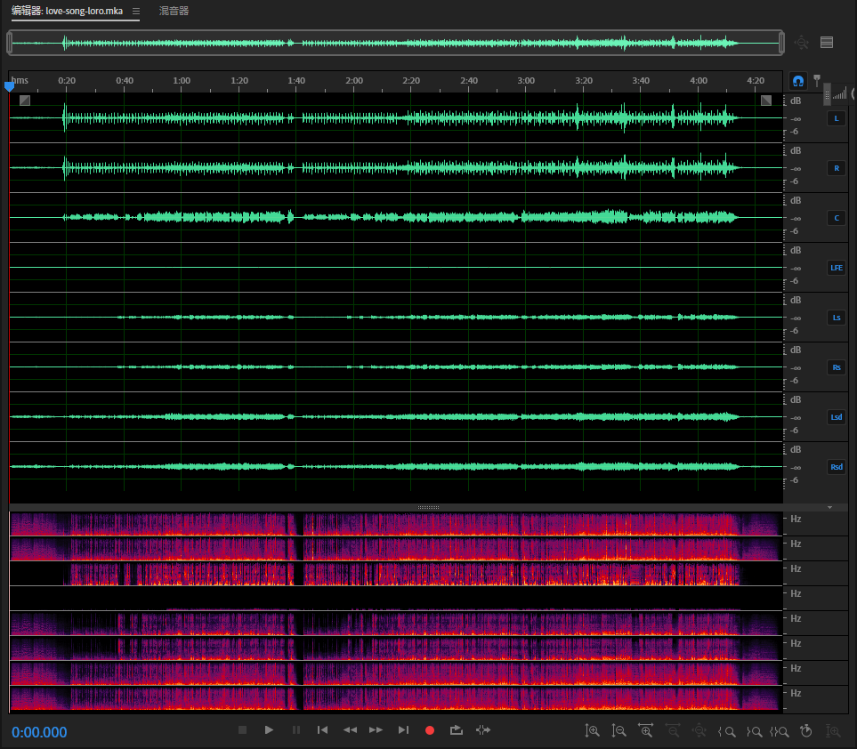

# Output containers

## Fragmented MP4 (CMAF)

`--container cmaf` writes one MP4 file: an initialization segment (`ftyp` + `moov`), then one `moof` + `mdat` fragment per 1536-sample access unit. All five profiles use strict EMDF, six blocks, and I0+D0. D0 is fixed at 640 kbps. The rest of the total goes to I0.

`--total-rate` accepts 1024, 1280, 1408, 1536 and 1664 kbps. The default is 1664. LFE defaults to `none`. Set `--lfe-owner` to `independent`, `dependent` or `replace-independent` when I0 should carry LFE, D0 should add it, or D0 should replace it. An explicit dependent count, block partition, carriage or EMDF profile must still satisfy those CMAF constraints.

For an XML job, keep selecting the container and the total rate on the CLI. In the XML, set `data_rate` to 640 and put the `.mp4` path under `output/ec3`.

```sh
jocforge encode "$PWD/input.adm.wav" "$PWD/mix.mp4" --joc-layout idx4 --container cmaf --total-rate 1664
```

## MKA and MP4

FFmpeg can remux a finished EC-3 file without re-encoding. `-c:a copy` keeps the JOC metadata. Replace `mix.ec3` with the file produced in [Layouts and objects](layouts.md).

```sh
ffmpeg -n -i mix.ec3 -map 0:a:0 -c:a copy -f matroska mix.mka
```

A `.m4a` suffix makes FFmpeg pick the `ipod` muxer. Write an MP4 first, then rename it, so the file keeps the MP4 container and the `ec-3` track:

```sh
ffmpeg -n -i mix.ec3 -map 0:a:0 -c:a copy -f mp4 mix.mp4
mv mix.mp4 mix.m4a
```

The tested Flat 7.1 MKA opened in Adobe Audition and Windows Media Player. The tested `.m4a` opened in the iOS system decoder.



The file in the picture is a 4:29 MKA of *Love Song*. The eight tracks are L, R, C, LFE, Ls, Rs, Lsd and Rsd.
