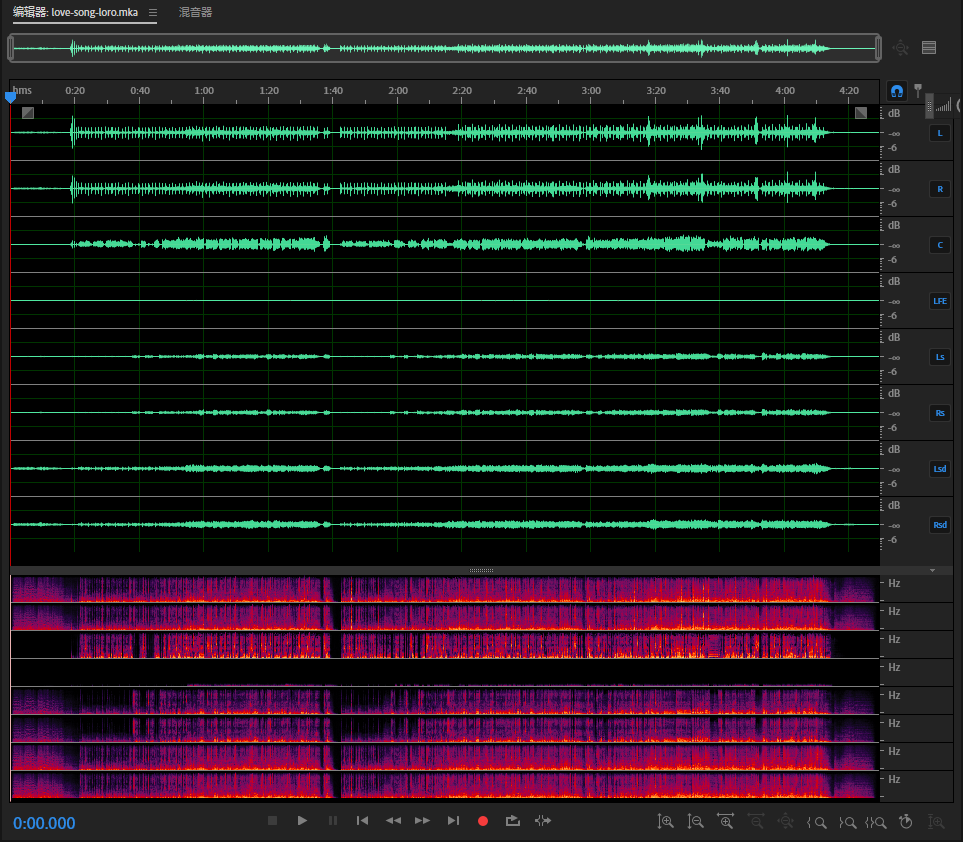

# 输出封装

## CMAF 分片 MP4

`--container cmaf` 写出一个 MP4 文件。文件以初始化段 `ftyp` + `moov` 开头，每个 1536 采样访问单元对应一个 `moof` + `mdat` 分片。五种布局都使用严格 EMDF、六块，以及 I0+D0。D0 固定 640 kbps，总码率的其余部分分给 I0。

`--total-rate` 可以是 1024、1280、1408、1536 和 1664 kbps，默认 1664。LFE 默认为 `none`。需要 I0 携带 LFE、D0 补充 LFE，或 D0 替换 LFE 时，把 `--lfe-owner` 设为 `independent`、`dependent` 或 `replace-independent`。另外指定的依赖子流数、块划分、承载位置和 EMDF 档位也必须满足这些 CMAF 限制。

XML 作业仍由命令行选择容器和总码率。XML 里把 `data_rate` 填为 640，并把 `.mp4` 路径写在 `output/ec3` 下。

```sh
jocforge encode "$PWD/input.adm.wav" "$PWD/mix.mp4" --joc-layout idx4 --container cmaf --total-rate 1664
```

## MKA 和 MP4

FFmpeg 可以只封装、不重编码已完成的 EC-3。`-c:a copy` 会保留 JOC 元数据。把 `mix.ec3` 换成[布局与对象](layouts.md)里生成的文件。

```sh
ffmpeg -n -i mix.ec3 -map 0:a:0 -c:a copy -f matroska mix.mka
```

后缀是 `.m4a` 时，FFmpeg 会选用 `ipod` 封装器。先写成 MP4，再改名，文件才能保留 MP4 封装和 `ec-3` 音轨：

```sh
ffmpeg -n -i mix.ec3 -map 0:a:0 -c:a copy -f mp4 mix.mp4
mv mix.mp4 mix.m4a
```

实测的 Flat 7.1 MKA 可以在 Adobe Audition 和 Windows 媒体播放器中打开。实测的 `.m4a` 可以由 iOS 系统解码器打开。



图中的文件是 4 分 29 秒的《Love Song》MKA。八条轨道依次为 L、R、C、LFE、Ls、Rs、Lsd 和 Rsd。
