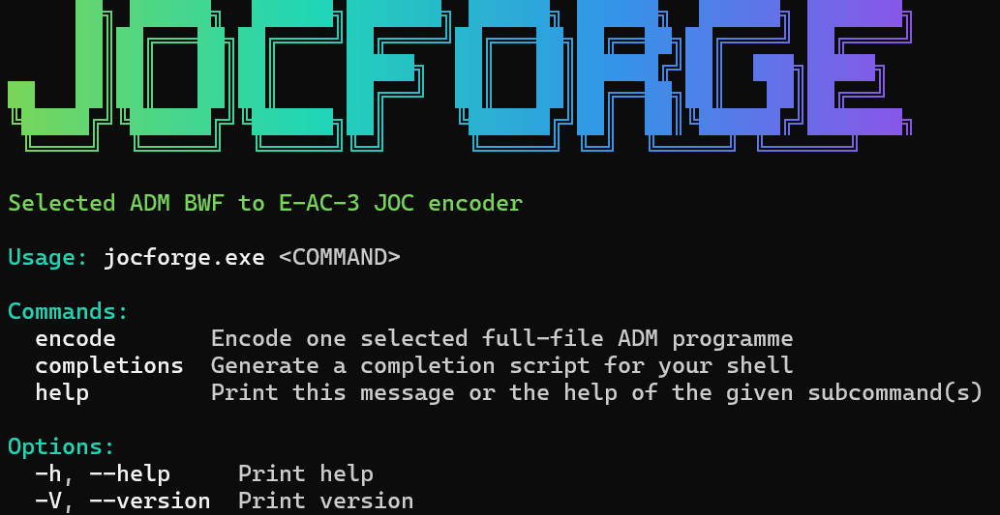

# Quick start

Install Rust and Cargo, then build the independent encoder branch in PowerShell.

```powershell
git clone --branch experimental/independent-encoder https://github.com/chyinan/JOCForge.git
cd JOCForge
cargo build --release --locked -p jocforge
```

Choose an ADM BWF and a new output filename. This produces a 1024 kbps 5.1 track with 15 coded objects.

```powershell
$adm = (Resolve-Path -LiteralPath "D:/Audio/input.adm.wav").Path
$ec3 = Join-Path $PWD "mix.ec3"
.\target\release\jocforge.exe encode "$adm" "$ec3" --data-rate 1024
```

With OpenJOC installed, run `openjoc inspect "$ec3" --emdf` to check the object count, bitrate and metadata.

{ .jocforge-hero }
