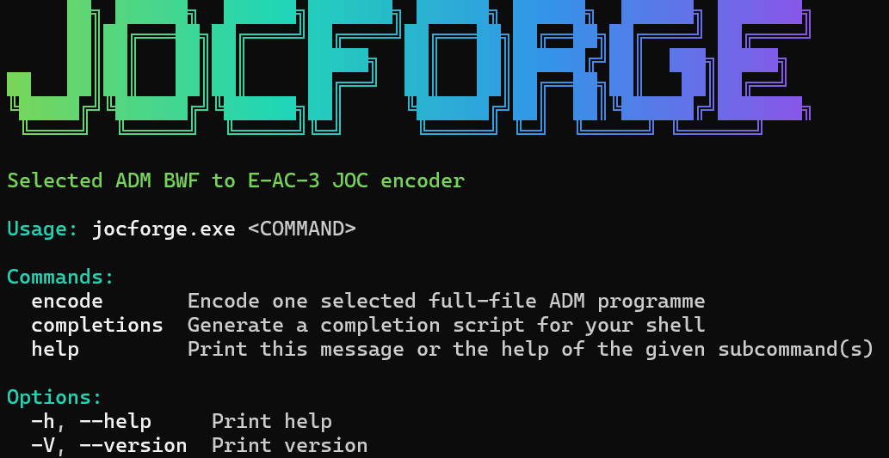

# 快速开始

安装 Rust 和 Cargo 后，安装 CLI：

```sh
git clone https://github.com/chyinan/JOCForge.git
cd JOCForge
cargo install --path crates/jocforge-cli --locked
```

CLI 支持 48 kHz、16 位或 24 位整数 PCM 的 ADM BWF。如果 audioTrackUID 声明了 bitDepth，其值须与 WAV 的实际位深一致。

如果 WAV 保留了未使用的物理轨，CHNA 必须用 `AT_00000000_00` 明确标记这些轨道。编码器只跳过明确标记的轨道，不会根据静音或缺少 CHNA 记录推断轨道未使用。

将 ADM BWF 编码为默认 1024 kbps 的 5.1 音轨。JOCForge 要求绝对路径；`$PWD` 在 PowerShell 和 POSIX shell 中均可用：

```sh
jocforge encode "$PWD/input.adm.wav" "$PWD/output.ec3"
```

装有 OpenJOC 时，检查编码结果：

```sh
openjoc inspect output.ec3 --emdf
```

Flat 7.1 默认 1664 kbps，输出需放入新的空目录并使用 `.candidate.ec3` 后缀：

```sh
mkdir flat7x
jocforge encode "$PWD/input.adm.wav" "$PWD/flat7x/mix.candidate.ec3" --joc-layout flat7x
```

{ .jocforge-hero }

布局、子流、承载和容器参数写在编码指南里。`jocforge encode --help` 会列出这些参数。
